# ggdibbler and the GoFish proposal (#980)

ggdibbler, by Harriet Mason, Dianne Cook, Sarah Goodwin and Susan VanderPlas, turns a ggplot2 plot into its uncertainty counterpart. You keep the plot code, replace a variable with a random variable from distributional, and add `_sample` to the geom. ggdibbler draws from each random variable and places the draws with a nested position. As the variance goes to zero, the plot converges to the plain ggplot2 plot. It works with most ggplot2 geoms and with any aesthetic.

The GoFish proposal for #980 takes this idea as its noise half. This tab puts the two side by side, then shows plots that ggdibbler's own issues ask for. The ggdibbler images are real renders from ggdibbler 0.6.8.9000 (GitHub main, commit 6bca10a) with distributional 0.9.0. The GoFish images are drawn with today's GoFish on draws precomputed in JavaScript, because `dist.*` and `sample` do not exist yet. So the two columns show different random draws of the same estimates.

**Draws and samples.** A **draw** is one random value taken from a distribution. A **sample** is a collection of draws. `sample({ n })` takes n draws per row and adds a `draw` key that says which draw each new row is. With shared draws, draw i is one consistent world across rows: draw 3 of every row comes from the same run of a model. With independent draws, each row is drawn on its own, so the shared index is only a label.

R scripts and data: `ggdibbler-r/` beside this page (`export-mpg.R`, `export-estimates.ts`, `render.R`). Stories: `packages/gofish-graphics/stories/proposals/uncertainty/Ggdibbler.stories.tsx` (title `Proposals/Uncertainty/Ggdibbler`), data in `ggdibbler-data.ts`. The bar, scatter and map images on the GoFish side are the Noise renders (`Noise.stories.tsx`), cropped.

## How the proposal maps ggdibbler's ideas

- A random variable in a column, such as `dist_normal(mean, se)`, becomes a `dist.*` expression over the parameter columns, `dist.normal({ mean: "mean", sd: "se" })`. A column that already holds draws, as `dist_sample` does, is declared with `schema: { value: { draws: "draw" } }`.
- `times` becomes the flow step `sample({ n })`. It turns each row into n rows with a `draw` key, which plays the role of ggdibbler's `drawID`.
- A nested position `main_draws` becomes steps in the flow. `identity_dodge` is `spread({ by: "draw", dir: "x", spacing: 0 })` after `sample`. `stack_dodge` is that spread with a `stack` inside each draw.
- Overplotting with `_identity` and a low `alpha` becomes today's `group({ by: "draw" })`, which splits by the draw key and places nothing, so the draws land on top of each other. The mark sets the low opacity. The specs write it as `opacity: field("draw").share()`, the draw's share of the total weight, so 1/n for n draws.
- `position_subdivide` becomes a small grid of draws in each region, `table({ by: "draw", numCols })`. This works for rectangles only. GoFish cannot cut a map polygon into cells yet.
- A HOP, which ggdibbler makes with gganimate's `transition_states(after_stat(drawID))`, becomes `time.sequence({ by: "draw" })`.
- Convergence holds for the same reason as in ggdibbler. The draws are placed by ordinary operators, so as every sd goes to zero, each spec draws the plain chart.
- Two things differ. The proposal checks the draw key, so it rejects `stack` by `draw` (ggdibbler leaves stack out as a draw position for a similar reason, [#34](https://github.com/harriet-mason/ggdibbler/issues/34)). It also draws a distribution directly with marks such as `slab` and `interval`, which ggdibbler leaves to ggdist.

## Part 1. Side by side

### Uncertain bar chart

Five estimates, each a normal. Twenty draws per bar are dodged inside the bar's slot. `geom_col_sample` uses `stack_dodge` by default, which is a plain dodge here because there is no fill.

**ggdibbler**

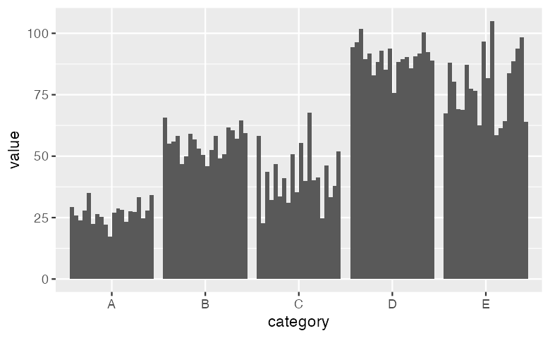

```r
bars |>
  mutate(value = dist_normal(mean, se)) |>
  ggplot(aes(x = category, y = value)) +
  geom_col_sample(times = 20)
```

**GoFish, proposed**

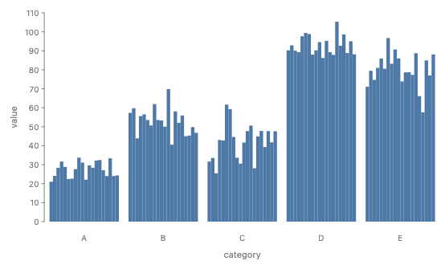

```js
const value = dist.normal({ mean: "mean", sd: "se" });
chart(bars)
  .flow(
    spread({ by: "category", dir: "x" }),
    sample({ n: 20 }),
    spread({ by: "draw", dir: "x", spacing: 0 })
  )
  .mark(rect({ h: value }));
```

```python
value = dist.normal(mean="mean", sd="se")
chart(bars).flow(
    spread(by="category", dir="x"), sample(n=20), spread(by="draw", dir="x", spacing=0)
).mark(rect(h=value))
```

### Uncertain counts, stack_dodge

From the ggdibbler README. In `uncertain_mpg`, each car's `class` and `drv` are categorical random variables. Each draw is a full stacked bar, and the draws are dodged within each class.

**ggdibbler**

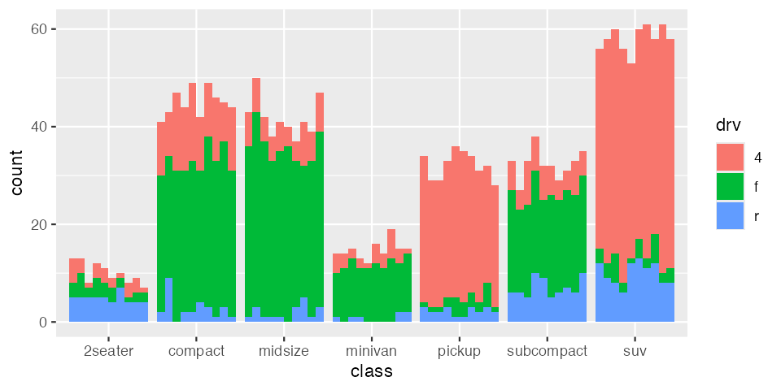

```r
ggplot(uncertain_mpg, aes(class)) +
  geom_bar_sample(aes(fill = drv), position = "stack_dodge")
```

**GoFish, proposed**

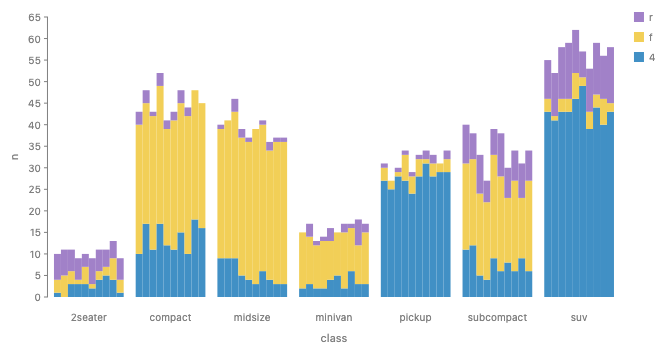

```js
// mpgDraws: one row per car and draw, from sample_expand(uncertain_mpg)
const draws = { schema: { class: { draws: "draw" }, drv: { draws: "draw" } } };
chart(mpgDraws, draws)
  .flow(
    spread({ by: "class", dir: "x" }),
    spread({ by: "draw", dir: "x", spacing: 0 }),
    stack({ by: "drv", dir: "y" })
  )
  .mark(rect({ h: field("drv").count(), fill: "drv" }));
```

```python
# mpg_draws: one row per car and draw, from sample_expand(uncertain_mpg)
schema = {"class": {"draws": "draw"}, "drv": {"draws": "draw"}}
chart(mpg_draws, schema=schema).flow(
    spread(by="class", dir="x"),
    spread(by="draw", dir="x", spacing=0),
    stack(by="drv", dir="y"),
).mark(rect(h=field("drv").count(), fill="drv"))
```

**Needs:** a categorical random variable per row, so `uncertain_mpg` could be read as it is. The proposal's `dist.categorical({ level, p })` reads its levels across rows, not a probability vector in one cell. So this spec reads the draws that ggdibbler's `sample_expand(times = 10)` writes. The GoFish image uses those draws, counted per draw.

### Uncertain counts, stack_identity

The same data. The draws of each class are drawn in one slot at low opacity, so the boundaries between `drv` levels blur where they are uncertain.

**ggdibbler**

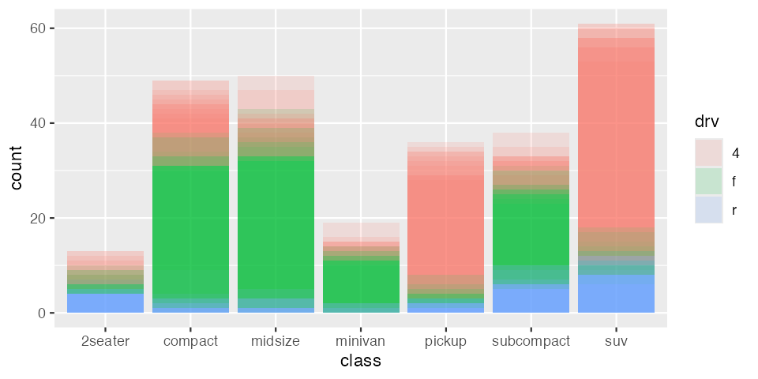

```r
ggplot(uncertain_mpg, aes(class)) +
  geom_bar_sample(aes(fill = drv), alpha = 0.15, position = "stack_identity")
```

**GoFish, proposed**

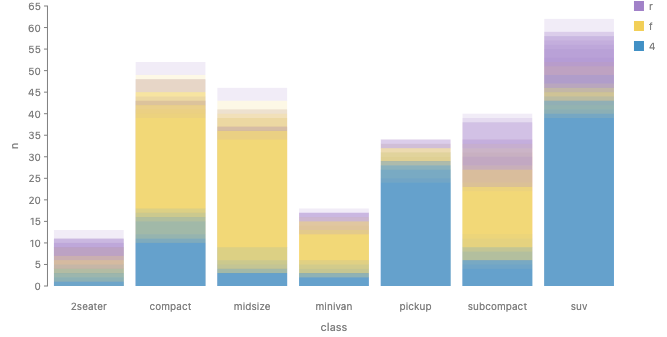

```js
chart(mpgDraws, draws)
  .flow(
    spread({ by: "class", dir: "x" }),
    group({ by: "draw" }),
    stack({ by: "drv", dir: "y" })
  )
  .mark(
    rect({
      h: field("drv").count(),
      fill: "drv",
      opacity: field("draw").share(),
    })
  );
```

```python
chart(mpg_draws, schema=schema).flow(
    spread(by="class", dir="x"), group(by="draw"), stack(by="drv", dir="y")
).mark(rect(h=field("drv").count(), fill="drv", opacity=field("draw").share()))
```

`field("draw").share()` gives each draw opacity 1/10. The GoFish image uses today's `group` with opacity 0.15, as the ggdibbler call does.

### Uncertain scatter

Twelve points whose x and y are both normal, with thirty draws each. Each point becomes a cloud.

**ggdibbler**

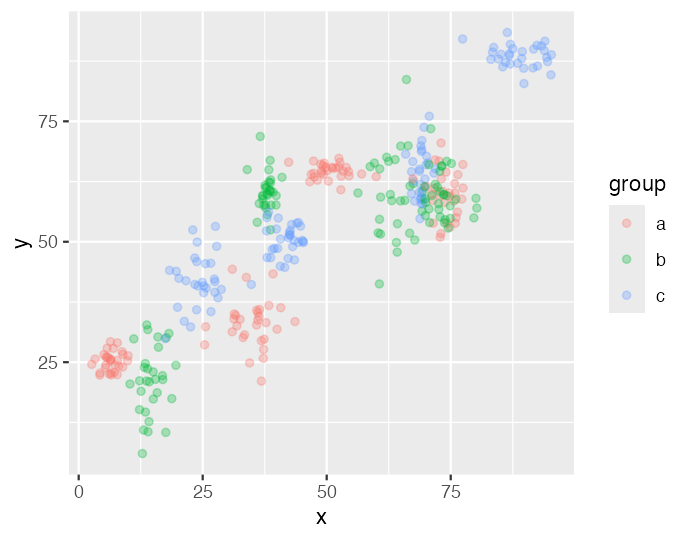

```r
points |>
  mutate(x = dist_normal(x, xSe), y = dist_normal(y, ySe)) |>
  ggplot(aes(x = x, y = y, colour = group)) +
  geom_point_sample(times = 30, alpha = 0.3)
```

**GoFish, proposed**

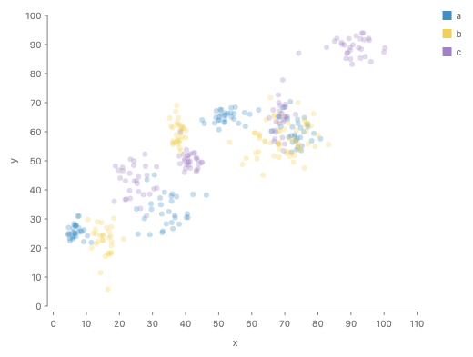

```js
const x = dist.normal({ mean: "x", sd: "xSe" });
const y = dist.normal({ mean: "y", sd: "ySe" });
chart(points)
  .flow(sample({ n: 30 }), scatter({ x, y }))
  .mark(circle({ r: 3, fill: "group", opacity: 0.3 }));
```

```python
x = dist.normal(mean="x", sd="xSe")
y = dist.normal(mean="y", sd="ySe")
chart(points).flow(sample(n=30), scatter(x=x, y=y)).mark(
    circle(r=3, fill="group", opacity=0.3)
)
```

### Uncertain forecast

Ten forecast steps, each a normal whose sd grows with the horizon, as in the fable example in ggdibbler's how-to guide. ggdibbler joins draw k at every step into one line.

**ggdibbler**

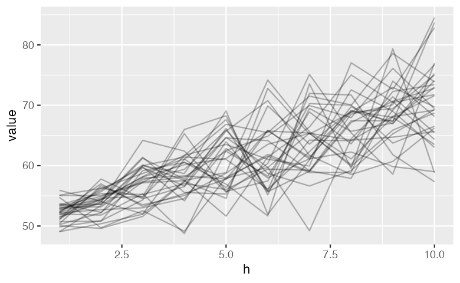

```r
forecast |>
  mutate(value = dist_normal(mean, sd)) |>
  ggplot(aes(x = h, y = value)) +
  geom_line_sample(times = 30, alpha = 0.3)
```

**GoFish, proposed**

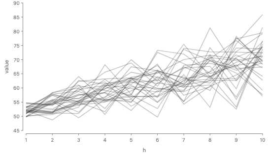

```js
const value = dist.normal({ mean: "mean", sd: "sd" });
chart(forecast)
  .flow(
    sample({ n: 30 }),
    group({ by: "draw" }),
    scatter({ by: "h", x: "h", y: value })
  )
  .mark(line({ opacity: field("draw").share() }));
```

```python
value = dist.normal(mean="mean", sd="sd")
chart(forecast).flow(
    sample(n=30), group(by="draw"), scatter(by="h", x="h", y=value)
).mark(line(opacity=field("draw").share()))
```

Today, on the precomputed draws (story `ForecastLines`):

```js
chart(forecastDraws)
  .flow(group({ by: "draw" }), scatter({ by: "h", x: "h", y: "value" }))
  .mark(
    line({
      stroke: "#333",
      strokeWidth: 1.5,
      opacity: 0.3,
      curve: Curve.linear(),
    })
  );
```

This is the multiline chart with the draw as the series. It follows `LineEndLabels` in `packages/gofish-graphics/stories/forwardsyntax/LabelPlacement.stories.tsx`, which splits by `symbol`, then scatters by date, then draws a `line`. Here `group({ by: "draw" })` splits the rows into one line chart per draw and lays the draws over each other in one frame, as the Today code does. Each line stays inside one draw, so the checker allows it. Without the split, one line would run across all 30 draws, and that is the error. The image uses opacity 0.3, as ggdibbler does. `field("draw").share()` would give 1/30.

There is one caveat. Each step here is its own normal, and `sample` draws each step on its own, so draw 3 at one step has no tie to draw 3 at the next. The lines show the steps moving independently, which the data does not say. So they zigzag more than real forecast paths would (compare the shared draws in Part 2). ggdibbler draws the same lines. Open question 1 asks whether that needs a warning.

### Uncertain map, subdivided

An 8 by 6 grid of square regions stands in for a map. Each region holds a normal whose sd grows to the east. Sixteen draws fill a 4 by 4 grid in each region, as in Vizumap's pixel map. The noisy eastern regions look grainy.

**ggdibbler**

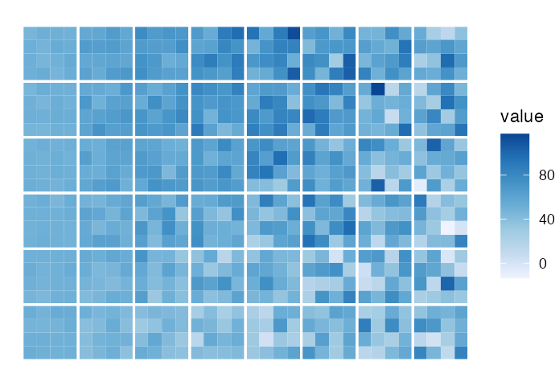

```r
tiles_sf |>
  mutate(value = dist_normal(mean, sd)) |>
  ggplot() +
  geom_sf_sample(aes(geometry = geometry, fill = value),
    times = 16, linewidth = 0
  ) +
  geom_sf(aes(geometry = geometry), fill = NA, colour = "white", linewidth = 0.7) +
  scale_fill_distiller(palette = "Blues", direction = 1) +
  theme_void()
```

**GoFish, proposed**

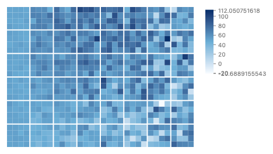

```js
const value = dist.normal({ mean: "mean", sd: "sd" });
chart(tiles, { color: Color.gradient(["#f7fbff", "#6baed6", "#08306b"]) })
  .flow(
    table({ by: { x: "col", y: "row" }, spacing: 2 }),
    sample({ n: 16 }),
    table({ by: "draw", numCols: 4, spacing: 0 })
  )
  .mark(rect({ fill: value }));
```

```python
value = dist.normal(mean="mean", sd="sd")
chart(tiles, color=Color.gradient(["#f7fbff", "#6baed6", "#08306b"])).flow(
    table(by={"x": "col", "y": "row"}, spacing=2),
    sample(n=16),
    table(by="draw", num_cols=4, spacing=0),
).mark(rect(fill=value))
```

**Needs:** a single-key `table({ by, numCols })` in flow form, which the proposal already lists. A real map also needs a way to cut a polygon into cells, as `position_subdivide` does. GoFish has none. Here the regions are squares, so a grid is enough.

## Part 2. Beyond ggdibbler today

### Correlated x and y

**Source:** [ggdibbler #31](https://github.com/harriet-mason/ggdibbler/issues/31) (Multivariate distributions across rows and columns), [ggdibbler #9](https://github.com/harriet-mason/ggdibbler/issues/9) (Alternate versions of geom_point (closed)). [#31](https://github.com/harriet-mason/ggdibbler/issues/31) asks for joint distributions, starting with the x and y of one point. [#9](https://github.com/harriet-mason/ggdibbler/issues/9) left this as a later task. Today ggdibbler draws x and y independently.

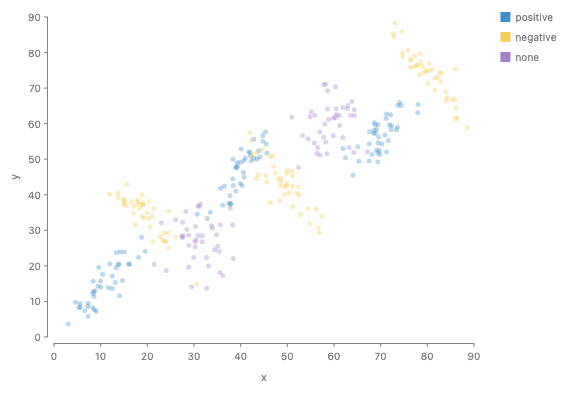

```js
const p = dist.mvnormal({
  mean: { x: "x", y: "y" },
  sd: { x: "sdX", y: "sdY" },
  cor: "rho",
});
chart(points)
  .flow(sample({ n: 40 }), scatter({ x: p.x, y: p.y }))
  .mark(circle({ r: 2.5, fill: "cor", opacity: 0.35 }));
```

Eight points, each a bivariate normal with correlation 0.85, −0.85 or 0. `p.x` and `p.y` are the two halves of one joint Dist, so `sample` draws them together and each cloud tilts. **ggdibbler would need:** a joint distribution mapped to two aesthetics and drawn once for both. In [#31](https://github.com/harriet-mason/ggdibbler/issues/31), Harriet notes that a multivariate normal in distributional can already hold the across-column case.

### Shared draws across rows

**Source:** [ggdibbler #31](https://github.com/harriet-mason/ggdibbler/issues/31) (Multivariate distributions across rows and columns), [ggdibbler #22](https://github.com/harriet-mason/ggdibbler/issues/22) (Dependence structures for geom_line_sample (closed as a duplicate of #31)). [#31](https://github.com/harriet-mason/ggdibbler/issues/31) discusses correlation between rows, such as a forecast path, and suggests a seed or ID that links two distributions.

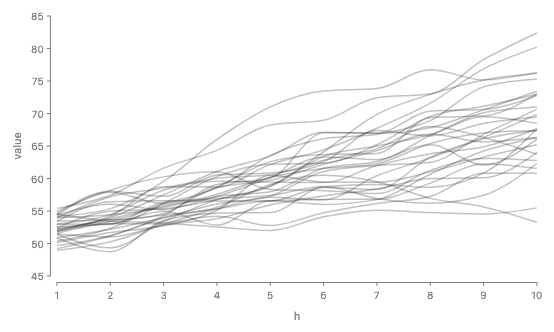

```js
// paths: one row per draw and step, from a model's simulated sample paths
chart(paths, { schema: { value: { draws: "draw" } } })
  .flow(group({ by: "draw" }), scatter({ by: "h", x: "h", y: "value" }))
  .mark(line({ opacity: field("draw").share() }));
```

Thirty random walk paths. Each step has the same normal as in the Part 1 forecast, but the steps of one path move together, so every line is a possible future. As in Part 1, `group` splits by `draw`, so each line stays inside one draw. Here the draws are shared, so the lines do not zigzag as Part 1's do. The image uses opacity 0.3. `field("draw").share()` would give 1/30. **ggdibbler would need:** a way to say that rows share draws. Its `seed` argument ([#39](https://github.com/harriet-mason/ggdibbler/issues/39)) keeps the same draws across layers, not across rows. [#31](https://github.com/harriet-mason/ggdibbler/issues/31) also argues the other side: that rows should stay independent, and a dependent table should be split into a fixed part and a random part. Open question 1.

### Uncertain dates on a time axis

**Source:** [ggdibbler #49](https://github.com/harriet-mason/ggdibbler/issues/49) (Should probably go through scales). [#49](https://github.com/harriet-mason/ggdibbler/issues/49) asks for nested scales beyond the continuous and discrete ones, "so you can have random time objects and stuff".

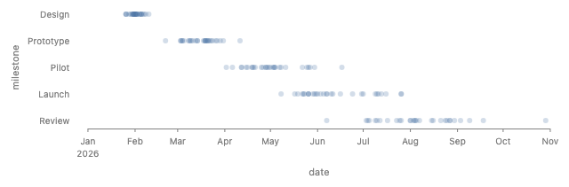

```js
// milestones: [{ milestone, date, sd }], with sd a duration in milliseconds
const date = dist.normal({ mean: "date", sd: "sd" }); // Dist<Instant>
chart(milestones, { schema: { date: Unit.time(), sd: Unit.duration } })
  .flow(
    spread({ by: "milestone", dir: "y" }),
    sample({ n: 30 }),
    scatter({ x: date })
  )
  .mark(circle({ r: 3, opacity: field("draw").share() }));
```

**ggdibbler today**

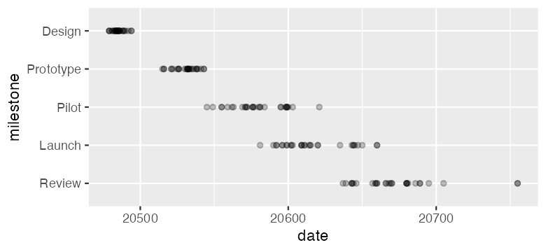

```r
# date: one dist_sample of Dates per milestone
ggplot(milestones, aes(x = date, y = milestone)) +
  geom_point_sample(times = 30, alpha = 0.25)
```

Five project milestones whose dates are uncertain, thirty draws each, on a date axis. The proposal types `dist.normal` over an Instant with its sd as a duration. `Unit.time()` and `Unit.duration` exist today, and the date axis is today's. `scatter` puts the draws of a milestone on one row by itself, so no `group` step is needed. The image uses opacity 0.25. **ggdibbler today:** `dist_normal` does not take a Date, and a `dist_sample` of dates is drawn on a continuous scale, so the axis shows day numbers (the ggdibbler image, from the same draws). **ggdibbler would need:** the nested scale for time that [#49](https://github.com/harriet-mason/ggdibbler/issues/49) describes.

### Two levels of uncertainty

**Source:** [ggdibbler #55](https://github.com/harriet-mason/ggdibbler/issues/55) (dibble() function). [#55](https://github.com/harriet-mason/ggdibbler/issues/55) proposes a `dibble()` wrapper for any layer. A comment there asks to nest it, `dibble(dibble(plot, times = 10), times = 50)`, for scenario uncertainty on top of model uncertainty.

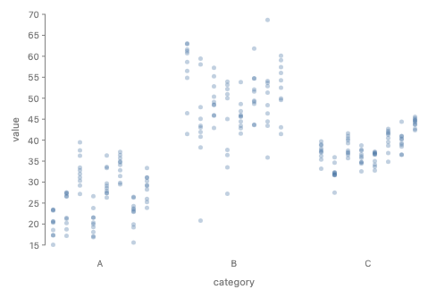

```js
const mu = dist.normal({ mean: "mean", sd: "tau" });
const value = dist.normal({ mean: mu, sd: "se" }); // Dist<Dist<number>>
chart(estimates)
  .flow(
    spread({ by: "category", dir: "x" }),
    sample({ n: 8 }), // draws the outer level, mu
    spread({ by: "draw", dir: "x" }),
    sample({ n: 10, as: "inner" }), // draws the inner level
    scatter({ y: value })
  )
  .mark(circle({ r: 2.5, opacity: field("inner").share() }));
```

Three estimates. The mean of each is itself uncertain (sd `tau`), and each value scatters around that mean (sd `se`). Eight outer draws are dodged, and each holds ten inner draws, which `scatter` draws in one column. A wide spread of column centers means model uncertainty. Tall columns mean noise within the model. **Needs:** the proposal shows one level per `sample` only (the jk-CDF in the Proposal tab, where a `cdf` mark reads the inner level). Two `sample` steps need a rule that the first draws the outer level and the second the inner, and a name for the second draw key. `as` was in an earlier draft and was dropped. **ggdibbler would need:** the nested `dibble()` from [#55](https://github.com/harriet-mason/ggdibbler/issues/55).

### Uncertain treemap

**Source:** Natural extension. A treemap's layout depends on every value, so one draw moves every tile. Placing the draws with the layout operator is the same move as ggdibbler's nested positions. The README lists "integration with the ggplot2 extension ecosystem" as a plan, and [#55](https://github.com/harriet-mason/ggdibbler/issues/55)'s `dibble()` would wrap an extension layer such as treemapify.

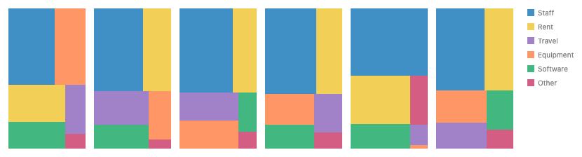

```js
const value = dist.normal({ mean: "mean", sd: "se" });
chart(budget)
  .flow(
    sample({ n: 6 }),
    spread({ by: "draw", dir: "x" }),
    treemap({ by: "item", size: value })
  )
  .mark(rect({ fill: "item" }));
```

Six budget lines, each a normal, six draws side by side. Swapping `spread` for `time.sequence({ by: "draw" })` gives a HOP. The image clamps each draw at 0.5, because a size cannot be negative. **Needs:** a positive Dist for sizes, such as a truncated normal, which the proposal does not have. **ggdibbler would need:** a draw position for a layout extension. Today `sample_expand` with `group = drawID` gets the draws to treemapify, but not a nested position.

## Open questions for Harriet

1. **Lines over independent draws.** ggdibbler and the proposal both join draw k at each x into one line per draw. With independent cells, the lines show the steps moving independently, a joint the data does not give. Your comment on [#31](https://github.com/harriet-mason/ggdibbler/issues/31) argues that the unit of an uncertainty visualization is an independent distribution. For a fable forecast, where each step is a marginal, should the line carry a warning or a note in the docs, or is it fine as it is?
2. **Default opacity.** ggdibbler leaves `alpha` to the user and warns about `times` ([#59](https://github.com/harriet-mason/ggdibbler/issues/59)). In the proposal the mark sets the opacity, for example `opacity: field("draw").share()`, which is 1/n. Should 1/n instead be a default for marks under a draw key, and should the legend then use full opacity by itself ([#67](https://github.com/harriet-mason/ggdibbler/issues/67))?
3. **Blending.** Alpha compositing favors the last draw. Would an order-free blend, as in ggblend ([#48](https://github.com/harriet-mason/ggdibbler/issues/48)), be a better default for draws drawn in one frame?
4. **Subdividing regions.** GoFish cannot cut a polygon into cells yet. Of the grid, random points with Voronoi cells ([#16](https://github.com/harriet-mason/ggdibbler/issues/16)) and a noise fill ([#23](https://github.com/harriet-mason/ggdibbler/issues/23)), which would you build first?
5. **Signal and noise in one system.** [#40](https://github.com/harriet-mason/ggdibbler/issues/40) settled on samples only, partly because quantiles do not extend to several random variables. The proposal also has marks that read the whole distribution. Does having both in one system risk the mix-up that the philosophy vignette warns about?
