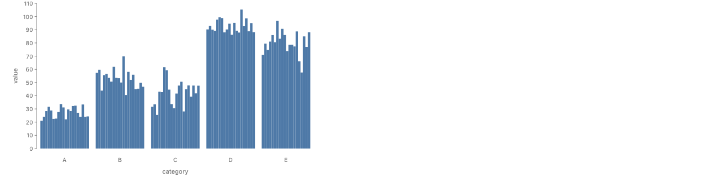
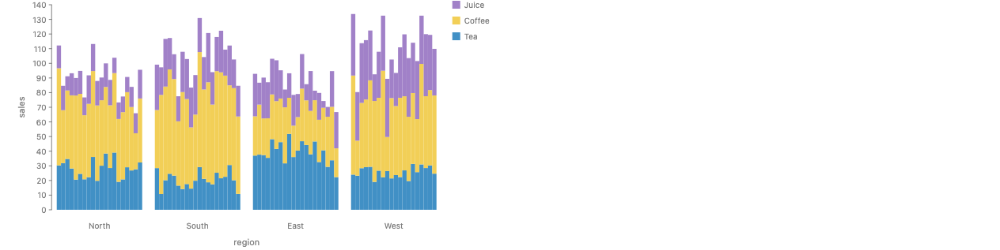
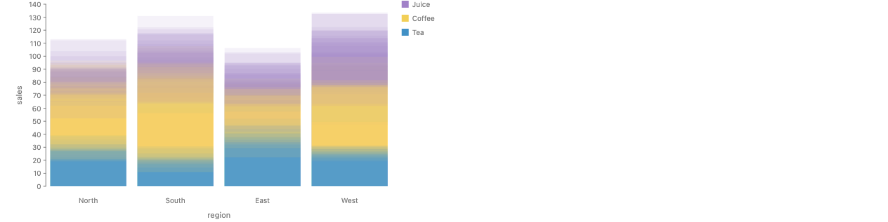
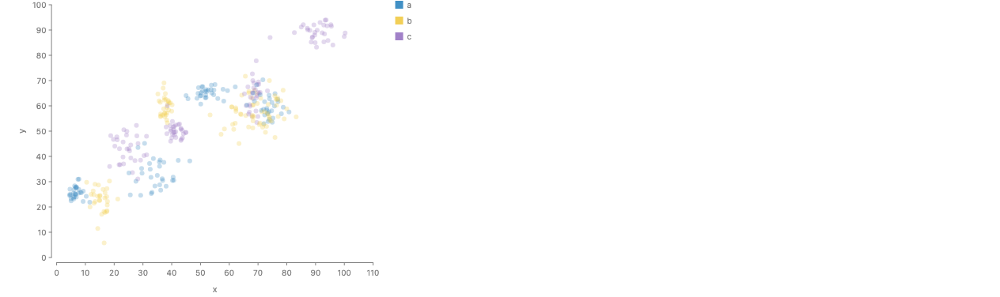
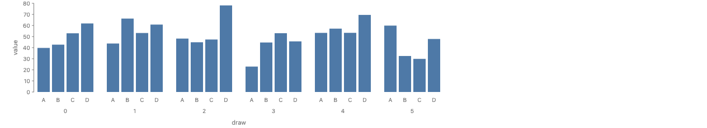
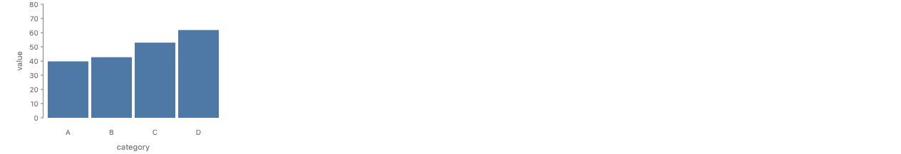
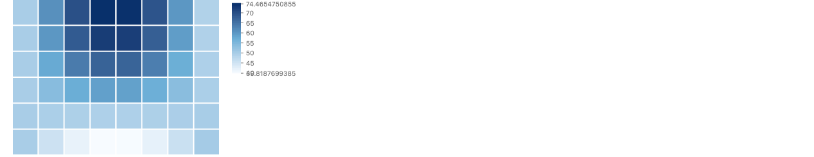
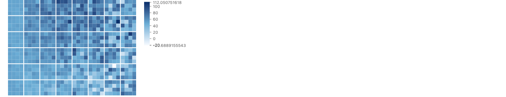
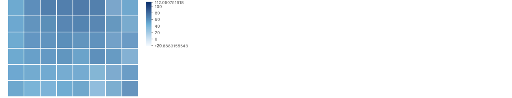

# Noise: uncertainty as noise

These examples follow ggdibbler, where a chart takes random variables in place of values,
draws from each one, and places the draws. Sources: Mason, Cook, Goodwin, VanderPlas,
"A Mathematical Framework and Software Implementation for Uncertainty Visualisation"
([arXiv 2606.24217](https://arxiv.org/abs/2606.24217)), and Mason, Rogers, Kleffner, Cook,
"Colour Blinded by the Noise" ([arXiv 2608.17976](https://arxiv.org/abs/2608.17976)).

Stories: `packages/gofish-graphics/stories/proposals/uncertainty/Noise.stories.tsx`
(title `Proposals/Uncertainty/Noise`). Data: `noise-data.ts` in the same folder. Every
draw is precomputed there with a seeded RNG (mulberry32 and Box–Muller, seed 980).

Findings that apply to more than one example:

- Today's `group({ by: "draw" })` draws the draws in one frame. It splits the rows by the
  draw key and places nothing (`src/ast/graphicalOperators/group.ts`). It builds a
  `Frame`, the same node `time.sequence` builds for its one frame (`src/ast/marks/time.ts`).
  So no new operator is needed for the overlay. The mark sets the low opacity.
- `group` works inside a `spread` slot and inside a `table` cell. An earlier draft used a
  `layer` of one chart per draw instead. That worked for the stacked bar, because sibling
  charts share their scales, but it failed for a `table`: the layered tables were laid out
  one after another (15000 px tall), and the `color` option on `layer(...).render` did not
  reach the charts. `layer` is not a flow step, and `group` is.
- Alpha compositing is order-dependent: with opacity `a` and `n` layers, the last draw
  gets weight `a` and the first gets `a(1−a)^(n−1)`. ggdibbler has the same bias. It is
  inherent to transparency, not to GoFish.
- On `spread`, `label: false` does not hide the axis ticks. `axes: false` does.

### Uncertain bar chart, dodge

Five estimates, each a normal(mean, se), with 20 draws per category dodged side by side
as thin bars. This is the ggdibbler dodge position on a bar chart (Mason et al. 2026,
[arXiv 2606.24217](https://arxiv.org/abs/2606.24217), section on nested positions).



**Today**

```js
chart(barDraws, { w: 480, h: 260 })
  .flow(
    spread({ by: "category", dir: "x", spacing: 12 }),
    spread({ by: "draw", dir: "x", spacing: 0, axes: false })
  )
  .mark(rect({ h: "value", fill: "#4e79a7" }))
  .render(container, { axes: true });
```

Precomputed by hand: the 20 draws of each category, as a long table with a `draw` column.

**Proposed (A)**

```js
const value = dist.normal({ mean: "mean", sd: "se" });
chart(estimates)
  .flow(
    spread({ by: "category", dir: "x" }),
    sample({ n: 20 }),
    spread({ by: "draw", dir: "x", spacing: 0 })
  )
  .mark(rect({ h: value }));
```

```python
value = dist.normal(mean="mean", sd="se")
chart(estimates).flow(
    spread(by="category", dir="x"), sample(n=20), spread(by="draw", dir="x", spacing=0)
).mark(rect(h=value))
```

**Proposed (B)** is the Today spec on a long table of draws. The only new piece is where
the draws come from: `sample` of a `dist.*` channel, or draws data declared with
`schema: { value: { draws: "draw" } }`.

**New pieces needed**: `dist.normal`, `sample`. The placement is the existing `spread`, so
the lift desugars exactly into today's chart over a draw table. This spelling declares the
Dist as a constant and first uses it in the mark, after `sample` in the flow. The
reconciled rule (from the `sample` descriptor in `types-sketch.ts`) is that `sample` does
not look for Dist cells at all. It turns each row into `n` rows with a `draw` key and a
seed, and any Dist expression read on a drawn row reads that row's draw. The draw is a
function of the seed, the row and the draw index, so two channels that name the same Dist
read the same draw, and no channel has to be known before the mark.

### Uncertain stacked bar, dodge

Sales by region (x) and product (stacked), each a normal; 20 draws are dodged inside each
region, and each draw is a full stack by product. This is ggdibbler's `stack_dodge`
position (Mason et al. 2026, Figure 7c).



**Today**

```js
chart(salesDraws, { w: 480, h: 260 })
  .flow(
    spread({ by: "region", dir: "x", spacing: 16 }),
    spread({ by: "draw", dir: "x", spacing: 0, axes: false }),
    stack({ by: "product", dir: "y" })
  )
  .mark(rect({ h: "sales", fill: "product" }))
  .render(container, { axes: true });
```

Precomputed by hand: 20 draws of every (region, product) cell, clamped at 0.

**Proposed (A)**

```js
const sales = dist.normal({ mean: "mean", sd: "se" });
chart(estimates)
  .flow(
    spread({ by: "region", dir: "x" }),
    sample({ n: 20 }),
    spread({ by: "draw", dir: "x", spacing: 0 }),
    stack({ by: "product", dir: "y" })
  )
  .mark(rect({ h: sales, fill: "product" }));
```

```python
sales = dist.normal(mean="mean", sd="se")
chart(estimates).flow(
    spread(by="region", dir="x"),
    sample(n=20),
    spread(by="draw", dir="x", spacing=0),
    stack(by="product", dir="y"),
).mark(rect(h=sales, fill="product"))
```

Writing `stack({ by: "draw", dir: "y" })` in place of the draw spread gives this error
(text from the design note, section 5):

```
stack({ by: "draw", dir: "y" }): "draw" is a sample index. The draws of one value are
a sample, and their sum grows with the number of draws, so the stacked total has no
meaning. stack needs a key whose groups add up to a whole.
Place the draws with spread({ by: "draw", dir: "x" }), with time.sequence({ by: "draw" }),
or stack by a category inside each draw.
```

**Proposed (B)** reads the same as Today. In B, `draw` is an ordinary column unless the
schema declares it a draw key (`schema: { sales: { draws: "draw" } }`) or `sample` made
it. If it is only a column, B cannot raise the stack error. With the record, both A and B
raise it from the key's type (`HasDraws`).

**New pieces needed**: `dist.normal`, `sample`, and a capability on the `draw` key that
`stack` checks. Placement desugars exactly into existing `spread` and `stack`.

### Uncertain stacked bar, transparency (z direction)

The same data, with all 20 draws of each region drawn in the same slot at low opacity, so
the product boundaries blur where they are uncertain. This is ggdibbler's
`stack_identity` position (Mason et al. 2026, Figure 7d).



**Today**

```js
chart(salesDraws, { w: 480, h: 260 })
  .flow(
    spread({ by: "region", dir: "x", spacing: 16 }),
    group({ by: "draw" }),
    stack({ by: "product", dir: "y" })
  )
  .mark(rect({ h: "sales", fill: "product", opacity: 0.1 }))
  .render(container, { axes: true });
```

Precomputed by hand: the draws and the opacity (0.1 for 20 draws).

`group({ by: "draw" })` splits each region's rows by draw and places nothing, so the 20
stacks of a region land in the same slot.

**Proposed (A)**

```js
chart(estimates)
  .flow(
    spread({ by: "region", dir: "x" }),
    sample({ n: 20 }),
    group({ by: "draw" }),
    stack({ by: "product", dir: "y" })
  )
  .mark(rect({ h: sales, fill: "product", opacity: field("draw").share() }));
```

```python
chart(estimates).flow(
    spread(by="region", dir="x"),
    sample(n=20),
    group(by="draw"),
    stack(by="product", dir="y"),
).mark(rect(h=sales, fill="product", opacity=field("draw").share()))
```

**New pieces needed**: `dist.normal`, `sample`, and the opacity rule. The layout is
today's `group`. The opacity is written as `field("draw").share()`, the draw's share of
the total weight, which is 1/20 = 0.05 here. That needs `opacity` to read a field. The
other option is a default opacity for marks under a draw key. `proposal.md` lists both as
open decision 5.

### Uncertain scatter

Twelve points whose x and y are both uncertain; 30 draws of each point are drawn at low
opacity, so each point becomes a cloud whose spread shows its uncertainty. This follows
the uncertain `mtcars` scatter in Mason et al. 2026, Figure 10, colored by a three-level
group as that figure is colored by `cyl`.



**Today**

```js
chart(pointDraws, { w: 400, h: 320 })
  .flow(scatter({ x: "x", y: "y" }))
  .mark(circle({ r: 3, fill: "group", opacity: 0.3 }))
  .render(container, { axes: true });
```

Precomputed by hand: 30 (x, y) draws per point.

**Proposed (A)**

```js
const x = dist.normal({ mean: "x", sd: "xSe" });
const y = dist.normal({ mean: "y", sd: "ySe" });
chart(points)
  .flow(sample({ n: 30 }), scatter({ x, y }))
  .mark(circle({ r: 3, fill: "group", opacity: 0.3 }));
```

```python
x = dist.normal(mean="x", sd="xSe")
y = dist.normal(mean="y", sd="ySe")
chart(points).flow(sample(n=30), scatter(x=x, y=y)).mark(
    circle(r=3, fill="group", opacity=0.3)
)
```

**New pieces needed**: `dist.normal`, `sample`. `scatter` overlaps the draws by itself,
so no `group` step is needed. The opacity is set by hand. The share rule,
`opacity: field("draw").share()`, would give 1/30. The two independent
normals stand in for one bivariate draw. A correlated (x, y) needs a joint constructor,
which the sheet does not have. The spelling chosen here, to keep `dist.*` regular, is
`const p = dist.mvnormal({ mean: { x: "x", y: "y" }, sd: { x: "xSe", y: "ySe" }, cor: "rho" })`,
read as `scatter({ x: p.x, y: p.y })`. `p.x` and `p.y` are the marginals of one joint
Dist, so a `sample` draws them together.

### HOPs (hypothetical outcome plots)

Four bars animated over draws, one frame per draw, so the viewer sees the spread of
outcomes over time (Hullman, Resnick, Adar 2015; the t direction in the design note).
A PNG cannot animate, so the strip shows 6 frames as small multiples, and a second story
holds the real animation still on draw 0.



**Today** (strip)

```js
chart(hopDraws, { w: 720, h: 160 })
  .flow(
    spread({ by: "draw", dir: "x", spacing: 24 }),
    spread({ by: "category", dir: "x", spacing: 4 })
  )
  .mark(rect({ h: "value", fill: "#4e79a7" }))
  .render(container, { axes: true });
```



**Today** (animation, `time.sequence` exists and renders)

```js
chart(hopDraws, { w: 240, h: 160 })
  .flow(
    time.sequence({ by: "draw", duration: 3000, playing: false }),
    spread({ by: "category", dir: "x", spacing: 4 })
  )
  .mark(rect({ h: "value", fill: "#4e79a7" }))
  .render(container, { axes: true });
```

Precomputed by hand: 6 draws per bar. `playing: false` only holds the frame for the
screenshot. The y axis holds still across frames because `time.sequence` infers domains
over every keyframe.

**Proposed (A)**

```js
const value = dist.normal({ mean: "mean", sd: "se" });
chart(estimates)
  .flow(
    sample({ n: 50 }),
    time.sequence({ by: "draw" }),
    spread({ by: "category", dir: "x" })
  )
  .mark(rect({ h: value }));
```

```python
value = dist.normal(mean="mean", sd="se")
chart(estimates).flow(
    sample(n=50), time.sequence(by="draw"), spread(by="category", dir="x")
).mark(rect(h=value))
```

The strip is the same chart with `spread({ by: "draw", dir: "x", spacing: 24 })` in place
of `time.sequence`.

**New pieces needed**: `dist.normal`, `sample`. The animation desugars exactly into the
existing `time.sequence`, which needs a numeric key; `sample`'s `draw` index is numeric,
so it fits.

### Uncertain map: means, pixel, transparency

An 8×6 grid of square regions stands in for a map; each region holds a normal whose sd
grows to the east. The three plates follow the choropleth comparisons in Mason et al.
"Colour Blinded by the Noise" ([arXiv 2608.17976](https://arxiv.org/abs/2608.17976)):
(a) the means, (b) a pixel map where each region is split into a 4×4 grid of draws,
(c) the draws of each region drawn on top of each other with transparency. The noisy eastern tiles look
grainy in (b) and washed out in (c).



**Today** (a)

```js
chart(tileEstimates, { w: 320, h: 240, color: MAP_COLOR })
  .flow(table({ by: { x: "col", y: "row" }, spacing: 2 }))
  .mark(rect({ fill: "mean" }))
  .render(container, { axes: false });
```



**Today** (b)

```js
chart(tileDraws, { w: 320, h: 240, color: MAP_COLOR })
  .flow(
    table({ by: { x: "col", y: "row" }, spacing: 2 }),
    table({ by: { x: "sx", y: "sy" }, spacing: 0 })
  )
  .mark(rect({ fill: "value" }))
  .render(container, { axes: false });
```

There is no subdivide operator. The pixel version is a `table` nested in a `table`, with
the subcell of each draw (`sx = draw % 4`, `sy = floor(draw / 4)`) precomputed in the
data. The flow form of `table` needs `by: { x, y }`; it has no single-key wrap with
`numCols`. On a real map the pixel version needs a way to cut a region's shape into
cells, which does not exist.



**Today** (c)

```js
chart(tileDraws, { w: 320, h: 240, color: MAP_COLOR })
  .flow(
    table({ by: { x: "col", y: "row" }, spacing: 2 }),
    group({ by: "draw" })
  )
  .mark(rect({ fill: "value", opacity: 0.15 }))
  .render(container, { axes: false });
```

`group({ by: "draw" })` splits each cell's 16 rows by draw, so each draw gets its own rect
and the 16 rects land on top of each other. Two things failed before `group` was used:
without the split, a `table` cell with 16 rows draws one rect, not 16 (48 rects for 768
rows, with no warning), and a `layer` of 16 table charts lays them out one after another.

Precomputed by hand for all three: 16 draws per tile. GoFish has no way to fix a color
domain, so (a) uses the range of the means (40 to 75) and (b), (c) use the range of the
draws (−21 to 112). The paper's plates share one scale; these do not. The gradient legend
also prints long decimals and overlaps its lowest tick label (an existing cosmetic issue).
The `table` column labels pile up at the left when axes are on, so axes are off here.

**Proposed (A)**

```js
const value = dist.normal({ mean: "mean", sd: "sd" });
const blues = Color.gradient(["#f7fbff", "#6baed6", "#08306b"]);

// (a) means
chart(tiles, { color: blues })
  .flow(table({ by: { x: "col", y: "row" }, spacing: 2 }))
  .mark(rect({ fill: value.mean() }));

// (b) pixel
chart(tiles, { color: blues })
  .flow(
    table({ by: { x: "col", y: "row" }, spacing: 2 }),
    sample({ n: 16 }),
    table({ by: "draw", numCols: 4, spacing: 0 }) // new: single-key wrap in flow form
  )
  .mark(rect({ fill: value }));

// (c) transparency
chart(tiles, { color: blues })
  .flow(
    table({ by: { x: "col", y: "row" }, spacing: 2 }),
    sample({ n: 16 }),
    group({ by: "draw" })
  )
  .mark(rect({ fill: value, opacity: field("draw").share() }));
```

```python
value = dist.normal(mean="mean", sd="sd")
blues = Color.gradient(["#f7fbff", "#6baed6", "#08306b"])

# (a) means
chart(tiles, color=blues).flow(table(by={"x": "col", "y": "row"}, spacing=2)).mark(
    rect(fill=value.mean())
)

# (b) pixel
chart(tiles, color=blues).flow(
    table(by={"x": "col", "y": "row"}, spacing=2),
    sample(n=16),
    table(by="draw", num_cols=4, spacing=0),  # new: single-key wrap in flow form
).mark(rect(fill=value))

# (c) transparency
chart(tiles, color=blues).flow(
    table(by={"x": "col", "y": "row"}, spacing=2), sample(n=16), group(by="draw")
).mark(rect(fill=value, opacity=field("draw").share()))
```

**New pieces needed**: `dist.normal`, `sample`, `d.mean()`, the opacity rule, and a
single-key `table({ by, numCols })` in flow form (the `numCols` option exists on the node
but the flow form rejects a single `by`). Papers B needed the same single-key grid for its
small multiples and first wrote `spread({ wrap })`. The reconciled spelling for both is
`table({ by, numCols })`, because `table` already owns `numCols`, and a `wrap` on `spread`
would be a second route to the same grid. For a real map, (b) needs a "cut a shape into
cells" operator; that is a new operator with no existing overlap. The three plates should
share one color domain, which needs a domain option on `Color.gradient` (not on the sheet,
and not a Dist question). Overlap check: (c) is the same `group` and opacity rule as the
stacked bar. A fill channel drawn this way is a color mix, which is the point of the plate.
