# Distribution-valued data in GoFish (#980)

**Summary.** GoFish should let a table cell hold a distribution, and it should treat a
group of rows as the distribution it already is. A chart then shows uncertainty in one of
two ways. It draws samples and places them with the operators it has today plus one new
`overlay` step, or it draws the distribution itself with a few new marks such as `slab`
and `interval`.

**Recommendation.** Adopt the synthesis worked out in `types.md`. It is Approach A (a
distribution type on fields) with Approach B (draws as rows only) as its plain-column
case. One new channel kind, `dist`, folds a group's rows into one distribution. The draw
key is a fact in the column record, `schema: { temp: { draws: "draw" } }`. Everything is
additive for users.

Issue #980 asks for distribution-valued data, with ideas from ggdist and ggdibbler. This
page is the review copy of the proposal. The work behind it is in this folder.

- `signal.md`, `noise.md`, `papers-a.md` and `papers-b.md` hold one section per example,
  each with its render, today's GoFish code, and the proposed code.
- `types.md` and `types-sketch.ts` give the types and schema changes. The sketch
  typechecks against the real descriptor types.
- The prototype stories are in
  `packages/gofish-graphics/stories/proposals/uncertainty/`.
- The design note is `apps/docs/docs/internals/design/distributions.md`. Its literature
  review is not repeated here.

## Terminology

- **Distribution.** A description of the values something could take and how likely
  each is. A normal with a mean and a standard deviation is one. `Dist<T>` is a
  distribution over values of type `T`, such as a price, a time or a category.
- **Draw.** One value picked at random from a distribution. A **sample** is a set of
  draws.
- **Draw key.** The column that says which draw a row belongs to, usually `draw`.
- **Empirical distribution.** The distribution of a sample, where each draw counts
  equally (or by its weight). A group of rows is the empirical distribution of its
  values. `.mean()` on a group of rows is the mean of that distribution.
- **Shared (joint) draws and independent draws.** Draws are shared when draw 3 of one
  value and draw 3 of another come from the same run of a model, so their correlation is
  kept. Posterior draws and bootstrap resamples are shared. Draws are independent when
  each value is sampled on its own, as `sample` does for a `dist.normal` cell. Only shared
  draws can be joined into lines or ranked as whole curves.
- **Fold.** Combining a group's rows into one value. A size channel folds by summing, a
  position channel by averaging. The new `dist` channel folds rows into one distribution,
  the mixture of the rows' distributions.
- **Lift, or uncertainty as noise.** Turning each distribution into draws and drawing
  each draw as an ordinary mark. The spread of the marks shows the uncertainty.
  ggdibbler works this way.
- **Consume, or uncertainty as signal.** A mark that reads the whole distribution and
  draws its shape or its summary, such as a density curve or an interval. ggdist works
  this way.
- **Summary.** One value computed from a distribution, such as its mean, median or a
  quantile.
- **Quantile.** The value below which a given share of the distribution lies. The 0.5
  quantile is the median.
- **Interval and level.** An interval at level 0.95 runs from the 0.025 quantile to the
  0.975 quantile, so it holds 95% of the distribution.
- **Coverage.** The share of a distribution that the range of n draws covers on average:
  (n − 1) / (n + 1). So 39 draws cover 95%.
- **Band.** An interval drawn along an axis, such as a forecast fan. A **pointwise** band
  takes the quantiles at each x on its own. A **depth** band keeps the most central whole
  curves and draws their envelope.
- **Overlay, or the z direction.** Drawing all the draws in the same place at low
  opacity, so they blend.
- **HOP (hypothetical outcome plot).** An animation that shows one draw per frame.
- **Kernel density estimate.** A smooth density curve made from a sample. Its
  **bandwidth**, called `smoothing` in GoFish, sets how smooth it is.

## Precedent

The design note's section 3 surveys these in full.

| System                            | What you write                                                                         | What it decides                                                                                                                                  |
| --------------------------------- | -------------------------------------------------------------------------------------- | ------------------------------------------------------------------------------------------------------------------------------------------------ |
| ggdist (R)                        | `stat_halfeye(aes(xdist = dist_normal(m, s)))`, or `aes(x = value)` over sample rows   | One stat family draws a slab and an interval. It reads distribution objects and sample rows alike. Its scales transform the distribution.        |
| ggdibbler (R)                     | `aes(y = dist_normal(m, se))` with a nested position such as `stack_dodge`             | Samples only, 10 draws by default, independent cells. Draws get their own position inside the plot's (x, y, z or time). Stacking draws is wrong. |
| distributional (R)                | `dist_normal(mu, sigma)` in a data frame column                                        | One distribution object per cell, independent. `mean`, `quantile`, `hilo`.                                                                       |
| posterior `rvar` (R)              | `rvar(draws_array)` in a column                                                        | The first array dimension indexes draws, so arithmetic matches draw i to draw i and keeps correlation.                                           |
| Vega-Lite                         | `{ "mark": "errorband", "encoding": { "y": { "field": "v" } } }` with `extent: "ci"`   | No distribution type. It computes an extent from rows or takes precomputed bounds.                                                               |
| Observable Plot                   | `Plot.lineY(draws, { x, y, z: "draw", strokeOpacity: 0.1 })`                           | No distribution type. Draws are rows, grouped by `z`, with opacity set by hand.                                                                  |
| `Uncertain<T>` (C#)               | `if (speed > 4)` on an `Uncertain<double>`                                             | Values build a lazy network, so a value used twice is one random variable. A conditional becomes a hypothesis test.                              |
| PPLs (Stan, PyMC with ArviZ, TFP) | posterior draws with `chain` and `draw` dimensions; TFP `Normal(loc, scale).sample(n)` | Output is shared draws. TFP splits independent cells (batch shape) from one joint draw (event shape).                                            |

Two things recur. A distribution lives in a cell, and the system needs a way to say
whether two cells share draws. GoFish follows both. It takes ggdist's marks, ggdibbler's
positions for draws, and rvar's shared draws.

## The approaches

### Approach A, a distribution type on fields

A field expression builds a distribution per row from parameter columns, such as
`dist.normal({ mean: "mean", sd: "se" })`. A signal mark reads it in a `dist` channel. For
noise, `sample({ n })` turns each row into n rows with a `draw` key, and a Dist read on a
drawn row reads that draw. The draws are then placed with `spread`, `time.sequence` or
`overlay`. Summaries are methods on the expression, such as `d.median()`,
`d.quantile(0.9)` and `d.interval(0.95)`.

**Half-eye.** A density slab per group with a point interval on its baseline.

```js
const value = dist.normal({ mean: "mean", sd: "sd" });

chart(halfEyeGroups, { w: 520, axes: { x: { title: "value" }, y: true } })
  .flow(spread({ by: "group", dir: "y", anchor: "baseline", spacing: 64 }))
  .mark(
    layer({ h: 60 }, [
      slab({ x: value, fill: SLAB }),
      interval({ x: value, levels: [0.66, 0.95], fill: INK }),
    ])
  );
```

```python
value = dist.normal(mean="mean", sd="sd")

(
    chart(half_eye_groups, w=520, axes={"x": {"title": "value"}, "y": True})
    .flow(spread(by="group", dir="y", anchor="baseline", spacing=64))
    .mark(
        layer(
            [
                slab(x=value, fill=SLAB),
                interval(x=value, levels=[0.66, 0.95], fill=INK),
            ],
            h=60,
        )
    )
)
```

**Uncertain bar chart, dodged.** Twenty draws per category, side by side.

```js
const value = dist.normal({ mean: "mean", sd: "se" });
chart(estimates)
  .flow(
    spread({ by: "category", dir: "x" }),
    sample({ n: 20 }),
    spread({ by: "draw", dir: "x", spacing: 0 })
  )
  .mark(rect({ h: value }));
```

```python
value = dist.normal(mean="mean", sd="se")
chart(estimates).flow(
    spread(by="category", dir="x"), sample(n=20), spread(by="draw", dir="x", spacing=0)
).mark(rect(h=value))
```

**jk-CDF.** Fifty posterior draws of a normal model, each drawn as its CDF. The parameter
columns are posterior draws, so the normal is a `Dist<Dist<number>>`. `sample` lifts the
outer level and `cdf` consumes the inner one exactly.

```js
// posterior: [{ draw, mu, sigma }], one row per posterior draw
const model = dist.normal({ mean: "mu", sd: "sigma" }); // Dist<Dist<number>>

chart(posterior, {
  schema: { mu: { draws: "draw" }, sigma: { draws: "draw" } },
})
  .flow(sample({ n: 50 }), overlay({ by: "draw" }))
  .mark(cdf({ x: model, stroke: "#3182bd" })) // new: cdf mark
  .layer(
    // the empirical CDF of the observed rows
    chart(observations).mark(cdf({ x: "value", stroke: "#111" }))
  );
```

```python
# posterior: one row per posterior draw, columns draw, mu, sigma
model = dist.normal(mean="mu", sd="sigma")  # Dist[Dist[float]]

chart(posterior, schema={"mu": {"draws": "draw"}, "sigma": {"draws": "draw"}}).flow(
    sample(n=50), overlay(by="draw")
).mark(
    cdf(x=model, stroke="#3182bd")  # new: cdf mark
).layer(
    chart(observations).mark(cdf(x="value", stroke="#111"))
)
```

### Approach B, draws as rows only

There is no distribution type. Data is always a long table of draws. A signal mark is a
statistic over the rows of each group, as ggdist reads sample rows. Noise is grouping by
the draw column. B reads well whenever the data is already a sample.

**Raincloud.** Penguin body mass per species. The same column feeds the slab, the
interval and the raw points.

```js
chart(penguins, { w: 560, axes: { x: { title: "Body mass (g)" }, y: true } })
  .flow(spread({ by: "Species", dir: "y", spacing: 20 }))
  .mark(
    layer([
      slab({ x: "Body Mass (g)", fill: "Species", opacity: 0.7 }),
      interval({ x: "Body Mass (g)", levels: [0.66, 0.95], fill: INK }),
      chart()
        .flow(
          scatter({ x: "Body Mass (g)", overlap: Overlap.jitter() }).translate({
            y: -16,
          })
        )
        .mark(circle({ r: 1.5, fill: "Species", opacity: 0.6 })),
    ])
  );
```

```python
(
    chart(penguins, w=560, axes={"x": {"title": "Body mass (g)"}, "y": True})
    .flow(spread(by="Species", dir="y", spacing=20))
    .mark(
        layer(
            [
                slab(x="Body Mass (g)", fill="Species", opacity=0.7),
                interval(x="Body Mass (g)", levels=[0.66, 0.95], fill=INK),
                chart()
                .flow(
                    scatter(x="Body Mass (g)", overlap=Overlap.jitter()).translate(
                        y=-16
                    )
                )
                .mark(circle(r=1.5, fill="Species", opacity=0.6)),
            ]
        )
    )
)
```

**Ridgeline of croissants.** Each month's daily highs, cut into five slices of equal
probability.

```js
chart(seattleWeather, {
  w: 520,
  axes: { x: { title: "Daily high (°C)" }, y: false },
})
  .flow(
    spread({
      by: field("month").sort(months),
      dir: "y",
      anchor: "baseline",
      spacing: 36,
    })
  )
  .mark(
    layer({ h: 34 }, [
      chart().mark(slab({ x: "temp_max", fill: "none" }).name("density")),
    ]).relate(({ density }) => [
      chart()
        .flow(
          partition({ by: field("temp_max").bin(Bin.quantiles(5)), dir: "x" })
        )
        .mark(
          layer([
            intersect({ fill: FILL, stroke: STROKE, strokeWidth: 1.5 }, [
              density,
              region({ inset: 2 }),
            ]),
            circle({
              cx: field("temp_max").median(),
              cy: 5,
              r: 2.25,
              fill: STROKE,
            }),
          ])
        ),
    ])
  );
```

```python
(
    chart(seattle_weather, w=520, axes={"x": {"title": "Daily high (°C)"}, "y": False})
    .flow(
        spread(by=field("month").sort(months), dir="y", anchor="baseline", spacing=36)
    )
    .mark(
        layer(
            [chart().mark(slab(x="temp_max", fill="none").name("density"))], h=34
        ).relate(
            lambda density: [
                chart()
                .flow(partition(by=field("temp_max").bin(Bin.quantiles(5)), dir="x"))
                .mark(
                    layer(
                        [
                            intersect(
                                [density, region(inset=2)],
                                fill=FILL,
                                stroke=STROKE,
                                stroke_width=1.5,
                            ),
                            circle(
                                cx=field("temp_max").median(), cy=5, r=2.25, fill=STROKE
                            ),
                        ]
                    )
                )
            ]
        )
    )
)
```

**Depth band.** Fifty whole curves. The band is the envelope of the deepest half.

```js
const draws = { schema: { y: { draws: "curve" } } };

// (a) pointwise quantile ribbons and the pointwise median
chart(curveDraws, draws)
  .flow(scatter({ by: "x", x: "x" }))
  .mark(
    interval({ y: "y", along: "x", levels: [0.5, 0.9], band: Band.pointwise() })
  );

// (b) depth band: the envelope of the deepest 50% of whole curves, the
// deepest curve as the median, and the outlier curves
chart(curveDraws, draws)
  .flow(scatter({ by: "x", x: "x" }))
  .mark(
    interval({
      y: "y",
      along: "x",
      levels: [0.5],
      band: Band.depth({ outliers: 1.5 }),
    })
  );
```

```python
schema = {"y": {"draws": "curve"}}

# (a) pointwise quantile ribbons
chart(curve_draws, schema=schema).flow(scatter(by="x", x="x")).mark(
    interval(y="y", along="x", levels=[0.5, 0.9], band=Band.pointwise())
)

# (b) depth band
chart(curve_draws, schema=schema).flow(scatter(by="x", x="x")).mark(
    interval(y="y", along="x", levels=[0.5], band=Band.depth(outliers=1.5))
)
```

The ridgeline shows where B falls short. The slab smooths the days, but the cuts are
quintiles of the days, so the slices do not hold equal shares of the drawn curve. Pure B
cannot say "cut the curve", so it keeps today's `quantileRows` helper. For a known family
such as one normal, pure B must first sample it, and the cuts are only as good as the
sample. The jk-CDF is worse. B has to turn each inner normal into 500 rows, and the curves
become noisy ECDFs over 25,000 rows.

### The synthesis, where rows are already a distribution

`types.md` notices that A and B are one model. A group of rows is the empirical
distribution of its values, and today's `.mean()` and `.median()` already summarize it.
Three rules follow.

1. **One fold.** A `dist` channel folds a group's rows into one Dist, the mixture of the
   rows' Dists. A plain value is a Dist with all its mass at one point. A plain column
   in a group gives its empirical Dist, which is B. One row with `dist.normal` gives that
   normal, which is A.
2. **One summary.** `.mean()`, `.median()` and `.quantile(p)` summarize the folded Dist.
   On a plain column that is what they do today.
3. **Binning a Dist key truncates it.** A cell of `d.bin(Bin.quantiles(n))` holds the Dist
   cut to that cell. For a sample, that is the draws in the cell, which is today's split.

The synthesis changes these spellings from the shared syntax sheet. The group files
use the new ones throughout.

- The draw key moves from a channel expression, `rvar("temp", { draw: "draw" })`, into
  the column record, `{ draws: "draw", weight: "w" }`, because which rows are one draw is
  a fact about the table. Issue #1198 (when a sum over rows is valid, for stocks, flows
  and per-unit values) argues the same for its `entity` key. A plain column needs no
  `rvar` at all.
- A smoothed sample is the fold `field("temp").kde({ smoothing })`, not a `dist.kde`
  constructor. `smoothing` is the word `Overlap.noise` already uses for a bandwidth.
- Summaries are methods on the Dist expression, `d.quantile(p)`, not
  `field(d).quantile(p)`, because `field()` takes a column name.
- An interval is a span, so it fills a `dims` entry, `rect({ dims: { x: d.interval(0.95) } })`.
  `rect({ x: d.interval(0.95) })` is an error, because `x` is one position.
- `overlay` draws each group at opacity `max(min, w / Σw)`, with `min` 0.05, and it shares
  `time.sequence`'s layout.
- A probit scale belongs on the axis, not on the `ccdf` mark, because a scale acts on
  every mark on its axis.
- B's `sample({ value: dist.normal(...), n, as })` is dropped. `sample({ n })` with a
  `dist.*` channel works in both approaches.
- Where no group had a spelling, these were chosen. `sample` does not look for Dist cells.
  It adds a `draw` key and a seed, and any Dist read on a drawn row reads that draw. A
  single-key grid is `table({ by, numCols })`, not `spread({ wrap })`, because `table`
  already has `numCols`. A correlated pair is
  `dist.mvnormal({ mean: { x, y }, sd: { x, y }, cor })`, read as `p.x` and `p.y`.
  `resample` takes `coverage` like `sample`. `summarize` takes its columns flat. A record
  `weight` with no `draws` key means weighted support points.

**Weighted forecasts.** Nine model runs, each line's opacity from its weight. The record
says `model` is the draw key and `weight` its weight, and `overlay` reads both.

```js
chart(forecasts, { schema: { temp: { draws: "model", weight: "weight" } } })
  .flow(
    overlay({ by: "model" }), // opacity follows the record's weight
    scatter({ by: "month", x: "month", y: "temp" })
  )
  .mark(line({ stroke: "#1f4e79", strokeWidth: 2 }));
```

```python
chart(forecasts, schema={"temp": {"draws": "model", "weight": "weight"}}).flow(
    overlay(by="model"),  # opacity follows the record's weight
    scatter(by="month", x="month", y="temp"),
).mark(line(stroke="#1f4e79", stroke_width=2))
```

**VMC aggregate per draw.** A histogram of each replicate's mean. Grouping by the draw
key and summarizing gives one row per draw.

```js
chart(replicates, { schema: { y: { draws: "draw" } } })
  .flow(
    group({ by: "draw" }),
    summarize({ mean: field("y").mean() }), // new: one row per group
    partition({ by: field("mean").bin(Bin.step(0.05)), dir: "x" })
  )
  .mark(rect({ h: field("mean").count(), fill: "#9ecae1", inset: 0.5 }))
  // new: rule mark
  .layer(
    chart(observed).mark(rule({ x: field("y").mean(), stroke: "#08306b" }))
  );
```

```python
chart(replicates, schema={"y": {"draws": "draw"}}).flow(
    group(by="draw"),
    summarize(mean=field("y").mean()),  # new: one row per group
    partition(by=field("mean").bin(Bin.step(0.05)), dir="x"),
).mark(rect(h=field("mean").count(), fill="#9ecae1", inset=0.5)).layer(
    chart(observed).mark(rule(x=field("y").mean(), stroke="#08306b"))
)
```

**Probit CCDF.** Posterior draws of an ordinal model. By the one-fold rule, the rows of a
(condition, draw) group with `k` weighted by `p` already fold to the categorical that
`dist.categorical({ level: "k", p: "p" })` builds. So B's form (below the A form in
`papers-a.md`) is the same distribution, not a second mechanism.

```js
// epred: [{ condition, draw, k, p }], p = P(rating = k) in that draw
const rating = dist.categorical({ level: "k", p: "p" }); // Dist<Dist<Ordinal>>

chart(epred, {
  schema: { p: { draws: "draw" } },
  color: Color.palette({ Control: "#7f7f7f", Treatment: "#d95f02" }),
  axes: { y: { scale: Scale.probit() } }, // new: a scale family, on the axis
})
  .flow(sample({ n: 40 }), group({ by: "condition" }), overlay({ by: "draw" }))
  // new: ccdf mark; new: rule mark
  .mark(ccdf({ x: rating, stroke: "condition" }))
  .layer(rule({ y: 0, strokeDasharray: "4 3" }));
```

```python
# epred: columns condition, draw, k, p with p = P(rating = k) in that draw
rating = dist.categorical(level="k", p="p")  # Dist[Dist[Ordinal]]

chart(
    epred,
    schema={"p": {"draws": "draw"}},
    color=Color.palette({"Control": "#7f7f7f", "Treatment": "#d95f02"}),
    axes={"y": {"scale": Scale.probit()}},  # new: a scale family, on the axis
).flow(sample(n=40), group(by="condition"), overlay(by="draw")).mark(
    ccdf(x=rating, stroke="condition")
).layer(
    rule(y=0, stroke_dasharray="4 3")
)
```

### Trade-offs

|                                             | A                                        | B                                | Synthesis                                         |
| ------------------------------------------- | ---------------------------------------- | -------------------------------- | ------------------------------------------------- |
| Known families (one normal per row)         | exact                                    | must sample first                | exact                                             |
| Data already a sample                       | needs a declaration                      | reads directly                   | reads directly                                    |
| Cut a smoothed curve at its quantiles       | yes                                      | no, keeps `quantileRows`         | yes, with `.kde()`                                |
| Nested distributions (posterior of a model) | exact                                    | 500 rows per draw                | exact                                             |
| Stack-by-draw and other errors              | from the type                            | only if the draw key is declared | from the record                                   |
| New concepts                                | type, constructors, `rvar`, marks, steps | marks, steps                     | type, constructors, marks, steps, two record keys |

### Overlap check

Each new piece either desugars exactly into existing operators or adds a capability that
none has. These are the cases.

- **`overlay` against `time.sequence` and `layer`.** `time.sequence` already lays all its
  groups out on top of each other in one frame (`src/ast/marks/time.ts`). `overlay` is
  that layout with no clock. It shows every group at opacity `max(min, w / Σw)` instead
  of one group at a time. The two must share one superimpose layout, so there is one
  mechanism and no partial overlap. A `layer` of one chart per draw works for sibling
  charts that share scales, but it is not a flow step and it failed inside a `table`.
- **`interval` against `ribbon`, `rect` and `scatter`'s `yMin`.** The point form is
  exactly a layer of one `rect({ dims: { x: d.interval(p) } })` per level and a
  `circle` at `d.median()`. The `along` form is a `ribbon` per level and a `line` through
  the medians. `d.interval(p)` returns an `AxisInterval`, the one span form the IR
  already has, so it needs no IR change. `interval` is shorthand.
- **`slab` against `ribbon`.** A slab is a `ribbon` over a density grid that the mark
  computes. Exact.
- **`dots` against `scatter` and `stack`.** A quantile dotplot is `sample({ n: 20,
at: "quantiles" })` then a `scatter` by bin and a `stack` of circles. Exact, except for
  Wilkinson's dot binning, which is new layout work in any form.
- **`sample` and `resample` against `derive`.** A `derive` can make the same rows, but
  then the draw key, its seed and whether it is joint are unknown to the checker. The two
  steps are a `derive` plus a column type (`HasDraws`).
- **`summarize` against `group` and an aggregate channel.** An aggregate channel such as
  `rect({ h: field("y").mean() })` folds a group, but its result cannot feed a later
  `partition`. `summarize` collapses each group to one row of columns. It is general,
  not specific to uncertainty, and could be its own issue.
- **`gradient`.** No exact desugaring. Today it is many thin cells under a color scale.
  It needs a gradient paint along a mark, which would also serve legends and areas.
- **`cdf` and `ccdf`.** A CDF is a curve over a grid of x values, not one value per row,
  so it is not a `line` over rows. These are new marks.
- **`Band.depth()`.** After the depth ranking, the rest is the pointwise band on a subset
  of whole curves. That partial overlap lives inside one strategy family, so the band
  rule is one option, not two marks.
- **`quantileRows`.** Fully subsumed. Once a cell can hold a Dist, `Bin.quantiles` cuts it
  directly, and the helper is deleted. Issue #1231 (replace `quantileRows` with
  first-class distributions) asks for exactly this.
- **`dist.categorical` across rows.** Subsumed by a weighted fold, as the probit example
  shows. It may not need to exist.

## Examples gallery

Each example has its today code, notes and Python in the group file named under its
heading. The code shown is the reconciled proposed spelling.

### Croissant

#### Croissant chart

A density cut at its quantiles into slices of equal probability, each with a dot at its
median (Fygenson, Bertini and Padilla, EuroVis 2026). PR #1229 merged it with the
`quantileRows` helper. See `signal.md`.

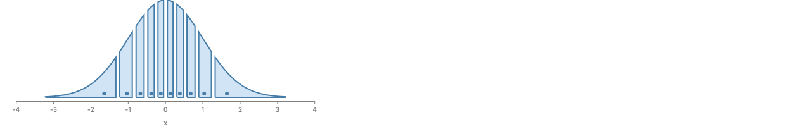

```js
const x = dist.normal({ mean: "mean", sd: "sd" });
const params = [{ mean: 0, sd: 1 }];

layer([chart(params).mark(slab({ x, fill: "none" }).name("density"))]).relate(
  ({ density }) => [
    chart(params)
      .flow(partition({ by: x.bin(Bin.quantiles(10)), dir: "x" }))
      .mark(
        layer([
          intersect({ fill: FILL, stroke: STROKE, strokeWidth: 2 }, [
            density,
            region({ inset: 3 }),
          ]),
          circle({ cx: x.median(), cy: 6, r: 3, fill: STROKE }),
        ])
      ),
  ]
);
```

#### Ridgeline of croissants

One croissant per month of Seattle's daily highs, each cut at its own quintiles. See
`signal.md`.

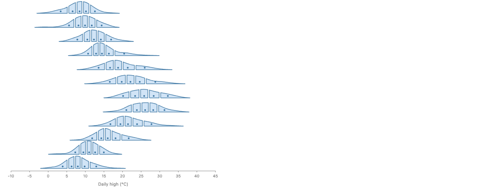

```js
const temp = field("temp_max").kde(); // one smooth Dist per group, from its rows

chart(seattleWeather, {
  w: 520,
  axes: { x: { title: "Daily high (°C)" }, y: false },
})
  .flow(
    spread({
      by: field("month").sort(months),
      dir: "y",
      anchor: "baseline",
      spacing: 36,
    })
  )
  .mark(
    layer({ h: 34 }, [
      chart().mark(slab({ x: temp, fill: "none" }).name("density")),
    ]).relate(({ density }) => [
      chart()
        .flow(partition({ by: temp.bin(Bin.quantiles(5)), dir: "x" }))
        .mark(
          layer([
            intersect({ fill: FILL, stroke: STROKE, strokeWidth: 1.5 }, [
              density,
              region({ inset: 2 }),
            ]),
            circle({ cx: temp.median(), cy: 5, r: 2.25, fill: STROKE }),
          ])
        ),
    ])
  );
```

### ggdist (uncertainty as signal)

#### Half-eye

A density slab with a 66% and 95% point interval, ggdist's `stat_halfeye`. See
`signal.md`.

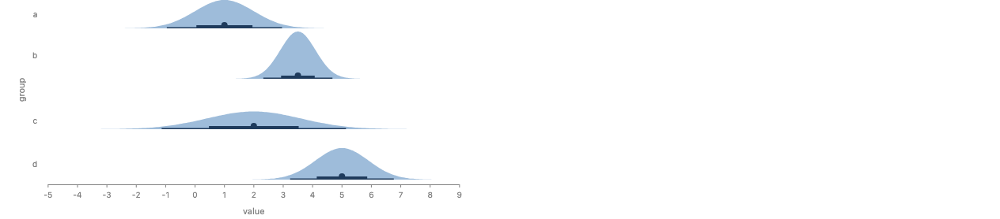

```js
const value = dist.normal({ mean: "mean", sd: "sd" });

chart(halfEyeGroups, { w: 520, axes: { x: { title: "value" }, y: true } })
  .flow(spread({ by: "group", dir: "y", anchor: "baseline", spacing: 64 }))
  .mark(
    layer({ h: 60 }, [
      slab({ x: value, fill: SLAB }),
      interval({ x: value, levels: [0.66, 0.95], fill: INK }),
    ])
  );
```

#### Multi-level point interval

A median with nested 66% and 95% intervals, ggdist's `stat_pointinterval`. See
`signal.md`.

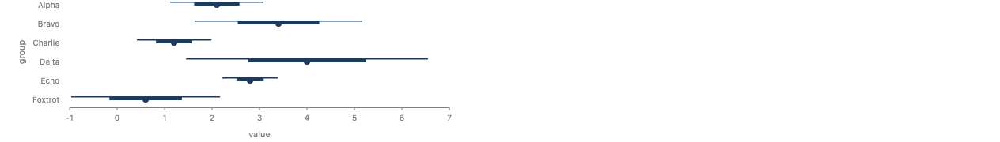

```js
const value = dist.normal({ mean: "mean", sd: "sd" });

chart(pointIntervalGroups, { w: 480, axes: { x: { title: "value" }, y: true } })
  .flow(spread({ by: "group", dir: "y", spacing: 16 }))
  .mark(interval({ x: value, levels: [0.66, 0.95], fill: INK }));
```

#### Gradient interval

A bar whose opacity follows the density, ggdist's `stat_gradientinterval`. The render
is stepped cells under a color scale, because GoFish has no gradient fill. See
`signal.md`.

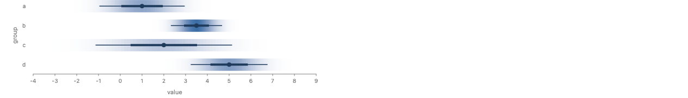

```js
const value = dist.normal({ mean: "mean", sd: "sd" });

chart(halfEyeGroups, { w: 520, axes: { x: { title: "value" }, y: true } })
  .flow(spread({ by: "group", dir: "y", spacing: 14 }))
  .mark(
    layer([
      gradient({ x: value, h: 22, fill: "#3a6ea5" }),
      interval({ x: value, levels: [0.66, 0.95], fill: INK }),
    ])
  );
```

#### Quantile dotplot

Twenty quantiles of a bus's arrival time, so each dot is a 5% chance (Kay et al., CHI
2016). See `signal.md`.

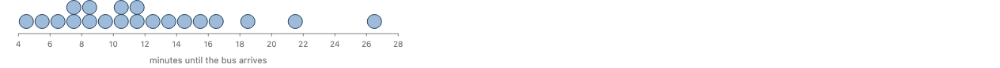

```js
const minutes = dist.lognormal({ meanlog: "meanlog", sdlog: "sdlog" });

chart([{ meanlog: Math.log(11), sdlog: 0.45 }], {
  w: 480,
  axes: { x: { title: "minutes until the bus arrives" }, y: false },
}).mark(dots({ x: minutes, n: 20, fill: SLAB, stroke: INK }));
```

#### Raincloud

A slab, a point interval and the jittered raw points per species (Allen et al., 2021).
See `signal.md`.

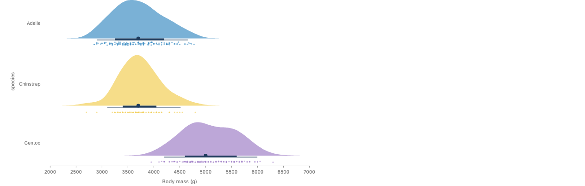

```js
chart(penguins, { w: 560, axes: { x: { title: "Body mass (g)" }, y: true } })
  .flow(spread({ by: "Species", dir: "y", spacing: 20 }))
  .mark(
    layer([
      slab({ x: "Body Mass (g)", fill: "Species", opacity: 0.7 }),
      interval({ x: "Body Mass (g)", levels: [0.66, 0.95], fill: INK }),
      chart()
        .flow(
          scatter({ x: "Body Mass (g)", overlap: Overlap.jitter() }).translate({
            y: -16,
          })
        )
        .mark(circle({ r: 1.5, fill: "Species", opacity: 0.6 })),
    ])
  );
```

#### Fan chart

Nested forecast bands that widen with the horizon, as in the Bank of England fan chart
and ggdist's `stat_lineribbon`. See `signal.md`.

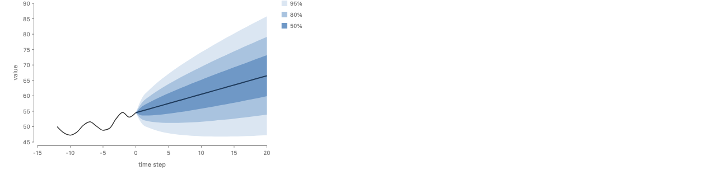

```js
const value = dist.normal({ mean: "median", sd: "sd" });

layer([
  chart(forecast)
    .flow(scatter({ by: "t", x: "t" }))
    .mark(
      interval({
        y: value,
        along: "t",
        levels: [0.5, 0.8, 0.95],
        fill: "#3a6ea5",
      })
    ),
  chart(history)
    .flow(scatter({ by: "t", x: "t", y: "value" }))
    .mark(line({ stroke: "#333", strokeWidth: 1.5 })),
]).render(container, {
  w: 520,
  h: 300,
  axes: { x: { title: "time step" }, y: { title: "value" } },
});
```

### ggdibbler (uncertainty as noise)

#### Uncertain bar chart, dodged

Twenty draws per estimate as thin bars side by side (Mason et al. 2026). See `noise.md`.

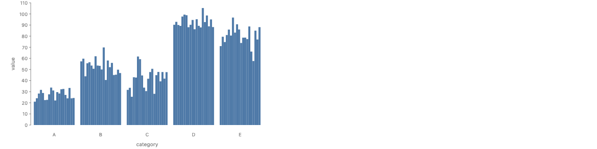

```js
const value = dist.normal({ mean: "mean", sd: "se" });
chart(estimates)
  .flow(
    spread({ by: "category", dir: "x" }),
    sample({ n: 20 }),
    spread({ by: "draw", dir: "x", spacing: 0 })
  )
  .mark(rect({ h: value }));
```

#### Uncertain stacked bar, dodged

Each draw is a full stack by product, and the draws are dodged within each region,
ggdibbler's `stack_dodge`. Stacking by `draw` instead is an error. See `noise.md`.

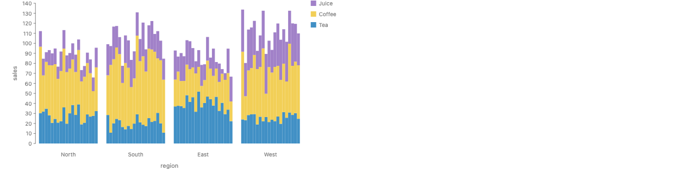

```js
const sales = dist.normal({ mean: "mean", sd: "se" });
chart(estimates)
  .flow(
    spread({ by: "region", dir: "x" }),
    sample({ n: 20 }),
    spread({ by: "draw", dir: "x", spacing: 0 }),
    stack({ by: "product", dir: "y" })
  )
  .mark(rect({ h: sales, fill: "product" }));
```

#### Uncertain stacked bar, overlaid

All draws in one slot at low opacity, so product boundaries blur where they are
uncertain. This is the first use of `overlay`. See `noise.md`.

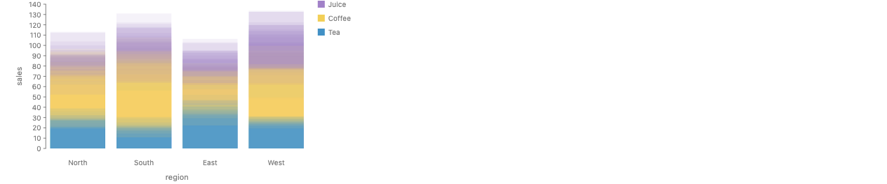

```js
chart(estimates)
  .flow(
    spread({ by: "region", dir: "x" }),
    sample({ n: 20 }),
    overlay({ by: "draw" }),
    stack({ by: "product", dir: "y" })
  )
  .mark(rect({ h: sales, fill: "product" }));
```

#### Uncertain scatter

Thirty draws of each point's x and y, drawn as a cloud. A correlated (x, y) would need
`dist.mvnormal`. See `noise.md`.

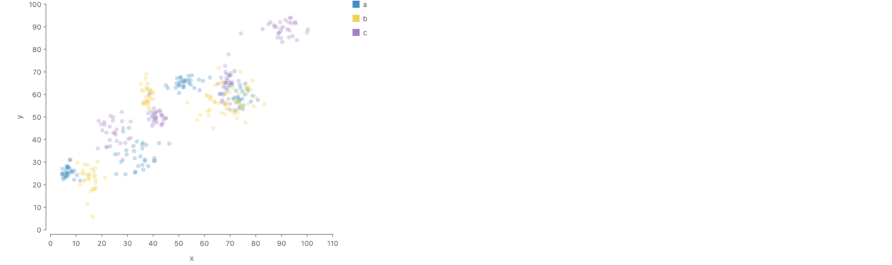

```js
const x = dist.normal({ mean: "x", sd: "xSe" });
const y = dist.normal({ mean: "y", sd: "ySe" });
chart(points)
  .flow(sample({ n: 30 }), scatter({ x, y }))
  .mark(circle({ r: 3, fill: "group", opacity: 0.3 }));
```

#### HOPs

One frame per draw. The strip shows six frames as small multiples, and the second image
is one frame of the real animation. See `noise.md`.

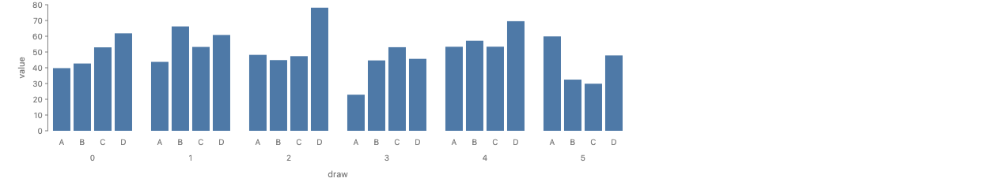

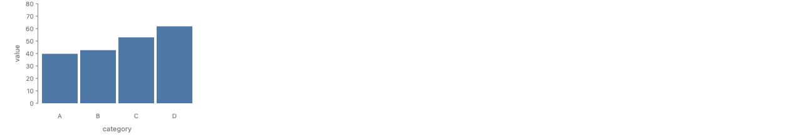

```js
const value = dist.normal({ mean: "mean", sd: "se" });
chart(estimates)
  .flow(
    sample({ n: 50 }),
    time.sequence({ by: "draw" }),
    spread({ by: "category", dir: "x" })
  )
  .mark(rect({ h: value }));
```

#### Uncertain map

A grid of regions shown three ways: the means, a pixel map of draws, and the draws
overlaid ("Colour Blinded by the Noise", Mason et al.). The images are the means, the
pixel map and the overlay, in that order, and the code holds all three. See `noise.md`.

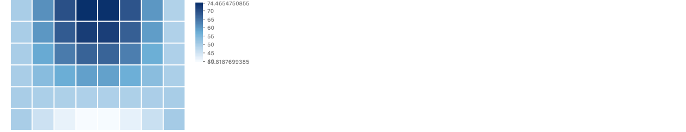

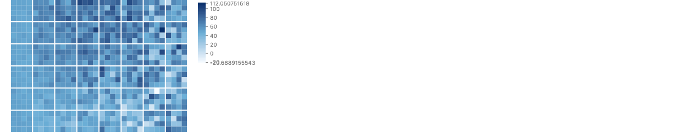

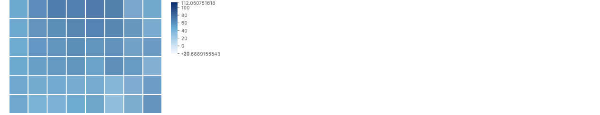

```js
const value = dist.normal({ mean: "mean", sd: "sd" });
const blues = Color.gradient(["#f7fbff", "#6baed6", "#08306b"]);

// (a) means
chart(tiles, { color: blues })
  .flow(table({ by: { x: "col", y: "row" }, spacing: 2 }))
  .mark(rect({ fill: value.mean() }));

// (b) pixel
chart(tiles, { color: blues })
  .flow(
    table({ by: { x: "col", y: "row" }, spacing: 2 }),
    sample({ n: 16 }),
    table({ by: "draw", numCols: 4, spacing: 0 }) // new: single-key wrap in flow form
  )
  .mark(rect({ fill: value }));

// (c) transparency
chart(tiles, { color: blues })
  .flow(
    table({ by: { x: "col", y: "row" }, spacing: 2 }),
    sample({ n: 16 }),
    overlay({ by: "draw" })
  )
  .mark(rect({ fill: value }));
```

### Papers

#### Bootstrap regression spaghetti

Thirty-nine regression lines, one per bootstrap resample, over the observed points
(Petek, Nabergoj and Štrumbelj, 2025). See `papers-a.md`.

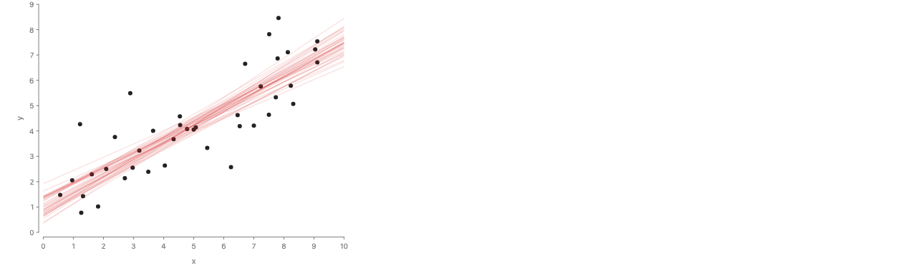

```js
chart(points)
  .flow(scatter({ by: "id", x: "x", y: "y" }))
  .mark(circle({ r: 3, fill: "#222" }))
  .layer(
    chart(points)
      .flow(
        resample({ n: 39 }), // or resample({ coverage: 0.95 })
        overlay({ by: "draw" }),
        derive(fitLine), // a user function; runs once per draw
        scatter({ by: "x", x: "x", y: "y" })
      )
      .mark(line({ stroke: "#d62728" }))
  );
```

#### Weighted forecast lines

Nine forecast lines, each line's opacity from its model weight (Zou et al., 2026). The
settled opacity rule draws these fainter than the paper. See `papers-a.md`.

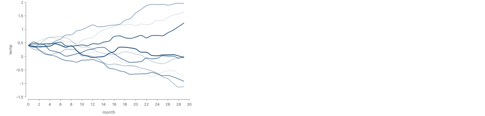

```js
chart(forecasts, { schema: { temp: { draws: "model", weight: "weight" } } })
  .flow(
    overlay({ by: "model" }), // opacity follows the record's weight
    scatter({ by: "month", x: "month", y: "temp" })
  )
  .mark(line({ stroke: "#1f4e79", strokeWidth: 2 }));
```

#### VMC aggregate per draw

A histogram of each replicated dataset's mean, with a rule at the observed mean (Guo,
Kale, Kay and Hullman, VMC). See `papers-a.md`.

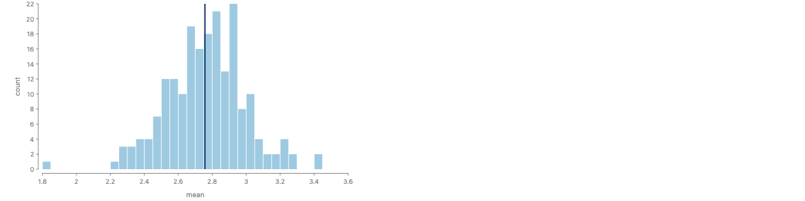

```js
chart(replicates, { schema: { y: { draws: "draw" } } })
  .flow(
    group({ by: "draw" }),
    summarize({ mean: field("y").mean() }), // new: one row per group
    partition({ by: field("mean").bin(Bin.step(0.05)), dir: "x" })
  )
  .mark(rect({ h: field("mean").count(), fill: "#9ecae1", inset: 0.5 }))
  // new: rule mark
  .layer(
    chart(observed).mark(rule({ x: field("y").mean(), stroke: "#08306b" }))
  );
```

#### jk-CDF

Fifty posterior normal CDFs over the empirical CDF (Piccolotto et al., VIS 2026). See
`papers-a.md`.

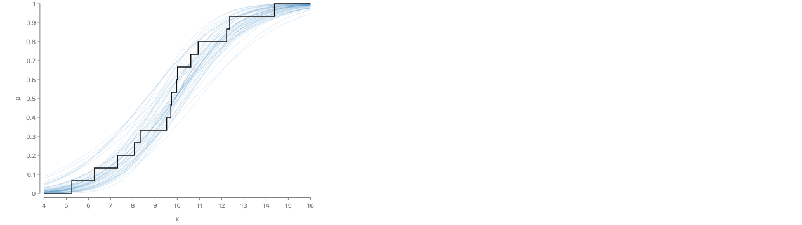

```js
// posterior: [{ draw, mu, sigma }], one row per posterior draw
const model = dist.normal({ mean: "mu", sd: "sigma" }); // Dist<Dist<number>>

chart(posterior, {
  schema: { mu: { draws: "draw" }, sigma: { draws: "draw" } },
})
  .flow(sample({ n: 50 }), overlay({ by: "draw" }))
  .mark(cdf({ x: model, stroke: "#3182bd" })) // new: cdf mark
  .layer(
    // the empirical CDF of the observed rows
    chart(observations).mark(cdf({ x: "value", stroke: "#111" }))
  );
```

#### jk pie

One ring per posterior draw of three category shares, from a Dirichlet. See
`papers-a.md`.

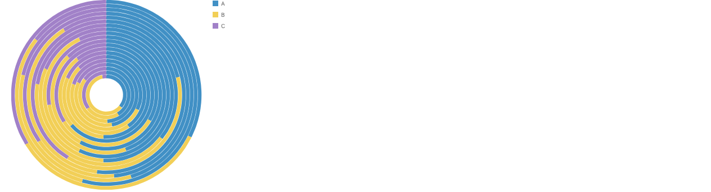

```js
// counts: [{ category, count }], the observed counts
// new: dist.dirichlet, one joint distribution over the rows
const probs = dist.dirichlet({ alpha: field("count").plus(1) });

chart(counts, { coord: Coord.polar(), axes: false })
  .flow(
    sample({ n: 20 }),
    spread({ by: "draw", dir: "y", spacing: 0 }),
    stack({ by: "category", dir: "x" })
  )
  .mark(rect({ w: probs, h: 6, fill: "category" }));
```

#### Probit CCDF

One CCDF line per posterior draw and condition of an ordinal model, on a probit axis
(Sarma, 2026). The render shows z values, because GoFish has no probit scale. See
`papers-a.md`.

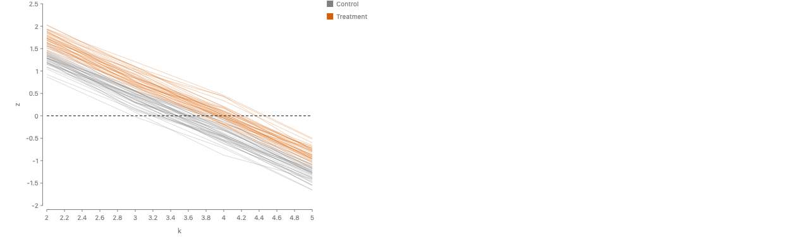

```js
// epred: [{ condition, draw, k, p }], p = P(rating = k) in that draw
const rating = dist.categorical({ level: "k", p: "p" }); // Dist<Dist<Ordinal>>

chart(epred, {
  schema: { p: { draws: "draw" } },
  color: Color.palette({ Control: "#7f7f7f", Treatment: "#d95f02" }),
  axes: { y: { scale: Scale.probit() } }, // new: a scale family, on the axis
})
  .flow(sample({ n: 40 }), group({ by: "condition" }), overlay({ by: "draw" }))
  // new: ccdf mark; new: rule mark
  .mark(ccdf({ x: rating, stroke: "condition" }))
  .layer(rule({ y: 0, strokeDasharray: "4 3" }));
```

#### Depth band and pointwise ribbon

Fifty whole curves summarized pointwise and by band depth, the functional boxplot (Sun
and Genton, 2011). See `papers-b.md`.

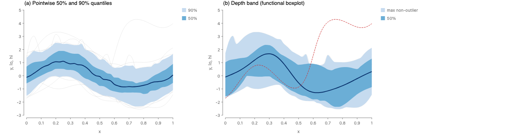

```js
const draws = { schema: { y: { draws: "curve" } } };

// (a) pointwise quantile ribbons and the pointwise median
chart(curveDraws, draws)
  .flow(scatter({ by: "x", x: "x" }))
  .mark(
    interval({ y: "y", along: "x", levels: [0.5, 0.9], band: Band.pointwise() })
  );

// (b) depth band: the envelope of the deepest 50% of whole curves, the
// deepest curve as the median, and the outlier curves
chart(curveDraws, draws)
  .flow(scatter({ by: "x", x: "x" }))
  .mark(
    interval({
      y: "y",
      along: "x",
      levels: [0.5],
      band: Band.depth({ outliers: 1.5 }),
    })
  );
```

#### Correlated field draws

Ten draws of a scalar field with a region that rises and falls together, as small
multiples (Zhao and Berger, VIS 2025). See `papers-b.md`.

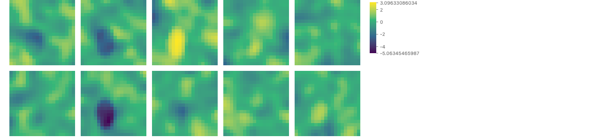

```js
const options = {
  schema: { value: { draws: "draw" } },
  color: Color.gradient("viridis"),
};

// small multiples: one panel per draw, five to a row
// new: single-key table with numCols in flow form
chart(fieldDraws, options)
  .flow(
    table({ by: "draw", numCols: 5, spacing: 12 }),
    table({ by: { x: "j", y: "i" } })
  )
  .mark(rect({ fill: "value" }));

// HOP: the same chart with the draw key on time instead of space
chart(fieldDraws, options)
  .flow(time.sequence({ by: "draw" }), table({ by: { x: "j", y: "i" } }))
  .mark(rect({ fill: "value" }));
```

#### Density scaling

Three normal densities on one shared scale and rescaled to one peak height (Fygenson and
Padilla, VIS 2024). The second form gets a lint warning. See `papers-b.md`.

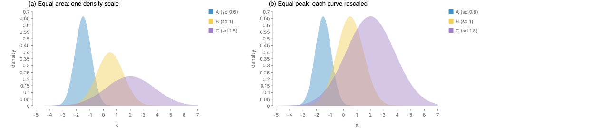

```js
// params: [{ curve, mean, sd }], one row per curve
const d = dist.normal({ mean: "mean", sd: "sd" });

// (a) equal area: one density scale for every slab (the default)
chart(params)
  .flow(group({ by: "curve" }))
  .mark(slab({ x: d, fill: "curve", opacity: 0.45, normalize: "all" }));

// (b) equal peak: each slab rescaled to the same height. The lint warns here.
chart(params)
  .flow(group({ by: "curve" }))
  .mark(slab({ x: d, fill: "curve", opacity: 0.45, normalize: "group" }));
```

#### Uncertain timeline

Activities with uncertain start and end times, drawn with fading ends and with dashed
end ranges (Potter et al., VIS 2025). See `papers-b.md`.

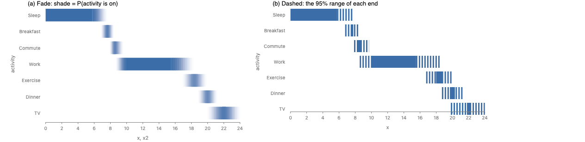

```js
// activities: [{ activity, start, startSd, end, endSd }]. start and end are
// Dist<Instant>; their sd columns are durations.
const start = dist.normal({ mean: "start", sd: "startSd" });
const end = dist.normal({ mean: "end", sd: "endSd" });

// (a) fade: the opacity at t is P(start <= t <= end)
// new: gradient with two Dist ends
chart(activities)
  .flow(spread({ by: ROWS, dir: "y" }))
  .mark(gradient({ x: start, x2: end, fill: BAR }));

// (a, noise form) the same fade from 50 overlaid draws
chart(activities)
  .flow(
    spread({ by: ROWS, dir: "y" }),
    sample({ n: 50 }),
    overlay({ by: "draw" })
  )
  .mark(rect({ x: start, x2: end, fill: BAR }));

// (b) dashed: a solid core, and a dashed box over each end's 95% interval
chart(activities)
  .flow(spread({ by: ROWS, dir: "y" }))
  .mark(
    layer([
      rect({ x: start.quantile(0.975), x2: end.quantile(0.025), fill: BAR }),
      // new: a dash option on rect
      rect({
        dims: { x: start.interval(0.95) },
        fill: "none",
        stroke: BAR,
        strokeDasharray: "3 3",
      }),
      rect({
        dims: { x: end.interval(0.95) },
        fill: "none",
        stroke: BAR,
        strokeDasharray: "3 3",
      }),
    ])
  );
```

## Types and schema

The full page is `types.md`, and the sketch is `types-sketch.ts`. The sketch imports the
real descriptor DSL, and it typechecks. Its six `@ts-expect-error` lines are each a real
error. It builds on PR #1200 (units as a domain plus traits, with `CanAdd`, and column
records) and PR #1237 (one name resolver).

| Layer             | Change                                                                                                                                                                                                                                                                                   | Additive or breaking |
| ----------------- | ---------------------------------------------------------------------------------------------------------------------------------------------------------------------------------------------------------------------------------------------------------------------------------------- | -------------------- |
| Value types       | `Dist<T>`, held as `pure`, `family`, `sample`, `mixture`, `truncated` or `smoothed`, and marked `independent` or `joint`. Each summary asks for a capability of `T`: `quantile` needs an order, `mean` needs values that average, `sd` returns the difference unit, `prob` needs levels. | additive             |
| Data and schema   | The column record gets `draws` and `weight`. The column type gets `HasDraws { joint, n?, seed? }` on the draw key and `HasSample { draws, weight? }` on the value column. `DataIR` does not change.                                                                                      | additive             |
| Internal          | `HasDomain.sorted()` becomes `HasDomain.quantile(p)`, so `Bin.quantiles` cuts a Dist with no new code, and `quantileRows` is deleted (#1231).                                                                                                                                            | internal only        |
| Field expressions | A new `DistAccessor` beside `FieldAccessor` and `StructAccessor`, because a normal reads two columns. New ops `quantile`, `cdf`, `sd`, `prob` and `kde`. `.interval(p)` adds no op, because it returns an `AxisInterval`.                                                                | additive             |
| Descriptors       | A `dist` channel kind. Operators `sample`, `resample`, `overlay`, `summarize`. Marks `slab`, `interval`, `dots`, `gradient`, `cdf`, `ccdf`.                                                                                                                                              | additive             |
| Strategy families | `Band.pointwise()` and `Band.depth({ outliers })`. The `dist.*` constructors get their own table in the same shape.                                                                                                                                                                      | additive             |
| Python            | A `DistAccessor` class, the new methods, a `dist` module, and generated wrappers. `sample` and `resample` take a `seed`, and JS and Python share one seeded generator.                                                                                                                   | additive             |

Everything is additive for users. `.mean()` and `.median()` change meaning only on Dist
inputs, which do not exist today.

The checker has five rules, each at a place that already reads column types. The error
texts are from the sketch and the design note.

1. **A Dist in a one-value channel with no lift.** In `inferNumeric` (`channels.ts`).
   Static.
   ```
   rect: channel "h" expects a number of sales, but it holds Dist<sales>. A distribution
   is not one number. Choose one of these:
     - summarize it:  rect({ h: field("sales").mean() })
     - draw it:       add sample({ n: 50 }) to the flow and place the draws
     - show it:       use interval({ y: "sales" }) or slab({ y: "sales" })
   ```
2. **A stack by a draw key.** In `spread`'s split, beside the `HasMidpoint` read. Static.
   ```
   stack({ by: "draw", dir: "y" }): "draw" is a sample index. The draws of one value are
   a sample, and their sum grows with the number of draws, so the stacked total has no
   meaning. stack needs a key whose groups add up to a whole.
   Place the draws with spread({ by: "draw", dir: "x" }), with time.sequence({ by: "draw" }),
   or stack by a category inside each draw.
   ```
3. **A sum over several draws** (a size channel, `.sum()`, treemap). Beside
   `checkSummable` (`measure.ts`). Read from the rows. This is #1198's entity check with
   the draw key as the repeated key, so they should be one function.
   ```
   rect h sums 20 draws of "draw". A sum of draws grows with their number. Split by
   "draw" first, or take .mean().
   ```
4. **A connecting mark over independent draws.** Where a relational mark picks its path
   tier (`classifyOperator`). Static.
   ```
   line({ along: "t" }) joins draw 3 of "value" in one t to draw 3 in the next, but each
   t's "value" is an independent distribution. Draw 3 in one t has no relation to draw 3
   in the next, so the line is not a possible path.
   Use draws from one joint sample (a column record { draws: "draw" }), or summarize
   first with field("value").interval(0.8) and draw a ribbon.
   ```
5. **A summary that `T` cannot support.** In `evalFieldValues` (`fieldExpr.ts`).
   Static.
   ```
   field("species").quantile(...): quantile needs an order on the values, but
   Dist<Category> (species) has none. Use field("species").prob(level) for the
   probability of a category, or draw it with sample().
   ```

The typed JS surface catches rules 1, 2, 4 and 5 at compile time in the sketch. The
engine runs all five, for Python and for untyped columns.

## Gaps in today's GoFish

These came up while drawing the examples. None depends on #980.

- **`line({ opacity })` takes only a number.** Weighted lines need one layer per weight.
  Own issue.
- **No rule mark.** A full-span reference line is a two-point `line`, and a `rect` with a
  literal height did not span the axis in data units. Own issue.
- **`group` takes one key.** Condition by draw needs a joined key column. Own issue,
  small.
- **No color domain option.** `Color.gradient` cannot fix its domain, so three plates of
  one map cannot share a scale. Own issue.
- **A `table` cell with many rows draws one rect, with no warning.** 768 rows gave 48
  rects. Own issue, as a bug.
- **No probit scale, and no scale family.** Own issue, a design question.
- **No gradient fill along a mark.** Fades are stepped cells under a color scale. Own
  issue, as a paint feature.
- **`rect` has no `strokeDasharray`.** Fold into the gradient paint issue or a small fix.
- **No single-key grid in flow form.** `table` has `numCols`, but its flow form requires
  `by: { x, y }`. Own issue, small.
- **Raincloud layout workarounds.** The rain needs a pixel `translate` to sit below the
  baseline, a child with no position then falls to the bottom of the layer, and a
  `stack` combinator did not separate the points from the slab. Own issue, to
  investigate.
- **`capture-one` Vite startup timeouts under parallel load.** Several renders at once
  timed out while the server started. Own issue, tooling.
- **Smaller ones.** `spread`'s `label: false` does not hide ticks. A `layer` of `table`
  charts lays them out one after another. The `color` option on `layer(...).render` does
  not reach its charts. The gradient legend prints long decimals. `table` column labels
  pile up on the left. These can go in one cleanup issue.

## Recommendation

Adopt the synthesis. These are the reasons, against the design principles in
`api-design.md`.

- **It desugars into the core.** `slab`, `interval` and `dots` are exact shorthands for
  marks GoFish has. Draws are placed by `spread`, `stack` and `time.sequence`, and
  `overlay` shares `time.sequence`'s layout. `sample` and `resample` are a `derive` plus a
  column type. Only `gradient`, `cdf`, `ccdf` and `Band.depth` add something new, and
  each is something no operator can do today.
- **One concept is one operator.** There is one fold for a distribution channel, not one
  for rows and one for cells. `.mean()` has one meaning. `quantileRows` goes away. B's
  plain columns are not a second path, they are the same fold.
- **Meaning lives on the data type.** Whether rows are draws, and whether those draws are
  shared, is in the column record, like units after #1200. The stack-by-draw error and
  the line-over-independent-draws error come from the type, not from the user
  remembering.
- **Few new terms.** The user learns `dist.*`, `sample`, `overlay`, two record keys and
  the signal marks. `rvar` and `dist.kde` are gone. The marks keep ggdist's names.
- **The same shape in JS and Python.** Every example above has a Python form with the
  same structure, and the draws cross as plain rows.

The runner-up is pure B, draws as rows only. It is shorter when the data is already a
sample, it needs no new value type, and Python users mostly bring draws from ArviZ. It
loses on known families, on nested distributions, and on cutting a smoothed curve, which
is the croissant chart that started #1231. The pick would change if the one-fold rule
broke on a hard example, such as a chart that mixes independent cells and shared draws in
one group, or if parameters could not cross to Python with a shared seeded generator. In
that case B with a declared draw key is the safe subset, and A could be added later.

## Decisions for the maintainer

1. Should the draw key live in the column record (`{ draws: "draw" }`, the pick here) or
   in a channel expression (`rvar`, the sheet's spelling)?
2. Should the namespace be `dist.normal`, like `time`, or `Dist.normal`, like the other
   capitalized factory namespaces, with `Dist.Dist` as the type?
3. When a chart mixes a `dist.*` cell with a joint draws column, are they independent, or
   is it an error? (Design note question 2.)
4. Should a group with several `dist.*` rows fold to their mixture, or should a signal
   mark draw one shape per row, as ggdist does?
5. Should `overlay` opacity be a share of the draws, `max(min, w / Σw)`, or a per-group
   opacity like `w / max(w)`? The weighted forecasts example wants the second, which
   could instead come from `line({ opacity: "weight" })`.
6. Should `slab` and `interval` over a plain column smooth the sample by default, as
   ggdist does, or read the raw sample unless the user writes `.kde()`?
7. What crosses the bridge from Python: `dist.*` parameters, draws as rows, or also cells
   of SciPy distributions as an Arrow struct column? And do JS and Python share one
   seeded generator? (Question 1.)
8. Which quantile range sets the axis extent of an unbounded distribution? (Question 5.)
9. Is the draw-sum check the same function as #1198's entity check, so #1198 lands first?
   (Question 3.)
10. For categories, is `prob()` per level a flow step or a mark, and does a `by` key or a
    color channel over `Dist<Category>` need anything beyond `sample`? (Question 8.)
11. Should `filter` on a Dist be an error, a test with a stated threshold, or a per-draw
    filter after `sample`? (Question 7.)
12. Are `summarize` (flat columns, or a `columns` record on the wire) and
    `dist.categorical` in scope for #980, or does `summarize` get its own issue and
    `dist.categorical` give way to the weighted fold?

Design note questions 4 (interaction with selection), 10 (visual convergence as a test,
and whether `n` is a chart option) and 11 (node count and a canvas path) stay open but do
not block the syntax. Question 6 (row folds versus cell summaries) and question 9 (the z
direction) are settled above by the one-summary rule and by `overlay` sharing
`time.sequence`'s layout.
