# Layouts in user space

A design for writing layout algorithms as GoFish code, on the smallest set of layout primitives that covers them. Every d3 layout is checked against it. (today) marks a real render on today's public API. (sketch) marks proposed syntax that does not run yet.

## Review: what landed and what is open

This tab has two parts. The first part shows what is open now: the GoTree polar stories checked against the GoTree gallery, then four layout questions, each with real renders, the code that drew them, and a recommendation where there is one. The second part shows what has been decided and built on the branch. Every picture is a render of the code under it, made on the branch today unless its caption says otherwise.

### Open now

> The layout protocol prototype is on the next tab. It defines `spread`, `stack`, `tile` and user layouts with one public call, `defineLayout`, and has three forks of its own.

#### GoTree polar stories against the GoTree gallery

Each card puts one GoTree story beside the picture in the GoTree gallery that it ports (BIT-VIS/gotree, `gallery/<Name>/tree.png`). Changed stories show three panels: the reference, the branch before this round (38a79eac3), and the branch now. The cause of each difference is one of four kinds. **(a)** The port's spec was wrong. **(b)** The engine has a bug. **(c)** GoFish cannot write it yet. **(d)** Cosmetic, such as different data. The first round found no engine bug. The second round, on the coordinate systems, found one, shown on the icicle card.

Each gallery story now uses the coordinate system its reference uses. A port never turns a cartesian picture into a polar one or a polar picture into a cartesian one. This is the maintainer's rule: "in general yeah we shouldn't convert between cartesian and polar with the gallery examples." The table checks every gallery story against its picture. The picture decides, not the `dsl.json`, because the icicle and deep tree folders hold a copy of the sunburst's polar `dsl.json` under cartesian pictures. Three stories broke the rule. Their cards show the reference, the branch before this round (11ecb7c9d), and the branch now.

| Story                                                                                                                                                                                                                                                                                                                   | Reference | Port                                        | Verdict              |
| ----------------------------------------------------------------------------------------------------------------------------------------------------------------------------------------------------------------------------------------------------------------------------------------------------------------------- | --------- | ------------------------------------------- | -------------------- |
| arc-tree, barcodetree, BeamTree, cartesian-deep-tree, CascadedTreemap, cheops, dendrogram, ElasticHierarchy, GardenLayout, HTreeLayout, HVDrawing, IndentedTree, iptp, Jewelry, NodeLinkTree, OrthogonalTree, ReadableTreeLayout, StairTree, Treemap, TreemapOval, treemap-slice, WeaveTree                             | cartesian | cartesian                                   | same                 |
| ClockTree, ClockTreeWithLink, FlowerTree, HierarchicalSectorChart, MultilevelSilhouetteTree, OakTreeVis, OrthogonalGridEmbedding, outside-in-tree, radial-deep, RadialTree, RadialTreeIncline, RotationTree, SectorTree, SectorTree2, SideTree, SpiralLayout, sunburst, TornadoTree, TornadoTree2, TyreTree, ViolinTree | polar     | polar                                       | same                 |
| RadialPhylogeneticTree                                                                                                                                                                                                                                                                                                  | polar     | polar, projected to the screen by the story | same picture         |
| icicleplot                                                                                                                                                                                                                                                                                                              | cartesian | polar                                       | fixed, now cartesian |
| deep-tree                                                                                                                                                                                                                                                                                                               | cartesian | polar                                       | fixed, now cartesian |
| NestedPieTree                                                                                                                                                                                                                                                                                                           | polar     | cartesian                                   | fixed, now polar     |

#### Sunburst (fixed)

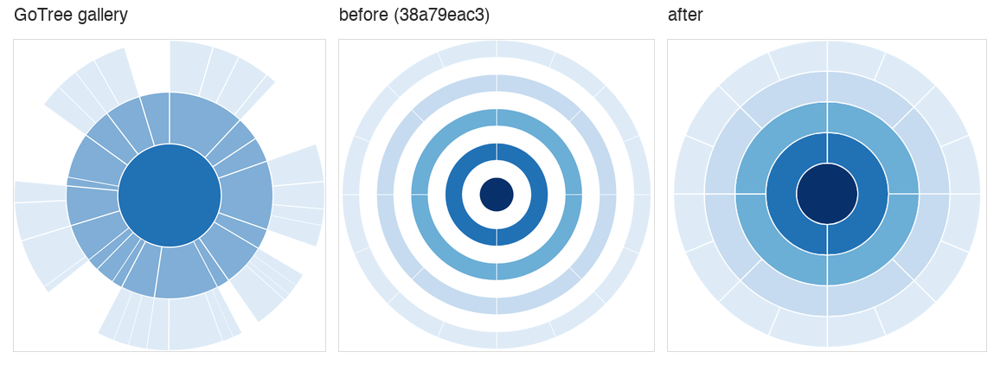

_The rings now touch, as in the reference._

**(a)** The port put a whole ring's thickness of space between a parent and its children, which drew the white rings. The dsl's margin is zero. The reference also uses real, uneven data (d), and the port keeps its balanced tree.

**Old code**

```ts
// GoTree / Gallery / sunburst, before. Each ring is bandHeight px thick.
mount({
  parentChild: combine({
    x: { kind: "nest", pad: 0 },
    y: { kind: "distribute", spacing: bandHeight }, // a ring's thickness of gap
  }),
  sibling: combine({
    x: { kind: "distribute", spacing: 0 },
    y: { kind: "align", alignment: "middle" },
  }),
});
```

**New code**

```ts
// After. Rings touch (the dsl's Margin is "0rr"), and siblings start on
// the same ring.
mount({
  parentChild: combine({
    x: { kind: "nest", pad: 0 },
    y: { kind: "distribute", spacing: 0 },
  }),
  sibling: combine({
    x: { kind: "distribute", spacing: 0 },
    y: { kind: "align", alignment: "start" },
  }),
});
```

#### Icicle plot (fixed, now cartesian)

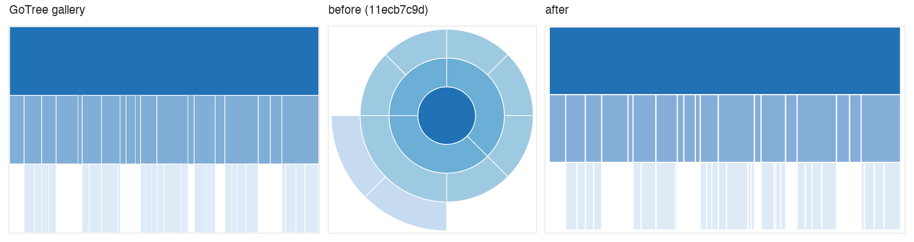

_The story now draws the cartesian icicle in the reference. Before, it drew a polar icicle, the same picture as the sunburst._

**(a)** The reference is a cartesian icicle, and its `dsl.json` is a byte copy of the sunburst's, so the story had followed the copy. The story is now cartesian. The root is one band across the top, its 19 children sit in the band below, and their leaves in the band below that. Each leaf is as wide as its value, read off the reference. The file is renamed from `IciclePlotPolar.stories.tsx` to `IciclePlot.stories.tsx`, and its gallery title from "GoTree: Polar Icicle" to "GoTree: Icicle Plot". Nothing referred to the old id. The node-link IciclePlot story is not a gallery story and stays as it is.

**(b)** The bands are pixels, not `h: datum(1)`. With a data height, a parent at depth 1 is drawn below its own children while the root stays above its children. The four-node repro is below the new code.

**Old code**

```ts
// GoTree / Gallery / icicleplot, before (IciclePlotPolar.stories.tsx).
// A polar picture: the same layout as the sunburst story.
const node = (d: any) =>
  d.height === 0
    ? rect({ w: datum(1), h: bandHeight, fill: byDepth(icicleBlues)(d) })
    : rect({ h: bandHeight, fill: byDepth(icicleBlues)(d) });
tree(
  {
    node,
    link: "none",
    parentChild: combine({
      x: { kind: "nest", pad: 0 },
      y: { kind: "distribute", spacing: 0 },
    }),
    sibling: combine({
      x: { kind: "distribute", spacing: 0 },
      y: { kind: "align", alignment: "start" },
    }),
    coord: Coord.clock(),
  },
  sampleTree
).render(container);
```

**New code**

```ts
// After (IciclePlot.stories.tsx). A cartesian icicle, as in the picture.
// The root's 19 children, read off the reference: a number is a leaf with
// that value, a list is a child whose leaves have those values.
const branches = [
  10,
  [7, 5],
  [5, 5],
  16,
  3,
  [5, 9],
  [12, 1],
  4,
  7,
  3,
  [4, 3, 4],
  [5, 13, 2, 2],
  4,
  [8, 1, 3, 3],
  7,
  [5, 4, 6, 9],
  8,
  7,
  [2, 6, 6, 10],
];
const bandHeight = 120; // one depth band
const node = (d: any) =>
  d.height === 0
    ? rect({
        w: datum(d.data.value),
        h: bandHeight,
        fill: byDepth(icicleBlues)(d),
      })
    : rect({ h: bandHeight, fill: byDepth(icicleBlues)(d) });
tree(
  {
    node,
    link: "none",
    parentChild: combine({
      x: { kind: "nest", pad: 0 },
      y: { kind: "distribute", spacing: 0 },
    }),
    sibling: combine({
      x: { kind: "distribute", spacing: 0 },
      y: { kind: "align", alignment: "start" },
    }),
  },
  icicleData
).render(container, { w: 640 });
```

**Engine bug repro**

```ts
// The engine bug in four nodes. With h: datum(1), the parent A is drawn
// below its own child a1, while the root stays above A and B. With h: 100,
// every parent is above its children.
const data = {
  name: "root",
  children: [{ name: "A", children: [{ name: "a1" }] }, { name: "B" }],
};
tree(
  {
    node: (d) =>
      rect({ w: d.height === 0 ? datum(1) : undefined, h: datum(1) }),
    link: "none",
    parentChild: combine({
      x: { kind: "nest", pad: 0 },
      y: { kind: "distribute", spacing: 0 },
    }),
    sibling: combine({
      x: { kind: "distribute", spacing: 0 },
      y: { kind: "align", alignment: "start" },
    }),
  },
  data
).render(container, { w: 200, h: 300 });
// Drawn: root y=0, A y=200, a1 y=100.
// Expected (and drawn with h: 100): root y=0, A y=100, a1 y=200.
```

#### Nested pie tree (fixed, now polar)

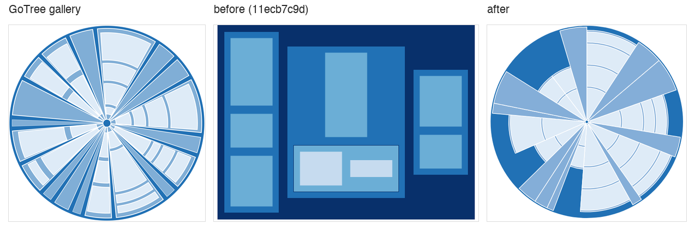

_The story now draws a polar nested pie. Before, it drew nested rectangles._

**(a)** The reference is polar, and the story was a cartesian treemap. The story now alternates the two GoTree templates by depth under `Coord.clock()`. The root's children split the angle by value, and their children split the radius by value. A node is sized only along the axis its parent splits, so a wedge with no children runs from the hub to the rim. Nothing is sized in radians. The data is read off the reference: 19 wedges, ten of them split into two to four bands.

**(c)** Two things still differ. First, GoTree fills every wedge to the rim and splits it by value inside. Here the bands of all wedges share one radial scale, so a wedge whose bands add up to less stops short of the rim. Second, the reference has gaps between siblings measured in data units. A gap inside a coord can only be pixels or `fr`, which warns beside data weights, and a percent is \#1238. So the wedges touch, and a white stroke parts them. The story stays in the gallery. It is clearly the reference's kind of picture, and its gallery description now says polar.

**Old code**

```ts
// GoTree / Gallery / NestedPieTree, before. A cartesian picture.
const node = (d: any) =>
  d.height === 0
    ? rect({
        w: 92,
        h: (d.data.value ?? d.width ?? 1) * 37,
        fill: byDepth()(d),
      })
    : rect({ fill: byDepth()(d), stroke: "#08306b", strokeWidth: 1 });
const dice = combine({
  x: { kind: "align", alignment: "middle" },
  y: { kind: "distribute", spacing: 18 },
});
const slice = combine({
  x: { kind: "distribute", spacing: 18 },
  y: { kind: "align", alignment: "middle" },
});
tree(
  {
    node,
    link: "none",
    parentChild: combine({
      x: { kind: "nest", pad: 14 },
      y: { kind: "nest", pad: 14 },
    }),
    sibling: alternate([slice, dice]),
  },
  sampleTree
).render(container);
```

**New code**

```ts
// After. A polar picture. A node is sized by its value only along the axis
// its parent splits (a slice splits the angle, a dice the radius), and it
// fills its parent on the other axis.
const wedges = [
  [3, 2, 2, 1],
  4,
  5,
  [3, 2, 1, 1],
  3,
  [3, 2, 2, 1],
  1.5,
  [4, 2, 2],
  [2, 2],
  1,
  2,
  3,
  [3, 2],
  [4, 3],
  1.5,
  5,
  [3, 2],
  [3, 2],
  4,
];
const node = (d: any) => {
  const style = {
    fill: byDepth(pieBlues)(d),
    stroke: "white",
    strokeWidth: 1.5,
  };
  if (d.depth === 0) return rect(style);
  const value = datum(total(d.data)); // a leaf's value, or its leaves' sum
  return d.depth % 2 === 1
    ? rect({ w: value, ...style })
    : rect({ h: value, ...style });
};
const slice = combine({
  x: { kind: "distribute", spacing: 0 },
  y: { kind: "align", alignment: "start" },
});
const dice = combine({
  x: { kind: "align", alignment: "middle" },
  y: { kind: "distribute", spacing: 4 },
});
tree(
  {
    node,
    link: "none",
    parentChild: combine({
      x: { kind: "nest", pad: 0 },
      y: { kind: "nest", pad: 4 },
    }),
    sibling: alternate([slice, dice]),
    coord: Coord.clock(),
  },
  pieData
).render(container, { w: 520, h: 520 });
```

#### Deep tree (fixed, now cartesian)

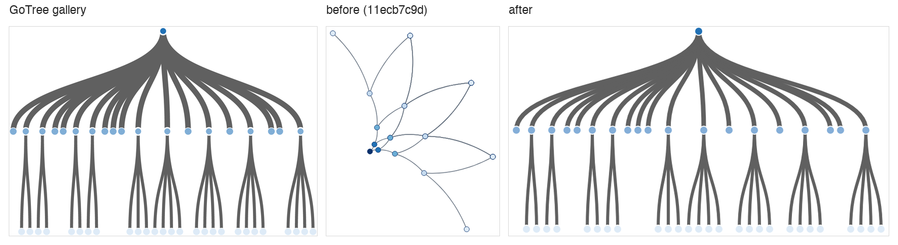

_The story now draws the cartesian tree in the reference._

**(a)** Like the icicle, the reference is cartesian and its `dsl.json` is a copy of the sunburst's. The story had drawn a polar binary tree with hand-set pitches in radians. It is now a top-down tree with the reference's 19 children and their leaves, bezier links, and thicker links out of the root (the dsl's LinkWidth by depth). It is not a gallery story.

**Old code**

```ts
// GoTree / Gallery / deep-tree, before. A polar picture.
mount(
  {
    node: (d) =>
      circle({ r: 6, fill: byDepth()(d), stroke: "#08306b", strokeWidth: 1 }),
    link: { curve: Curve.linear(), stroke: "#5f6b7a", strokeWidth: 1.5 },
    parentChild: combine({
      x: { kind: "nest", pad: 0 },
      y: {
        kind: "distribute",
        spacing: Spacing.pitch(151, { at: "middle" }),
      },
    }),
    sibling: combine({
      x: {
        kind: "distribute",
        spacing: Spacing.pitch((2 * Math.PI) / 10, { at: "middle" }),
      },
      y: { kind: "align", alignment: "middle" },
    }),
    coord: Coord.clock(),
  },
  {},
  deepTree // a balanced binary tree, 4 levels
);
```

**New code**

```ts
// After. A cartesian picture with the reference's 19 children.
const leafCounts = [0, 2, 2, 0, 0, 2, 2, 0, 0, 0, 3, 4, 0, 4, 0, 4, 0, 0, 4];
const linkWidths = [9, 6]; // LinkWidth=depth
mount(
  {
    node: (d) =>
      circle({
        r: 8,
        fill: byDepth(deepBlues)(d),
        stroke: "white",
        strokeWidth: 2,
      }),
    link: (source) => ({
      curve: Curve.bezier(),
      stroke: "#606060",
      strokeWidth: linkWidths[source.depth],
    }),
    parentChild: combine({
      x: { kind: "nest", pad: 0 },
      y: { kind: "distribute", spacing: 180 },
    }),
    sibling: combine({
      x: { kind: "distribute", spacing: 4 },
      y: { kind: "align", alignment: "start" },
    }),
  },
  {},
  deepTree
);
```

#### Hierarchical sector chart (fixed)

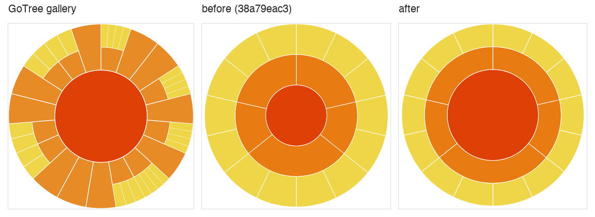

_The root disc is now twice a ring's thickness._

**(a)** Every ring had the same thickness in pixels, and siblings were centered. In GoTree a parent is as thick as its child group, so the root is two rings thick here. The reference's tree also has some leaves at depth 1 (d).

**Old code**

```ts
// GoTree / Gallery / HierarchicalSectorChart, before.
const bandHeight = 90; // radial thickness of one ring
rect({ w: datum(1), h: bandHeight /* ... */ }); // leaves
rect({ h: bandHeight /* ... */ }); // internal nodes
mount({
  sibling: combine({
    x: { kind: "distribute", spacing: 0 },
    y: { kind: "align", alignment: "middle" },
  }),
});
tree(spec, data).render(container);
```

**New code**

```ts
// After. GoTree sizes a parent like its child group, so a node of height h
// is 2^(h-1) rings thick and a leaf one ring.
const rings = (d: any) => (d.height === 0 ? 1 : 2 ** (d.height - 1));
rect({ w: datum(1), h: datum(rings(d)) /* ... */ }); // leaves
rect({ h: datum(rings(d)) /* ... */ }); // internal nodes
mount({
  sibling: combine({
    x: { kind: "distribute", spacing: 0 },
    y: { kind: "align", alignment: "start" },
  }),
});
tree(spec, data).render(container, { w: 540, h: 540 });
```

#### Tyre tree (fixed)

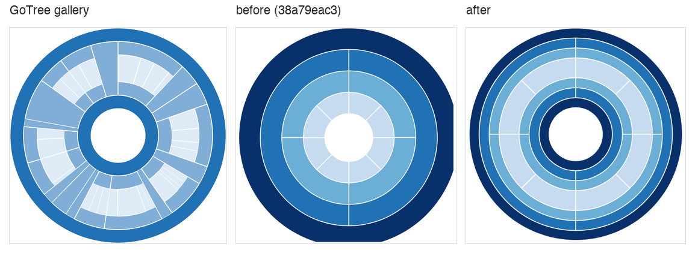

_The root now shows at the rim and around the hub, and nothing is clipped._

**(a)** The port aligned each child group at the parent's inner edge, so the root showed only at the rim. GoTree's "within" centers it. The bands were also pixels that needed 224 px of room in a canvas with 187.5 px. They are weights now, so they fit.

**Old code**

```ts
// GoTree / Gallery / TyreTree, before. Bands in pixels: 224 px of radial
// room in a canvas that has 187.5 px.
const band = 56;
rect({ h: (d.height + 1) * band /* ... */ });
mount({
  parentChild: combine({
    x: { kind: "nest", pad: 0 },
    y: { kind: "align", alignment: "start" },
  }),
  sibling: combine({
    x: { kind: "distribute", spacing: 0 },
    y: { kind: "align", alignment: "start" },
  }),
});
```

**New code**

```ts
// After. A band is as thick as its reverse depth (RootHeight: rdepth), and
// the child group sits centered within its parent's band ("within").
const LEVELS = 4;
const rdepth = (d: any) => LEVELS - d.depth;
rect({ h: datum(rdepth(d)) /* ... */ });
mount({
  parentChild: combine({
    x: { kind: "nest", pad: 0 },
    y: { kind: "align", alignment: "middle" },
  }),
  sibling: combine({
    x: { kind: "distribute", spacing: 0 },
    y: { kind: "align", alignment: "middle" },
  }),
});
```

#### Clock tree (fixed)

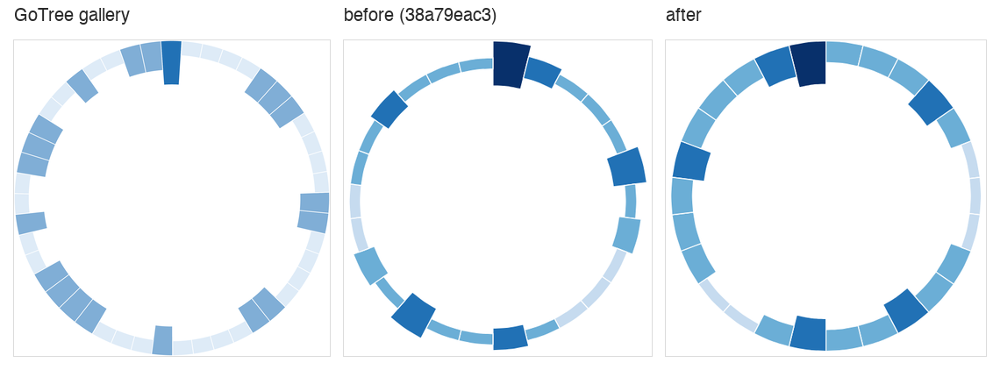

_Wedges hang from the rim, and the root is just before 12._

**(a)** Three rules were off. Bottom-up layout puts a parent after its children, a wedge's length is its reverse depth, not its height, and the dsl aligns every wedge at the rim, not at the middle of the band.

**Old code**

```ts
// GoTree / Gallery / ClockTree, before.
rect({ w: datum(1), h: datum(d.height + 1) /* ... */ });
mount({
  parentChild: combine({
    x: { kind: "distribute", spacing: 0 },
    y: { kind: "align", alignment: "middle" },
  }),
  sibling: combine({
    x: { kind: "distribute", spacing: 0 },
    y: { kind: "align", alignment: "middle" },
  }),
});
```

**New code**

```ts
// After. Bottom-up puts a parent after its children; RootHeight: rdepth
// sizes by depth; Y align "bottom" hangs every wedge from the rim.
const LEVELS = 4;
rect({ w: datum(1), h: datum(LEVELS - d.depth) /* ... */ });
mount({
  parentChild: combine({
    x: { kind: "distribute", spacing: 0, order: "reverse" },
    y: { kind: "align", alignment: "end" },
  }),
  sibling: combine({
    x: { kind: "distribute", spacing: 0 },
    y: { kind: "align", alignment: "end" },
  }),
});
```

#### Clock tree with link (wedges fixed, links differ)

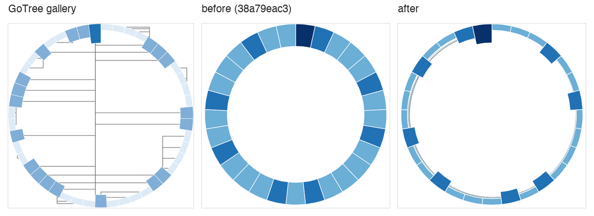

_The wedges follow the clock tree's rule. The links do not match._

The wedges were **(a)**, the same three rules as the clock tree. The links are **(c)**. The reference draws straight step links across the hollow center in screen space. A link inside a coord is drawn in the coord's space, so it bends with the circle.

> To match, a link needs a route that is drawn in screen space while its ends stay on marks placed in the polar space.

**Old code**

```ts
// GoTree / Gallery / ClockTreeWithLink, before.
const bandHeight = 60;
rect({ w: datum(1), h: bandHeight /* ... */ });
mount({
  parentChild: combine({
    x: { kind: "distribute", spacing: 0 },
    y: { kind: "align", alignment: "middle" },
  }),
  sibling: combine({
    x: { kind: "distribute", spacing: 0 },
    y: { kind: "align", alignment: "middle" },
  }),
});
```

**New code**

```ts
// After. The same rule as ClockTree. The links are unchanged.
const LEVELS = 3;
rect({ w: datum(1), h: datum(LEVELS - d.depth) /* ... */ });
mount({
  parentChild: combine({
    x: { kind: "distribute", spacing: 0, order: "reverse" },
    y: { kind: "align", alignment: "end" },
  }),
  sibling: combine({
    x: { kind: "distribute", spacing: 0 },
    y: { kind: "align", alignment: "end" },
  }),
});
```

#### Sector tree (fixed)

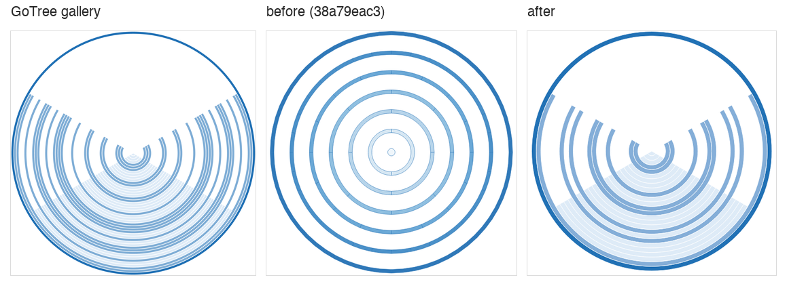

_Arcs centered on 6 o'clock, the root the outer circle._

**(a)** The dsl sets `PolarAxis: x-axis`, which puts the layout's X on the radius and its Y on the angle. The port drew a sunburst instead. GoFish's polar always reads x as θ, but the swap is still easy to write: the X relations go on `y` and the Y relations on `x`. The reference has more nodes (d).

**Old code**

```ts
// GoTree / Gallery / SectorTree, before: one ring per depth.
rect({ w: datum(1), h: 8 /* ... */ }); // leaves; internal nodes have no w
mount({
  parentChild: combine({
    x: { kind: "nest", pad: 0 },
    y: { kind: "distribute", spacing: 35 },
  }),
  sibling: combine({
    x: { kind: "distribute", spacing: 0 },
    y: { kind: "align", alignment: "middle" },
  }),
});
```

**New code**

```ts
// After. PolarAxis: x-axis puts the dsl's X on r and its Y on θ, so the X
// relations go on `y` and the Y relations on `x`.
const LEVELS = 3;
rect({ w: datum(LEVELS - d.depth), h: datum(1) /* ... */ });
mount({
  parentChild: combine({
    x: { kind: "align", alignment: "middle" }, // Y Root: within
    y: { kind: "distribute", spacing: 0, order: "reverse" }, // X Root: juxtapose
  }),
  sibling: combine({
    x: { kind: "align", alignment: "middle" }, // Y Subtree: align
    y: { kind: "distribute", spacing: 0 }, // X Subtree: flatten
  }),
});
```

#### Sector tree 2 (fixed)

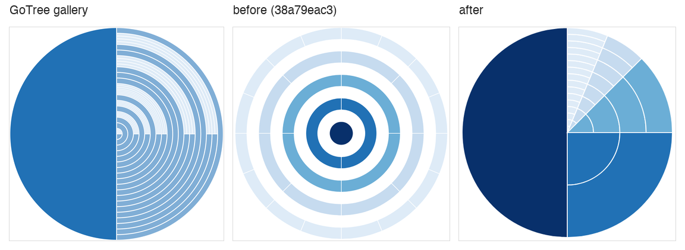

_The root is the left half, and the leaves split the radius._

**(a)** The same axis swap as the sector tree. The levels run around the angle and the leaves along the radius. The reference's tree is three levels deep with uneven fan-out, and the port keeps a balanced tree four levels deep, so it has one more angular slot (d).

**Old code**

```ts
// GoTree / Gallery / SectorTree2, before: a sunburst with gaps.
rect({ w: datum(1), h: 42 /* ... */ }); // leaves; internal nodes have no w
mount({
  parentChild: combine({
    x: { kind: "nest", pad: 0 },
    y: { kind: "distribute", spacing: 42 },
  }),
  sibling: combine({
    x: { kind: "distribute", spacing: 0 },
    y: { kind: "align", alignment: "middle" },
  }),
  coord: Coord.clock(),
});
```

**New code**

```ts
// After. PolarAxis: x-axis, so the X relations go on `y` (r) and the Y
// relations on `x` (θ). A node of height h takes 2^(h-1) angular slots.
const slots = (d: any) => (d.height === 0 ? 1 : 2 ** (d.height - 1));
rect({ w: datum(slots(d)), h: datum(1) /* ... */ }); // leaves
rect({ w: datum(slots(d)) /* ... */ }); // internal nodes
mount({
  parentChild: combine({
    x: { kind: "distribute", spacing: 0 }, // Y Root: juxtapose
    y: { kind: "nest", pad: 0 }, // X Root: include
  }),
  sibling: combine({
    x: { kind: "align", alignment: "start" }, // Y Subtree: align
    y: { kind: "distribute", spacing: 0 }, // X Subtree: flatten
  }),
  coord: Coord.polar({ baselineAngle: Math.PI / 2 }), // counter-clockwise from 12
});
```

#### Tornado trees (still differ)

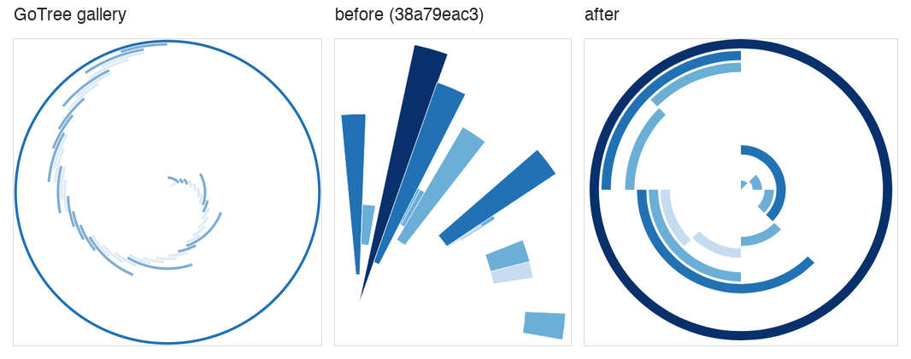

_Tornado tree. The root is the outer circle._

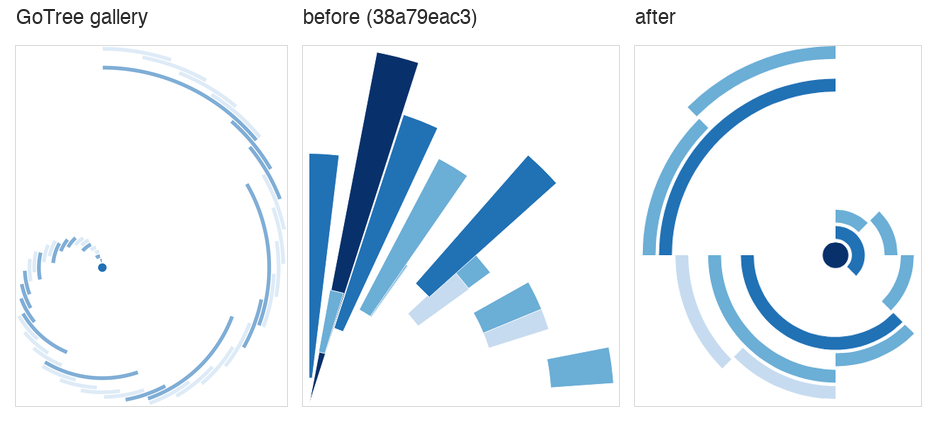

_Tornado tree 2. The root is the dot at the center._

The axes were **(a)**. Both use `PolarAxis: x-axis`, which the port had ignored, and placed nodes by hand-set pitches with the `emX` flag. The rewrite uses the swap and has no flags or hand numbers. What is left is **(c)**. The dsl overlaps each sibling with the one before it by 46% of its length (`Margin -0.46`), which winds the spiral tighter.

> To match, a gap needs to be writable as a negative share of the children's own size. A box gap today is pixels, a percent of the room, or a non-negative `fr`.

**Old code**

```ts
// GoTree / Gallery / TornadoTree, before. TornadoTree2 was the same with
// other numbers.
rect({ w: 0.13, h: 59, emX: true /* ... */ }); // leaves
rect({ w: 0.13, emX: true /* ... */ }); // internal nodes
mount({
  parentChild: combine({
    x: { kind: "distribute", spacing: Spacing.pitch(0.55, { at: "middle" }) },
    y: { kind: "nest", pad: 44 },
  }),
  sibling: combine({
    x: { kind: "distribute", spacing: Spacing.pitch(0.42, { at: "middle" }) },
    y: { kind: "distribute", spacing: Spacing.pitch(44, { at: "middle" }) },
  }),
});
```

**New code**

```ts
// After. PolarAxis: x-axis, so the X relations go on `y` (r) and the Y
// relations on `x` (θ). No flags and no hand numbers.
rect({ w: datum(1), h: datum(1) /* ... */ }); // leaves
rect({ h: datum(1) /* ... */ }); // internal nodes
mount({
  parentChild: combine({
    x: { kind: "nest", pad: 0 }, // Y Root: include
    // X Root: juxtapose, bottom-up. TornadoTree2 (PolarCenter: left) leaves
    // out `order: "reverse"`, so its root is at the center.
    y: { kind: "distribute", spacing: 4, order: "reverse" },
  }),
  sibling: combine({
    x: { kind: "distribute", spacing: 0 }, // Y Subtree: flatten
    y: { kind: "distribute", spacing: 4 }, // X Subtree: flatten
  }),
});
```

#### Violin tree (still differs)

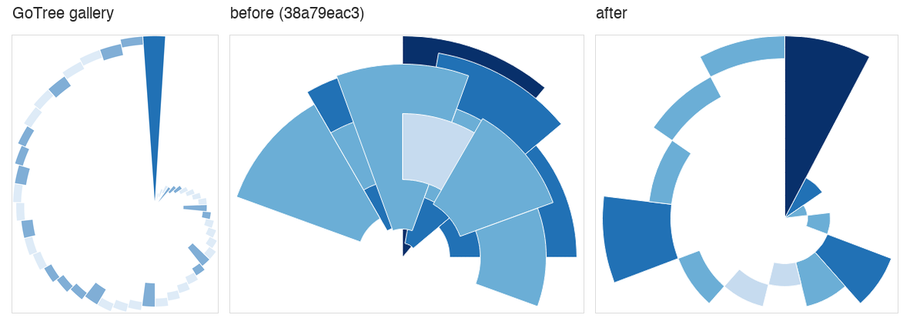

_The root wedge reaches from the center to the rim just after 12, and the rest spiral inward._

The order was **(a)**. The port placed nodes by pitches with `emX`, and its parents were centered over their children instead of after them. The rewrite gives each node its own slot, parent after children, counter-clockwise from 12. The steps are wider than the reference's for the same reason as the tornado trees, **(c)**, and the port's tree is smaller (d).

> To match, the same negative gap as the tornado trees.

**Old code**

```ts
// GoTree / Gallery / ViolinTree, before.
const LEAF_THETA = (2 * Math.PI) / 9;
rect({ w: LEAF_THETA, h: d.data.value * 42, emX: true /* ... */ }); // leaves
rect({ w: LEAF_THETA, emX: true /* ... */ }); // internal nodes
mount({
  parentChild: combine({
    x: { kind: "distribute", spacing: Spacing.pitch(0, { at: "middle" }) },
    y: { kind: "nest", pad: 18 },
  }),
  sibling: combine({
    x: {
      kind: "distribute",
      spacing: Spacing.pitch(LEAF_THETA, { at: "middle" }),
    },
    y: { kind: "distribute", spacing: Spacing.pitch(0, { at: "middle" }) },
  }),
  coord: Coord.clock(),
});
```

**New code**

```ts
// After. Each node takes its own angular slot, parent after children.
rect({ w: datum(1), h: datum(1) /* ... */ }); // leaves
rect({ w: datum(1) /* ... */ }); // internal nodes
mount({
  parentChild: combine({
    x: { kind: "distribute", spacing: 0, order: "reverse" }, // X Root: juxtapose
    y: { kind: "nest", pad: 0 }, // Y Root: include
  }),
  sibling: combine({
    x: { kind: "distribute", spacing: 0 }, // X Subtree: flatten
    // Y Subtree: flatten. PolarCenter: bottom puts the layout's top at the rim.
    y: { kind: "distribute", spacing: 0, order: "reverse" },
  }),
  coord: Coord.polar({ baselineAngle: Math.PI / 2 }), // counter-clockwise from 12
});
```

#### Side tree and spiral layout (still differ)

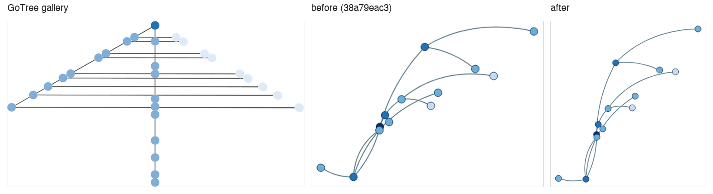

_Side tree._

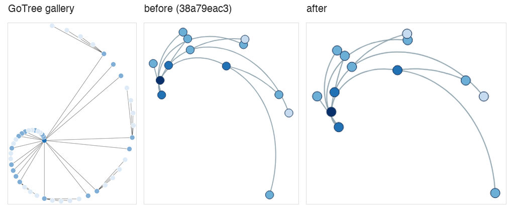

_Spiral layout._

In both references the first branch starts at the start angle, so the root's chain now writes `ends: [0, 1]`. That is the only change. The rest is **(a)** and **(c)**. These stories place circles by hand-set pitches in radians, and their links bend with the circle, while the references draw straight links. A circle node gets no angular room from the tree, which is the gap GALLERY.md lists first.

> To match, point nodes need angular room by leaf count, and links need a straight route in screen space.

**Old code**

```ts
// GoTree / Gallery / SideTree and SpiralLayout, before: the root's chain
// around the turn took the default ends, half a gap at each end.
mount({
  parentChild: combine({
    x: { kind: "distribute", spacing: Spacing.pitch(0.5, { at: "middle" }) },
    // ...
  }),
});
```

**New code**

```ts
// After. GoTree puts the first branch at the start angle, so no room
// before it and a whole gap after the last.
mount({
  parentChild: combine({
    x: {
      kind: "distribute",
      spacing: Spacing.pitch(0.5, { at: "middle", ends: [0, 1] }),
    },
    // ...
  }),
});
```

#### Node-link sunburst and nested pie tree (cleaned up)

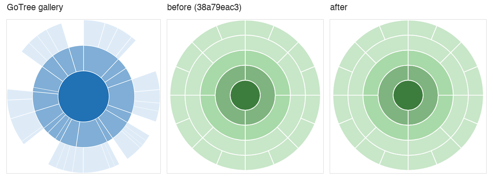

_Sunburst. The normalized DOM is unchanged._

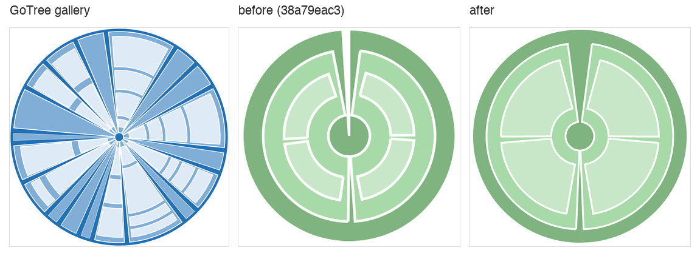

_Nested pie tree. The ring now closes and fills the canvas._

Both stories sized wedges by hand in radians, and the sunburst also set `emX`. They now give weights, which the coord fits. The sunburst draws the same picture. The nested pie tree's hand sizes added up to more than a full turn, so it had a seam at 12; now it closes. Neither is a port of one gallery picture: the gallery's NestedPieTree has many more leaves and alternates slice and dice by depth (d).

**Old code**

```ts
// GoTree / Node-Link / Sunburst and NestedPietree, before.
const leafTheta = (2 * Math.PI) / deepLeafCount;
rect({ w: d.width * leafTheta, h: bandHeight, emX: true /* ... */ });
// NestedPietree leaves, sized by hand to fit 2π with the pads and gaps
const NPT_LEAF_W = Math.PI / 2 - 0.27;
rect({ w: NPT_LEAF_W, h: 36 /* ... */ });
```

**New code**

```ts
// After. Weights, which the coord fits to the turn and the radius.
rect({ w: datum(d.width), h: bandHeight /* ... */ });
rect({ w: datum(1), h: datum(1) /* ... */ }); // NestedPietree leaves
```

#### Stories not changed in this round

The reference beside the branch, with the main difference in each caption.

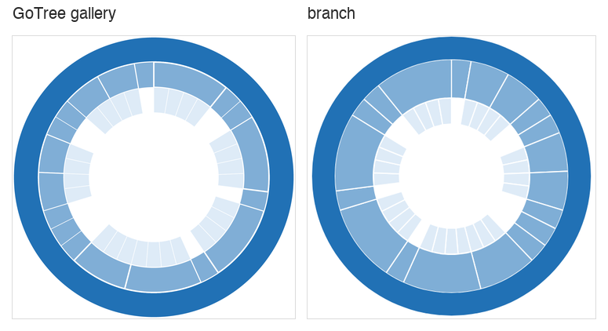

_Outside-in tree. Matches; the data differs (d)._

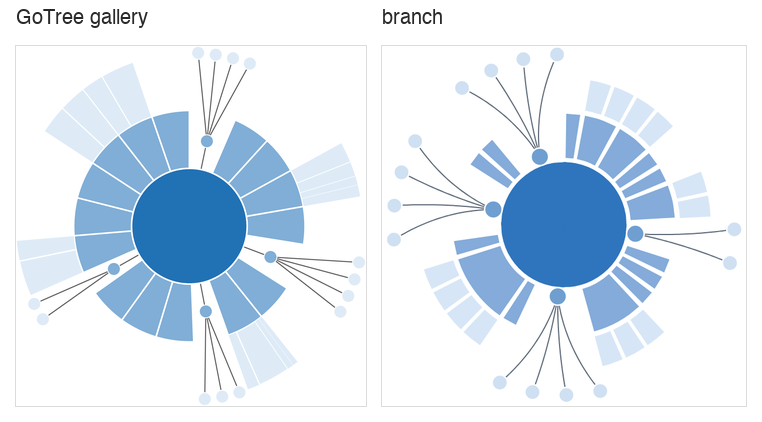

_Multilevel silhouette tree. Close. A gap runs between the root disc and the first ring, and the links bend (c)._

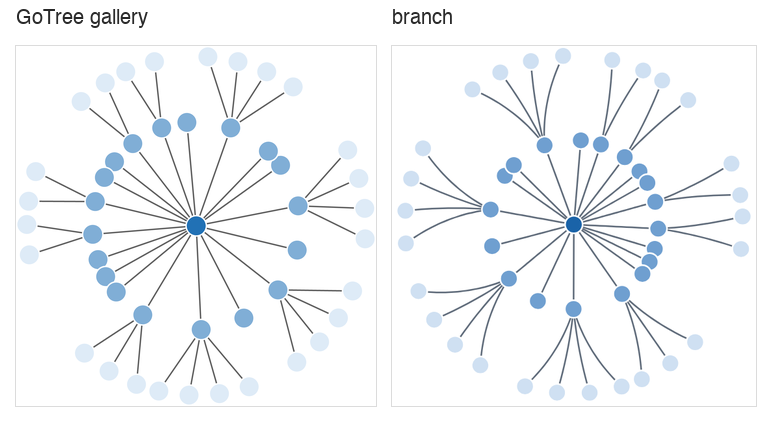

_Radial tree. Close; the links bend (c)._

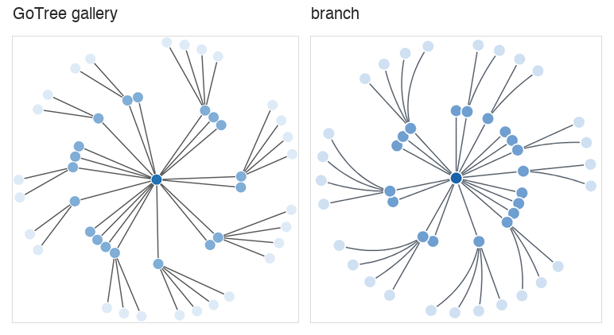

_Radial tree incline. Close; the links bend (c)._

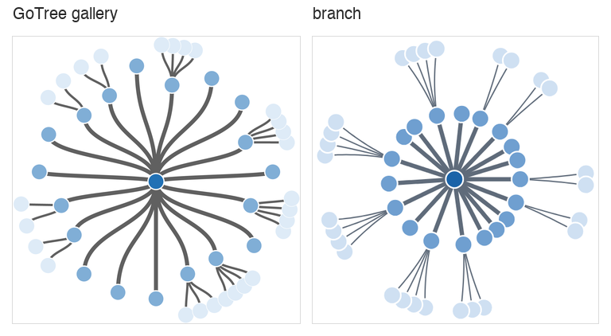

_Radial deep. Close; curved links are drawn straight (c)._

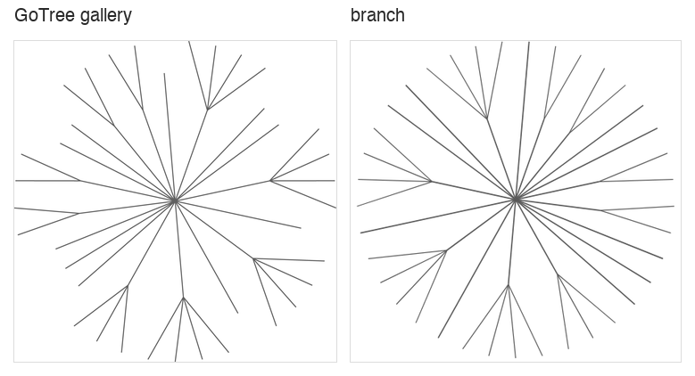

_Radial phylogenetic tree. Close._

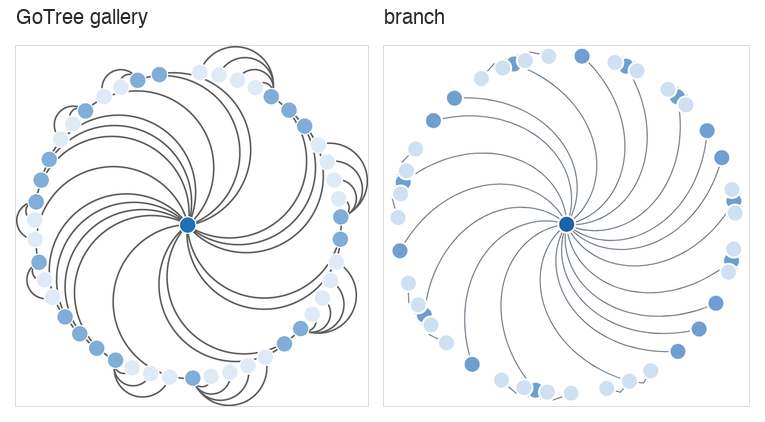

_Rotation tree. Close; the arc links are approximated (c)._

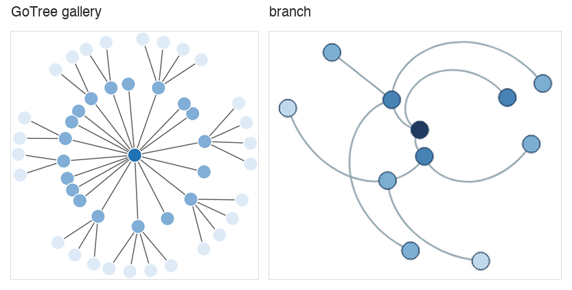

_Node-link radial nodes. Does not match. Every level uses the same pitch, a third of a turn, so the fans wrap around (a)._

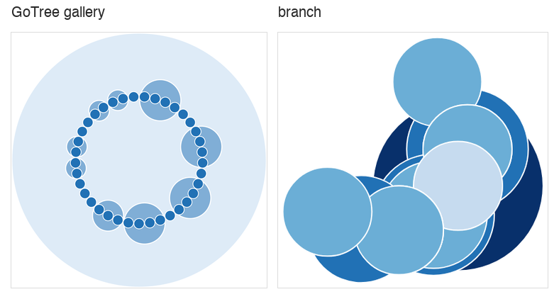

_Flower tree. Does not match. Circles nest on one axis, which a circle cannot do (c)._

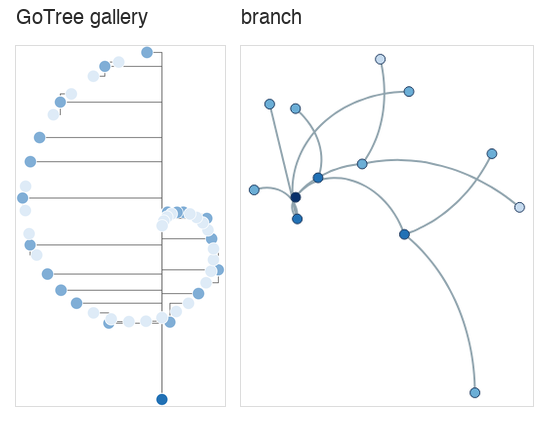

_Oak tree. Does not match. It needs the axis swap and straight step links (a, c)._

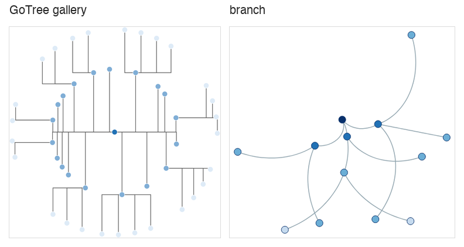

_Orthogonal grid embedding. Does not match; orthogonal links are drawn straight (c)._

#### Layout questions

#### 1\. Slack in a spread of a stated size (prototype)

**Slack** is the spare room that minimum gaps leave, and a slack rule says where the parts go within it. The picture has three boxes 30 px wide, gaps of at least 10 px, and a spread 400 px wide. The boxes and gaps need 110 px, so 290 px are spare. Today the spare room stays empty on the right whatever the slack rule says, because the solver does not read the spread's own width as a bound.

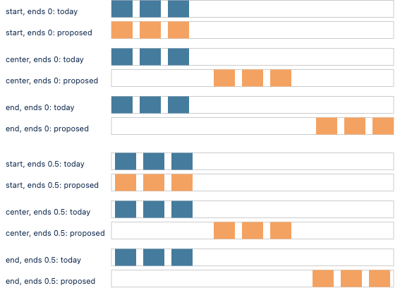

_Blue rows are what the library draws today. Orange rows are a prototype that the story computes by hand, not the library. The lower half adds **ends: 0.5**._

**Code today (blue rows)**

```ts
// Blue rows (the library): a spread 400 px wide, three 30 px boxes, gaps
// of at least 10, under each slack rule, with ends 0 and then 0.5.
const sizedToday = (slack: Slack.Slack, ends: number, y: number) =>
  spread(
    {
      dir: "x",
      w: 400,
      x: 150,
      y,
      spacing: Spacing.atLeast(10, { slack, ends }),
    },
    [0, 1, 2].map(() => rect({ w: 30, h: 24, fill: "#457b9d" }))
  );
```

**The prototype (orange rows), computed in the story**

```ts
// Orange rows: a PROTOTYPE computed in the story, not by the library.
// The ends keep `ends` gaps inside each side of the 400 px, and the slack
// rule's t takes that fraction of what is left.
const sizedPrototype = (t: number, ends: number, y: number) => {
  const lo = ends * 10;
  const hi = 400 - ends * 10;
  const chain = 3 * 30 + 2 * 10; // 110 px
  const first = lo + t * (hi - lo - chain);
  return layer(
    [0, 1, 2].map((i) =>
      rect({ x: 150 + first + i * 40, y, w: 30, h: 24, fill: "#f4a261" })
    )
  );
};
```

The same gap in the solver shows with `ends`. With minimum gaps, `ends` is only a minimum too, so nothing pushes the parts to fill a stated width.


**\*Spacing.atLeast(10, { ends: 1 })** in a spread 300 px wide. The boxes sit at 10, 60 and 140, and 105 px are left after the last one.\*

```ts
// Proposals / End Spacing / AtLeastEnds
layer([
  rect({ x: 0, y: 0, w: 300, h: 60, fill: "#eeeeee" }),
  spread(
    {
      dir: "x",
      spacing: Spacing.atLeast(10, { ends: 1 }),
      w: 300,
      x: 0,
      y: 10,
    },
    [40, 70, 55].map((w) => rect({ w, h: 40, fill: "#59a14f" }))
  ),
]).render(container, { w: 340, h: 100 });
```

> **Fork: does a spread's own width bound its slack?** (a) Leave it as it is. A stated width is a frame, and the parts keep to the start. (b) The spread's own extent bounds the solution, the way CSS `justify-content` places items inside the box it is given. The orange rows are (b), and `ends` then becomes a margin inside that box.  
> Recommended: (b). A slack rule that does nothing when a width is stated is a surprise, and (b) gives the slack rule and `ends` the same meaning on a line and around a turn.

#### 2\. The default end spacing on a glued axis (today)

An axis is **glued** when its end meets its start, as a full turn does. A spread that fills a glued axis has as many gaps as parts, so the last gap has to go somewhere. The branch splits it, half a gap at each end. The alternative is no room at the start and a whole gap at the end. The maintainer had not yet chosen between the two.

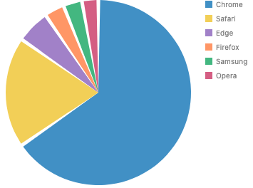

_The default, half a gap at each end. Within 1.8e-15 rad of the rim that **d3.arc** draws for **d3.pie().padAngle(0.04)**._

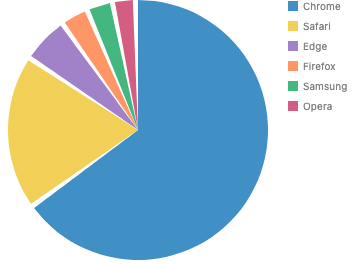

**\*ends: \[0, 1\]**. Within 8.9e-16 rad of d3.pie's own start and end angles.\*

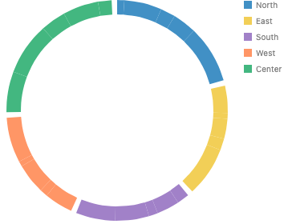

_Chord arcs with **ends: \[0, 1\]**. Within 7.4e-5 rad of **d3.chord().padAngle(0.05)**. That figure is limited by fitting a circle to the rounded points of the path. Under the default each group would be half a pad off (not rendered)._

```ts
// Proposals / End Spacing / Pie: no option. The chain fills the turn, so
// it gets half a gap (PAD = 0.04) at each end.
chart(browsers, { coord: Coord.clock(), w: 360, h: 320 })
  .flow(spread({ by: "name", dir: "x", spacing: PAD }))
  .mark(rect({ w: "value", fill: "name" }))
  .render(container);
```

```ts
// Proposals / End Spacing / PieFromNoon: nothing before the first slice
// and a whole gap after the last.
chart(browsers, { coord: Coord.clock(), w: 360, h: 320 })
  .flow(
    spread({
      by: "name",
      dir: "x",
      spacing: Spacing.box(PAD, { ends: [0, 1] }),
    })
  )
  .mark(rect({ w: "value", fill: "name" }))
  .render(container);
```

**Chord arcs**

```ts
// Proposals / End Spacing / Chord
layer({ coord: Coord.clock(), w: 360, h: 320 }, [
  spread(
    { dir: "x", spacing: Spacing.box(0.05, { ends: [0, 1] }), y: 120 },
    trips.map((row, i) =>
      stack(
        { dir: "x", w: v(rowTotal(row)) },
        row.map((m) => rect({ w: v(m), h: 18, fill: v(districts[i]) }))
      )
    )
  ),
]).render(container, { axes: false });
```

When this question was written, the default turned four GoTree stories by half their root gap: side-tree, spiral-layout, tornado-tree and tornado-tree2. The pictures below are from then. Since the GoTree rework above, the tornado trees have no gaps on the angle, so the default does not touch them. The side tree and the spiral layout now write `ends: [0, 1]` on the root's chain themselves, because in both GoTree references the first branch starts at the start angle.

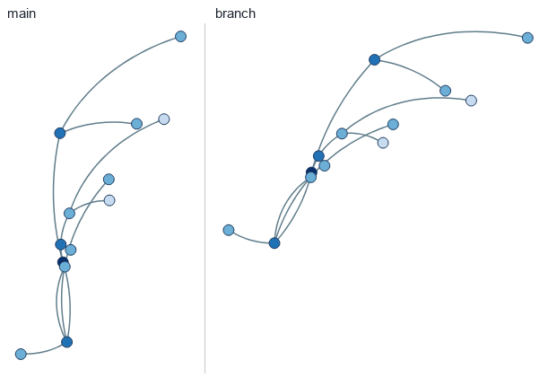

_Side tree. Turned by half its root gap._

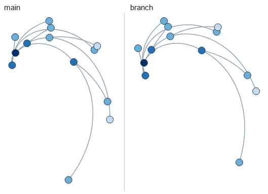

_Spiral layout. Turned by half its root gap._

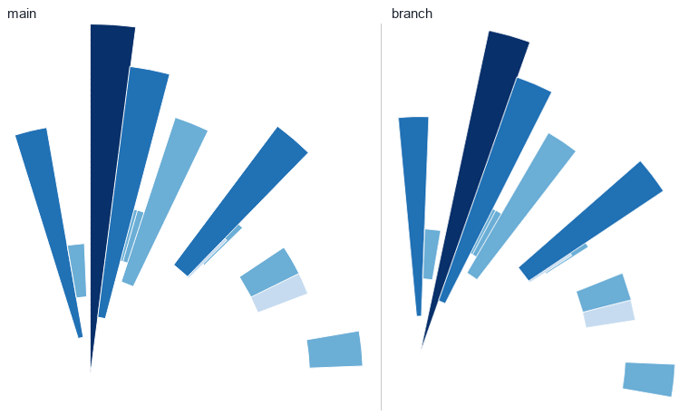

_Tornado tree. Turned, and the SVG goes from 505 by 390 to 426 by 456._

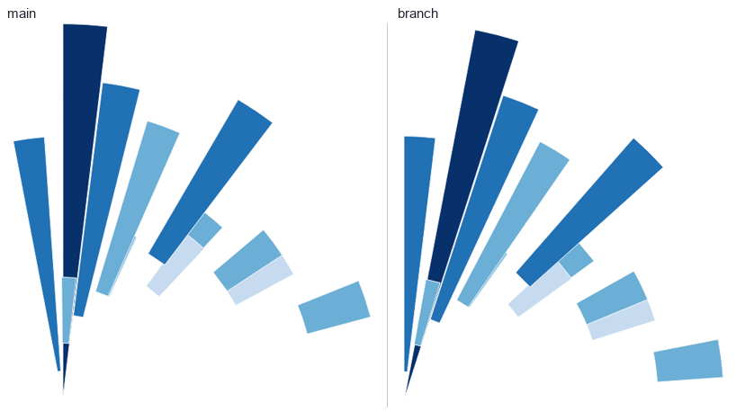

_Tornado tree 2. Turned by half its root gap._

**The tornado tree's spec at the time, since rewritten**

```ts
// GoTree / Gallery / TornadoTree, as on the branch. Every node is 0.13 rad
// wide, and pitches between centers place it along the angle.
const TH = 0.13;
const node = (d: any) =>
  d.height === 0
    ? rect({ w: TH, h: 59, emX: true, fill: byDepth()(d) /* ... */ })
    : rect({ w: TH, emX: true, fill: byDepth()(d) /* ... */ });

mount({
  node,
  link: "none",
  parentChild: combine({
    x: { kind: "distribute", spacing: Spacing.pitch(0.55, { at: "middle" }) },
    y: { kind: "nest", pad: 44 },
  }),
  sibling: combine({
    x: { kind: "distribute", spacing: Spacing.pitch(0.42, { at: "middle" }) },
    y: { kind: "distribute", spacing: Spacing.pitch(44, { at: "middle" }) },
  }),
  coord: Coord.clock(),
});
```

On a line nothing is glued, so the default is 0, and a stated `ends` gives the three CSS spacings.

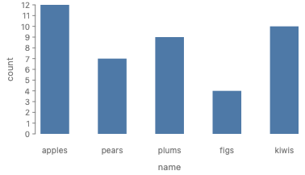

**\*ends: 0**, the default. CSS **space-between**.\*

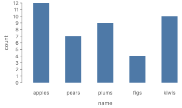

**\*ends: 0.5**. CSS **space-around**.\*

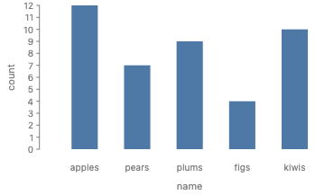

**\*ends: 1**. CSS **space-evenly**.\*

```ts
// Proposals / End Spacing / BarsBetween, BarsAround, BarsEvenly
const barsWith = (spacing: any) =>
  chart(fruit, { w: 320, h: 160 })
    .flow(spread({ by: "name", dir: "x", spacing }))
    .mark(rect({ h: "count", fill: "#4e79a7" }));

barsWith(Spacing.box(fr(1))); // ends 0, the default on a line
barsWith(Spacing.box(fr(1), { ends: 0.5 }));
barsWith(Spacing.box(fr(1), { ends: 1 }));
```

> **Fork: the default on a glued axis.** (a) Keep half a gap at each end, and each GoTree story that needs it writes `ends: [0, 1]` itself, as the side tree and the spiral layout now do. (b) Keep half a gap at each end, and GoTree's lowering writes `ends: [0, 1]` on the root's sibling chain, so the stories need not. (c) Make a whole gap at the end the default. That is a one-line change in the library, and the pie and chord then match d3's layouts rather than d3.arc.  
> Recommended: (b). Half a gap at each end is what d3.arc draws and what a pie user sees, and the GoTree stories are better fixed in GoTree, which knows that its root is a tree and not a pie.

```ts
// Option (b), a sketch, not run: GoTree's lowering adds `ends: [0, 1]` to
// the sibling chain of the root only, where the chain fills the turn.
// Inner chains keep the default, 0, so nothing else moves.
Spacing.pitch(0.42, { at: "middle", ends: [0, 1] }); // root siblings only
```

#### 3\. Embedding, and the last `emX` and `emY` flags (today)

A mark's size along an axis can be read in two ways. It can be **embedded**, a quantity of the space, so a bar's width in a polar space is an angle and the bar is drawn as a wedge. Or it can be **ink**, pixels drawn where the mark sits, so the bar stays a straight bar of that many pixels.

The branch has one rule. A relation embeds a mark's extent on an axis only when it fixes both of the mark's edges there. Box spacing, a minimum gap in a chain, an align by span, and an align at both start and end all do. A pitch, or an align at one anchor, pins one point, and the extent stays ink. No rule reads sizes or units. In the maintainer's words, "a spread embeds its children b/c otherwise its spatial relationships aren't properly preserved. it has nothing to do with absolute sizes".

#### The model case: the rose

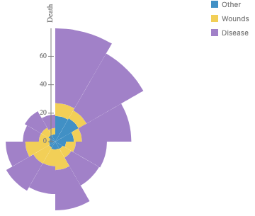

_Main, with the old code. Each bar states its angle, **w: (Math.PI \* 2) / 12**._


_The branch, with no width on the bar. The normalized DOM is byte-identical to main._

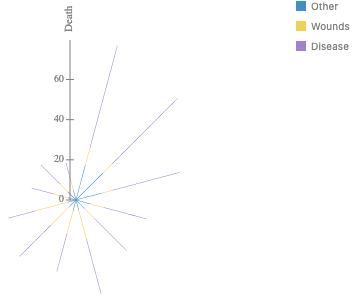

_The old code on the branch. The spread already fixes both edges, so a stated width is now read as ink, and each bar is a thin line._

**Old code**

```ts
// Forward Syntax / Pie / Rose, on main: the bar states its angular width.
chart(nightingale, { coord: Coord.clock(), axes: true, padding: 40 /* ... */ })
  .flow(
    spread({ by: "Month", dir: "x", spacing: 0, axes: { x: false, y: true } }),
    stack({ by: "Type", dir: "y" }),
    derive((d) => d.map((d) => ({ ...d, Death: Math.sqrt(d.Death) })))
  )
  .mark(rect({ w: (Math.PI * 2) / 12, h: "Death", fill: "Type" }));
```

**New code**

```ts
// On the branch: the same, with no width on the bar.
chart(nightingale, { coord: Coord.clock(), axes: true, padding: 40 /* ... */ })
  .flow(
    spread({ by: "Month", dir: "x", spacing: 0, axes: { x: false, y: true } }),
    stack({ by: "Type", dir: "y" }),
    derive((d) => d.map((d) => ({ ...d, Death: Math.sqrt(d.Death) })))
  )
  .mark(rect({ h: "Death", fill: "Type" }));
```

When this question was written, seven stories set a flag. Each pair below is the branch with its flag, then the same story with the flag removed, rendered in a throwaway copy of the branch. Since then the GoTree rework above removed the flag from the tornado trees, the violin tree and the node-link sunburst, and the balloon chart dropped its flag too. The multilevel silhouette tree and the outside-in tree still set one.

#### (i) Widths placed by a pitch

The tornado trees and the violin tree place nodes by pitches between centers. A pitch pins one point, so without the flag every node is a sliver.

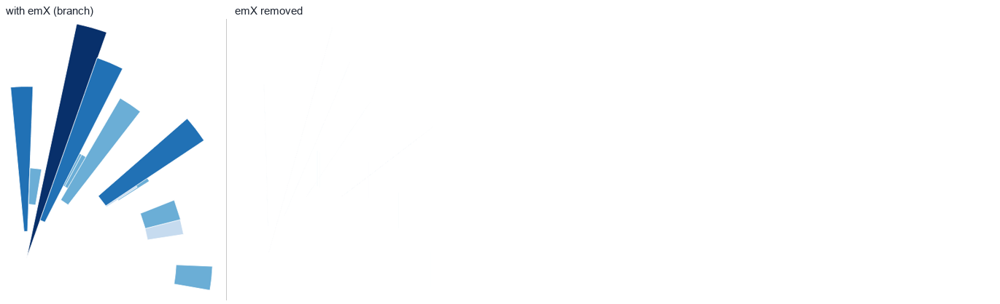

_Tornado tree._

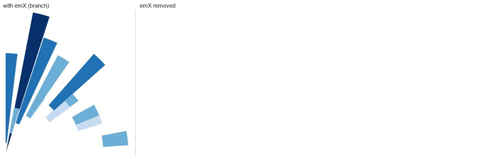

_Tornado tree 2._

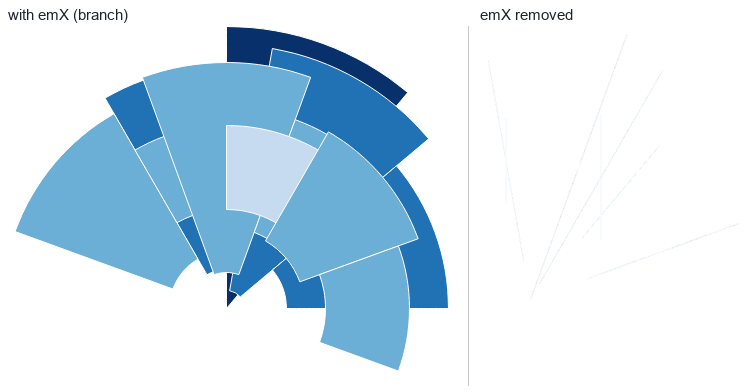

_Violin tree._

Rewriting the tornado with box gaps fixes both edges. It ran, and it does embed the nodes as wedges, but the picture is not the same. The fan spreads wider. So the rewrite below is a sketch of the direction, not a replacement yet.


_The rewrite, run in a throwaway copy. Not identical to the branch._

**Sketch**

```ts
// Run in a throwaway copy of the branch, not proposed: no emX, and box
// gaps (pitch less the 0.13 rad node width) instead of the two pitches.
const node = (d: any) =>
  d.height === 0
    ? rect({ w: TH, h: 59, fill: byDepth()(d) /* ... */ })
    : rect({ w: TH, fill: byDepth()(d) /* ... */ });

mount({
  node,
  link: "none",
  parentChild: combine({
    x: { kind: "distribute", spacing: Spacing.box(0.42) },
    y: { kind: "nest", pad: 44 },
  }),
  sibling: combine({
    x: { kind: "distribute", spacing: Spacing.box(0.29) },
    y: { kind: "distribute", spacing: Spacing.pitch(44, { at: "middle" }) },
  }),
  coord: Coord.clock(),
});
```

#### (ii) Wedges placed by hand with literal numbers

The multilevel silhouette tree and the outside-in tree compute angles in story code and write them as literal `x` and `w`. The balloon chart's strings are literal heights in a wavy space. No relation places these marks, so nothing embeds them.

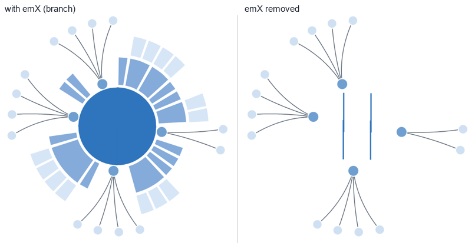

_Multilevel silhouette tree. Without the flag the wedges and the disc become lines._

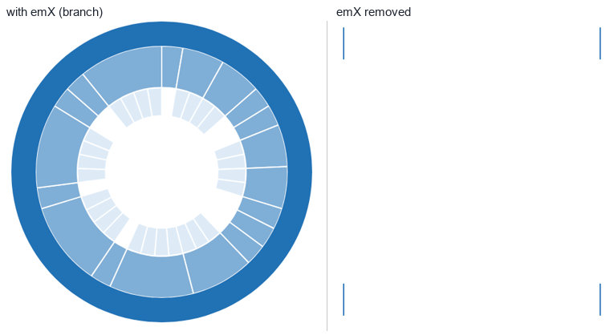

_Outside-in tree. Without the flag it is four tick lines._

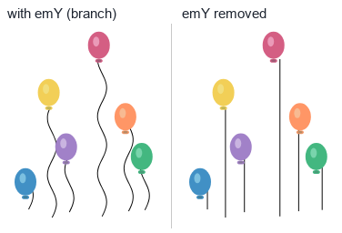

_Balloon chart. Without **emY** the strings are straight._

```ts
// GoTree / Gallery / MultilevelSilhouetteTree (OutsideInTree is alike):
// angles and radii computed in story code and written as literal x, w,
// y and h. No relation places the wedge.
const wedgeMark = (
  w: Wedge,
  rInner: number,
  rOuter: number,
  strokeWidth: number
) =>
  rect({
    x: w.theta0,
    w: w.theta1 - w.theta0,
    y: rInner,
    h: rOuter - rInner,
    emX: true,
    fill: w.fill,
    stroke: w.stroke,
    strokeWidth,
  });
```

**The balloon's string**

```ts
// Low Level Syntax / Balloon Chart: each string is a rect in a wavy
// space, inside a layer placed at the data's x. No relation fixes its
// height.
layer(
  { coord: Coord.wavy(), x: 0, y: 0 },
  scatterData.map((data, i) =>
    layer({ x: data.x }, [
      rect({ x: 0, y: 0, w: 1, h: data.y, emY: true, fill: color.black }),
      Balloon({ scale: 1, x: 0, y: data.y /* ... */ }),
    ])
  )
);
```

> **Fork: a literal written in the space.** (a) A literal `x` or `w` on a mark with no relation counts as a quantity of the space, so these stories embed with no flag. (b) The story writes its literals as data with `datum(...)`, so they embed through the data scale. (c) Keep an override, which is today's flag. This one is the maintainer's call, and there is no recommendation.

```ts
// Option (b) for this group, a sketch, not run: the literal angles as
// data values, so a data width embeds by the data size, with no flag.
rect({
  x: datum(w.theta0),
  w: datum(w.theta1 - w.theta0),
  y: rInner,
  h: rOuter - rInner,
  fill: w.fill,
});
```

#### (iii) The node-link sunburst, placed by a center align

The GoTree node-link sunburst aligns each parent to its children at their middle. That pins one point, so without the flag only the leaf ring keeps its shape. Aligning at start and end instead fixes both edges. That rewrite ran, and its normalized DOM is byte-identical to the branch's render.

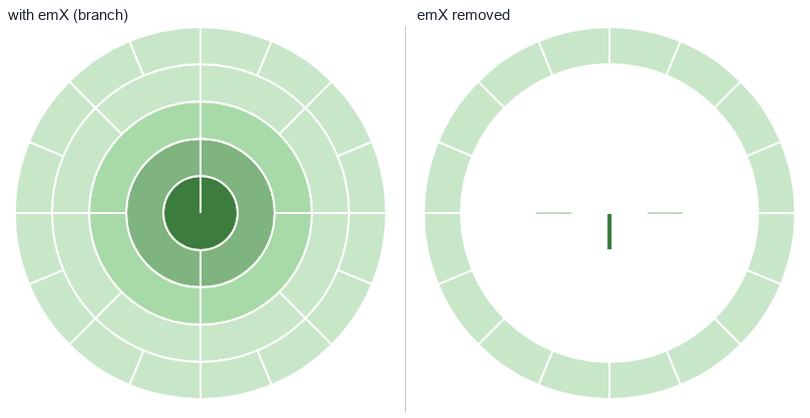

_The flag kept, then removed._

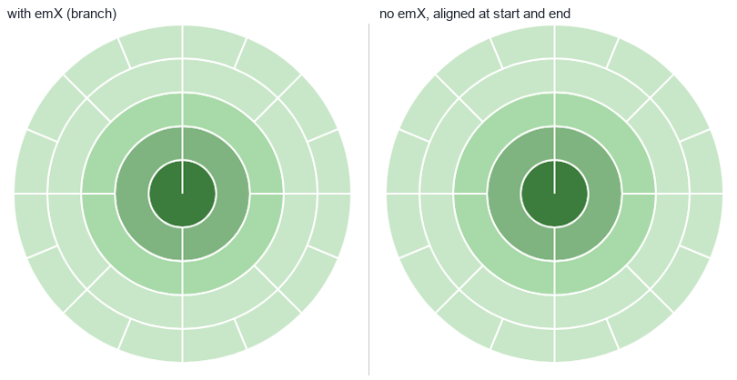

_The flag kept, then removed with the parent aligned at both edges. Identical._

**Code today**

```ts
// GoTree / Node-Link / Sunburst, as on the branch
const sunburstNode = (d: any) =>
  rect({
    w: d.width * leafTheta,
    h: bandHeight,
    emX: true,
    fill: polarGreens[Math.min(d.depth, polarGreens.length - 1)],
    stroke: "white",
    strokeWidth: 2,
  });

tree(
  {
    node: sunburstNode,
    link: "none",
    parentChild: distribute({ dir: "y", spacing: 0, alignment: "middle" }),
    sibling: distribute({ dir: "x", spacing: 0, alignment: "middle" }),
    coord: Coord.clock(),
  },
  deepBalancedTree
);
```

**Rewrite, run**

```ts
// Run in a throwaway copy of the branch: no emX on sunburstNode, and the
// parent aligned to its children's group at both edges instead of the
// middle. The normalized DOM is byte-identical to the branch's render.
const parentChild = (children: any[]) => {
  const named = children.map((c, i) => layer([c]).name(`pc-${i}`));
  const refs = (c: any) => named.map((_, i) => c[`pc-${i}`]);
  return layer(named).relate((c: any) => [
    Constraint.distribute({ dir: "y", spacing: 0 }, refs(c)),
    Constraint.align({ x: "start" }, refs(c)),
    Constraint.align({ x: "end" }, refs(c)),
  ]);
};
```

Recommended for (i) and (iii): rewrite each to relations that fix both edges, story by story. That is now done. The tornado and violin trees were rewritten from their GoTree specs, with the axis swap and weights in place of pitches, and the node-link sunburst gives its wedges weights.

`emX` and `emY` cannot be deleted from the API yet, since the multilevel silhouette tree and the outside-in tree still use them. The `embed()` that `connect` uses inside the library stays either way.

#### 4\. Two workarounds in the radar (today)

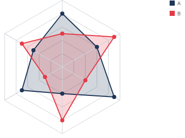

_RadarTwoSeries._

```ts
// Proposals / Radar Outline / RadarTwoSeries
layer({ w: 320, h: 320 }, [
  layer({ coord: Coord.clock() }, [
    chart(spokes)
      .flow(scatter({ by: "metric", x: "metric" }))
      .mark(rect({ w: 0, h: "max", stroke: GRID, strokeWidth: 1 })),
    chart(levels)
      .flow(
        group({ by: "level" }),
        scatter({ by: "metric", x: "metric", y: "level" })
      )
      .mark(circle({ r: 0 }).name("grid")),
    chart(both, { color: Color.palette([INK, RED]) })
      .flow(
        group({ by: "series" }),
        scatter({ by: "metric", x: "metric", y: "value" })
      )
      .mark(circle({ r: 4, fill: "series" }).name("pts")),
  ]),
  chart(selectAll("grid"))
    .flow(group({ by: "level" }))
    .mark(polygon({ fill: "none", stroke: GRID, strokeWidth: 1 })),
  chart(selectAll("pts"))
    .flow(group({ by: "series" }))
    .mark(polygon({ fill: "series", opacity: 0.2 })),
  chart(selectAll("pts"))
    .flow(group({ by: "series" }))
    .mark(polygon({ fill: "none", stroke: "series", strokeWidth: 2 })),
]).render(container);
```

#### (i) The spokes claim radius 0

The spokes are bars from 0 to 10, and they are the only thing that puts 0 in the radial domain. Without them the radius starts at the data's least value, 3, and every point moves.


_With the spokes, then the same chart with the spokes' chart removed._

```ts
// Proposals / Review Examples / RadarNoSpokes: the left picture is
// RadarWithSpokes, the radar above less its grid. The right one drops the
// spokes' chart from the polar layer, and nothing else.
layer({ coord: Coord.clock() }, [
  chart(both, { color: Color.palette([INK, RED]) })
    .flow(
      group({ by: "series" }),
      scatter({ by: "metric", x: "metric", y: "value" })
    )
    .mark(circle({ r: 4, fill: "series" }).name("pts")),
]);
```

Three ways to say it directly. A trait on the data column that says its values start at zero (\#1195, the issue about declaring traits on data columns). An explicit domain on the radial axis. Or reading the value as a size channel, which starts at zero by its meaning. The cleanest is the trait on the column, because the zero is a fact about the data and every chart of that column then agrees.

#### (ii) Opacity reaches the stroke

`opacity` applies to the whole mark, so one polygon with a faint fill also has a faint outline. The radar draws two polygons per series to get a faint fill and a solid stroke.


_Two polygons per series, then one._

```ts
// Proposals / Review Examples / RadarOnePolygon: one polygon per series
// in place of the two
chart(selectAll("pts"))
  .flow(group({ by: "series" }))
  .mark(
    polygon({ fill: "series", stroke: "series", strokeWidth: 2, opacity: 0.2 })
  );
```

The options are a `fillOpacity` on `polygon`, or a fill color with its own alpha. The cleanest is `fillOpacity`. `circle` and `ellipse` already take it, as the opacity of the fill alone, so the polygon would only gain an option its siblings have, and the color scale is left alone.

### Decided and built

#### The mean of positions (decided)

`mean([...])` is a position that a relation can use, the average of the marks it lists. A parent at the mean of its children is one align.


_Dendrogram. Each inner node at the mean of its children._


_Tidy tree. Each node at the mean of its first and last child._

```ts
// Proposals / Minimum Gap / Dendrogram
layer([
  spread(
    { dir: "x", spacing: Spacing.pitch(DX, { at: "middle" }) },
    leaves.map((n) => dot(n.path, "#457b9d"))
  ).name("leaves"),
  ...inner.map((n) => dot(n.path, "#1d3557")),
]).relate((c) => [
  ...inner.map((n) =>
    Constraint.align({ x: "middle" }, [
      c[n.path],
      mean(n.t.children!.map((_, i) => c[`${n.path}.${i}`])),
    ])
  ),
  ...ns
    .filter((n) => n.parent)
    .map((n) =>
      Constraint.distribute(
        {
          dir: "y",
          spacing: Spacing.atLeast(DY - 2 * R, { slack: Slack.end() }),
        },
        [c[n.parent!], c[n.path]]
      )
    ),
  ...treeLinks(ns),
]);
```

**Tidy tree**

```ts
// Proposals / Minimum Gap / TidyTree: a subtree's node at the mean of its
// first and last child.
Constraint.align({ x: "middle" }, [
  c[path],
  mean([c[kids[0]], c[kids[kids.length - 1]]]),
]);
```

#### Slack is an option of the minimum gap (decided)

The slack rule is written where the minimum gap is, as `Spacing.atLeast(8, { slack: Slack.center() })`. Distributes whose gaps are linked share one room, so they share one rule. When none states one, the rule is `Slack.start()`.


_Start, center and end. The red box q sits in the room that its minimum gaps leave between p and r._


**\*Slack.at(0.25)**.\*


_The two ends pinned 160 px apart, and the middle box placed by the rule._

```ts
// Proposals / Minimum Gap / RowAll: rowOfRects under start, center, end
const rowOfRects = (slack: Slack.Slack) =>
  layer([A, B, C, D, p, q, r]).relate((c) => [
    Constraint.distribute({ dir: "x", spacing: 2 }, [c.A, c.B]),
    Constraint.distribute({ dir: "x", spacing: 2 }, [c.C, c.D]),
    Constraint.distribute({ dir: "x", spacing: Spacing.atLeast(16) }, [
      c.B,
      c.C,
    ]),
    Constraint.align({ x: "start" }, [c.A, c.p]),
    Constraint.align({ x: "end" }, [c.D, c.r]),
    Constraint.distribute(
      { dir: "x", spacing: Spacing.atLeast(8, { slack }) },
      [c.p, c.q, c.r]
    ),
    Constraint.align({ y: "start" }, [c.A, c.B, c.C, c.D]),
    Constraint.align({ y: "start" }, [c.p, c.q, c.r]),
    Constraint.distribute({ dir: "y", spacing: 12 }, [c.A, c.p]),
  ]);

spread(
  { dir: "y", spacing: 24, alignment: "start" },
  [Slack.start(), Slack.center(), Slack.end()].map(rowOfRects)
);
rowOfRects(Slack.at(0.25)); // RowQuarter
```

**RowPinned**

```ts
// Proposals / Minimum Gap / RowPinned
const pinnedRow = (slack: Slack.Slack) =>
  layer([p, q, r]).relate((c) => [
    Constraint.distribute({ dir: "x", spacing: 160 }, [c.p, c.r]),
    Constraint.distribute(
      { dir: "x", spacing: Spacing.atLeast(8, { slack }) },
      [c.p, c.q, c.r]
    ),
    Constraint.align({ y: "start" }, [c.p, c.q, c.r]),
  ]);
```

Two linked distributes that state different rules are an error.

```text
Two linked distributes that state different slack rules (from the
minimumGap test, run on the branch):

[gofish] Minimum gaps on x: distribute[0] states
Spacing.atLeast(…, { slack: Slack.at(1) }) but distribute[1] states
Spacing.atLeast(…, { slack: Slack.at(0.5) }), and their gaps are linked
(through {node-21}), so they share one room. State the slack on one of
them, or the same slack on both.
```

#### Room at the two ends of a spread (decided)

`Spacing.box(gap, { ends })`, and the same option on `pitch` and `atLeast`, sets the room before the first part and after the last as a multiple of the gap. A stated `ends` always wins. On a glued axis the default is half a gap at each end, which is open question 2 above, and on a line it is 0.

| `ends`   | Room at each end                      | CSS `justify-content` |
| -------- | ------------------------------------- | --------------------- |
| `0`      | None                                  | `space-between`       |
| `0.5`    | Half a gap                            | `space-around`        |
| `1`      | A whole gap                           | `space-evenly`        |
| `[s, e]` | `s` gaps at the start, `e` at the end | None                  |


**\*ends: 0** on a full turn. The first and last slices touch.\*


_A half turn is not glued, so the default is 0._


_The half turn with **ends: 0.5**._


_Nested spreads. Only the outer one fills the turn._


_Rings. Each ring's spread fills its own turn._


**\*ends: 2** in a 360 px layer.\*

```ts
// Proposals / End Spacing: PieSeam, HalfTurn, HalfTurnAround
pie(Coord.clock(), Spacing.box(PAD, { ends: 0 }));
pie(Coord.clock({ centralAngle: Math.PI }), PAD);
pie(Coord.clock({ centralAngle: Math.PI }), Spacing.box(PAD, { ends: 0.5 }));
// where
const pie = (coord: any, spacing: any) =>
  chart(browsers, { coord, w: 360, h: 320 })
    .flow(spread({ by: "name", dir: "x", spacing }))
    .mark(rect({ w: "value", fill: "name" }));
```

**Nested, rings and fixed width**

```ts
// Proposals / End Spacing / Nested and Rings
chart(sales, { coord: Coord.clock(), w: 360, h: 320 })
  .flow(
    spread({ by: "quarter", dir: "x", spacing: 0.12 }),
    spread({ by: "product", dir: "x", spacing: 0.03 })
  )
  .mark(rect({ w: "value", fill: "quarter" }));

chart(sales, { coord: Coord.clock({ innerRadius: 0.3 }), w: 360, h: 320 })
  .flow(
    spread({ by: "quarter", dir: "y", spacing: 4 }),
    spread({ by: "product", dir: "x", spacing: 0.08 })
  )
  .mark(rect({ w: "value", fill: "product" }));
```

```ts
// Proposals / End Spacing / FixedWidthLayer
layer([
  rect({ x: 0, y: 0, w: 360, h: 60, fill: "#eeeeee" }),
  spread(
    {
      dir: "x",
      spacing: Spacing.box(12, { ends: 2 }),
      w: 360,
      x: 0,
      y: 10,
    },
    [1, 2, 1].map((k) => rect({ w: fr(k), h: 40, fill: "#f28e2b" }))
  ),
]);
```

The earlier `closed` option on the coordinate space was dropped, since `ends` covers every case it served. The earlier candidates for this card, a switch between two defaults and a `closed` flag, are kept only in the history of the page.

#### Embedding from relations that fix both edges (decided)

The rule is the one in open question 3. A mark embedded on one axis only is drawn as a filled band, not a stroked line. These pairs show the change in the commit that made the rule.


_Chord arcs. The notches at the sub-arc joins are gone._


_Bars with pixel widths in a spread. Box spacing fixes both edges, so they are now wedges._


_A lone bar with a pixel width. No relation, so it stays ink. Same picture._


_GoTree sunburst with its **emY** flag, then with the flag dropped. Both are rendered with the branch's code today. Same picture._

#### Every story the branch changed, main beside branch

Sixteen stories changed from embedding alone. The expected kinds of change are an arc that now ends on the mark's edges, a stroke that is now an outline, a flag dropped with the same picture, or a root node that now shows where main drew nothing. Captions marked **Flag** show something else.

Seven stories below now show a root node that main did not draw. In each one the spec gives the root a size and a fill. In six of them the GoTree reference image also shows a root, and for the node-link sunburst no reference was checked. Main hid the root because a ring that spans the full circle collapsed to a point. On the branch a mark that spans a full turn has no seam, so no white line runs from the center to 12 o'clock.


_Nested pie tree. Same picture._


_Clock tree with link. Same picture._


_Multilevel silhouette tree. Same picture as main._


_Outside-in tree. Same picture._


_Violin tree. Same picture. Since rewritten; see the GoTree cards above._


_Balloon chart. Same picture._


_Hierarchical sector chart. The root now shows as a red-orange disc at the center, as in the GoTree reference image._


_Icicle plot in polar. The root now shows as a disc at the center. Its reference is a cartesian icicle, whose top band is the root. The rings around the root sit at uneven radii, as they do on main. Since rewritten as the cartesian icicle of its reference; see the GoTree cards above._


_Sector tree 2. The root now shows as a dark disc at the center. The reference's root is the left half-disc; the GoTree cards above show the story rewritten to match._


_GoTree sunburst. The root now shows as a dark disc at the center, as in the GoTree reference image._


_Node-link sunburst. The root now shows as a disc at the center. The spec declares the root the same way as the other sunbursts. No reference image was checked._


_Sector tree. The root now shows as an 8 px circle at the center. The GoTree reference draws the root as the outer circle, because its rings run the other way. The GoTree cards above show the story rewritten to match._


**\*Flag.** Tyre tree. The root now shows as the dark outer rim, as in the GoTree reference image. The layout did not change, and every ring has the same radii on main and on the branch. The two sides are scaled to the same height, so the rings look smaller on the branch. The picture is clipped by 15 px on the right and the bottom, and it was clipped on main too, with the same warning that it draws past the canvas. The story's four bands are sized by hand in pixels and need 224 px of radial room, and the canvas gives 187.5 px. That was a problem in the story's spec. It is fixed in the GoTree cards above.\*


**\*Flag.** A spread in a wavy space. The bars now bend on both axes, and their outlines follow the wave.\*


_Tornado tree. Turned by the end spacing default, open question 2. Since rewritten; see the GoTree cards above._


_Tornado tree 2. Turned by the end spacing default, open question 2. Since rewritten; see the GoTree cards above._

#### `Coord.clock` is a preset of `Coord.polar` (decided)

`Coord.clock()` is `Coord.polar` with 0 at 12 o'clock and turning clockwise. It is sent over the wire as polar, and it takes only the options it does not fix. Any other start is written on `Coord.polar`.


**\*Coord.polar()**. 0 at 3 o'clock, counterclockwise.\*


**\*Coord.clock()**. 0 at 12 o'clock, clockwise.\*


**\*Coord.polar({ baselineAngle: 0, direction: -1 })**. 0 at 3 o'clock, clockwise.\*

```ts
// Proposals / Review Examples / PiePolar, PieClock, PiePolarClockwise
const pie = (coord: any) =>
  chart(slices, { coord, w: 200, h: 200, color: palette })
    .flow(spread({ by: "name", dir: "x", spacing: 0.06 }))
    .mark(rect({ w: "value", fill: "name" }));

pie(Coord.polar()); // 0 at 3 o'clock, counter-clockwise
pie(Coord.clock()); // 0 at 12 o'clock, clockwise
pie(Coord.polar({ baselineAngle: 0, direction: -1 })); // 3 o'clock, clockwise
```

```text
Coord.clock({ baselineAngle: 0 })

[gofish] Coord.clock({ baselineAngle }): Coord.clock is Coord.polar with
baselineAngle 1.5707963267948966 and direction -1, and takes only the
options it does not fix. For another baselineAngle, write the kind:
Coord.polar({ baselineAngle: 0, direction: -1 }).

On the wire, Coord.clock() is
{"type":"polar","baselineAngle":1.5707963267948966,"direction":-1}
```

#### Presets take only the options they do not fix (decided)

| Preset             | Is the kind     | Fixes                                          | Still takes                               |
| ------------------ | --------------- | ---------------------------------------------- | ----------------------------------------- |
| `Overlap.sina()`   | `Overlap.noise` | `smoothing: "silverman"`                       | `randomness`, `padding`, `seed`           |
| `Overlap.jitter()` | `Overlap.noise` | `randomness: "uniform"`, `smoothing: Infinity` | `padding`, `seed`                         |
| `Shape.hull()`     | `Shape.blob`    | `convexity: 1`, `neck: 1`                      | `connection`, `holes`, `separate`         |
| `Shape.spine()`    | `Shape.blob`    | `convexity: 0`                                 | `connection`, `neck`, `holes`, `separate` |
| `Slack.start()`    | `Slack.at`      | `t: 0`                                         | nothing                                   |
| `Slack.center()`   | `Slack.at`      | `t: 0.5`                                       | nothing                                   |
| `Slack.end()`      | `Slack.at`      | `t: 1`                                         | nothing                                   |
| `Coord.clock()`    | `Coord.polar`   | `baselineAngle: Math.PI / 2`, `direction: -1`  | `innerRadius`, `centralAngle`, `center`   |

Passing a fixed option is a type error in TypeScript and an error at the call in both languages. The message names the kind to write instead.

```text
Shape.hull({ convexity: 0.5 })

[gofish] Shape.hull({ convexity }): Shape.hull is Shape.blob with
convexity 1 and neck 1, and takes only the options it does not fix. For
another convexity, write the kind: Shape.blob({ convexity: 0.5, neck: 1 }).
```

#### Refs across a coordinate space, and a polygon over marks (decided)

A mark outside a polar layer can refer to marks inside it, and it reads them where the space draws them. A `polygon` or `line` over a selection runs through those points.


_A line outside the space, through the points inside it._


_The line inside the space, so it bends with the angle._

```ts
// Proposals / Radar Outline / OutsideOpen: a line outside the space,
// through the points where the space draws them
layer({ w: 320, h: 320 }, [
  layer({ coord: Coord.clock() }, [
    chart(rows)
      .flow(scatter({ by: "metric", x: "metric", y: "value" }))
      .mark(circle({ r: 4, fill: INK }).name("pts")),
  ]),
  chart(selectAll("pts")).mark(
    line({ stroke: RED, strokeWidth: 2, curve: Curve.linear() })
  ),
]);
```

**Inside the space**

```ts
// Proposals / Radar Outline / InsideCoord: the line inside the space
chart(rows, { coord: Coord.clock(), w: 320, h: 320 })
  .flow(scatter({ by: "metric", x: "metric", y: "value" }))
  .mark(circle({ r: 4, fill: INK }))
  .layer(line({ stroke: INK, strokeWidth: 2 }));
```

#### Two fixes in placement (decided)

- The Bluefish baking recipes story broke when minimum gaps landed. An align by span only reads its source, so a source nested in a child no longer counts as moving that child, and the story draws again.
- Minimum gaps that leave a rigid group and come back to another member of it were reported as a cycle. They now solve, and too little room is its own error that says how many pixels are missing. RowPinned below is that case.


_RowPinned. The ends are one rigid group, 160 px apart, and the middle box's minimum gaps leave it and come back._

## Layout protocol prototype

### What this is

The maintainer set the goal in two sentences. "I think we can treat constraints as the lowest level of layout (and position is a kind of "escape-hatch" constraint) and then we can think of the layout/measure API as being a form of "macro expansion" that bottoms out at the constraints." And: "we should be able to write _everything_ including our stdlib against it". This tab shows a prototype of that frame. A layout operator is defined with one public call, `defineLayout`, whose body returns constraints among the operator's children, so each use of the operator expands into constraints that its layer's solver reads, and `Constraint.position` stays the escape hatch that pins a child by hand. The prototype lives in a throwaway copy of the repository at commit fac08ebd7, not on this branch. In that copy the built-in `spread`, `stack` and `tile` are rebuilt on the public call, all 751 existing stories render the same normalized DOM as at fac08ebd7, and the unit tests pass.

The full 751-story comparison ran before the renames on this tab. After them, the prototype's own stories were rendered again and their normalized DOM is byte-identical to before, the type check is clean, and the unit tests pass. Every picture on this tab is a render of the code under it, made in the copy today.

#### Words used on this tab

- **Operator.** A function that takes children and arranges them, e.g., `spread` or `tile`.
- **Constraint.** A fact about the children's positions that the solver keeps, e.g., `Constraint.align` (these line up at their start) or `Constraint.distribute` (these follow one another with a gap). `Constraint.position` pins a child at a point or between two edges, and it is the escape hatch.
- **Expansion.** The constraints an operator's body returns for its actual children.
- **Bounds.** The rectangle, in pixels, that a parent gives a child to lay itself out in. SwiftUI uses the same word for the argument of `placeSubviews(in:)`. A child's bounds are a box `{ x, y, w, h }` or a **polygon** `{ points }`, the same shape the `polygon` mark takes.
- **Scale, written σ.** Pixels per data unit. The solver picks σ so that the visualization fits the size it is given.
- **Scope.** A group of nodes that share one scale.
- **Glue.** What `stack` does and `spread` does not. Glued children add up into one data space, so the stack's length is the sum of theirs, with no gap.
- **Size request.** What a node asks its parent for on each axis, as a function of σ. A bar 3 data units wide asks for 3σ pixels.
- **Length.** A size that may depend on σ, e.g., 9σ + 6, written before σ is known.
- **Claim walk.** The pass that works out each node's size request. The word appears in the prototype's doc comments.

The prototype first called the bounds a "room" and a polygon a "ring", and both words were replaced because neither has precedent outside GoFish. Issue \#1410 checks every layout engine term against what other layout systems call it and proposes renames, and "bounds" is its first row.

### Defining and using a custom layout

Each card shows the picture, the definition in full, the use, what the use expands into for its actual children, and the numbers that show it works. The code is copied from the copy's stories file, `LayoutProtocol.stories.tsx` in `stories/_proposals`. A definition has one of two bodies. `relate` returns constraints. `arrange` returns each child's bounds once the operator's own bounds are known. The section on the definition call below says why there are two.

#### A row pitched by its widest child (prototype)

Each child starts the same distance after the one before it. That distance, the pitch, is the widest child's width plus a gap. The top row is eight words and the bottom row is eight 6 px squares, each a `pitched` row.


_Story **PitchedLabels**. The words start every 56.6035 px and the squares every 14 px._

**Definition**

```ts
// Every child starts the same distance after the one before it: the widest
// child's width plus `gap`. The distance is a length read off the children,
// so the row's size request is derived by the solver, in the scale.
const pitched = defineLayout<{ gap?: number }>({
  name: "pitched",
  options: ["gap"],
  relate: (children, { gap = 8 }, { measure }) => {
    const pitch = maxLength(...children.map((c) => measure(c).w)).add(gap);
    return {
      relations: [
        Constraint.align({ y: "start" }, children),
        Constraint.distribute(
          { dir: "x", spacing: Spacing.pitch(pitch, { at: "start" }) },
          children
        ),
      ],
      orientation: 0,
    };
  },
});
```

The body reads each child's width as a length with `measure(c).w`, takes the largest with `maxLength`, adds the gap, and hands the result to `Spacing.pitch`. It returns two constraints and never sees a pixel.

`measure(child)` is the prototype's spelling, and the name is open, because "measure" already means a unit of measure in GoFish. The design note suggests `size(child)`.

**Use**

```ts
const words = ["a", "row", "of", "labels", "pitched", "by", "the", "widest"];

const container = initializeContainer();
layer([
  spread({ dir: "y", spacing: 6, alignment: "start" }, [
    pitched(
      { gap: 8 },
      words.map((t) => text({ text: t, fontSize: 14 }))
    ),
    pitched(
      { gap: 8 },
      words.map(() => rect({ w: 6, h: 6, fill: "#4190c5" }))
    ),
  ]),
]).render(container, { axes: false });
```

**What it expands into**

```js
// texts: the eight texts "a", "row", "of", "labels", "pitched", "by", "the"
// and "widest". A text's width does not change with the scale.
Constraint.align({ y: "start" }, texts);
Constraint.distribute(
  { dir: "x", spacing: Spacing.pitch(pitch, { at: "start" }) },
  texts
);
// pitch = the widest word's width + 8 = 48.6035 + 8 = 56.6035 px
// The second row's children are 6 px squares: pitch = 6 + 8 = 14 px.
```

The words start at x = 0, 56.6035, 113.207 and so on. The pitch is the widest word's width, 48.6035, plus the gap of 8. The squares start at x = 0, 14, 28 and so on.

#### The same row over data widths, fit to 400 px (prototype)

Here the children are bars whose widths are data. A bar's width in pixels depends on σ, so the pitch does too, and the solver must find σ with the pitch inside the row's size request. This is why `measure` returns a length and not a number of pixels.


_Story **PitchedBarsFit**. The last bar ends at 400.0000 px._

**Definition**

The same `pitched` as in the card above.

**Use**

```ts
const widths = [3, 1, 4, 1, 5, 9, 2, 6];

const container = initializeContainer();
countRuns(
  container,
  layer({ w: 400, h: 120 }, [
    pitched(
      { gap: 6 },
      widths.map((w) => rect({ w: v(w), h: 100, fill: "#f2cf57" }))
    ),
  ]).render(container, { axes: false })
);
```

**What it expands into**

```js
// bars: eight rects 100 px tall whose widths are data, 3, 1, 4, 1, 5, 9, 2
// and 6. σ is the scale, in pixels per data unit.
Constraint.align({ y: "start" }, bars);
Constraint.distribute(
  { dir: "x", spacing: Spacing.pitch(pitch, { at: "start" }) },
  bars
);
// pitch = max(3σ, 1σ, 4σ, 1σ, 5σ, 9σ, 2σ, 6σ) + 6 = 9σ + 6
// width of the row = 7 pitches + the last bar = 7(9σ + 6) + 6σ = 69σ + 42
// The layer is 400 px wide: 69σ + 42 = 400, so σ = 358 / 69 = 5.1884.
```

- The solver finds σ = 5.1884 for 400 px.
- The first bar is 15.5652 px wide, which is 3σ, and the bars start every 52.6957 px, which is 9σ + 6.
- The last bar starts at 368.8696 and is 31.1304 px wide, which is 6σ, so it ends at 400.0000.
- The render ran the layout pipeline once. The story counts the runs and prints the count under the picture.

#### A squarified treemap that reads its bounds (prototype)

The squarify rule needs the treemap's own width and height, in pixels, to decide where each row of cells ends. So this definition uses the second body, `arrange`, which runs once the treemap's bounds are known and returns each child's bounds. The built-in beside it is `tile` with `Tiling.squarify`.


_Story **UserSquarify**, the user's **squarified**._


_Story **BuiltinSquarify**, the built-in **tile**._

**Definition**

```ts
const box = ([x0, y0, x1, y1]: Rect) => ({
  x: x0,
  y: y0,
  w: x1 - x0,
  h: y1 - y0,
});

// The whole layout definition: no size request (it fills its bounds), and
// once its bounds are known, each child's bounds.
const squarified = defineLayout<{ weights: number[] }>({
  name: "squarified",
  options: ["weights"],
  arrange: ({ w, h }, _children, { weights }) => ({
    bounds: squarify(weights, [w, h]).map(box),
  }),
});
```

**The `squarify` helper, 58 lines of plain TypeScript with no GoFish imports**

```ts
type Rect = [number, number, number, number]; // x0, y0, x1, y1
const PHI = (1 + Math.sqrt(5)) / 2;

// The squarify rule (Bruls et al. 2000) as d3's `squarifyRatio` runs it:
// add items to a row while its worst aspect ratio does not get worse, lay
// the row along the box's shorter side, and go on in what is left.
function squarify(weights: number[], [w, h]: [number, number]): Rect[] {
  const out: Rect[] = [];
  let [x0, y0, x1, y1] = [0, 0, w, h];
  let value = sum(weights);
  let i0 = 0;
  while (i0 < weights.length) {
    const dx = x1 - x0;
    const dy = y1 - y0;
    let i1 = i0;
    let rowSum = weights[i1++];
    let lo = rowSum;
    let hi = rowSum;
    const alpha = Math.max(dy / dx, dx / dy) / (value * PHI);
    let beta = rowSum * rowSum * alpha;
    let best = Math.max(hi / beta, beta / lo);
    for (; i1 < weights.length; i1++) {
      const wv = weights[i1];
      const s = rowSum + wv;
      beta = s * s * alpha;
      const ratio = Math.max(Math.max(hi, wv) / beta, beta / Math.min(lo, wv));
      if (ratio > best) break;
      rowSum = s;
      lo = Math.min(lo, wv);
      hi = Math.max(hi, wv);
      best = ratio;
    }
    if (dx < dy) {
      // A row along x at the top.
      const ry1 = value ? y0 + (dy * rowSum) / value : y1;
      let x = x0;
      for (let i = i0; i < i1; i++) {
        const nx = x + (weights[i] * dx) / rowSum;
        out[i] = [x, y0, nx, ry1];
        x = nx;
      }
      y0 = ry1;
    } else {
      // A column along y at the left.
      const rx1 = value ? x0 + (dx * rowSum) / value : x1;
      let y = y0;
      for (let i = i0; i < i1; i++) {
        const ny = y + (weights[i] * dy) / rowSum;
        out[i] = [x0, y, rx1, ny];
        y = ny;
      }
      x0 = rx1;
    }
    value -= rowSum;
    i0 = i1;
  }
  return out;
}
```

`squarify` is the squarify rule as d3's `squarifyRatio` runs it, with the golden ratio, written from scratch. It returns one rectangle `[x0, y0, x1, y1]` per weight, and `box` turns each into a box.

**Use**

```ts
const cell = (d: Country) =>
  rect({ fill: v(d.continent), stroke: "white", strokeWidth: 1 });

const userTreemap = (rows: Country[]) =>
  squarified({ weights: rows.map((d) => d.pop) }, rows.map(cell));

const builtinTreemap = (rows: Country[]) =>
  tile(
    { size: rows.map((d) => v(d.pop)), tiling: Tiling.squarify, round: false },
    rows.map(cell)
  );

// How many times the render ran the layout pipeline (a prototype counter
// in gofish.tsx), written under the picture.
const countRuns = (container: HTMLElement, rendered: Promise<unknown>) => {
  const g = globalThis as { __gofishLayoutRuns?: number };
  g.__gofishLayoutRuns = 0;
  rendered.then(() => {
    const p = document.createElement("pre");
    p.textContent = `pipeline runs: ${g.__gofishLayoutRuns}`;
    container.appendChild(p);
  });
};

const alone = (node: () => any) => () => {
  const container = initializeContainer();
  countRuns(
    container,
    layer({ w: 360, h: 300 }, [node()]).render(container, { axes: false })
  );
  return container;
};

export const UserSquarify: StoryObj = {
  render: alone(() => userTreemap(countries)),
};
export const BuiltinSquarify: StoryObj = {
  render: alone(() => builtinTreemap(countries)),
};
```

**What it returns**

```js
// The body runs once, with bounds { w: 360, h: 300 }, and returns one box
// per child, in child order (the 20 largest countries, largest first).
[
  { x: 0, y: 0, w: 182.9656, h: 150.9514 }, // India
  { x: 0, y: 150.9514, w: 182.9656, h: 149.0486 }, // China
  { x: 182.9656, y: 0, w: 69.6086, h: 93.0808 }, // United States
  { x: 252.5742, y: 0, w: 57.557, h: 93.0808 }, // Indonesia
  // ... 16 more
];
```

This body returns bounds, not constraints, so its use does not yet expand into constraints. The card "The second body is not constraints yet" below says why, and shows the treemap written with a constraint instead.

- The normalized DOM of the two stories is byte for byte identical.
- The drawn rectangles are the boxes above moved half a pixel right and down, e.g., India's is at x = 0.5, y = 0.5 with width 182.9656. The built-in draws the same numbers, so the user layout adds no shift of its own.
- Neither story writes a layout warning.
- Each render ran the layout pipeline once.

#### The treemap inside a larger visualization (prototype)

The same treemap under a title in a `spread`, with an arrow from the title to China's cell. The treemap's bounds are what the spread leaves it. The arrow reads the cell from outside the treemap, by name.


_Story **UserInSpread**, the user's **squarified**._


_Story **BuiltinInSpread**, the built-in **tile**._

```ts
const panelWithArrow = (treemap: (rows: Country[]) => any) => () => {
  const container = initializeContainer();
  const cells = countries.map((d) =>
    d.country === "China" ? cell(d).name("china") : cell(d)
  );
  const tm =
    treemap === userTreemap
      ? squarified({ weights: countries.map((d) => d.pop) }, cells)
      : tile(
          {
            size: countries.map((d) => v(d.pop)),
            tiling: Tiling.squarify,
            round: false,
          },
          cells
        );
  countRuns(
    container,
    layer({ w: 400, h: 320 }, [
      spread({ dir: "y", spacing: 24, alignment: "start" }, [
        text({ text: "China", fontSize: 13 }).name("title"),
        tm,
      ]),
    ])
      .relate(() => [arrow({}, [ref("title"), ref("china")])])
      .render(container, { axes: false })
  );
  return container;
};

export const UserInSpread: StoryObj = { render: panelWithArrow(userTreemap) };
export const BuiltinInSpread: StoryObj = {
  render: panelWithArrow(builtinTreemap),
};
```

The normalized DOM of the two stories is identical, and each render ran the layout pipeline once. China's cell is the large one at the lower left. The arrow ends a little above that cell's top edge, at the same point for both treemaps. Whether that gap is the arrow's intended padding was not checked.

The same treemap under `Coord.polar()`:


_Story **UserPolar**._


_Story **BuiltinPolar**._

```ts
const polar = (treemap: (rows: Country[]) => any) => () => {
  const container = initializeContainer();
  layer({ coord: Coord.polar(), w: 300, h: 300 }, [treemap(countries)]).render(
    container,
    { axes: false }
  );
  return container;
};
export const UserPolar: StoryObj = { render: polar(userTreemap) };
export const BuiltinPolar: StoryObj = { render: polar(builtinTreemap) };
```

The normalized DOM of the two stories is identical. An `arrange` body works in its own flat frame, and the coordinate space warps the result, as it does for the built-in.

#### A `spread` written by a user (prototype)

The built-in `spread` is nothing special. This `row` is a `relate` definition of 15 lines that aligns its children across `dir` and distributes them along it. `axes.axis(dir, ...)` turns an axis name into axis 0 or 1, so `dir: "theta"` works under a polar coordinate space.


_Story **UserRow**, the user's **row**._


_Story **BuiltinRow**, the built-in **spread**._


_Story **UserRowPolar**, **row** along theta._


_Story **BuiltinRowPolar**, **spread** along theta._

**Definition**

```ts
const row = defineLayout<{ dir?: string; spacing?: number }>({
  name: "row",
  options: ["dir", "spacing"],
  relate: (children, { dir = "x", spacing = 8 }, axes) => {
    const along = axes.axis(dir, "row({ dir })");
    const [alongName, acrossName] = along === 0 ? ["x", "y"] : ["y", "x"];
    return {
      relations: [
        Constraint.align({ [acrossName]: "start" }, children),
        Constraint.distribute({ dir: alongName, spacing }, children),
      ],
      orientation: along,
    };
  },
});
```

**Use**

```ts
const heights = [3, 1, 4, 1, 5, 9, 2, 6];
const bars = () =>
  heights.map((h) => rect({ w: 24, h: v(h), fill: "#4190c5" }));
const inBox = (node: () => any, coord?: any) => () => {
  const container = initializeContainer();
  layer(coord ? { coord, w: 240, h: 240 } : { w: 300, h: 160 }, [
    node(),
  ]).render(container, { axes: false });
  return container;
};

export const UserRow: StoryObj = {
  render: inBox(() => row({ spacing: 8 }, bars())),
};
export const BuiltinRow: StoryObj = {
  render: inBox(() =>
    spread({ dir: "x", spacing: 8, alignment: "start" }, bars())
  ),
};
// Under polar, along `theta`: equal data widths, so each bar is a wedge.
const wedges = () =>
  heights.map((h) =>
    rect({ w: v(1), h: v(h), fill: "#4190c5", stroke: "white" })
  );
export const UserRowPolar: StoryObj = {
  render: inBox(
    () => row({ dir: "theta", spacing: 0 }, wedges()),
    Coord.polar()
  ),
};
export const BuiltinRowPolar: StoryObj = {
  render: inBox(
    () => spread({ dir: "theta", spacing: 0, alignment: "start" }, wedges()),
    Coord.polar()
  ),
};
```

**What it expands into**

```js
// UserRow: dir "x" is axis 0, so the row aligns on y and distributes on x.
Constraint.align({ y: "start" }, bars);
Constraint.distribute({ dir: "x", spacing: 8 }, bars);

// UserRowPolar: under Coord.polar(), dir "theta" is axis 0 too, so the
// constraints name the same axes, and axis 0 is the angle.
Constraint.align({ y: "start" }, wedges);
Constraint.distribute({ dir: "x", spacing: 0 }, wedges);
```

The normalized DOM of **UserRow** and **BuiltinRow** is identical, and so is that of **UserRowPolar** and **BuiltinRowPolar**.

#### What a wrong definition does (prototype)

Three wrong definitions, each rendered. The prototype checks one mistake in each body and leaves others unchecked.

An `arrange` body that returns bounds for 19 of its 20 children:

```ts
// An `arrange` body that leaves out the first child's bounds.
const squarifiedMissingOne = defineLayout<{ weights: number[] }>({
  name: "squarified",
  options: ["weights"],
  arrange: ({ w, h }, _children, { weights }) => ({
    bounds: squarify(weights, [w, h]).map(box).slice(1),
  }),
});
export const ErrorBoundsCount: StoryObj = {
  render: failing(() =>
    squarifiedMissingOne(
      { weights: countries.map((d) => d.pop) },
      countries.map(cell)
    )
  ),
};
```

The render fails with this message:

```text
squarified: its arrangement gives bounds for 19 children, but it has 20. Give each child its bounds.
```

A `relate` body that asks for the pixels of a length the scale changes, here the width of a data bar:

```ts
// A `relate` body that asks for the pixels of a length the scale changes.
const pitchedInPixels = defineLayout<{ gap?: number }>({
  name: "pitched",
  options: ["gap"],
  relate: (children, { gap = 8 }, { measure }) => {
    const widest = Math.max(...children.map((c) => measure(c).w.pixels));
    return {
      relations: [
        Constraint.align({ y: "start" }, children),
        Constraint.distribute(
          { dir: "x", spacing: Spacing.pitch(widest + gap, { at: "start" }) },
          children
        ),
      ],
      orientation: 0,
    };
  },
});
export const ErrorPixelsOfScaledLength: StoryObj = {
  render: failing(() =>
    pitchedInPixels(
      { gap: 6 },
      widths.map((w) => rect({ w: v(w), h: 100, fill: "#f2cf57" }))
    )
  ),
};
```

The render fails with this message:

```text
a measured length changes with the scale, so it has no pixels before the scale is solved. Compose it with add, sub, times and maxLength, and give it to a relation.
```

The message does not name the operator, because it comes from the length, which does not know which definition read it. Both errors are thrown during layout, after `render` has returned, so they reach the page as unhandled errors and the promise `render` returns does not reject. The stories catch them with a window listener to print them.

A `relate` body that leaves its first child (red) out of every constraint. Nothing checks this. The red bar lands at the layer's origin, under the first bar the constraints place:


_Story **UncheckedDroppedChild**. No error and no warning._

```ts
// A `relate` body that leaves the first child (red) out of its relations.
// It is not checked: the red bar lands at the layer's origin, under the
// first bar the relations place.
const dropsOne = defineLayout<{}>({
  name: "dropsOne",
  options: [],
  relate: (children) => ({
    relations: [
      Constraint.align({ y: "start" }, children.slice(1)),
      Constraint.distribute({ dir: "x", spacing: 8 }, children.slice(1)),
    ],
    orientation: 0,
  }),
});
export const UncheckedDroppedChild: StoryObj = {
  render: failing(() =>
    dropsOne({}, [
      rect({ w: 24, h: v(heights[0]), fill: "#d1495b" }),
      ...bars().slice(1),
    ])
  ),
};
```

A `relate` body cannot create or remove a child, because it returns constraints and not nodes. Naming a child in two constraints on the same axis is how constraints normally combine, so it is not a mistake the protocol can see.

### The standard library on the same call

The built-in `spread`, `stack` and `tile` are defined with `defineLayout` in the copy. The line counts are these. `tile.tsx` went from 466 to 278 lines, because the engine code it held moved into `layoutProtocol.ts`. `spread.tsx` went from 371 to 413 lines. `layoutProtocol.ts` is new and has 415 lines. Before the renames on this tab the counts were 273 and 391. The renames added the `Box` and `Polygon` types and the code that turns them into the engine's outlines.

#### `spread` (prototype)

The key lines of its `relate` body, with comments removed (`spread.tsx` lines 235 to 263 in the copy):

```ts
return {
  relations: [
    Constraint.align({ [alignAxis]: alignment }, refs),
    Constraint.distribute(
      {
        dir: stackAxis,
        spacing,
        glue,
        order: reverse ? "reverse" : "forward",
        baseline:
          baseline?.kind === "at"
            ? { ...baseline, part: refs[baseline.part] }
            : baseline,
        hasMidpoint,
        measure: axisMeasures?.[dir],
        hasOrder,
      },
      refs
    ),
  ],
  orientation: stackDir,
};
```

**The whole implementation in the copy, spread.tsx lines 36 to 266**

```ts
/**
 * `Spread` arranges its children along `dir` with spacing and aligns them on the
 * cross axis. It **elaborates to `layer + distribute + align`**: #547 proved the
 * space fold, budget, and auto-fit are identical to the bespoke spread, and #549
 * made the scale handling match (fresh child array, no parent mutation). `stack` is
 * `spread({ glue: true })`; `spreadX`/`spreadY` fix `dir`. The IR keeps `spread`/
 * `stack` (the fluent operator wrapper's `serialize` tag), so this elaboration is below the IR.
 *
 * `size` (per-entry stack-axis extent, #700 Phase 2) wraps each child in its
 * own sized layer BEFORE the align/distribute elaboration below: `layer({ [w|h]:
 * size[i] }, [child])` on the stack axis. A prop-less child (e.g. a rect with
 * only `fill`) fills its wrapper's proposed size, so the usual mark stays
 * unchanged; only the wrapping is added. `size: field(<name>).normalize()`
 * computes each entry's share of the window (see fieldExpr.ts's
 * `applyWindowMaps`) as a data-driven size claim on the wrapper, whose
 * content layer.tsx nests in the wrapper's box as a sized node: the general
 * rule that a data-valued size nests its content.
 */
export const Spread = createNodeOperator(
  async (
    {
      key,
      dir,
      spacing,
      alignment = "baseline",
      reverse = false,
      glue = false,
      baseline,
      hasMidpoint,
      hasOrder,
      size,
      axes,
      axisMeasures,
      ...fancyDims
    }: {
      key?: string;
      /** The axis to spread along: `x`/`y`, a name the enclosing coordinate
       *  space declares (`theta`, `lon`, ...), or an axis index. */
      dir: AxisName | Direction;
      /** How far apart neighbors are: a {@link Spacing} strategy, or a bare
       *  amount, which is `Spacing.box(amount)`. */
      spacing?: Gap | Spacing;
      alignment?: Alignment;
      reverse?: boolean;
      // When true, treat as a stack: glue children together, summing their
      // sizes into a POSITION at this level. `spacing` is ignored.
      glue?: boolean;
      /** Where the spread or stack puts its own 0 (`Baseline`), the part of
       *  an `at` a child index. Omitted: a stack's is `Baseline.start()`,
       *  and a spread's 0 is its start. In a flow the split sets it from
       *  the `baseline` option, whose `at` part is a value of the `by`
       *  column, or from a `HasMidpoint` column (`stackBaseline` in
       *  schema.ts). A spread takes every baseline but `wiggle`, and only
       *  for placement: its type stays a sequence of separate spaces. */
      baseline?: StackBaseline<number>;
      /** The `by` column's order has a midpoint (`HasMidpoint`), which set
       *  `baseline`: the split sets it, and the stack checks that each part
       *  is a nonnegative amount. Ignored without `glue`. */
      hasMidpoint?: boolean;
      /** The `by` column's values have an order (`HasOrder`, from the chart's
       *  `schema`): the split sets it, and the ORDINAL space this spread
       *  folds carries it, so its axis knows its keys are ordered. */
      hasOrder?: boolean;
      /** Per-entry stack-axis extent — one value per child, in child order.
       *  Wraps each child in a sized layer on the stack axis before the
       *  align/distribute elaboration. See the doc comment above. */
      size?: MaybeValue<number>[];
      /** Override axis rendering for this node. true/false applies to both
       * dims; object form controls x/y independently. */
      axes?: boolean | { x?: AxisOptions; y?: AxisOptions };
      /** Resolved grouping field per axis name, injected by createOperator (the
       *  `by` field keyed by `dir`, e.g. `{ x: "lake" }`). Stamped onto the
       *  ORDINAL space the stack distribute builds so a category axis names
       *  itself off its own space. */
      axisMeasures?: Record<string, string | undefined>;
    } & FancyDims<MaybeValue<number>>,
    children: GoFishAST[] | Collection<GoFishAST>
  ) => {
    if ((fancyDims as any).normalize !== undefined) {
      throw new Error(
        "spread/stack: `normalize: true` was removed — use " +
          "`size: field(<field-name>).normalize()` instead (#700 Phase 2)."
      );
    }

    children = unwrapLodashArray(children);
    // An axis index is the same axis as its scope-free name (0 is `x`), so
    // every use below can key by name.
    const dirName: AxisName = typeof dir === "number" ? axisName(dir) : dir;

    let childList = children as GoFishAST[];

    if (size !== undefined) {
      if (size.length !== childList.length) {
        throw new Error(
          `spread/stack: \`size\` has ${size.length} entries but there are ` +
            `${childList.length} children — one size value is required per child.`
        );
      }
      // The wrapper's size is on the `dir` axis, named the same way `dir`
      // names it, so it resolves in the same scope pass as `dir` itself.
      childList = await Promise.all(
        childList.map(async (child, i) => {
          const wrapped = (await layer(
            { dims: { [dirName]: { size: size[i] } } } as any,
            [child]
          )) as GoFishNode;
          // Copy split identity onto the wrapper so downstream ordinal-axis
          // labeling / resolve()-by-key see the same key/datum the unwrapped
          // child would have — the wrapper is purely a sizing shim.
          if (child instanceof GoFishNode) {
            wrapped.setKey(child.key ?? "");
            wrapped._syntheticKey = child._syntheticKey;
            wrapped.keyCell = child.keyCell;
            wrapped.keyBy = child.keyBy;
            (wrapped as any).__splitBy = (child as any).__splitBy;
            wrapped.datum = child.datum;
          }
          return wrapped;
        })
      );
    }

    return SpreadLayout(
      {
        key,
        dir: dirName,
        spacing,
        alignment,
        reverse,
        glue,
        baseline,
        hasMidpoint,
        hasOrder,
        axisMeasures,
        axes,
        ...fancyDims,
      } as any,
      childList
    );
  }
);

type SpreadRelateProps = {
  dir: AxisName;
  spacing?: Gap | Spacing;
  alignment: Alignment;
  reverse: boolean;
  glue: boolean;
  baseline?: StackBaseline<number>;
  hasMidpoint?: boolean;
  hasOrder?: boolean;
  axisMeasures?: Record<string, string | undefined>;
};

/**
 * The layout of `spread` and `stack` (`defineLayout` with `relate`): an
 * align across `dir` and a distribute along it, among the children, in the
 * one solve of the layer the spread is. Its arrangement does not depend on
 * its bounds, so the solver derives its size request.
 */
const SpreadLayout = defineLayout<SpreadRelateProps>({
  name: "spread",
  options: [
    "dir",
    "spacing",
    "alignment",
    "reverse",
    "glue",
    "baseline",
    "hasMidpoint",
    "hasOrder",
    "axisMeasures",
  ],
  relate: (
    refs,
    {
      dir,
      spacing,
      alignment,
      reverse,
      glue,
      baseline,
      hasMidpoint,
      hasOrder,
      axisMeasures,
    },
    axes
  ) => {
    const stackDir = axes.axis(dir, `spread({ dir })`);
    const alignAxis = axisName((1 - stackDir) as Direction);
    const stackAxis = axisName(stackDir);
    // In the combinator form the part of an `at` is a child index.
    if (baseline?.kind === "at" && refs[baseline.part] === undefined)
      throw new Error(
        `${glue ? "stack" : "spread"}: its baseline is ` +
          `\`Baseline.at(${baseline.part}, ...)\`, a child index, but it ` +
          `has ${refs.length} ${refs.length === 1 ? "child" : "children"}.`
      );
    return {
      relations: [
        // The cross-axis align: it shares the frame (unions the children's
        // domain) and, for free children (bars), commits a baseline. A
        // self-positioned child (a scatter facet) is left alone by `align`
        // automatically: the placement solver reads the child's abstract
        // placement, so no guard flag.
        Constraint.align({ [alignAxis]: alignment }, refs),
        Constraint.distribute(
          {
            dir: stackAxis,
            spacing,
            glue,
            order: reverse ? "reverse" : "forward",
            baseline:
              baseline?.kind === "at"
                ? { ...baseline, part: refs[baseline.part] }
                : baseline,
            hasMidpoint,
            // The grouping field for this (stack) axis: the ORDINAL space's
            // measure, so a spread-by-category axis titles itself off its
            // space.
            measure: axisMeasures?.[dir],
            hasOrder,
          },
          refs
        ),
      ],
      orientation: stackDir,
    };
  },
});
```

**Before, at fac08ebd7: the lines that built the constraints, 65 of the operator's 172**

```ts
// Its constraints refer to the children by slot (`SlotOperand`), so no
// name is looked up and none is given.

// Elaborate to a layer carrying the cross-axis align + the stack distribute.
// `fancyDims` (explicit w/h) flow to the layer, which is then a sized
// node: it maps its keyed domain into that size.
const node = (await layer(
  {
    key,
    ...fancyDims,
  } as any,
  childList
)) as GoFishNode;
// `dir` names an axis in the scope of the spread's children: `x`/`y`, or a
// name the enclosing coordinate space declares (`theta`, `lon`, ...). The
// spread is built before that space exists, so the constraints, which need
// the axis, are installed by the resolveAliases pass, after the layer's
// own `dims` hook (if the spread was given `dims`).
const layerDims = node._elaborateInAxisScope;
node._elaborateInAxisScope = async (outer, inner) => {
  await layerDims?.(outer, inner);
  const stackDir = resolveAxisName(inner, dirName, `spread({ dir })`);
  const alignAxis = axisName((1 - stackDir) as Direction);
  const stackAxis = axisName(stackDir);
  const refs = childSlots(node);
  // In the combinator form the part of an `at` is a child index.
  if (baseline?.kind === "at" && refs[baseline.part] === undefined)
    throw new Error(
      `${glue ? "stack" : "spread"}: its baseline is ` +
        `\`Baseline.at(${baseline.part}, ...)\`, a child index, but it ` +
        `has ${refs.length} ${refs.length === 1 ? "child" : "children"}.`
    );
  // The cross-axis align: it shares the frame (unions the children's
  // domain) and, for free children (bars), commits a baseline. A
  // self-positioned child (a scatter facet) is left alone by `align`
  // automatically — the placement solver reads the child's abstract
  // placement, so no guard flag.
  await node.INTERNAL_relate([
    Constraint.align({ [alignAxis]: alignment }, refs),
    Constraint.distribute(
      {
        dir: stackAxis,
        spacing,
        glue,
        order: reverse ? "reverse" : "forward",
        baseline:
          baseline?.kind === "at"
            ? { ...baseline, part: refs[baseline.part] }
            : baseline,
        hasMidpoint,
        // The grouping field for this (stack) axis → the ORDINAL
        // space's measure, so a spread-by-category axis titles itself
        // off its space.
        measure: axisMeasures?.[dirName],
        hasOrder,
      },
      refs
    ),
  ]);
  // Tag with stack direction so coord can map axis overrides to polar dims.
  node.axisDir = stackDir;
};

if (axes !== undefined) node._axisOverride = axisOverrideOf(axes);
return node;
```

The definition returns an align across `dir` and a distribute along it, the same two constraints the old code installed by hand. From the protocol it needed `axes.axis`, to turn `dir` into an axis inside the coordinate space, and the `orientation` field, which replaces writing the node's private `axisDir`. The file grew by 42 lines because the options are now passed twice, once into the definition and once destructured in its body, and because the definition has its own option type, its list of option names and a doc comment.

It still reaches for these, which a user could not write:

- Four options of `Constraint.distribute` that are not in the IR: `baseline`, `hasMidpoint`, `measure` and `hasOrder` (spread.tsx 249 to 258). A JS user can pass them, but they are not documented and do not cross to Python (gofish-ir `descriptors.ts` 2999).
- The wrapper around the definition, which handles the `size` option, wraps each child in a `layer` and copies private node fields onto the wrapper (`_syntheticKey`, `keyCell`, `keyBy`, `__splitBy`, `datum`, spread.tsx 139 to 153).
- The internal helper `axisName` (spread.tsx 18, 226 and 227) and `createNodeOperator` (spread.tsx 54).

#### `stack` (prototype)

`stack` did not change. It is `spread` with `glue: true`, so it runs the same definition, and the distribute it returns adds the children's data sizes in one data space instead of spacing them.

**Its code in the copy, spread.tsx lines 373 to 413, unchanged**

```ts
/** A stack adds its children's data amounts: each part starts where the one
 * before it ends, in one data space, so there is no spacing or anchor to
 * set. Every part needs a data size along `dir` (`distributeSpaceFold`);
 * parts that only touch are a `spread({ spacing: 0 })`. */
export type StackOptions<T = any> = Omit<
  SpreadOptions<T>,
  "spacing" | "glue" | "anchor"
>;

export function stack(
  opts: StackOptions,
  marks: MarkChild[]
): ReturnType<typeof spread>;
export function stack(opts: StackOptions): Operator<any[], any[]>;
export function stack(
  opts: StackOptions,
  marks?: MarkChild[]
): ReturnType<typeof spread> | Operator<any[], any[]> {
  // A stack has no spacing, so it takes no length there: checked against
  // its own descriptor, not the spread's it forwards to.
  checkLengths(
    Frontend.acceptedFields("operator", "stack"),
    "stack",
    opts as Record<string, unknown>
  );
  const stackOpts: SpreadOptions = { ...opts, glue: true };
  const result =
    marks !== undefined ? spread(stackOpts, marks) : spread(stackOpts);
  // Stack is `spread({glue: true})` under the hood, but the IR wire format
  // discriminates them by type. Re-tag the produced operator/mark so the
  // frontend-IR emitter sees `{ type: "stack", ...stripped-opts }` instead
  // of `{ type: "spread", glue: true, ... }`. Preserve `__combinator` and
  // `children` when present (combinator form) — dropping them would make
  // toJSON emit a leaf-shaped node missing its children.
  const tag = wireOf(result);
  if (tag) {
    const { glue: _glue, ...stackPayload } = tag.opts;
    withWire(result, { ...tag, type: "stack", opts: stackPayload });
  }
  return result;
}
```

#### `tile` (prototype)

The key lines, its `arrange` body with comments removed (`tile.tsx` lines 211 to 250 in the copy):

```ts
arrange: (
  { w, h, shape },
  children,
  {
    spacing = 0,
    padding = 0,
    round = true,
    tiling = squarify(),
    sort = "desc",
    size: sizeChannel,
  }
) => {
  Frontend.checkStrategy("Tiling", tiling, "tile({ tiling })");
  const leafData: LeafDatum[] = children.map((_child, i) => ({
    i,
    weight: resolveWeight(sizeChannel, i),
  }));
  const total = leafData.reduce((acc, d) => acc + d.weight, 0);
  if (total <= 0) for (const d of leafData) d.weight = 1;
  if (sort !== "none")
    leafData.sort((a, b) =>
      sort === "asc" ? a.weight - b.weight : b.weight - a.weight
    );
  const cells = cellsOf(tiling)(
    shape?.points,
    leafData.map((d) => d.weight),
    { spacing, padding, round, size: [w, h], where: where(children) }
  );
  return {
    bounds: byChild(
      leafData.map((d) => d.i),
      cells.map((points) => ({ points }))
    ),
  };
},
```

**The whole definition in the copy, tile.tsx lines 180 to 251**

```ts
/** A `tile` operator as an error message names it: by the field its children are
 *  split by, which each child records (`keyBy`). */
const where = (children: readonly Child[]): string => {
  const by = children[0]?.by;
  return by === undefined ? "tile" : `tile (by "${by}")`;
};

/**
 * `tile` is a layout that reads its bounds (`defineLayout` with `arrange`):
 * it asks for no size of its own, and once its bounds are known it cuts
 * them into one cell per child, each with its weight's share of the area,
 * and gives each child its cell as its bounds.
 */
const TileNode = defineLayout<TileProps>({
  name: "tile",
  options: ["spacing", "padding", "round", "tiling", "sort", "size"],
  check: ({ spacing = 0, padding = 0, size }) => {
    // Its spacing and padding are one number d3 applies on both axes, so a
    // percent has no one size to be a percent of.
    // TODO(#1176): a percent `tile` spacing needs the axis it is of (the
    // smaller side, or each axis on its own), a design question.
    rejectLength("tile's spacing", spacing);
    rejectLength("tile's padding", padding);
    // A tile's area is its entry's share of the total, so the operator adds
    // its entries: their unit must add up (`checkSummable`, #1197). It is
    // checked once here, so the layout below sums the weights as they are.
    checkSummable(
      size?.map(getQuantity).find((q) => q !== undefined),
      "tile({ size })"
    );
  },
  arrange: (
    { w, h, shape },
    children,
    {
      spacing = 0,
      padding = 0,
      round = true,
      tiling = squarify(),
      sort = "desc",
      size: sizeChannel,
    }
  ) => {
    Frontend.checkStrategy("Tiling", tiling, "tile({ tiling })");
    // The weights, one per child.
    const leafData: LeafDatum[] = children.map((_child, i) => ({
      i,
      weight: resolveWeight(sizeChannel, i),
    }));
    // Ensure total > 0 so the tiling doesn't produce NaNs.
    const total = leafData.reduce((acc, d) => acc + d.weight, 0);
    if (total <= 0) for (const d of leafData) d.weight = 1;
    // The order the tiling lays the children out in. The sort is stable,
    // so equal weights keep their child order.
    if (sort !== "none")
      leafData.sort((a, b) =>
        sort === "asc" ? a.weight - b.weight : b.weight - a.weight
      );
    // One cell per child, in the operator's frame, in weight order.
    const cells = cellsOf(tiling)(
      shape?.points,
      leafData.map((d) => d.weight),
      { spacing, padding, round, size: [w, h], where: where(children) }
    );
    return {
      bounds: byChild(
        leafData.map((d) => d.i),
        cells.map((points) => ({ points }))
      ),
    };
  },
});
```

Before, at fac08ebd7, `tile` was a node of its own of 223 lines (tile.tsx 217 to 439). It declared its own scope rules, its own size request, the box it fills, the weights and the tiling, and it laid out and placed each child in its cell by hand. Now the definition is 59 lines. It returns each child's cell as a polygon, and the protocol does the rest, with the same engine code the old node had.

It still reaches for these, which a user could not write:

- `cellsOf`, the internal code of the `Tiling` strategies (tile.tsx 239).
- Two internal checks, `Frontend.checkStrategy` (tile.tsx 223) and `checkSummable` (tile.tsx 206).
- `byChild`, which puts the cells back in child order. It is exported from `layoutProtocol.ts` but not from the library (tile.tsx 245).

#### What the protocol itself reaches for

The call is written inside the engine, so it uses engine internals that a definition does not see. These are the ones that would stay if the call became public.

- A `relate` definition is built as a `layer`, and its body runs in the pass that gives axis names their meaning, by replacing the layer's private `_elaborateInAxisScope` hook (layoutProtocol.ts 191 to 197).
- The one `await` in the protocol is around `INTERNAL_relate` (layoutProtocol.ts 221), because drawing clauses in `.relate` are marks that are built asynchronously today. Constraints alone need nothing asynchronous.
- `INTERNAL_relate` runs `requireLayer`, a check on the node's type by name (\_node.ts 3708 and 3740), and four passes check `type === "coord"` (\_node.ts 2410 and 2484, axisDirection.ts 105, gofish.tsx 1135). \#1279 accepts both as special cases of the domain.
- The orientation and the `axes` option are written to the private fields `axisDir` and `_axisOverride` (layoutProtocol.ts 222, 224 and 385).
- `defineLayout` picks the `relate` path or the `arrange` path by the shape of the definition (layoutProtocol.ts 175). That is a second path, and it goes away if the second body becomes constraints.

### The definition call

These are the public types in `layoutProtocol.ts` in the copy, lines 50 to 156, and the call itself, lines 170 to 179. The library exports `defineLayout` and `maxLength`, and the types `LayoutDefinition`, `RelateDefinition`, `ArrangeDefinition`, `LayoutChild`, `Bounds`, `Box`, `Polygon`, `Arrangement` and `Relations`.

```ts
/** Options every layout operator takes, whatever its definition: its key,
 *  its own box (`w`, `h`, `x`, `y`, `dims`, ...), and its axes. */
export type BoxOptions = {
  key?: string;
  axes?: boolean | { x?: AxisOptions; y?: AxisOptions };
  [box: string]: unknown;
};

/** How a definition names an axis: `x`/`y`, or a name the enclosing
 *  coordinate space declares (`theta`, `r`), resolved once that space is
 *  known. `what` says where the name came from, for the error when no
 *  space declares it. */
export type Axes = {
  axis(name: AxisName | Direction, what: string): 0 | 1;
  /** A child's size request on each axis, as a length (stage 2): a value
   *  in the scale of the scope the child is in, read when the claim walk
   *  asks for it. Lengths compose with `add`, `sub`, `times` and
   *  `maxLength`, and a relation takes them as its gaps; their `pixels`
   *  exist only for a length the scale does not change. */
  measure(child: ConstraintRef): { w: LengthValue; h: LengthValue };
};

/** What a `relate` definition returns. */
export type Relations = {
  /** Relations among the children, for the layer's solve. */
  relations: ConstraintSpec[];
  /** The axis the children are laid out along, if there is one (SwiftUI's
   *  `layoutProperties.stackOrientation`): what an axis override under a
   *  coordinate space, and the check of flexible parts, read. */
  orientation?: 0 | 1;
};

/** A child as an `arrange` definition sees it. */
export type Child = {
  readonly index: number;
  /** What the child asks for on `axis` before the scale is known, in
   *  pixels: a text's width, a rect's literal size. Undefined when it asks
   *  for nothing there and fills the bounds it is given (a rect with no
   *  size, or content its own scale fits to its bounds). */
  request(axis: 0 | 1): number | undefined;
  /** Whether it fills the bounds it is given on `axis`. */
  fillsBounds(axis: 0 | 1): boolean;
  /** The field the flow split it by, for messages. */
  readonly by?: string;
};

/** A rectangle in pixels, in the operator's frame: its corner at `x`, `y`
 *  and its size `w` by `h`. */
export type Box = { x: number; y: number; w: number; h: number };

/** A convex polygon in pixels, in the operator's frame: its corners in
 *  order, with no repeated closing point, as the `polygon` mark takes its
 *  `points`. */
export type Polygon = { points: readonly (readonly [number, number])[] };

/** The bounds an `arrange` definition is given, in pixels, in its own
 *  frame: the box `[0, w] × [0, h]`, and the shape it was offered inside
 *  that box when that is not the whole box (a Voronoi cell). */
export type Bounds = { w: number; h: number; shape?: Polygon };

/** What an `arrange` definition returns: each child's bounds, by child
 *  index, a box or a convex polygon in the operator's frame. A child is
 *  laid out in the box that holds its bounds, with a polygon as its shape,
 *  centered on that box on an axis where it fills its bounds, else on the
 *  polygon's centroid. Bounds with no area hold a child of no size at
 *  their center (the operator's center, for a polygon with no points). */
export type Arrangement = { bounds: (Box | Polygon)[] };

type Common<O> = {
  /** The operator's name, for messages. */
  name: string;
  /** The keys of the options that are the definition's own. Every other
   *  option is a {@link BoxOptions} key. */
  options: readonly (keyof O & string)[];
  /** Checks on the options and children, run once when the operator is
   *  called. */
  check?: (opts: O, children: readonly GoFishAST[]) => void;
};

export type RelateDefinition<O> = Common<O> & {
  /** The relations among `children` (handles for `Constraint` calls), once
   *  the axis names have their meaning. Runs once per node. */
  relate: (children: ConstraintRef[], opts: O, axes: Axes) => Relations;
};

export type ArrangeDefinition<O> = Common<O> & {
  /** Its size request on each axis before the scale is known, in pixels,
   *  from its children's ({@link Child.request}). Undefined on an axis: it
   *  asks for nothing and fills the bounds it is given. Omitted: it fills
   *  on both. Runs once per claim walk. */
  request?: (
    children: Child[],
    opts: O
  ) => [number | undefined, number | undefined];
  /** Each child's bounds once its own bounds are known. Runs once per
   *  layout. Must not create marks: it returns bounds, not nodes. */
  arrange: (bounds: Bounds, children: Child[], opts: O) => Arrangement;
};

export type LayoutDefinition<O> = RelateDefinition<O> | ArrangeDefinition<O>;

/** The operator a definition defines: a combinator over a child list, as
 *  `spread(opts, children)` and `tile(opts, children)` are. */
export type LayoutOperator<O> = (
  opts: O & BoxOptions,
  children?: unknown
) => PromiseWithRender<GoFishNode>;

/** Define a layout operator (see the module comment). */
export function defineLayout<O>(def: LayoutDefinition<O>): LayoutOperator<O> {
  return createNodeOperator((opts: O & BoxOptions, children: GoFishAST[]) => {
    const { own, box } = split(def, opts);
    def.check?.(own, children);
    return "relate" in def
      ? relateNode(def, own, box, children)
      : arrangeNode(def, own, box, children);
  }) as unknown as LayoutOperator<O>;
}
```

Two names are open. `defineLayout` may instead be part of `defineOperator`, the public call \#692 plans beside `defineMark`. `measure(child)` may become `size(child)`. The callout below gives a recommendation.

| Body                        | Returns                               | Knows when it runs                                                | Takes part in fitting                                | A ref from outside can reach a child                                      | Shares a scale with its children     |
| --------------------------- | ------------------------------------- | ----------------------------------------------------------------- | ---------------------------------------------------- | ------------------------------------------------------------------------- | ------------------------------------ |
| `relate`, without `measure` | constraints                           | the children as handles, the axis names                           | yes                                                  | yes                                                                       | yes                                  |
| `relate`, with `measure`    | constraints whose numbers are lengths | also the children's sizes, as lengths                             | yes                                                  | yes                                                                       | yes                                  |
| `arrange`                   | each child's bounds                   | also its own bounds in pixels, and each child's request in pixels | no, it fills its bounds or asks for a size in pixels | yes, after layout, as the arrow shows, but not while sizes are worked out | no, each child is a scope of its own |

A `relate` body asks a child one thing, `measure(child)`, which gives its width and height as lengths. A length supports four operations, and asking it for pixels throws when the scale changes it, with the message shown in example (f):

- `a.add(b)`, where `b` is a length or pixels.
- `a.sub(b)`.
- `a.times(k)`, for a number `k`.
- `maxLength(a, b, ...)`, the larger at every σ.

<!-- end list -->

```ts
export class LengthValue {
  // ... its percent, pixel and fr fields, and its wire form

  /** This length plus another, or plus pixels. Only a measured length
   *  composes this way; a percent takes `offset`. */
  add(other: LengthValue | number): LengthValue {
    return measured(() => Pwl.add(readOf(this), readOf(other)));
  }
  /** This length less another, or less pixels. */
  sub(other: LengthValue | number): LengthValue {
    return measured(() => Pwl.add(readOf(this), Pwl.negate(readOf(other))));
  }
  /** This length times `k`. */
  times(k: number): LengthValue {
    return measured(() => Pwl.scale(k, readOf(this)));
  }
  /** Its pixels: only for a length with no scale in it, read once the
   *  claims exist. A comparison needs pixels, so a decision made on a
   *  length that the scale changes is an error. */
  get pixels(): number {
    const v = readOf(this);
    if (!Pwl.isConstant(v))
      throw new Error(
        "a measured length changes with the scale, so it has no pixels " +
          "before the scale is solved. Compose it with add, sub, times " +
          "and maxLength, and give it to a relation."
      );
    return Pwl.at(v, 0);
  }
}
```

```ts
/** A measured length: `read` gives its value in σ once the claims exist. */
export const measured = (read: () => Pwl.Value): LengthValue =>
  new LengthValue(undefined, undefined, undefined, read);

/** The value in σ of a measured length or of pixels. A percent or an `fr`
 *  is a share of the bounds or the scope it is laid out in, so it does not
 *  compose with one. */
const readOf = (v: LengthValue | number): Pwl.Value => {
  if (typeof v === "number") return Pwl.constant(v);
  if (v.read === undefined)
    throw new Error(
      `${printLength(v)} does not compose with a measured length: a percent ` +
        `or an fr is a share of the bounds or the scope it is laid out in.`
    );
  return v.read();
};

/** The larger of lengths, at every scale. */
export const maxLength = (...ls: (LengthValue | number)[]): LengthValue =>
  measured(() => Pwl.envelope(ls.map(readOf)));
```

An `arrange` body asks each child `request(axis)`, its size in pixels before σ is known, and `fillsBounds(axis)`, whether it fills the bounds it is given.

> **Fork: the names.** (a) Keep `defineLayout`, which says what the body does but adds a second definition call beside \#692's. (b) Make a layout a kind of operator under `defineOperator` (\#692), so one registration path covers layouts and other operators and a user layout gets a descriptor that can cross to Python. For the child query, (a) `measure(child)` as in the prototype, or (b) `size(child)`, which reads as what it returns and does not collide with GoFish's units of measure. For the constraint the next section proposes, the naming survey recommends `Constraint.cell`, and the card there gives the alternatives. None of these names is decided.  
> Recommended: `defineOperator` with a `relate` body, and `size(child)`.

### Where it falls short

#### The second body is not constraints yet (proposed, not built)

The squarified treemap in example (c) returns bounds, not constraints. A layer reads its constraints three times before its own bounds exist. It reads them to decide which children share a scale, to decide which children are pinned in a coordinate space, and to work out its size request. A body that needs the bounds cannot have its constraints there in time, so the prototype gives such a body a node kind of its own, the `arrange` path. That is a declared shortcut.

The fix is a bottom-level constraint that lays a child out inside a box, whose kind is known early and whose numbers come once the bounds are known. The three early readers learn what they need from its kind. The child is a scope of its own, it is not pinned, and it asks its parent for nothing. With it, a definition has one body, `relate`:

```js
// A sketch that did not run: Constraint.cell does not exist, and its name
// is not chosen. The constraint takes a function of the bounds, so its kind
// is known before the bounds are, and its numbers come once they are.
const squarified = defineLayout({
  name: "squarified",
  options: ["weights"],
  relate: (children, { weights }) => ({
    relations: [
      Constraint.cell(
        (bounds) =>
          squarify(weights, [bounds.w, bounds.h]).map(([x0, y0, x1, y1]) => ({
            x: [x0, x1],
            y: [y0, y1],
          })),
        children
      ),
    ],
  }),
});
```

Beside it, the `arrange` body that ran:

```ts
const box = ([x0, y0, x1, y1]: Rect) => ({
  x: x0,
  y: y0,
  w: x1 - x0,
  h: y1 - y0,
});

// The whole layout definition: no size request (it fills its bounds), and
// once its bounds are known, each child's bounds.
const squarified = defineLayout<{ weights: number[] }>({
  name: "squarified",
  options: ["weights"],
  arrange: ({ w, h }, _children, { weights }) => ({
    bounds: squarify(weights, [w, h]).map(box),
  }),
});
```

The naming survey for this constraint is done, and its result is not decided. It recommends `Constraint.cell({ x: [x0, x1], y: [y0, y1] }, [child])`, and `{ points }` for a polygon cell. The public `tile` and `partition` docs already say each child is handed "its cell", and CSS Grid's "grid cell" and d3-delaunay's `cellPolygon` are precedent outside GoFish. The two alternatives are these:

- `Constraint.frame`. SwiftUI's `.frame` does this for one child, so it is the best match outside, but GoFish uses "frame" for a node's coordinate frame about 860 times in the source.
- `Constraint.place`. It is the common verb, but every system that uses it places a child at a point, and it collides with the public `Placement` family.

`Constraint.position` already has a hidden internal form for this, its `region` option, which is how `partition` gives each child its cell. The new constraint would take over that form, and `position` would go back to meaning only "pin this point or these edges".

> **Fork: should the second body become constraints?** (a) Keep two bodies, `relate` and `arrange`. (b) Add the bottom-level constraint above, so a definition has one body that returns constraints, and `arrange` is either removed or kept as a short way to write a `relate` body that returns one such constraint. Two questions come with (b). Does a cell always make its child a scope of its own? `tile`'s children are, and `partition`'s data cells may not be. And should the constraint take an alignment, as SwiftUI's `.frame` does? It always centers today.  
> Recommended: (b), named `Constraint.cell`. It is the frame the maintainer set, and it removes the second path in `defineLayout`. It was not built because it changes how a layer reads `position`'s region form, which `partition` and `scatter` share.

#### A child of the second body is asked only for pixels (not built)

Each child of an `arrange` body is a scope of its own, so a child whose size is data asks its parent for nothing, and `request(axis)` returns no size for it. A body that wants its children's sizes in σ cannot have them. This is the same limit \#967 found for `pack`. The fix is the constraint in the card above, together with `measure` in a `relate` body.

#### No layout whose height depends on its width (not built)

A flow of words that wraps into lines has a height that depends on the width it is given. A size request is one function of σ per axis, and `request` in `arrange` returns pixels per axis, so a wrapping row inside a layout that fits to it cannot be written. This is the same limit the `choose` proposal found for wrapping at a solved width.

#### A measured length has no wire form (not built)

A length from `measure` is a function inside the engine, and its `toJSON` throws. The IR's `Length` type cannot say "the width of child 3", so a definition that uses `measure` cannot cross to Python. A Python `relate` body would also have to run as a callback, as `derive` lambdas do. The prototype also checks a measured spacing as 0 px when it validates a spacing strategy (`distribute.ts` 205), which is a declared shortcut marked in the code. The fix is an IR `Length` member for a measured length.

#### Built-ins that are not expansions into constraints

These do not arrange children, so they stay outside the protocol, and that is fine for each:

- `coord` gives axis names their meaning and warps its children after layout.
- `connect`, `line`, `ribbon`, `arrow` and `enclose` draw from other nodes' positions after layout.
- `cut` clips its child.
- The compositing operators (`union`, `intersect` and the rest) combine the regions of their children.
- Axes, legends and titles are layers that the library adds around a visualization, so they are already constraints.
- Marks have a size request and no children to place.

One is not fine. `pack` arranges children and is still a node of its own that places circles by a procedure in pixels. `scatter`, `partition` and `table` already build a layer with constraints, but they were not moved onto `defineLayout`.

#### Operators are built asynchronously (separate prototype)

A separate prototype makes building an operator synchronous. Its patch touches 23 files. With it, 748 of the 751 stories render the same normalized DOM, and the other three are byte-identical after a one-line fix. This prototype does not include it. With it, the one `await` in `defineLayout` goes away, and no definition changes.

> **Fork: landing order.** (a) Land the layout protocol first and the synchronous building after. (b) Land the synchronous building first, as its own change, and then the layout protocol on top of it.  
> Recommended: (b). It is a refactor that changes no output, and the protocol is then written without the `await` from the start.

### How this compares with SwiftUI

SwiftUI's custom layout is the `Layout` protocol ([Apple's documentation](https://developer.apple.com/documentation/swiftui/layout), and the WWDC22 session [Compose custom layouts with SwiftUI](https://developer.apple.com/videos/play/wwdc2022/10056/)). A layout writes [`sizeThatFits`](<https://developer.apple.com/documentation/swiftui/layout/sizethatfits(proposal:subviews:cache:)>), which returns its size for a proposed size, and `placeSubviews(in:)`, which places each child with `place(at:)`. The prototype differs in four ways:

- **The size request.** A SwiftUI layout writes its own. In the prototype the solver derives it from the constraints a `relate` body returns.
- **Asking a child its size.** A SwiftUI layout asks a child ([`LayoutSubview`](https://developer.apple.com/documentation/swiftui/layoutsubview)) for its size in points, as many times as it likes. A `relate` body reads each child once, as a length in σ.
- **Placing.** A SwiftUI layout calls `place(at:)` for each child. A `relate` body returns constraints as data, and the solver places.
- **Choosing between layouts.** SwiftUI has `ViewThatFits`. GoFish would have `choose`, which is proposed and not built.

The reason is one. A SwiftUI size is a number, so asking a child its size is cheap and exact. A GoFish size depends on σ, which is solved for a whole scope at once, so a body cannot ask a child for pixels before the solve. No public statement by a SwiftUI engineer about a more declarative layout was found, so none is cited here.

A row or a column, whichever fits, in SwiftUI as a custom layout:

```swift
struct RowOrColumn: Layout {
  func sizeThatFits(proposal: ProposedViewSize, subviews: Subviews, cache: inout ()) -> CGSize {
    let sizes = subviews.map { $0.sizeThatFits(.unspecified) }
    let rowWidth = sizes.map(\.width).reduce(0, +)
    if rowWidth <= (proposal.width ?? .infinity) {
      return CGSize(width: rowWidth, height: sizes.map(\.height).max() ?? 0)
    }
    return CGSize(width: sizes.map(\.width).max() ?? 0, height: sizes.map(\.height).reduce(0, +))
  }
  func placeSubviews(in bounds: CGRect, proposal: ProposedViewSize, subviews: Subviews, cache: inout ()) {
    let sizes = subviews.map { $0.sizeThatFits(.unspecified) }
    let asRow = sizes.map(\.width).reduce(0, +) <= bounds.width
    var p = bounds.origin
    for (s, size) in zip(subviews, sizes) {
      s.place(at: p, proposal: .unspecified)
      if asRow { p.x += size.width } else { p.y += size.height }
    }
  }
}
```

In GoFish with `choose`, as a sketch. It is one choice between two expansions, and the engine already has each one's size request, so nothing is measured twice and nothing is placed by hand.

```js
// A sketch that did not run: `choose` is not built.
choose([
  spread({ dir: "x", spacing: 0 }, children),
  spread({ dir: "y", spacing: 0 }, children),
]);
```

### `choose` and what stays procedural

Each studied layout makes some decisions that depend on its bounds or on sizes. The table sorts those decisions into four kinds:

- (a) none,
- (b) a small fixed set of alternatives, which `choose` covers,
- (c) a large family of alternatives with a cost to compare them,
- (d) a procedure.

| Layout                          | Kind                              | Reason                                                                                                                           |
| ------------------------------- | --------------------------------- | -------------------------------------------------------------------------------------------------------------------------------- |
| spread, stack                   | (a)                               | The order and gaps are fixed, and σ is solved.                                                                                   |
| pie, sunburst, icicle           | (a)                               | Stacks and partitions under a coordinate space.                                                                                  |
| treemap slice, dice, slice-dice | (a)                               | A stack of `fr` shares along one axis, alternating by depth.                                                                     |
| treemap binary                  | (b) per split                     | Each split chooses x or y by the shape of its bounds.                                                                            |
| treemap squarify, strip         | (c)                               | Where each row ends and which way it runs, scored by aspect ratio.                                                               |
| tidy tree                       | (a)                               | Separations are maxima of contour lengths, which compose with `maxLength` once `measure` returns contours.                       |
| dendrogram                      | (a)                               | Leaves are a spread, and each parent sits at the middle of its children.                                                         |
| sankey columns                  | (a) for layout, (d) for order     | Columns come from data. The order heuristic repeats, but reads only data, so it runs in `derive`.                                |
| layered graph ranks             | (a) for layout, (d) for crossings | Ranks and crossing reduction read only the graph. Coordinates are a linear program, which is constraints.                        |
| wrap, flow                      | (c), or (b) per break             | Each possible line break chooses to break or not. The first fit at each break is the greedy flow, and a cost gives the best one. |
| row or column                   | (b)                               | Two alternatives.                                                                                                                |
| circle pack                     | (d), independent of its bounds    | A chain of circles placed in turn. Without padding it is a multiple of σ, so it expands to positions in lengths.                 |
| Voronoi                         | (d), needs its bounds             | Cells come from the sites and the shape of its bounds.                                                                           |
| force                           | (d), needs its bounds             | It repeats its steps in a fixed box.                                                                                             |

Squarify both ways. The `arrange` body that ran is in example (c). As a `choose` with a cost, as a sketch:

```js
// A sketch that did not run: `choose.seams`, `Cost.worstAspect` and
// `dir: "short"` do not exist. Each row is a stack of fr shares along the
// short side, and the rows are a stack along the long side.
const squarifiedByChoice = (items) =>
  choose.seams(items, {
    row: (run) =>
      stack(
        { dir: "short", spacing: 0 },
        run.map((d) => cell(d).w(fr(d.w)))
      ),
    rest: (row, rest) => stack({ dir: "long", spacing: 0 }, [row, rest]),
    cost: Cost.worstAspect(), // the d3 rule, read at the solved bounds
    ranking: "first fit per seam", // greedy: add while the cost does not get worse
  });
```

The `choose` form needs an axis named by the shape of the bounds (`dir: "short"`), a cost read from placed cells, and a choice at each break. All three read the bounds, so the decision still happens after σ is solved. For squarify the `choose` form gains nothing over the body that ran, because a treemap fills its bounds and asks for nothing. For flow and for row or column it gains a lot, because there the choice changes the size request.

Deriving size requests from constraints is cheap today. A scratch script in the copy (`src/tests/unfoldCost.scratch.ts`) timed the claim walk, the pass that works out each node's size request. Each node is worked out once, at about 0.04 ms per node, and the claim walk is 36 to 43 percent of layout for visualizations made of spreads and stacks. A definition that wrote its own size request would save only its own part of that 0.04 ms, because placement reads its children's requests anyway. So the protocol has no way to write a size request by hand except in `arrange`, and it should add one only if a profile shows the claim walk is the bottleneck.

## The design

- A layout algorithm has two parts. Its **decisions** are discrete: an order, a grouping into rows, which side a dot goes on. Its **relations** say how positions and sizes depend on each other once the decisions are made. A **solver** turns relations into positions.
- The relations today's solver handles come down to five primitives: a linear equation between positions, a minimum gap, one shared scale per scope, a coordinate map, and a choice. `stack`, `spread`, `tile`, a tidy tree and a sankey are compositions of those.
- Every d3 layout was written this way and compared with d3's own numbers. Pie, stack, partition, treemap, tree, cluster, chord arcs and a sankey without relaxation match exactly. Circle packing, force and sankey relaxation need relations today's solver does not have.
- Those are jobs for other solvers: one for geometry (touching, intersecting) and one that optimizes (pulls, repulsion). A scope picks its solver the way it picks a coordinate space, and solvers meet only at scope boundaries.
- User code writes decisions three ways: a function that calls `measure` on its children, a `choose` among alternatives, or a `layout` that reads the room it was given.
- Nothing is implemented except prototype stories, the minimum gap and the average of positions (in the engine since commit b960e601d, and written `mean([...])` inside `Constraint.align`), the `Slack` family's `start`, `center`, `end` and `at(t)` as an option of `Spacing.atLeast`, and `ends` on the spacing strategies for the room at the two ends of a spread.

**Decisions.** Discrete. Made by plan code, or by `choose`. _which items share a row, the order in a column, which two circles a new one rests on_

**Relations** Facts between shapes. Data, not code. these are 10 apart, this is at least clear of that, these touch

**A solver per scope.** Turns one scope's relations into positions. today: one symbolic solver. Later: geometry, optimization

This is the split issue \#485 asks for: a small relational core, and user-space algorithms that hand it their discrete commitments instead of final positions. A commitment survives a resize or a data edit. A position does not.

### The primitives

#### What today's symbolic solver needs

| Primitive                                | In math                                                      | In GoFish                                                                                            | Status                                                                                                                         |
| ---------------------------------------- | ------------------------------------------------------------ | ---------------------------------------------------------------------------------------------------- | ------------------------------------------------------------------------------------------------------------------------------ |
| A linear equation between positions      | a = b; b − a = g; p = the average of a, b, c                 | `Constraint.align`, `Constraint.distribute`, `Constraint.position`, `Constraint.nest`, `mean([...])` | Today. The average is `mean([...])`, an operand of `Constraint.align`.                                                         |
| A minimum gap, with a rule for the slack | b − a ≥ g, then start, end, center or even                   | `Spacing.atLeast(g)`, `Spacing.contour(g)` on `distribute` and `spread` (sketch)                     | In the engine since commit b960e601d. The slack rule is `Spacing.atLeast(g, { slack })`, with no `even`; see "The slack rule". |
| One scale per scope                      | size = value × scale; a container is the max of its contents | `rect({ h: "value" })`, shared across a scope                                                        | Today. It solved d3-sankey's scale on its own.                                                                                 |
| A coordinate map                         | positions → f(positions), applied after the solve            | `Coord.polar()`, `Coord.clock()`                                                                     | Today. A full-turn angle is glued, so a spread that fills it leaves as many gaps as parts, by default half a gap at each end.  |
| A choice                                 | the minimum over alternatives                                | `choose([a, b])` (sketch)                                                                            | The choice proposal. Needs `min` in the size algebra (\#630).                                                                  |

The first three are one piece of mathematics: equations and lower bounds on differences of positions, a max, and one unknown scale. That is why one pass solves them. Every operator below lowers into these.

| Operator                  | Lowers into                                                                                                                  |
| ------------------------- | ---------------------------------------------------------------------------------------------------------------------------- |
| `stack`, `spread`         | equal positions across, an exact gap along. Today.                                                                           |
| `tile` (treemap)          | a decision (which items share a row), then nested stacks whose sizes are shares of the parent.                               |
| pie, sunburst, chord arcs | stacks and spreads along the angle, inside a coordinate map. Today.                                                          |
| a tidy tree, a dendrogram | minimum gaps between subtrees, an average for the parent.                                                                    |
| a sankey, a layered graph | minimum gaps for the columns, spreads on one shared scale for the nodes, stacks for the links, and a decision for the order. |

#### Relations for other solvers (sketch)

| Solver           | Its relations                                                          | What needs it                                                                                                                |
| ---------------- | ---------------------------------------------------------------------- | ---------------------------------------------------------------------------------------------------------------------------- |
| Symbolic (today) | equations and minimum gaps between positions, per axis, with one scale | charts, trees, treemaps, sankeys without relaxation                                                                          |
| Geometry         | touches, intersects, lies on, at a distance, at an angle               | circle packing (each circle touches two others), Voronoi cells (a cell is its region cut by lines), ribbons through a center |
| Optimizing       | pull toward a position, keep a distance, push apart, do not overlap    | force layouts, sankey relaxation, label avoidance, the beeswarm's above-or-below                                             |

```js
// Relations are one vocabulary. The scope's solver turns them into positions.
layer(nodes).relate((n) => [
  Constraint.align({ y: "start" }, [n.a, n.b, n.c]), // today
  Constraint.distribute({ dir: "x", spacing: 10 }, [n.a, n.b]), // today: exactly 10
  Constraint.distribute({ dir: "x", spacing: Spacing.atLeast(10) }, [n.b, n.c]), // proposed: 10 or more
]);

// Later, another solver for another kind of relation. The solver is chosen
// where a coordinate space is chosen today: at the layer.
layer({ solver: Solver.geometry }, circles).relate((c) => [
  Constraint.touch([c.a, c.b]),
  Constraint.touch([c.c, c.a]),
  Constraint.touch([c.c, c.b]),
]);
```

The names `Solver.geometry` and `Constraint.touch` only show the shape of the idea. The point is that a relation is data in one vocabulary, a solver declares which relations it handles, and a relation handed to a solver that does not handle it is an error at the layer that declared it.

#### Solvers meet at scope boundaries

Across a scope boundary, solvers share no unknowns. What crosses is small and the same for every solver:

- **Down:** the room offered, as a box or a convex shape.
- **Up:** how much room the scope needs, and its geometry (box, enclosing circle, outline).
- **Nothing else.** No scale is shared across the boundary, and no length leaves the scope it was computed in.

**Inside a scope, solvers can share unknowns in one direction.** One runs first and the next reads its results as known. The engine already does this: the overlap step and label placement run after the symbolic solve, on the positions it fixed. That covers a beeswarm (x from the symbolic solver, the other axis from another), ribbons drawn after their nodes, and a circle placed against two circles that are already placed. It is an order of solvers, not an exchange between them.

**Nelson-Oppen does not give more than that for these solvers.** It combines solvers that share unknowns by passing equalities between them until nothing new appears. It needs the theories to have no operations in common, and the symbolic and geometry solvers both do arithmetic on the same coordinates. It answers whether a solution exists, not which one a slack rule or a cost would pick. And where a relation has an either-or consequence (a circle that touches two others has two possible places), it needs case splits, which here are the decisions. The design note in PR \#806 draws the same line: the lesson to keep is cooperation through a small shared set of facts, not the algorithm. Unknowns that two solvers constrain at the same time belong inside one solver whose relations cover both, which is the optimizing one.

This is the same boundary a `layout` function needs (below), and it is what issue \#806 calls cooperating layout theories. A geometry scope inside a chart is a child with a size. A chart inside a geometry scope is a shape to be placed. The symbolic solver asks one more thing of a scope that wants to take part in fitting a chart to its room: its size must be a function of the scale that never shrinks when the scale grows. Circle packing gives one when all its radii come from data, because the whole packing grows with the scale. That is what d3 does.

### Writing the decisions

The Layout protocol prototype tab builds this as one call, `defineLayout`, and shows two things this section does not know: the function that calls `measure` ran with lengths, and `layout(children, body)` (there an `arrange` body) needed no second run, because its children are laid out in the same run.

#### Three ways, by when the structure is known

| Structure                                           | What user code writes                                 | What it can do                                                         | Example                                   |
| --------------------------------------------------- | ----------------------------------------------------- | ---------------------------------------------------------------------- | ----------------------------------------- |
| Fixed. Values flow through it.                      | a function that calls `measure` and returns relations | Joins the one solve, takes part in fitting.                            | a tidy tree, a sankey                     |
| A choice among alternatives that all exist up front | `choose([a, b])`                                      | Every alternative is measured, one is picked, nothing is created late. | wrapped text, a row that becomes a column |
| Depends on a value known only late                  | `layout(children, body)`                              | A nested second run inside its box. The escape hatch.                  | squarify, which compares aspect ratios    |

```ts
// A length before the scale is chosen: a function of the scale that the
// engine can solve for. Inside the engine this is `Pwl.Value`, a
// piecewise-linear function of pixels per data unit.
type Length = {
  add(other: Length | number): Length;
  sub(other: Length | number): Length;
  scale(k: number): Length;
  // Its pixels, for a length with no scale in it. An error otherwise.
  readonly px: number;
};
declare const Length: { max(...lengths: (Length | number)[]): Length };

// A child's geometry, in lengths, before the scale is chosen.
declare function measure(child: Node): Geometry;

type Geometry = {
  box: { min: [Length, Length]; max: [Length, Length] };
  enclosingCircle: { cx: Length; cy: Length; r: Length };
  outline: Outline[];
};

// The space this node was offered, in pixels, after the scale is chosen,
// and the children it was given. The body returns an arrangement of those
// children.
declare function layout(
  children: Node[],
  body: (
    space: { w: number; h: number; shape?: Ring },
    children: Node[]
  ) => Node
): Node;
```

- `measure` answers in lengths. A length is a size before the scale is chosen. Arithmetic that stays inside `Length` (add, subtract, scale by a number, max) keeps the result solvable, which is the rule the engine's own code follows. `.px` leaves that world and is an error if the length depends on the scale.
- `layout` gives pixels, because room comes down after the scale is solved. Its body runs then, so a `layout` node asks for no room of its own, and what it returns is laid out in a second run inside its box.
- The children are an argument and the body only arranges them. Marks carry the data, names and colors, so they have to exist before the body runs. A mark created inside the body is an error.
- None of the three places anything. They return operators and relations, and the solver does the placing.

> **Fork: the names.** `layout` and `measure` are Typst's spellings for exactly these two things. The alternative is a second argument to `createMark`, which adds no top-level names but ties both to defining a mark. This page uses `layout` and `measure`.

#### `layout`: a treemap that reads its box (sketch)


**\*treemap({ tile: Tile.squarify })**, built-in\*


_Nested stacks in user space today, with the size typed by hand. All 20 cells agree to 3e-14 px._

```js
// A tiling written in GoFish: read the box, plan the rows, and return
// stacks of the cells it was given.
const squarified = (cells, weights) =>
  layout(cells, ({ w, h }, cells) =>
    drawPlan(squarify(weights, [w, h]), cells)
  );

squarified(
  countries.map(cell),
  countries.map((d) => d.pop)
).render(container, { w: 360, h: 300 });
```

#### `measure`: a tree's contour fit, in lengths (sketch)

```js
// Kennedy's fit over lengths. It only subtracts, adds a number and takes a
// max, so its result is still a length and the tree takes part in fitting.
const fit = (p, q) =>
  Length.max(
    0,
    ...p.slice(0, q.length).map(([, right], d) => right.sub(q[d][0]).add(GAP))
  );
```

It only subtracts, adds a number and takes a max, so the result is still a length. With the minimum gap as a primitive, user code would not write this at all: `spread` with `Spacing.contour` is this fit.

#### `choose`: alternatives that exist up front (sketch)

```js
// A row when it fits, a column otherwise. Both arrangements exist up front,
// so nothing is created late and both are measured in lengths.
choose([spread({ dir: "x" }, cards), spread({ dir: "y" }, cards)]);
```

Wrapped text is this case. Every way of breaking the text exists up front. With a literal width nothing new is needed. With a width that comes from the room offered, the height has to be measured after the width is placed, which means finishing the x passes before the y measure pass. Only a trade between the two axes needs a set of alternatives carried upward, which is the frontier in the choice proposal.

#### In Python (sketch, not run)

```python
def squarified(cells, weights):
    return layout(
        cells,
        lambda space, cells: draw_plan(squarify(weights, (space.w, space.h)), cells),
    )
```

`layout` takes a function, so it goes through the callback runner, as `derive` does. A function that calls `measure` runs inside the engine, so it is a callback too. Relations and `choose` are data and need no callback.

## Every d3 layout

Each layout was written through GoFish's public API, the way GoFish already writes it where it has a way, and compared with d3's numbers for the same input. (exact) means the difference is rounding. (partly) means some of it matches. (not matched) means the prototype shows it does not fit. (on paper) means it was not run.

d3 layout

Decisions

Relations

Solver

Against d3

pie

a sort

a stack along the angle, sizes on one scale, a polar map

symbolic, today

(exact) angles identical. With `padAngle`, the default ends match the rim d3.arc draws within 1.8e-15 rad, and `ends: [0, 1]` matches d3.pie's own angles within 8.9e-16 rad.

stack: none, expand, silhouette

the series order

a stack per x; normalized sizes; stacks aligned on their middle

symbolic, today

(exact) 0 px at every x, both orders

stack: wiggle

the series order

a stack per x on a baseline that d3 gives by a formula

symbolic, today, with a workaround

(exact) 1e-4 px. The prototype puts the baseline in as an invisible first band. `Baseline.wiggle()` landed on main after it was written (\#1375) and has not been compared with d3 yet.

treemap: squarify, binary, slice, dice

which items share a row

nested stacks whose sizes are shares of the parent

symbolic, today

(exact) 3e-14 px at spacing 0. d3's padding is a different relation from spacing.

partition: icicle, sunburst

none

each node stacked above the stack of its children; the same in a polar map

symbolic, today

(exact) 1e-4 px; angles identical. The sunburst's root disc is drawn, and its rings have no seams.

tree (tidy)

none

minimum gaps between subtree contours, slack spread by Walker's rule; the parent at the average of its first and last child

symbolic, with the minimum gap

(exact) node for node, on the test tree and 398 random trees. The left-packed and centered variants were run through the one solver. d3's spread was matched by direct code, not yet through the solver. The even rule alone matches 327 of 331 random trees ("The slack rule" tab).

cluster (dendrogram)

none

leaves in a spread; levels by minimum gaps packed to the end; the parent at the average of its children

symbolic, with the minimum gap and the average

(exact) all 24 nodes. The average is `mean([...])`, and the result draws the same links as the version computed by hand.

sankey, no relaxation

node order, link order

columns by minimum gaps; each column a spread on one shared scale, slack shared evenly; links as stacks against each node's sides; ribbons

symbolic, with the minimum gap

(exact) 0 px for nodes and links, for all four of d3's alignments. GoFish solved d3's scale itself.

sankey, relaxed

node order

each node pulled toward the weighted mean of its neighbors, kept in order and apart

optimizing

(not matched) up to 68 px off. A pull is not a constraint.

pack

which two circles each new circle rests on

touches; the smallest enclosing circle

geometry

(partly) a different greedy rule packs within 4% of d3's radius. d3's own choices replayed as "touches" were not run.

chord

sorts

a spread of groups along the angle, each a stack of sub-arcs; ribbons through the center

symbolic for the arcs, geometry for the ribbons

(partly) arcs match to 7.4e-5 rad with `ends: [0, 1]`. Ribbons through the center cannot be drawn.

force

none

pulls toward positions, target distances, repulsion, no overlap

optimizing

(drawn only) d3 computed the positions and GoFish drew them.

Voronoi, Delaunay

site positions

a cell is its region cut by one line per other site; Delaunay is which sites are neighbors

geometry (a built-in today)

(exact) cells match d3-delaunay to 1e-4 px

histogram, hexbin, contour, bundle, geo

Not layouts in this sense. They are data transforms, curves and coordinate maps, and GoFish has them as `bin`, `Curve` and `Coord.geo`.

So the layouts that are equations and gaps come out exactly, with no new operator. The ones that do not are the ones whose core relation is touching or pulling. None needed anything outside the three solver families.

#### Pie, sunburst, icicle, chord: stacks and a coordinate map (today)


_Pie. The existing Pie story also matches **d3.pie** to 1e-5 rad._


_Icicle. Within 1e-4 px of **d3.partition**, as is the existing Icicle story._


_Sunburst: the same stacks in a polar map._


_Chord arcs. Within 7.4e-5 rad of **d3.chord**, with **ends: \[0, 1\]**._

```ts
// A pie, as GoFish already writes it: a stack along the angle.
chart(browsers, { coord: Coord.clock() })
  .flow(stack({ by: "name", dir: "x" }))
  .mark(rect({ w: "value", fill: "name" }));

// With d3's padAngle: a spread. It fills a full turn, so it leaves as
// many gaps as slices, half a gap at each end, where d3.arc draws them.
chart(browsers, { coord: Coord.clock() })
  .flow(spread({ by: "name", dir: "x", spacing: PAD }))
  .mark(rect({ w: "value", fill: "name" }));
```

```ts
// An icicle: each node above the stack of its children, widths from data.
const node = (t: Tree): any => {
  const self = rect({ w: v(total(t)), h: ROW, fill: v(t.name) });
  if (!t.children) return self;
  return stack({ dir: "y", alignment: "middle" }, [
    self,
    stack({ dir: "x", alignment: "start" }, t.children.map(node)),
  ]);
};
layer({ w: 360, h: 320 }, [node(budget)]);

// A sunburst: the same node in a polar coordinate space.
layer({ coord: Coord.clock() }, [node(budget)]);
```

**Chord arcs**

```ts
// Chord arcs: a spread of groups along the angle, each a stack of sub-arcs.
// `ends: [0, 1]` starts the first group at 12 o'clock, as d3.chord does.
layer({ coord: Coord.clock() }, [
  spread(
    { dir: "x", spacing: Spacing.box(PAD, { ends: [0, 1] }), y: 120 },
    matrix.map((row, i) =>
      stack(
        { dir: "x", w: v(sum(row)) },
        row.map((m) => rect({ w: v(m), h: 18, fill: v(names[i]) }))
      )
    )
  ),
]);
```

These are written the way GoFish already writes a pie. They have no plan at all. What is missing is a ribbon that crosses the center. A spread that fills a full turn leaves as many gaps as slices, half a gap at each end by default.

#### Stack and its offsets (today)


**_stackOffsetNone_**


**_Expand_**


**_Silhouette_**


**\*Wiggle**, inside-out order\*

```js
// stackOffsetNone: a stack per x.
chart(rows, { w: 420, h: 300 })
  .flow(
    spread({ by: "x", dir: "x", spacing: 14, alignment: "start" }),
    stack({ by: "series", dir: "y" })
  )
  .mark(rect({ w: 4, h: "amount", fill: "series" }));

// stackOffsetExpand: each stack fills the height.
stack({ by: "series", dir: "y", size: field("amount").normalize() });

// stackOffsetSilhouette: the stacks centered on one line.
spread({ by: "x", dir: "x", spacing: 14, alignment: "middle" });
```

All match d3 at every x. In the prototype, wiggle's baseline and the inside-out order are plans (17 and 15 lines of d3's formulas). Main now has `Baseline.wiggle()`, which should replace the first. d3's diverging offset was not tested. It needs two stacks per x that meet at zero.

#### Treemap: one tiling, many settings (today)


**\*squarify**. 0 px from the built-in.\*


**_strip_**


**_spiral_**


**_pivot_**

Baudel and Broeksema (2012) show the rectangular treemaps are one algorithm with five small functions plugged in: the order, the size, a score that says when to close a row, whether to subdivide a closed row again, and a phrase that says which side the next row goes on. That is the decision. The relations are nested two-child stacks. It works one level at a time, which is what `tile` is.

```ts
const seq = (options) =>
  render(drawSequential(sequential(countries, [W, H], options)));

// squarify
seq({ size: pop, score: Score.squarified(), phrase: Phrase.bestDiscontinuous });
// strip, zigzag, spiral
seq({ size: pop, score: Score.bestMinAspectRatio, phrase: Phrase.strip });
seq({ size: pop, score: Score.bestMinAspectRatio, phrase: Phrase.zigzag });
seq({ size: pop, score: Score.bestMinAspectRatio, phrase: Phrase.spiral });
// grid
seq({ size: () => 1, score: Score.grid, phrase: Phrase.strip });
```

**The decision: 40 lines**

```ts
function sequential<T>(
  items: T[],
  [w, h]: [number, number],
  options: Options<T>
): SeqPlan<T> {
  const { order = (xs) => xs, size, score, phrase, recurse } = options;
  items = order(items);
  const sizes = items.map(size);
  const plan: SeqPlan<T> = [];
  let i = 0;
  while (i < items.length) {
    const remaining = sum(sizes.slice(i));
    const state = { w, h, remaining, total: sum(sizes), count: items.length };
    const config = phrase(plan[plan.length - 1], state);
    const chunk: Chunk<T> = { ...config, items: [], sizes: [], sum: 0 };
    let last = -Infinity;
    while (i < items.length) {
      const next = score(chunk, sizes[i], state);
      if (next < last) break;
      last = next;
      chunk.items.push(items[i]);
      chunk.sizes.push(sizes[i]);
      chunk.sum += sizes[i];
      i++;
    }
    const share = chunk.sum / remaining;
    const box: [number, number] = isColumn(chunk.side)
      ? [w * share, h]
      : [w, h * share];
    if (isColumn(chunk.side)) w *= 1 - share;
    else h *= 1 - share;
    const whole = chunk.items.length === items.length;
    plan.push(
      !whole && recurse?.(chunk)
        ? { ...chunk, subplan: sequential(chunk.items, box, options) }
        : chunk
    );
  }
  return plan;
}
```

**The relations: any plan as nested stacks, 24 lines**

```ts
function drawSequential<T extends Country>(plan: SeqPlan<T>): any {
  const [chunk, ...rest] = plan;
  const reverse = chunk.direction === "up" || chunk.direction === "left";
  const flip = <X>(xs: X[]) => (reverse ? [...xs].reverse() : xs);
  const here = chunk.subplan
    ? drawSequential(chunk.subplan)
    : stack(
        along(isColumn(chunk.side) ? "y" : "x", flip(chunk.sizes)),
        flip(chunk.items).map(cell)
      );
  if (rest.length === 0) return here;
  const parts = [
    { weight: chunk.sum, node: here },
    { weight: sum(rest.map((c) => c.sum)), node: drawSequential(rest) },
  ];
  if (chunk.side === "S" || chunk.side === "E") parts.reverse();
  return stack(
    along(
      isColumn(chunk.side) ? "x" : "y",
      parts.map((p) => p.weight)
    ),
    parts.map((p) => p.node)
  );
}
```

**Proposed: named tilings are presets (sketch)**

```js
// Tiling.squarify is this, by definition.
const squarify = Tiling.sequential({
  score: Score.squarified(),
  phrase: Phrase.bestDiscontinuous,
});

// A tiling GoFish does not have, with no new code in the library.
const spiral = Tiling.sequential({
  score: Score.bestMinAspectRatio,
  phrase: Phrase.spiral,
});

chart(countries)
  .flow(tile({ size: "pop", tiling: spiral }))
  .mark(rect({ fill: "continent" }));
```

> **Fork: what spacing means in a tiling.** d3 tiles the whole box and then shrinks each cell, on one side for a partition. A stack with gaps gives each child its share of the room that is left. Cell areas differ by up to 11% in a treemap at spacing 2, and edges by up to 28 px in an icicle. The built-in tilings can become presets with no pixel change only at spacing 0. This page leans to the stack meaning, since it is the one the primitives give.

#### Tree and dendrogram: minimum gaps and an average (today)


_Exact gaps between bounding boxes, which is all today's primitives give: 446 px._


_Minimum gaps between contours: 314 px, **d3.tree**'s width._


\*Slack at the **start\***


**_center_**


**\*Walker**. Equals **d3.tree**.\*


_Dendrogram. Equals **d3.cluster**._

Each subtree is at least its contour gap from every earlier sibling. Where the slack goes is the only choice, and d3's is Walker's spread, which is close to "shared evenly" but not the same. Nodes of different heights need no new idea: the contour is measured over vertical position, and a layered tree is the case where every node in a row has the same height.

**Proposed (sketch)**

```js
const kids = spread(
  { dir: "x", spacing: Spacing.contour(GAP), alignment: "start" },
  t.children.map((c, i) => tidyTree(c, `${path}.${i}`))
).name(`${path}/kids`);
```

**The minimum-gap solver, as the semantics of the constraint: 56 lines**

```ts
/** pos[before] - pos[after] >= gap. A lower bound `x >= p` is a separation
 *  of gap p from a fixed zero item. */
export type Sep = { after: string; before: string; gap: number };
export type Policy = "start" | "end" | "center";

/** Items in an order where every separation points forward. */
const topoOrder = (items: string[], seps: Sep[]): string[] => {
  const ins = new Map(items.map((id) => [id, 0]));
  for (const s of seps) ins.set(s.before, ins.get(s.before)! + 1);
  const ready = items.filter((id) => ins.get(id) === 0);
  for (let k = 0; k < ready.length; k++)
    for (const s of seps)
      if (s.after === ready[k]) {
        ins.set(s.before, ins.get(s.before)! - 1);
        if (ins.get(s.before) === 0) ready.push(s.before);
      }
  if (ready.length < items.length)
    throw new Error("solveSeparations: the separations have a cycle");
  return ready;
};

/** One pass in order: each item as near `base` as its separations allow. */
const nearest = (
  order: string[],
  into: (id: string) => [string, number][],
  base: number
): Map<string, number> => {
  const pos = new Map<string, number>();
  for (const id of order) {
    const from = into(id).map(([u, gap]) => pos.get(u)! + gap);
    pos.set(id, from.length ? Math.max(...from) : base);
  }
  return pos;
};

/** "start": every item as near the start as its separations allow.
 *  "end": as near the end. "center": the mean of the two. */
export function solveSeparations(
  items: string[],
  seps: Sep[],
  { policy = "start", upper }: { policy?: Policy; upper?: number } = {}
): Map<string, number> {
  const order = topoOrder(items, seps);
  const least = nearest(
    order,
    (id) => seps.filter((s) => s.before === id).map((s) => [s.after, s.gap]),
    0
  );
  if (policy === "start") return least;
  const top = upper ?? Math.max(...least.values());
  // The greatest solution is the least one of the mirrored problem.
  const mirrored = nearest(
    [...order].reverse(),
    (id) => seps.filter((s) => s.after === id).map((s) => [s.before, s.gap]),
    -top
  );
  return new Map(
    items.map((id) => {
      const greatest = -mirrored.get(id)!;
      return [
        id,
        policy === "end" ? greatest : (least.get(id)! + greatest) / 2,
      ];
    })
  );
}
```

**The first dendrogram prototype: levels from the solver, the average by hand**

```ts
// The plan: a level per node, and an x per node in units of one leaf.
const levels = solveSeparations(
  nodes.map((n) => n.path),
  links.map((l) => ({ after: l.parent, before: l.child, gap: 1 })),
  { policy: "end" }
);
const x = new Map<string, number>();
let k = 0;
const walk = (t: Tree, path: string): number => {
  const v = t.children
    ? mean(t.children.map((c, i) => walk(c, `${path}.${i}`)))
    : k++;
  x.set(path, v);
  return v;
};
walk(root, "n");

// The drawing: leaves in a spread, every other node at its computed place.
const dot = (n: Node) => circle({ r: 5 }).name(n.path);
layer([
  spread({ dir: "x", spacing: Spacing.pitch(DX) }, leaves.map(dot)).name(
    "leaves"
  ),
  ...inner.map(dot),
]).relate((c) => [
  Constraint.position(
    { x: ((leaves.length - 1) / 2) * DX, y: levels.get(leaves[0].path)! * DY },
    [c.leaves]
  ),
  ...inner.map((n) =>
    Constraint.position(
      { x: x.get(n.path)! * DX, y: levels.get(n.path)! * DY },
      [c[n.path]]
    )
  ),
  ...links.map((l) => line({}, [ref(l.parent), ref(l.child)])),
]);
```


_Layered: 349 by 337 px._


_Non-layered, contours over vertical position (van der Ploeg 2014): 434 by 204 px._

#### Sankey: gaps, one scale, and a decision (today)


_No relaxation. Nodes and links 0 px from **d3-sankey**._


_An attempt at d3's relaxation with two passes. Up to 68 px off._

| Step in d3-sankey        | What it is                                                                                                                                                                 |
| ------------------------ | -------------------------------------------------------------------------------------------------------------------------------------------------------------------------- |
| A node's column          | A minimum gap per link. Left is slack at the start, right is slack at the end, justify adds one lower bound per sink. d3's center is a two-step rule, so it is a decision. |
| A node's height          | Value on one scale shared by every column. GoFish solves it: each column is a spread with gaps, and the tightest column sets the scale.                                    |
| A node's vertical place  | A minimum gap between neighbors, with the slack shared evenly. The order is a decision.                                                                                    |
| A link's width and place | Its value on the same scale, stacked against its node's side.                                                                                                              |
| Relaxation               | A pull toward the weighted mean of neighbors, repeated six times with damping. Not a constraint.                                                                           |

```js
// Columns: every link's target is at least one column after its source.
const columnsOf = (nodes, links, align) => {
  const seps = links.map((l) => ({
    after: l.source,
    before: l.target,
    gap: 1,
  }));
  const left = solveSeparations(nodes, seps); // d3's sankeyLeft
  if (align === "left") return left;
  if (align === "right")
    return solveSeparations(nodes, seps, { policy: "end" }); // sankeyRight
  // sankeyJustify: the same, with every sink also held at the last column.
  const last = Math.max(...left.values());
  const sinks = nodes.filter((n) => !links.some((l) => l.source === n));
  return solveSeparations(
    ["zero", ...nodes],
    [...seps, ...sinks.map((n) => ({ after: "zero", before: n, gap: last }))]
  );
};
```

```js
// Node heights: GoFish solves d3's one scale (ky) itself. Each column is a
// spread with gaps, and all columns share one scale.
chart(rows, { w: 420, h: 300 })
  .flow(
    spread({ by: "column", dir: "x", spacing: 124, alignment: "start" }),
    spread({ by: "name", dir: "y", spacing: 10, alignment: "start" })
  )
  .mark(rect({ w: 12, h: "value" }));
```

**A node with its links, and a ribbon**

```js
// A node and its links: the links are ports stacked end to end against the
// node's two sides, on the same shared scale, and a ribbon joins each pair.
const sankeyNode = (n, value, outs, ins, links) => {
  const port = (l, side) =>
    blank({ w: 0, h: v(l.value) }).name(`${side}:${links.indexOf(l)}`);
  const ports = (ls, side) =>
    spread(
      { dir: "y", spacing: 0, alignment: "start" },
      ls.map((l) => port(l, side))
    );
  return layer([
    rect({ w: NODE_W, h: v(value), fill: "#2f3e46" }).name(n),
    ports(outs, "o").name(`${n}/out`),
    ports(ins, "i").name(`${n}/in`),
  ]).relate((c) => [
    Constraint.align({ x: "end", y: "start" }, [c[n], c[`${n}/out`]]),
    Constraint.align({ x: "start", y: "start" }, [c[n], c[`${n}/in`]]),
  ]);
};

ribbon({ dir: "x", curve: Curve.bezier() }, [ref(`o:${i}`), ref(`i:${i}`)]);
```

A layered graph is the same without sizes. Its layers come from the same minimum gaps, and ordering by barycenter sweeps took the test graph from 39 crossings to 6.


_Input order: 39 crossings_


_After four ordering sweeps: 6_

#### Circle packing: a decision and "touches" (today)


**\*pack()**, d3's front chain. Radius 149.\*


_A greedy rule in user space. Radius 144._


_Slide in along an angle. Radius 153._


_The greedy rule with squares._

d3 decides which two circles each new circle rests on. Given that, the positions follow from "touches", one circle at a time. Today's solver works on each axis separately, and touching ties x and y together through a square root, so this is the first layout that needs a geometry solver.

```js
// Circle packing as a plan and relations. The plan is d3's front chain: it
// only says which two circles each new circle rests against. A geometry
// solver finds the centers from "touches".
const packed = (children) =>
  layer({ solver: Solver.geometry }, children).relate((c) =>
    restingPairs(children).flatMap(({ circle, on: [a, b] }) => [
      Constraint.touch([c[circle], c[a]]),
      Constraint.touch([c[circle], c[b]]),
    ])
  );
```

- Keeping the list of pairs, instead of positions, means changed data moves the picture smoothly. A reused list can fail when new radii make a circle bump into a third one, so it needs an overlap check.
- It still fits a chart's scale. When every radius comes from data, the whole packing grows with the scale, so it runs once at scale 1 and reports a length. Pixel gaps break that (\#967).
- Two other rules were tried as the decision: "the free spot nearest the center", and "slide in along an angle until something is touched". Both pack within a few percent of d3 and neither is d3's rule.

**The greedy rule today: 31 lines**

```ts
type Pos = { x: number; y: number };
type Placed = Pos & { r: number };

function greedyPlace<T extends { r: number }>(
  items: T[],
  rule: {
    candidates: (item: T, placed: Placed[]) => Pos[];
    cost: (pos: Pos, item: T, placed: Placed[]) => number;
    collides: (pos: Pos, item: T, placed: Placed[]) => boolean;
  }
): Placed[] {
  const placed: Placed[] = [];
  for (const item of items) {
    let best = { x: NaN, y: NaN };
    let bestCost = Infinity;
    for (const pos of rule.candidates(item, placed)) {
      const c = rule.cost(pos, item, placed);
      if (c < bestCost && !rule.collides(pos, item, placed)) {
        best = pos;
        bestCost = c;
      }
    }
    placed.push({ ...best, r: item.r });
  }
  return placed;
}
```

```ts
const packed = greedyPlace(
  seafood.map((d) => ({ r: 4.5 * Math.sqrt(d.count) })),
  {
    candidates: (item, placed) =>
      placed.length === 0
        ? [{ x: 0, y: 0 }]
        : placed.length === 1
          ? [{ x: placed[0].r + item.r, y: 0 }]
          : placed.flatMap((a, i) =>
              placed.slice(i + 1).flatMap((b) => tangentToBoth(a, b, item.r))
            ),
    cost: (pos) => Math.hypot(pos.x, pos.y),
    collides: (pos, item, placed) => overlapsAny(pos, item.r, placed),
  }
);
```

#### Force and the beeswarm: pulls and either-or (today)


_d3-force computed the positions. GoFish only drew them._


**\*Overlap.separate**. A greedy rule in user space matches it dot for dot.\*

| d3 force                          | What it is                                              |
| --------------------------------- | ------------------------------------------------------- |
| `forceX`, `forceY`, `forceRadial` | a pull toward a position or a circle                    |
| `forceLink`                       | a pull toward a distance between two marks              |
| `forceManyBody`                   | a push between every pair                               |
| `forceCollide`                    | no overlap, which is an either-or between directions    |
| `forceCenter`                     | an exact relation: the mean of all positions is a point |

None of these is an equation or a minimum gap, so a force layout is a different solver: one that minimizes, with a stopping rule and a seed. The beeswarm is on the border. "This dot is at least clear of that one" is a minimum gap, but each pair also needs "above or below", and deciding that is the greedy rule itself. Given those choices, the minimum-gap solver matches the built-in on all 342 dots. Without them it cannot place the swarm.

#### Voronoi and Delaunay (today)


_Random sites_


_Sites moved to their cells' centers 30 times_


**\*Tile.voronoi**: the same loop with a weight per site\*


_Delaunay links_

A cell is its region cut by one straight line per other site, which is how GoFish's own `Tile.voronoi` computes it. So a Voronoi diagram is "intersects" relations, and it belongs with the geometry solver. The decision is where the sites go, and a relaxed layout repeats the diagram with the sites moved. Delaunay is not a layout relation. It is which sites are neighbors, and drawing it needed only named points and `line`.

**Relaxation in user code, drawn by `partition`**

```ts
function relax(sites: Site[], steps: number): Site[] {
  for (let s = 0; s < steps; s++) {
    const voronoi = Delaunay.from(sites.map((d) => [d.x, d.y])).voronoi([
      0,
      0,
      W,
      H,
    ]);
    sites = sites.map((d, i) => {
      const [x, y] = centroid(voronoi.cellPolygon(i) as any);
      return { ...d, x, y };
    });
  }
  return sites;
}

const cells = (sites: Site[]) =>
  chart(framed(sites)) // two extra corner rows, see the list of walls
    .flow(
      partition({
        by: struct({ x: "x", y: "y" }).bin(Bin.voronoi({ seeds: sites })),
      })
    )
    .mark(region({ fill: "continent", stroke: "white", strokeWidth: 1.5 }));

const links = chart(edges)
  .flow(resolve(["source", "target"], { from: selectAll("sites") }))
  .mark(line({ from: "source", to: "target", stroke: "#222" }));
```

## What to build, and what is open

### What to build, by how much it unlocks

1.  **The minimum gap**, with a rule for the slack. (done) Tidy trees, dendrogram levels, sankey columns, layered graphs. One pass, and it stays symbolic. It is a second kind of fact inside the solver: exact gaps glue items into rigid groups, and minimum gaps separate the groups. The slack rule is an option of the gap, `Spacing.atLeast(g, { slack })`.
2.  **An average of positions.** (done) A parent over its children. The last missing piece of "a linear equation between positions".
3.  **`layout`: read the room offered.** Every tiling, and any mark that adapts to its box.
4.  **One sequential tiling with settings.** `squarify`, strip, spiral, pivot, `slice` and `dice` become presets of it. The built-in `binary` is not shown to be one.
5.  **Custom members (\#1101, \#692).** So a function that returns GoFish can be passed as `tiling:` and work in `.flow()`.
6.  **`measure`, in lengths.** Only the box exists in lengths in the engine today. The circle, the outline and a contour exist only in pixels after layout.
7.  **Room at the two ends of a spread.** (done) `ends` on the spacing strategies, the same on a line and around a full turn. It removes the workaround in the pie and chord prototypes. The default on a full turn is open question 2 on the review tab. The other workaround, a baseline per group on `stack`, is already on main as `Baseline.wiggle()` (\#1375).
8.  **A spread's own width bounds its slack.** Open question 1 on the review tab. Small, in the minimum gap solver.
9.  **The last `emX` and `emY` flags.** Open question 3. The node-link sunburst can drop its flag now. The tornado and violin trees need a rewrite that keeps their picture, and the hand-placed wedges wait on a decision.
10. **The radar's two workarounds.** Open question 4. A zero origin declared on the data column (\#1195, traits on data columns), and `fillOpacity` on `polygon` as `circle` already has.
11. **`choose`**, from the choice proposal, with `min` in the size algebra (\#630).
12. **A relation vocabulary that names its solver.** Needed before a second solver exists, so the first one's relations are not special.

Not proposed: a geometry or optimizing solver now, a constraint that iterates, or a phase language for graph layout.

### What is not settled

#### Three forks

- **The names `layout` and `measure`**, or a second argument to `createMark`. Shown with the API on The design tab. The Layout protocol prototype tab has a newer form of this fork.
- **What spacing means in a tiling:** d3's inset or a stack's gap. Shown with the treemap on the Every d3 layout tab. It decides whether the built-in tilings can become presets with no pixel change.
- **The spelling of the minimum gap and its slack rule.** (decided) The slack rule is an option of `Spacing.atLeast`. Linked gaps share one rule, and two that disagree are an error. The slack rule tab keeps the four spellings it compared.

#### Hard parts

- **Shapes in lengths.** A node tells its parent how big it is before the scale is chosen, as a box. For a contour fit or a packing to take part in fitting, the contour or the circle has to go up in lengths too. The silhouette note is the start of that design.
- **The contract a scope with another solver must meet.** To sit inside a fitted chart its size must be a function of the scale that never shrinks. A packing with data radii meets it. A packing with pixel gaps does not (\#967). A force layout has no such function and would need a fixed box.
- **A pass that creates nodes.** The layout literature avoids it. Ours is contained because what `layout` returns reuses the same node kinds and the same passes, inside a box whose size is set from outside. It still means incremental re-layout needs keyed reuse.
- **Pulls.** Sankey relaxation and graph straightening are not constraints. Solving "at least" and "at most" as one system contradicts itself. They need the optimizing solver, or they stay plan code.
- **Either-or.** The beeswarm and non-overlap in general need a side chosen per pair. The solver can check the choice but not make it.

#### What declared structure buys

| What is known                           | What it allows                                                                          |
| --------------------------------------- | --------------------------------------------------------------------------------------- |
| The decisions did not change, only data | Solve the relations again. Do not decide again. d3's resquarify does this for treemaps. |
| Only the box changed                    | Size requests do not mention the box, so only the solve and the place pass run again.   |
| A node only measures                    | Its passes can be fused, and its children processed in parallel or as arrays.           |
| A scope is contained                    | A change inside cannot spread out, and separate scopes are independent.                 |
| A scope scales evenly                   | Run it once at scale 1 and multiply.                                                    |
| A cost adds up along a sequence         | `choose` can prune alternatives instead of trying every combination.                    |

None of this is measured on GoFish.

### Walls and bugs the prototypes hit

Each is a candidate issue. The stories mark every workaround with a comment.

- **User code cannot read its box, a scale, or a sibling's size.** Plans take the size by hand, and the beeswarm rebuilt GoFish's x scale from a rendered axis.
- **A mark cannot sit at a data value on one axis and a pixel offset on the other.** There is no way to say a coordinate is already in pixels. This also stops a packing from being drawn through `Coord.polar()`.
- **A `stack` nested in a stack or spread along the same axis has no size of its own.** It silently gets an equal share, or lands on top of its siblings. A stack of data-sized parts beside a data-sized rect in a `layer` breaks the rect's size, with no warning.
- **Sizes in nested stacks must be shares of the parent.** Raw weights share one scale across nesting levels.
- **Even slack cannot be stated beside data sizes.** `spacing: fr(1)` with data-sized rects gives the wrong scale.
- **A `distribute` between two nested operands is ignored with no warning**, and `Constraint.position` inside a spread with `alignment: "start"` or `"middle"` is discarded with no warning.
- **`stack({ dir: "y", alignment: "start" })` over a rect and a stack throws a placement conflict** on some trees. `"middle"` works.
- **In polar space:** a sunburst with data-sized rings gets its radii wrong, and a `ribbon` runs around the ring instead of across it.
- **`Bin.voronoi` clips to the data's bounding box**, which cannot be set, and a `rect` inside a `Tile.voronoi` treemap draws its cell's bounding box with no error.
- **`stack` along y runs up and `spread` along y runs down** in the same frame.
- **A `.name()` inside a `.mark((d) => ...)` function does not register**, and a `createMark` prop declared `"raw"` arrives wrapped.
- **Rendering a combinator puts the legend inside `w`**, and a layer of positioned marks is shifted so its bounding box starts at the corner.

## The slack rule

Commit b960e601d added minimum gaps to the engine with a placeholder option, `Spacing.atLeast(8, { justify: "center" })`. The question it left is what `justify` means, and how anyone knows how much room is left over. This tab answers that, compares four ways to spell the choice on the same four examples, and recommends one.

This tab is kept as the history of a decision. Since it was written, the rule was decided and built as an option of the minimum gap, `Spacing.atLeast(8, { slack: Slack.center() })`, not on the scope as approach A first proposed. Linked gaps share one rule, and two that disagree are an error. The code on this tab is written that way. `Slack.even()` is still not built.

#### How much room is left over

A set of minimum gaps does not fix a position. It fixes a range. Each item has an earliest place and a latest place, and the room left over for that item is the distance between them. Both ends come from the same pass the engine already runs.


_p is pinned at 0 and r at 290. q and s must each be 8 px from their neighbors. Solid outlines are the earliest places, dashed are the latest. The bars are each item's slack, 156 px._

**Before the Slack family (the placeholder `justify`, now the `slack` option)**

```ts
// Commit b960e601d's placeholder, before the Slack family. The rule rode
// on each gap under the name `justify`. The branch keeps it on the gap,
// renamed: Spacing.atLeast(8, { slack: Slack.center() }).
layer([A, B, C, D, p, q, s, r]).relate((c) => [
  Constraint.align({ x: "start" }, [c.A, c.p]),
  Constraint.align({ x: "end" }, [c.D, c.r]),
  Constraint.distribute(
    { dir: "x", spacing: Spacing.atLeast(8, { justify: "center" }) },
    [c.p, c.q, c.s, c.r]
  ),
]);
```

### Terms

- **Least solution.** Every item as early as its minimum gaps allow. Scheduling calls each item's place its early start, or "as soon as possible" (ASAP). The engine computes it by longest path in order.
- **Greatest solution.** Every item as late as its gaps allow, while the whole span stays as short as the least one or ends at a pinned item. Scheduling calls this the late start, or "as late as possible" (ALAP). The engine computes it by the same pass run backward.
- **Slack.** For one item, its greatest place minus its least place. The critical path method calls this total float. High-level synthesis calls it mobility.
- **Tight item.** An item with no slack: a pinned item, or one on the longest chain of gaps. The longest chain is the critical path.
- **Run.** The items between two tight items along a chain.
- **Slack rule.** A rule that picks one place for every item inside its range, so that every gap still holds.

### What the four examples need

Each example below has a minimum gap and some slack. The d3 layout for each one picks a different place inside the range, so a single fixed rule does not cover them.

| Example                      | Minimum gaps                                                | What d3 does with the slack                                                                                                                             |
| ---------------------------- | ----------------------------------------------------------- | ------------------------------------------------------------------------------------------------------------------------------------------------------- |
| (a) A row of p, q, s, r      | 8 px between neighbors, p and r pinned                      | No d3 layout. CSS would say start, end, center or space-between.                                                                                        |
| (b) Sankey columns           | each link's target at least one column after its source     | `nodeAlign`: left is the least solution, right is the greatest, justify is the least with every sink in the last column, and center is a two-step rule. |
| (b) Sankey nodes in a column | a padding between neighbors, inside the column's height     | Node _i_ of _n_ moves down by (_i_ + 1) / (_n_ + 1) of the room left. That is CSS's space-evenly.                                                       |
| (c) Tidy tree siblings       | each subtree at least its contour gap from earlier siblings | Walker's rule: when one subtree is pushed right, the siblings between it and the one that pushed it take equal steps of the push.                       |
| (d) Dendrogram levels        | each child at least one level below its parent              | `d3.cluster` puts every node at the root's height minus its own height, which is the greatest solution.                                                 |

### Precedent

Every system below has a minimum and a rule for what is left. They differ in where the rule lives and whether it is one choice or a weight on every gap.

| System                                        | Where the choice lives       | The choices                                                                                                                                                                                  |
| --------------------------------------------- | ---------------------------- | -------------------------------------------------------------------------------------------------------------------------------------------------------------------------------------------- |
| TeX glue                                      | each gap                     | A natural width, a stretch and a shrink. Stretch has orders (fil, fill, filll), and only the highest order present stretches. `\hfil` on both sides centers.                                 |
| CSS flexbox                                   | the container, and each item | `justify-content`: start, end, center, space-between, space-around, space-evenly. Items with `flex-grow` take the free space first, and then `justify-content` has nothing to place.         |
| CSS grid                                      | each track                   | `minmax(8px, 1fr)`. A flexible maximum is a weight, and leftover space is shared by weight after the fixed tracks are sized.                                                                 |
| Jetpack Compose                               | the row or column            | `Arrangement`: Start, End, Center, SpaceBetween, SpaceAround, SpaceEvenly, and `spacedBy(space, alignment)`, a minimum with a rule for the rest.                                             |
| Figma auto layout                             | the frame                    | A fixed gap, or "Auto", which spaces items between the edges.                                                                                                                                |
| Critical path method                          | the analysis                 | Early start, late start, and total float for each task. Tasks with no float form the critical path. It reports the range and leaves the choice to the planner.                               |
| High-level synthesis                          | the scheduler                | ASAP, ALAP, and mobility (ALAP minus ASAP). List schedulers place the least mobile operations first.                                                                                         |
| d3-sankey                                     | the layout, one option       | `nodeAlign`: left, right, center, justify, or any function of a node.                                                                                                                        |
| dagre, ELK, Brandes and Köpf                  | the layout, one option       | Four one-sided alignments (up-left, up-right, down-left, down-right) and their balanced average. dagre's `align` and ELK's `fixedAlignment` pick one.                                        |
| Graphviz dot                                  | an objective                 | No rule. It minimizes the weighted length of edges subject to the minimum separations, by network simplex.                                                                                   |
| Reingold and Tilford, Walker, Buchheim et al. | the algorithm                | A parent centered over its children. Walker adds the equal spread of smaller subtrees between two that pushed apart. Buchheim, Jünger and Leipert make it linear time with the same layouts. |
| VPSC, CoLa                                    | an objective                 | Separation constraints _u_ + _a_ ≤ _v_, and the placement nearest to given desired positions.                                                                                                |
| Cassowary                                     | each constraint              | Strengths: required, strong, medium, weak. A weak "stay" keeps a value where it was. Ties between equal strengths are not defined by the user.                                               |
| Bluefish                                      | the distribute               | `spacing`, `total`, or both. All are exact, and there is no minimum.                                                                                                                         |

Three findings matter for GoFish.

- The ends of the range already have names in scheduling, and d3's choices are those ends. Sankey left is ASAP, sankey right and `d3.cluster` are ALAP.
- The interface toolkits put the choice on the container, once per line. A weight on each gap (TeX stretch, `flex-grow`, `fr`) is a second, finer mechanism, and when both are present the weights win.
- The graph drawing tools put it on the layout as one option. The ones that do not (dot, VPSC) replace the rule with an objective.

Sources: MDN's `justify-content`, the CSS Grid 1 specification, the Compose `Arrangement` reference, Figma's auto layout help, the d3-sankey `align.js` source, the dagre wiki, ELK's option reference, Brandes and Köpf (2001) and its 2020 erratum (arXiv 2008.01252), Gansner et al. (1993), Dwyer, Marriott and Stuckey (2005), Badros, Borning and Stuckey (2001), and the Bluefish `Distribute` source. Walker (1990) and Buchheim et al. (2002) are described from their abstracts and from d3's code, not read in full. SwiftUI's `Spacer` and Typst's `fr` spacing were not checked.

### Sankey's even spread and Walker's are not the same rule

On one run they agree. Sankey's vertical spread is space-between over a column, with the two walls counted as items. Walker's spread is space-between over the siblings between two tight siblings. The only difference is what counts as the ends. With the walls as the ends, the even rule matches d3-sankey's node tops to 0 px.

They part when two pushes nest. Walker adds one ramp of steps for each push. The even rule makes one ramp per run from each item's total slack. The smallest tree where they differ has 18 nodes. Its root's four children are at −60, −16, 28 and 60 in d3. The even rule puts the second at −20.


**\*Walker**, equals **d3.tree\***


**\*even**, 4 px off\*


**\*glue**, 8 px off\*

Over 331 random trees, the even rule matched `d3.tree` to 0.05 px on 327, and was off by at most 24 px. Walker's steps are a procedure over the order the siblings arrive in, not a rule over the final ranges.

### Four approaches

#### A. One slack rule per room (today on the gap, except even)

A strategy family, `Slack`, written on the minimum gap as `Spacing.atLeast(g, { slack })`. Gaps that are linked share one room and one rule. Every item takes the same fraction _t_ of its own slack. `start`, `center` and `end` are _t_ = 0, 0.5 and 1, and `at(t)` is any point between. `even` shares the slack of each run in equal steps. A uniform _t_ always keeps every gap, on any set of gaps, because a gap that holds at both ends holds at every point between them.

```ts
// The family, an option of the minimum gap. Each item takes a fraction t
// of its slack: x = least + t * (greatest - least).
Slack.start(); // t = 0: the least solution (ASAP, early start)
Slack.end(); // t = 1: the greatest solution (ALAP, late start)
Slack.center(); // t = 1/2
Slack.at(0.25); // any t from 0 to 1; the three above are presets of it
Slack.even(); // on a chain: t grows by one step per gap between tight items (not built)
```

> **Fork: the name.** `slack: Slack.even()`, the word this page uses for the room, or `justify: Justify.even()`, CSS's word for the same choice on a line. Both follow the family rule (a noun, and its key the same word). `justify` is familiar but reads as "fill the line" in typography, which is only one member. Recommended: `Slack`. (decided) The branch uses `Slack`.


**\*start**, q at 38\*


**\*center**, q at 116\*


**\*end**, q at 194\*


**\*even**, q at 90, s at 190\*

**Proposed, the row**

```ts
layer([A, B, C, D, p, q, s, r]).relate((c) => [
  Constraint.align({ x: "start" }, [c.A, c.p]),
  Constraint.align({ x: "end" }, [c.D, c.r]),
  Constraint.distribute(
    { dir: "x", spacing: Spacing.atLeast(8, { slack: Slack.even() }) },
    [c.p, c.q, c.s, c.r]
  ),
]);
```

```python
from gofish import Constraint, Slack, Spacing, layer, spread

row = layer([A, B, C, D, p, q, s, r]).relate(
    lambda c: [
        Constraint.align([c.A, c.p], x="start"),
        Constraint.align([c.D, c.r], x="end"),
        Constraint.distribute(
            [c.p, c.q, c.s, c.r],
            dir="x",
            spacing=Spacing.at_least(8, slack=Slack.even()),
        ),
    ]
)

siblings = spread(
    [subtree(k) for k in children],
    dir="x",
    spacing=Spacing.contour(10, slack=Slack.even()),
)
```

> **Where the choice lives.** (decided) On the gap, as an option of `Spacing.atLeast`. This page first recommended the scope, a layer or spread, so that two linked gaps could never disagree. The branch puts it on the gap instead, where the gap is written, and two linked gaps that state different rules are an error that names both. When none states one, the rule is `Slack.start()`.


**\*Slack.start**, equals d3 left\*


**\*Slack.end**, equals d3 right\*


**\*Slack.start** with the sinks aligned to the end, equals d3 justify\*


**\*Slack.center**, half a column from d3 center\*


_d3 center is the least solution, then each source moved next to its first target. A decision in user space._

**Proposed, the sankey**

```ts
// Columns: every link's target at least one column after its source. The
// gaps are linked, so the rule is stated on each, the same every time.
layer(nodes).relate((c) =>
  links.map((l) =>
    Constraint.distribute(
      {
        dir: "x",
        spacing: Spacing.atLeast(COLUMN_GAP, { slack: Slack.end() }),
      },
      [c[l.source], c[l.target]]
    )
  )
);
// Inside a column, a spread in the column's room: the walls are its edges.
spread(
  { dir: "y", spacing: Spacing.atLeast(10, { slack: Slack.even() }) },
  column.map((n) => rect({ w: 12, h: v(value(n)) }))
);
```


**\*start**, 45 px from d3.tree\*


**\*center**, 15 px\*


**\*even**, 0 px\*


**\*Walker**, d3.tree\*

**Proposed, the tree**

```ts
// Each set of siblings: at least their contour gap apart, slack shared.
spread(
  { dir: "x", spacing: Spacing.contour(10, { slack: Slack.even() }) },
  children.map(subtree)
);
```

> **Fork: Walker as a member.** `even` matches `d3.tree` on this tree and 327 of 331 random ones. To match all of them, `Slack.walker()` could be a member, defined only on a chain of siblings. Or Walker stays a plan written in user space, as on the "Every d3 layout" tab, and the family keeps only rules over ranges. Recommended: keep it in user space, because its steps depend on the order of pushes, which a range does not record.


**\*Slack.end**, equals d3.cluster\*


**\*Slack.start**, a tidy tree's levels\*

**Proposed, the dendrogram**

```ts
layer(nodes).relate((c) => [
  ...edges.map(([parent, child]) =>
    Constraint.distribute(
      { dir: "y", spacing: Spacing.atLeast(70, { slack: Slack.end() }) },
      [c[parent], c[child]]
    )
  ),
  ...inner.map((n) =>
    Constraint.align({ x: "middle" }, [c[n], mean(kids(c, n))])
  ),
]);
```

For size, `start`, `end`, `center` and `at` need nothing new, since the engine already computes both solutions. `even` is 28 lines in the prototype. It is defined on a chain, so on a scope whose gaps are not a chain it is an error.

#### B. Glue: a weight on each gap (sketch)

Each minimum gap carries a `grow` weight, as TeX's stretch, `flex-grow`, and grid's `fr` do. The slack goes to the gaps in proportion to their weights. On a chain this is the even rule with weights, and `fr` on a spread already means it. On a set of gaps that is not a chain, "in proportion" has no closed form, and it becomes a least-squares problem.


_weights 1, 1, 1_


_weights 2, 1, 0, q at 142, s at 242_


_Sankey columns, weight 1 on every link. d3 center except Heat, at column 1.5_


_Tree, 0.001 px from d3.tree_


_Dendrogram, leaves pinned. Inner nodes land between levels_

**Proposed, the row**

```ts
// Glue: each gap has a minimum and a weight for its share of the slack
// in its run (TeX's "plus", CSS flex-grow, grid's minmax(8px, 1fr)).
Constraint.distribute({ dir: "x", spacing: Spacing.atLeast(8, { grow: 1 }) }, [
  c.p,
  c.q,
  c.s,
  c.r,
]);
// start: only the last gap grows. end: only the first. center: the first
// and the last. Uneven shares: list one spacing per gap.
Constraint.distribute(
  {
    dir: "x",
    spacing: [
      Spacing.atLeast(8, { grow: 2 }),
      Spacing.atLeast(8, { grow: 1 }),
      Spacing.atLeast(8, { grow: 0 }),
    ],
  },
  [c.p, c.q, c.s, c.r]
);
```

**Proposed, the dendrogram**

```ts
// The levels are not a chain, so "which gap grows" has no local answer.
// The nearest local spelling pins the leaves and lets every gap grow:
layer(nodes).relate((c) => [
  ...edges.map(([parent, child]) =>
    Constraint.distribute(
      { dir: "y", spacing: Spacing.atLeast(70, { grow: 1 }) },
      [c[parent], c[child]]
    )
  ),
  Constraint.align({ y: "end" }, leaves(c)),
]);
```

For size, off a chain it needs a quadratic program. The prototype is an 80-line dual coordinate ascent, accurate to about 0.02 px. That is an optimizing solver inside the symbolic one, which this design rules out. Nor can local weights state "every node as late as possible" on a graph, so sankey right and the dendrogram have no spelling.

#### C. No rule: always the least solution (works today)

A minimum gap always takes its least solution. Any other place is an exact relation the user adds, such as an align to a wall or a mean.


_The row, start only_


_Sankey nodes packed to the top of each column, 95 px from d3_


_Dendrogram, leaves aligned to the bottom. Inner nodes stay high, one level from d3.cluster_

```ts
// No rule: a minimum gap always takes the least solution.
Constraint.distribute({ dir: "x", spacing: Spacing.atLeast(8) }, [
  c.p,
  c.q,
  c.s,
  c.r,
]);
// Anything else is an exact relation the user writes, e.g. q midway:
Constraint.align({ x: "mean" }, [c.q, c.p, c.r]);
```

```ts
// Leaves on the last level: an explicit align. Inner nodes stay at their
// depth, which is not d3.cluster.
layer(nodes).relate((c) => [
  ...edges.map(([parent, child]) =>
    Constraint.distribute({ dir: "y", spacing: Spacing.atLeast(70) }, [
      c[parent],
      c[child],
    ])
  ),
  Constraint.align({ y: "end" }, leaves(c)),
]);
```

For size, it needs nothing. But sankey right, the dendrogram and an even spread cannot be written without flipping the axis or adding a relation per node, and the even spread needs each item's slack, which the user cannot see.

#### D. An objective in the optimizing solver (sketch)

dot and VPSC treat the slack as an objective, such as the least total stretch or the nearest place to a wish. In this design that belongs to the optimizing solver of a scope, not to the minimum gap. It is shown only to mark the boundary. Approach B's 80-line solver is this approach on a small scale.

```ts
// The rule as an objective, in the optimizing solver of the main design:
// least squares on how far each gap stretches past its minimum.
layer({ solver: Solver.optimize({ cost: Cost.stretch() }) }, children).relate(
  (c) => gaps(c)
);
```

### Against d3

The largest difference from d3 for each rule and example. Columns and levels are in columns and levels; the rest is in pixels.

| Rule                              | Sankey columns (left, right, center, justify) | Sankey tops | Wedge tree | 18-node tree | 331 random trees       | Dendrogram levels |
| --------------------------------- | --------------------------------------------- | ----------- | ---------- | ------------ | ---------------------- | ----------------- |
| A start                           | (0), 1, 1, 1                                  | (94.75)     | (45)       | (20)         | (169 exact, worst 485) | (2)               |
| A end                             | 1, (0), 1, 1                                  |             |            |              |                        | (0)               |
| A center                          | 0.5, 0.5, 0.5, 0.5                            | (23.69)     | (15)       | (4)          | (319 exact, worst 65)  | (1)               |
| A start, sinks aligned to the end | 1, 1, 1, (0)                                  |             |            |              |                        |                   |
| A even                            |                                               | (0)         | (0)        | (4)          | (327 exact, worst 24)  |                   |
| Walker, in user space             |                                               |             | (0)        | (0)          | (331 exact)            |                   |
| B glue, weight 1                  | 1, 1, 0.5, 1                                  | (0.022)     | (0.001)    | (8)          | (327 exact, worst 44)  | (0.333)           |
| C, leaves aligned to the bottom   |                                               |             |            |              |                        | (1)               |

d3's center is the least solution followed by moving each source next to its first target. That two-step rule matches it exactly and is a decision, so it is written in user space. A blank cell was not measured, or the rule does not apply to that example. Exact means within 0.05 px. The sankey uses d3-sankey 0.12.3 with no relaxation passes, and the trees use `d3.tree().nodeSize([24, 40])`. Scripts: `scratch/slack/check.mjs.txt`.

### Trade-offs

|                          | A. One rule per scope                                       | B. Glue per gap                                  | C. No rule                          |
| ------------------------ | ----------------------------------------------------------- | ------------------------------------------------ | ----------------------------------- |
| Covers the four examples | All but d3 center and Walker's nested case, which are plans | Row and tree; not sankey right or the dendrogram | Row start and sankey left only      |
| Stays symbolic           | Yes                                                         | Only on a chain                                  | Yes                                 |
| Can two gaps disagree    | No                                                          | Yes, by design                                   | No                                  |
| Uneven shares in one row | No                                                          | Yes                                              | By hand                             |
| Precedent                | justify-content, Arrangement, nodeAlign, dagre align        | TeX glue, flex-grow, grid fr                     | dot and VPSC, but with an objective |

### Recommendation

**Approach A.** One `Slack` rule per room, with `start`, `end`, `center`, `at(t)` and `even`, and the default `start`. As built, it is the `slack` option of `Spacing.atLeast(n)`, which replaces the placeholder `justify`. The first three are points of `at(t)`, and `even` is the weighted case of B with equal weights, so the family is one rule with presets. It reaches every d3 example that is a rule over ranges, and it never solves an optimization. The toolkits and the graph layouts put the choice on the container. The branch puts it on the gap, since a minimum gap need not belong to one container.

**Runner-up: approach B.** It is the more general idea, and it is what `fr` on a spread already does. It loses because off a chain it is an optimization, and because it cannot say "as late as possible", which the dendrogram and sankey right need.

The pick would change if real examples need uneven shares inside one run often, for example a toolbar where one gap takes all the room. Then B's weights on a chain, which stay symbolic, could be added under A as a finer option, the way `flex-grow` sits under `justify-content`. The open `fr` issues (even slack beside data sizes, \#1292, \#1406) point the same way.

## Background

### Terms

- **Decision.** A discrete choice a layout makes: an order, a grouping, a side. Also called the plan.
- **Relation.** A fact between shapes that a solver can satisfy: these are 10 apart, these touch.
- **Solver.** The part of the engine that turns one scope's relations into positions.
- **Scope.** A group of nodes solved together. Today, the nodes that share a scale.
- **Length.** A size before the scale is chosen, as a function of the scale.
- **Scale.** Pixels per data unit, the one unknown the symbolic solver finds for a scope.
- **Minimum gap.** "At least this far apart, in this order." Each item takes the nearest position that satisfies all of them.
- **Slack.** The room a minimum gap leaves over. A rule says where it goes.
- **Contour.** The left and right outline of a subtree at each height.
- **Pass.** One sweep over the tree. GoFish has four: resolve what each axis means, measure, solve, place.

### How the passes run

#### The four passes, and where user code runs

```text
parPost Node { meaning } ;                 resolve what each axis means
parPost Node { size(scale) } ;             measure: user `measure` code runs here
[ solve the scale, once per scope ] ;      not a traversal
parPre  Node { x, y, w, h }                place
  { layout -> body ;                       user `layout` body runs here
              parPost { size(scale') } ;   and the same schedule runs again
              [ solve scale' ] ;           on the tree it returned
              parPre  { x, y, w, h } }
```

`parPost` is a bottom-up pass and `parPre` a top-down one, in the notation of Meyerovich and others (2013). A function that calls `measure` runs in the second pass and joins the one solve. A `layout` body runs in the last one, and the same passes then run again on what it returned, inside its box. Nothing ever loops back.

| Rule                                            | Where it comes from                                                          |
| ----------------------------------------------- | ---------------------------------------------------------------------------- |
| A `layout` node's size is set from outside      | CSS container queries require containment; Flutter's relayout boundary       |
| It asks for no room of its own                  | Compose and Flutter refuse size questions through a builder                  |
| Its body arranges children and creates no marks | SwiftUI's `Layout` and CSS Houdini hand the children in                      |
| Its body is pure                                | Julia's generated functions                                                  |
| A length does not leave its scope               | scope extrusion in multi-stage languages                                     |
| Nothing loops back                              | Typst and LaTeX rerun layout; attribute-grammar layout engines reject cycles |

### Precedent

#### Issue \#485, Spytial

A small relational core, with user-space algorithms that hand it discrete commitments. The source of the decisions-and-relations split.

#### Baudel and Broeksema (2012)

Rectangular treemaps as one algorithm with five functions. The decision half of a tiling.

#### Kennedy (1996), van der Ploeg (2014)

A tidy tree as `fit` and `merge` over contours, by depth or by vertical position. The minimum gap for trees.

#### WebCoLa, VPSC

Separation constraints. The either-or part of non-overlap is decided first and only the rest goes to the solver.

#### Auto Layout, TeX glue

One constraint with a relation of equal, at least or at most. Exact and minimum gaps as one idea.

#### SwiftUI Layout, Compose, CSS Houdini, Typst

Offer space, measure children, place them. GoFish's engine runs the same steps inside. They pass boxes; GoFish passes shapes and scales.

#### Compose SubcomposeLayout, Flutter LayoutBuilder

Children built during layout. The model for `layout` and its rules.

#### Scala LMS

`Rep[T]` against `T`: the type says when a value is known. The model for `Length`.

#### Build Systems à la Carte (2018)

Dependencies known up front, chosen among fixed alternatives, or found while running. The three ways to write decisions. Applying it to layout is our reading.

#### Superconductor and its schedule synthesis

Layout as ordered passes over a tree, checked statically. Three to five passes for visualizations. A bottom-up request, a global step and a top-down response is their memory allocation and our measure, solve, place.

#### Spineless Traversal, Servo

Incremental layout needs a tree that does not change during layout. Servo's fixed passes grew from four to seven and were dropped. The cautions for `layout`.

#### Penrose, d3-force

Constraints and energies handed to an optimizer. The model for the third solver, and the reason it is separate.

#### Mojo, GHC, Lean

A small core, with built-ins written as library code on top of it. The test: can a built-in be replaced by library code with no change in output? For squarify, yes.

**Alternatives considered**

- **A function from geometry to geometry per family** (\#1101's first form): a tiling takes a region and weights and returns regions. Cheapest to build. It lowers into nothing, each family has its own signature, and it reaches Python only as a callback. It is a special case of a function that returns GoFish.
- **One solver for everything**, with non-overlap and costs as constraints, as Penrose does. Non-overlap is an either-or and ordering is a permutation, so the result stops being predictable, and nothing in the exact layouts needed it.
- **Positions out of the plan.** What the first prototypes did. It works, but a resize or a data edit has to decide everything again.
- **Circle packing as contour spacing in polar coordinates.** It holds in part: one function packs circles and places a beeswarm. Neither d3's packing nor the built-in beeswarm is that rule, because both use holes a straight slide cannot reach.

### Related issues

- **\#485**: a relational core with user-space solvers that emit commitments. This page is a concrete version.
- **\#806**: cooperating layout theories across a scope boundary. The solver boundary here.
- **\#1101, \#1279, \#692**: user functions as strategy members, the extensibility audit, public `defineOperator`.
- **\#631, \#610, \#355, \#541**: modular layout algorithms, a layout-program IR, decomposing treemap, tree and Sugiyama, treemap as generated constraints.
- **\#486, \#630, \#1194, \#122, \#40**: the choice operator, `min` in the size algebra, choices in chart chrome, wrap, pretty printing.
- **\#37, \#1334**: layout that depends on the offered size, lazy node operators.
- **\#967, \#973, \#974, \#1064**: `pack` fitting its room and its geometry queries.
- **\#1276, \#1355, \#1295**: delete slice and dice, rename treemap to tile, the Voronoi outer shape.
- **\#38, \#618, \#1163**: GoTree examples and parity, extension packages crossing to Python.

Names: this page uses `tile({ tiling: Tiling.squarify })`, decided on 11-17 (draft PR \#1366). The prototype stories run on main, where it is still `treemap({ tile: Tile.squarify })`. Stories: `packages/gofish-graphics/stories/_proposals/UserSpace*.stories.tsx`. Papers not obtained, so described from the papers that cite them: Kastens (1980), Vogt, Swierstra and Kuiper (1989), TreeFuser, Medea, Cassius.
