# Layouts in user space

**Summary.**

- We wrote a dozen layout algorithms in user space on today's public API and rendered them: squarify, binary, strip, spiral and pivot treemaps, a Voronoi relaxation, a beeswarm, a circle packing, layered and non-layered tidy trees, and a layered graph. Squarify and binary land on the built-in treemap's cells exactly. The beeswarm lands on `Overlap.separate` dot for dot. The tidy tree equals `d3.tree` node for node.
- Every one splits the same way: a **plan** (the discrete decisions, as plain data) and a **drawing** (the plan written out in operators GoFish already has). No algorithm needed a new operator to draw its result.
- What user code cannot do today is read two things: the space it was offered and its children's measured geometry. (A third, where other nodes ended up, is already public through `ref`.) Those are the steps of the layout protocol that SwiftUI and Jetpack Compose expose, and GoFish's engine already works this way inside. The proposal is to make it public as two functions, `layout` and `measure`, that return GoFish.

**Recommendation.** A layout algorithm in user space is a function that returns GoFish operators (approach B below). It reads what it needs through `layout` (the space offered) and `measure` (its children's geometry). The rectangular tilings become presets of one sequential tiling, written this way, with no pixel change. `Spacing.contour` gives tidy trees, layered or not. A sequential `choose` with a `Cost` (approach C) is the next step for the decision half, once the choice proposal is signed off, because it is the form that crosses to Python as data.

This is the review you deferred in the sankey round ("until GoFish has many layout algorithms, then look at circle packing, treemap, pretty printing, dodging and layered layouts together"). It is a design-space document. Nothing here is implemented except the prototype stories.

Names: this page uses `tile({ tiling: Tiling.squarify })` and `Placement`, the spellings decided on 11-17 (draft PR #1366). The prototype stories run on main, where they are still `treemap({ tile: Tile.squarify })` and `Place`.

## The API: `layout` and `measure`

Two functions and one type, all sketches. A layout written with them returns GoFish, so it is ordinary operators all the way down.

<!-- id: p-api -->

```ts
// A length before the scale is chosen: a function of the scale that the
// engine can solve for. Inside the engine this is `Pwl.Value`, a
// piecewise-linear function of pixels per data unit.
type Length = {
  add(other: Length | number): Length;
  sub(other: Length | number): Length;
  scale(k: number): Length;
  // Its pixels, for a length with no scale in it. An error otherwise.
  readonly px: number;
};
declare const Length: { max(...lengths: (Length | number)[]): Length };

// A child's geometry, in lengths, before the scale is chosen.
declare function measure(child: Node): Geometry;

type Geometry = {
  box: { min: [Length, Length]; max: [Length, Length] };
  enclosingCircle: { cx: Length; cy: Length; r: Length };
  outline: Outline[];
};

// The space this node was offered, in pixels, after the scale is chosen,
// and the children it was given. The body returns an arrangement of those
// children.
declare function layout(
  children: Node[],
  body: (
    space: { w: number; h: number; shape?: Ring },
    children: Node[]
  ) => Node
): Node;
```

The engine is symbolic, and the types have to show it. Before the scale is chosen, every node tells its parent how much room it needs as a function of the scale (in the code, an `Extent` whose sides are `Pwl.Value`). The engine composes those, solves for the scale once per scope, and only then hands pixels down. Its own placement code is written once over an abstract arithmetic (`Arith`: add, subtract, scale by a number, max) and runs first in formulas and then in numbers. A user layout meets the same two moments:

| Kind of layout                                         | Example                                      | What it reads                          | Its own size                                                                                                                                                                                                                                        |
| ------------------------------------------------------ | -------------------------------------------- | -------------------------------------- | --------------------------------------------------------------------------------------------------------------------------------------------------------------------------------------------------------------------------------------------------- |
| Divides the room it is given                           | squarify, any tiling                         | `layout`: the space offered, in pixels | none. It takes the room it is given, as `treemap` does today and as SwiftUI's `GeometryReader` does                                                                                                                                                 |
| Builds up from its children with add, subtract and max | a tidy tree by contours, anything stack-like | `measure`: the children's lengths      | falls out of what it returns, as a length, so it takes part in fitting                                                                                                                                                                              |
| Builds up from its children with other arithmetic      | circle packing, the greedy rule              | `measure`, then `.px`                  | pixels only, unless it scales evenly. A packing of circles whose radii all grow with the scale grows with it too, so it can run once at scale 1 and report a length. Pixel parts (a gap, a pixel radius) break that, and #967 has the plan for them |

- `measure` answers in lengths. Arithmetic that stays inside `Length` (add, subtract, scale by a number, max) keeps the result solvable, which is the same rule the engine's own code follows.
- `.px` leaves the symbolic world. It works only for a length with no scale in it. A comparison, a product of two lengths, a square root or a division needs `.px`.
- `layout` gives pixels, because space comes down after the scale is solved. Its body runs then, so a `layout` node cannot ask for room of its own. It takes its children as an argument and returns an arrangement of them (see "How the stages work").
- Neither places anything. The function returns operators (`stack`, `layer`, `position`), and those do the placing. `position` takes lengths as well as numbers.
- A function that calls `measure` needs its children's types resolved first, so it runs inside the engine and not when the spec is built. How it is registered (a lazy operator, issue #1334) is not designed here.
- Decisions are the catch. Kennedy's mean uses only add, subtract, max and halving, so it stays symbolic. Walker's spread and the by-position `fit` compare positions, so they need pixels wherever a position depends on the scale.

### How the stages work

The stacks a `layout` body returns do take part in layout, but in a second run of their own. The engine works in stages (resolve what each axis means, collect size claims, solve the scale, lay out), and the body can only run in the last one, because that is when the space is known. So the nodes it returns arrive after the earlier stages have finished for everything around them.

| When                         | What exists                                     | What happens                                                                                           |
| ---------------------------- | ----------------------------------------------- | ------------------------------------------------------------------------------------------------------ |
| The spec is built            | the `layout` node and the children it was given | names, color scales, legends and axis meaning see the children, as for any node                        |
| Size claims                  | the same                                        | the `layout` node asks for no room. Its children's own claims are known                                |
| Scale solved, layout         | the space offered, in pixels                    | the body runs and returns stacks over the children                                                     |
| A second run, inside the box | the returned arrangement                        | the engine collects claims, solves and lays out the arrangement as its own scope, in the space offered |

That is why the children are an argument and the body returns only an arrangement of them.

- **The marks exist up front.** Data, names and colors live on the children, so legends, `selectAll` and animation keys see them at the usual time. Only the grouping is late. `stack`, `layer` and `position` carry no data, so creating them late loses nothing.
- **A mark created inside the body is too late** for legends, shared scales and names. That should be a loud error and not a silently missing legend entry.
- **Nothing shares a scale across the boundary.** The inside is solved against the box after the outside is settled. Children can share a scale with each other, because their claims are folded together in the second run. They cannot share one with a sibling of the `layout` node, and no axis runs through it.
- **`treemap` already works this way.** Its children exist up front, and each is laid out in a room of its own (its tile) after the tiling is decided (`nestEach` in the engine). `layout` makes the deciding step user code.
- **The cost is one more run per `layout` node**, over the arrangement only.

Compose has the same split, from memory and not checked here: `BoxWithConstraints` is built on a separate mechanism, `SubcomposeLayout`, because composing content during measurement is a second stage there too.

A function that calls `measure` is in a different position. It runs earlier, while size claims are collected, so what it returns joins the same solve as everything around it. That is why a layout built with add, subtract and max can take part in fitting and a `layout` body cannot.

### Staging: what other systems do

A related-work search found close precedents for both functions. The split that organizes them comes from build systems (Mokhov, Mitchell and Peyton Jones, "Build Systems à la Carte", 2018): whether the structure of a computation is known before it runs. Applying it to layout is our reading, not something a paper states.

| Structure                                           | In GoFish                       | What it can do                                                                   | Precedent                                                                                                                                                 |
| --------------------------------------------------- | ------------------------------- | -------------------------------------------------------------------------------- | --------------------------------------------------------------------------------------------------------------------------------------------------------- |
| Fixed, values flow through it                       | a function that calls `measure` | joins the one solve, takes part in fitting                                       | Scala's `Rep[T]`, where the type says when a value is known. SwiftUI's `Layout`, which sizes and places the subviews it is handed and cannot create views |
| A choice among alternatives that all exist up front | `choose([a, b])`                | every alternative is measured in lengths, one is picked, nothing is created late | SwiftUI's `ViewThatFits`. Selective functors (Mokhov and others, 2019)                                                                                    |
| Depends on a value known only late                  | `layout(children, body)`        | a nested second run inside its box                                               | Compose's `SubcomposeLayout`, Flutter's `LayoutBuilder`. Higher-order attribute grammars (Vogt, Swierstra and Kuiper, 1989)                               |

So `layout` is the escape hatch, and the first two rows should cover what they can. A layout that only switches between arrangements by the room it has is the middle row:

<!-- id: p-choose-responsive -->

```js
// A row when it fits, a column otherwise. Both arrangements exist up front,
// so nothing is created late and both are measured in lengths.
choose([spread({ dir: "x" }, cards), spread({ dir: "y" }, cards)]);
```

Tilings stay in the third row. Squarify compares aspect ratios, which is outside what a length can do.

The rules those systems impose, all of which the sketch above already follows or should adopt:

- **Containment.** A `layout` node's size is set from outside and cannot depend on what its body builds. CSS container queries require exactly this (`container-type`), and it is what made them possible.
- **No size question through a builder.** Compose rejects intrinsic measurement of a `SubcomposeLayout`, and Flutter rejects it for `LayoutBuilder`, because answering would mean running the builder speculatively. This is why a `layout` node asks for no room.
- **The body arranges, it does not create.** SwiftUI's `Layout` and CSS Houdini's `layout(children, ...)` hand the children in. This is why the children are an argument.
- **The body is pure**, so it can be run again. Julia's generated functions have the same rule.
- **A length must not leave its scope.** A length computed inside a nested run refers to that run's scale, so it must not flow into the solve outside. Multi-stage languages call this scope extrusion. It is new to our list.
- **Never loop back.** Typst lays out again up to five times and warns "layout did not converge within 5 attempts". LaTeX asks for a rerun. GoFish solves once, and nothing here should change that.

Names worth borrowing: ggplot2 names its stages in user code (`after_stat`, `after_scale`, `stage()`), which is the precedent for naming ours (resolve, measure, solve, place). Shading languages call "when a value is known" its rate, which reads better than "too late" in an error.

Not verified: several details in the search came from memory (exact SwiftUI signatures, Racket and Lean mechanics). One claim needs checking before it is cited: that a `Length` is exactly the "partially static data" of Yallop, von Glehn and Kammar (ICFP 2018). The paper is real. Applying it to piecewise-linear values is a reading.

### Scheduling: what the attribute-grammar layout work says

Superconductor (Meyerovich, Torok, Atkinson and Bodik, 2013) and the papers around it treat layout as passes over a tree, where each pass runs top-down or bottom-up and computes a fixed set of values per node. The user writes what each value depends on, and a tool finds and checks the order of passes, which they call the schedule.

- **A fixed number of ordered passes is well supported.** Meyerovich's thesis finds that "sequences of 3-5 traversals often suffice for data visualizations and 9 for CSS". Superconductor's own treemap is five alternating passes over 94,000 nodes.
- **Measure, solve, place has an exact precedent.** The thesis stages memory allocation the same way: a bottom-up pass of requests, one global allocation, then a top-down pass of responses. Our solve step is the global step in the middle. It has no form in their schedule language.
- **Never iterating is their rule too.** They reject cyclic dependencies outright. Where CSS would need a fixed point, they copy what browsers do and pick a value.

Our stages in their schedule notation (`parPost` is a bottom-up pass, `parPre` a top-down one, `;` runs one after the other):

<!-- id: p-schedule -->

```text
parPost Node { meaning } ;                 resolve what each axis means
parPost Node { size(scale) } ;             measure: user `measure` code runs here
[ solve the scale, once per scope ] ;      not a traversal
parPre  Node { x, y, w, h }                place
  { layout -> body ;                       user `layout` body runs here
              parPost { size(scale') } ;   and the same schedule runs again
              [ solve scale' ] ;           on the tree it returned
              parPre  { x, y, w, h } }
```

What this literature says we should not overclaim, or have not solved:

- **A pass that creates nodes is what everyone avoids.** Spineless Traversal assumes "the tree structure itself does not change during layout". The traversal-fusion systems require a tree whose shape is read-only. Meyerovich moved CSS's generated boxes into a separate pass before layout, and tables needed a hand-declared dependency. Higher-order attribute grammars do allow it, but the thesis associates them with scheduling at run time. So the nested run is not settled by citing them. What keeps ours simple is narrower: the returned tree uses the same node kinds and the same fixed schedule, so the schedule stays static and is only recursive.
- **Text that wraps belongs to `choose`, not to `layout`.** Every way of breaking the text exists up front, so nothing is created late. What it needs depends on where the width comes from. A literal width (`w: 260`) needs nothing new: the breaks are decided when the text is measured and the height is a plain number. A width that comes from the room offered needs the height to be measured after the width is placed. CSS does this by always computing widths before heights, and GoFish's two axes are solved separately, so running the x passes to the end before the y measure pass is the same move. A choice that interacts with the scale on its own axis (how many columns fit) is a minimum over the alternatives' lengths, which is `min` in the size algebra (#630). Only a trade between the two axes needs a set of alternatives carried upward, which is the frontier in the choice proposal. Label avoidance is not this: it is the greedy rule.
- **Fixed passes grew in practice.** Servo's first layout engine began with four traversals, grew to seven plus passes "added to address bugs", and its 2020 rewrite dropped the fixed-pass design for recursive traversals over two trees.
- **Fusing the nested run into the outer one does not apply.** Fusion works on a tree that exists up front, and the nested tree does not exist until the outer pass reaches the node.
- **Incremental layout is not free.** The incremental engines rely on a stable tree and a fixed order of fields. A `layout` body regenerates its tree, so it would need keyed reuse, and a solve is global, so any size change dirties its whole scope.

Our rules as the static checks those systems make:

| Our rule                                   | Their check                                                |
| ------------------------------------------ | ---------------------------------------------------------- |
| Marks exist before the body runs           | the tree does not change during layout                     |
| No scale shared across a `layout` boundary | only interface attributes of a nested region are scheduled |
| A `layout` node reports no size            | a parent that reads it has an unsatisfied dependency       |
| A length does not leave its nested run     | a type check                                               |
| Never loop back                            | cyclic dependencies are rejected                           |

Their checkers analyze declared reads and writes. JavaScript closures cannot be analyzed that way, so GoFish has to enforce the same rules through the shape of the API: in the measure pass, pixel values do not exist to be read. Their error is the model for ours: name the first pass that fails and the value it could not get, e.g. "computation of a node's x attribute fails due to a read-before-write on its parent node's x attribute".

What declared structure buys. These papers are mostly about speed, and every speedup comes from knowing something about the layout before running it. The split in this proposal (a plan of decisions, and a drawing in operators) is that kind of knowledge.

| What is known                                  | What it allows                                                                                                       | Precedent                                                                                                                                                                  |
| ---------------------------------------------- | -------------------------------------------------------------------------------------------------------------------- | -------------------------------------------------------------------------------------------------------------------------------------------------------------------------- |
| A node's structure is fixed (it only measures) | Its passes can be fused, and its children can be processed in parallel or as arrays.                                 | Superconductor fuses rendering into the layout passes and sizes buffers with a prefix sum. Six to seven times faster on eight cores.                                       |
| The tree's shape did not change, only data     | Re-evaluate the stored formulas. Do not re-plan and do not re-measure.                                               | Spineless Traversal recomputes only fields that changed, in the original order: 1.8 times faster on average. d3's resquarify keeps the row plan and redoes the arithmetic. |
| Only the box changed (a resize)                | Size requests are functions of the scale and do not mention the box, so only the solve and the place pass run again. | Follows from the symbolic engine. Not measured.                                                                                                                            |
| A node is a `layout` box                       | Its size is fixed from outside, so a change inside cannot spread out, and separate boxes are independent.            | Flutter's relayout boundary. CSS containment.                                                                                                                              |
| A kernel scales evenly                         | Run it once at scale 1 and multiply.                                                                                 | d3's circle packing.                                                                                                                                                       |
| A cost adds up along a sequence                | `choose` can prune alternatives instead of trying every combination.                                                 | Knuth and Plass. Bernardy's pretty printer.                                                                                                                                |

None of this is needed for the design to work, and none of it is measured on GoFish. It says which declarations are worth keeping: whether a node only measures, chooses, or builds late; what each pass reads; and stable keys for children.

Naming: in this literature a "visit" is one entry into one node, a "traversal" or "pass" is one sweep over the tree, and the "schedule" is the passes and their order. So our stages are passes, and "visit" should not be used for them.

Not obtained, so not verified here: Kastens (1980), Vogt, Swierstra and Kuiper (1989), TreeFuser, Medea and the Cassius papers. What is said about them comes from the papers that cite them.

`layout` in use, a treemap that reads its box (the squarify plan and drawing are below, under "Squarify, as nested stacks"):


<!-- id: p-layout -->

```js
// A tiling written in GoFish: read the box, plan the rows, and return
// stacks of the cells it was given.
const squarified = (cells, weights) =>
  layout(cells, ({ w, h }, cells) =>
    drawPlan(squarify(weights, [w, h]), cells)
  );

squarified(
  countries.map(cell),
  countries.map((d) => d.pop)
).render(container, { w: 360, h: 300 });
```

Today the same code types the size twice, once for the plan and once for the render: `drawSquarify(squarify(countries, [360, 300]))` inside `layer({ w: 360, h: 300 }, ...)`.

`measure` in use, circle packing:

 

<!-- id: p-measure -->

```js
// Circle packing in user space. The packing needs real radii, so it asks
// each length for its pixels. That is an error if a radius depends on the
// scale, which is the error the built-in `pack` raises today.
const packed = (children) => {
  const circles = children.map((c) => measure(c).enclosingCircle);
  const at = frontChain(circles.map((c) => c.r.px)); // plain JS
  return layer(
    children.map((c, i) => position({ x: at[i].x, y: at[i].y }, [c]))
  );
};
```

Today the prototype can only pack circles whose radii are literal pixels, because user code cannot ask a child how big it is.

`measure` in use where the result stays symbolic, the contour fit of a tidy tree:

<!-- id: p-fit-lengths -->

```js
// Kennedy's fit over lengths. It only subtracts, adds a number and takes a
// max, so its result is still a length and the tree takes part in fitting.
const fit = (p, q) =>
  Length.max(
    0,
    ...p.slice(0, q.length).map(([, right], d) => right.sub(q[d][0]).add(GAP))
  );
```

In Python `layout` takes a function, so it goes through the callback runner, as `derive` does. A function that calls `measure` runs inside the engine, so in Python it is a callback too:

<!-- id: p-api-py -->

```python
def squarified(cells, weights):
    return layout(
        cells,
        lambda space, cells: draw_plan(squarify(weights, (space.w, space.h)), cells),
    )
```

(A sketch. The Python calls were not run.)

**Fork: the names.** `layout` and `measure` are Typst's spellings for exactly these two things, and they work anywhere a node does. The alternative is a second argument to `createMark`, `createMark((props, { box, measure }) => node)`, which adds no top-level names but ties both to defining a mark. SwiftUI calls the first `GeometryReader` and Compose `BoxWithConstraints`. This page uses `layout` and `measure`.

## Terms

- **Plan.** The discrete decisions of a layout, as plain data: which items share a row, what order the nodes of a layer go in, which side of the axis a dot sits on. No pixels are placed yet.
- **Drawing.** The plan written out in GoFish operators (`stack`, `spread`, `layer`, `partition`, `scatter`), which then size and place everything.
- **Kernel.** An algorithm that stays inside the library because nothing simpler expresses it, e.g., building a Voronoi diagram.
- **Lowering.** Rewriting a construct into simpler ones. `spread` lowers into `layer` plus an `align` and a `distribute` constraint.
- **Member.** One strategy in a family, e.g., `Tiling.squarify` in the `Tiling` family.
- **Box.** The width and height a parent offers a child during layout.
- **Contour.** The left and right outline of a subtree, one pair of numbers per depth. Two subtrees can sit closer than their bounding boxes when one is shallow where the other is wide.
- **Greedy rule.** Take the items in order. Give each one the lowest-cost position that does not collide with the items already placed. Never move an item again.
- **Relaxation.** Repeating a small adjustment until the layout stops moving.
- **Voronoi diagram.** Given points called sites, each site's cell is the region closer to it than to any other site.
- **Delaunay triangulation.** The same diagram seen as links: two sites are linked when their cells share an edge.
- **Power diagram.** A Voronoi diagram where each site has a weight, so cells can have chosen areas. `Tile.voronoi` uses one.

## What the prototypes show

Every picture below is a real GoFish render. The decisions are computed in plain JS in the story. All sizing, placing and drawing goes through the public API. The stories are in `packages/gofish-graphics/stories/_proposals/UserSpace{Tilings,Greedy,Trees}.stories.tsx`.

### Squarify, as nested stacks

Built-in on the left, user space on the right. All 20 cells agree to 3e-14 px (spacing 0, rounding off).

 

The plan is the squarify row rule: keep adding items to a row while its worst aspect ratio does not get worse.

<!-- id: sq-plan -->

```ts
type Plan = { dir: Dir; row: Country[]; rest?: Plan };
const PHI = (1 + Math.sqrt(5)) / 2;

function squarify(
  items: Country[],
  [w, h]: [number, number],
  ratio = PHI
): Plan | undefined {
  if (items.length === 0) return undefined;
  const alpha = Math.max(w / h, h / w) / (total(items) * ratio);
  const worst = (row: Country[]) => {
    const beta = total(row) ** 2 * alpha;
    const ws = row.map((d) => d.pop);
    return Math.max(Math.max(...ws) / beta, beta / Math.min(...ws));
  };
  let k = 1;
  while (
    k < items.length &&
    worst(items.slice(0, k + 1)) <= worst(items.slice(0, k))
  )
    k++;
  const dir = w < h ? "y" : "x";
  const share = total(items.slice(0, k)) / total(items);
  const rest: [number, number] =
    dir === "x" ? [w * (1 - share), h] : [w, h * (1 - share)];
  return { dir, row: items.slice(0, k), rest: squarify(items.slice(k), rest) };
}
```

The drawing is two stacks per row: the row's cells across, then the row and the rest of the plan along.

<!-- id: sq-draw -->

```ts
const shares = (ws: number[]) => ws.map((w) => v(w / sum(ws)));
const along = (dir: Dir, weights: number[]) => ({
  dir,
  reverse: dir === "y", // a stack along y runs upward; the built-in runs down
  size: shares(weights),
});
const cell = (d: Country) => rect({ fill: v(d.continent) });

function drawSquarify({ dir, row, rest }: Plan): any {
  const cells = stack(
    along(
      across(dir),
      row.map((d) => d.pop)
    ),
    row.map(cell)
  );
  if (!rest) return cells;
  return stack(along(dir, [total(row), total(flatten(rest))]), [
    cells,
    drawSquarify(rest),
  ]);
}

layer({ w: 360, h: 300 }, [
  drawSquarify(squarify(countries, [360, 300])!),
]).render(container, { axes: false });
```

What is missing: the `[360, 300]` is typed twice. The plan needs the box, and user code cannot read the box it will be given. `layout` at the top of this page is the fix.

### Binary and strip, from the same machinery

Binary: built-in, then user space (exact match, 3e-14 px). Strip: user space only, GoFish has no strip tiling today.

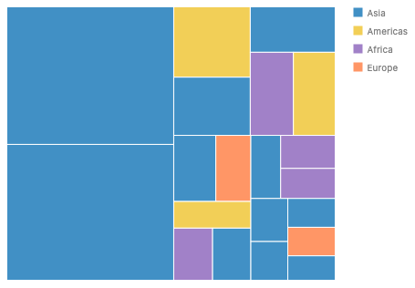  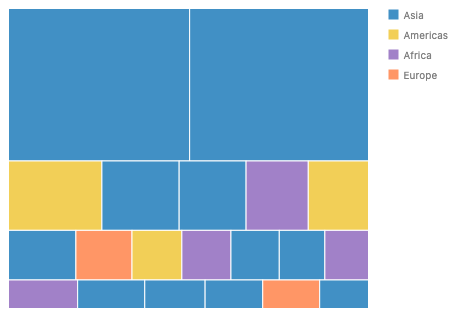

A binary plan is a tree of two-way splits (27 lines). Its drawing is four lines:

<!-- id: bin-draw -->

```ts
const drawBinary = (s: Split): any =>
  "pop" in s
    ? cell(s)
    : stack(along(s.dir, s.weights), s.parts.map(drawBinary));
```

A strip plan is a list of rows (24 lines), and its drawing is a stack of stacks:

<!-- id: strip-draw -->

```ts
const drawStrip = (rows: Country[][]) =>
  stack(
    along("y", rows.map(total)),
    rows.map((row) =>
      stack(
        along(
          "x",
          row.map((d) => d.pop)
        ),
        row.map(cell)
      )
    )
  );
```

A strip treemap is line wrapping where a row's height follows from its total weight. Squarify is the same rule with the row direction chosen again for each row.

### One tiling, many settings

Baudel and Broeksema (2012) show that the rectangular treemaps are one algorithm with five small functions plugged in: the order of the items, the size of each, a score that says when to close a row, whether to subdivide a closed row again, and a phrase that says which side of the remaining room the next row goes on and which way its items run. We wrote that algorithm once (40 lines) and one drawing function (24 lines) that turns any of its plans into nested `stack`s. Every picture below is a setting of it.

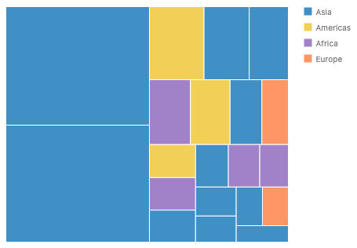  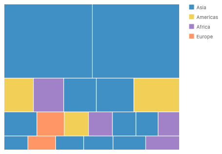   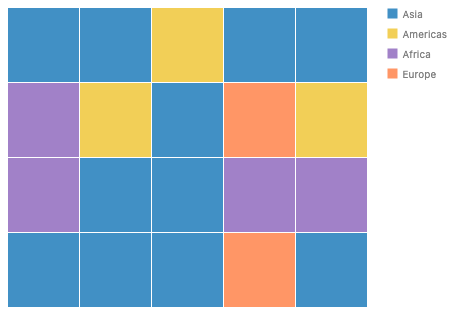

| Picture  | Score (when a row closes)                                  | Phrase (where the next row goes)       | Subdivide again         |
| -------- | ---------------------------------------------------------- | -------------------------------------- | ----------------------- |
| squarify | the squarify worst-aspect rule                             | the side that makes the room squarer   | never                   |
| strip    | aspect ratio of the smallest item                          | always a row at the top, left to right | never                   |
| zigzag   | aspect ratio of the smallest item                          | rows at the top, direction alternating | never                   |
| spiral   | aspect ratio of the smallest item                          | the next side, clockwise               | never                   |
| pivot    | closest to half the size still to place                    | the side that makes the room squarer   | while more than 2 items |
| grid     | about the square root of the item count, with every size 1 | always a row at the top                | never                   |

The squarify setting equals the built-in and the earlier hand-written plan with 0 px difference over 20 cells. Every plan the algorithm produced drew as nested two-child stacks with no special case.

<!-- id: seq-use -->

```ts
const seq = (options) =>
  render(drawSequential(sequential(countries, [W, H], options)));

// squarify
seq({ size: pop, score: Score.squarified(), phrase: Phrase.bestDiscontinuous });
// strip, zigzag, spiral
seq({ size: pop, score: Score.bestMinAspectRatio, phrase: Phrase.strip });
seq({ size: pop, score: Score.bestMinAspectRatio, phrase: Phrase.zigzag });
seq({ size: pop, score: Score.bestMinAspectRatio, phrase: Phrase.spiral });
// grid
seq({ size: () => 1, score: Score.grid, phrase: Phrase.strip });
```

The algorithm: an item joins the row unless the row's score with it is lower than before. Then the row closes, takes its share of the room, and the next row starts on the side the phrase picks.

<!-- id: seq-plan -->

```ts
function sequential<T>(
  items: T[],
  [w, h]: [number, number],
  options: Options<T>
): SeqPlan<T> {
  const { order = (xs) => xs, size, score, phrase, recurse } = options;
  items = order(items);
  const sizes = items.map(size);
  const plan: SeqPlan<T> = [];
  let i = 0;
  while (i < items.length) {
    const remaining = sum(sizes.slice(i));
    const state = { w, h, remaining, total: sum(sizes), count: items.length };
    const config = phrase(plan[plan.length - 1], state);
    const chunk: Chunk<T> = { ...config, items: [], sizes: [], sum: 0 };
    let last = -Infinity;
    while (i < items.length) {
      const next = score(chunk, sizes[i], state);
      if (next < last) break;
      last = next;
      chunk.items.push(items[i]);
      chunk.sizes.push(sizes[i]);
      chunk.sum += sizes[i];
      i++;
    }
    const share = chunk.sum / remaining;
    const box: [number, number] = isColumn(chunk.side)
      ? [w * share, h]
      : [w, h * share];
    if (isColumn(chunk.side)) w *= 1 - share;
    else h *= 1 - share;
    const whole = chunk.items.length === items.length;
    plan.push(
      !whole && recurse?.(chunk)
        ? { ...chunk, subplan: sequential(chunk.items, box, options) }
        : chunk
    );
  }
  return plan;
}
```

The drawing: the first row and the rest of the plan side by side, the row first on the top and left sides and last on the bottom and right, its items stacked across it.

<!-- id: seq-draw -->

```ts
function drawSequential<T extends Country>(plan: SeqPlan<T>): any {
  const [chunk, ...rest] = plan;
  const reverse = chunk.direction === "up" || chunk.direction === "left";
  const flip = <X>(xs: X[]) => (reverse ? [...xs].reverse() : xs);
  const here = chunk.subplan
    ? drawSequential(chunk.subplan)
    : stack(
        along(isColumn(chunk.side) ? "y" : "x", flip(chunk.sizes)),
        flip(chunk.items).map(cell)
      );
  if (rest.length === 0) return here;
  const parts = [
    { weight: chunk.sum, node: here },
    { weight: sum(rest.map((c) => c.sum)), node: drawSequential(rest) },
  ];
  if (chunk.side === "S" || chunk.side === "E") parts.reverse();
  return stack(
    along(
      isColumn(chunk.side) ? "x" : "y",
      parts.map((p) => p.weight)
    ),
    parts.map((p) => p.node)
  );
}
```

Proposed: the named tilings are presets of one tiling with settings. The names below are the paper's, and they are placeholders. `Score` is a `Cost` with the sign flipped and should fold into the `Cost` family of the choice proposal.

<!-- id: p-presets -->

```js
// Tiling.squarify is this, by definition.
const squarify = Tiling.sequential({
  score: Score.squarified(),
  phrase: Phrase.bestDiscontinuous,
});

// A tiling GoFish does not have, with no new code in the library.
const spiral = Tiling.sequential({
  score: Score.bestMinAspectRatio,
  phrase: Phrase.spiral,
});

chart(countries)
  .flow(tile({ size: "pop", tiling: spiral }))
  .mark(rect({ fill: "continent" }));
```

**This fits `tile` as one level.** The paper's algorithm takes a flat list of sizes and one rectangle. It never looks at the levels above or below. For a hierarchy the paper runs it once per node, inside the rectangle that node got, which is one `tile` step per level in `.flow()`. Its "recurse" setting is a different thing from the hierarchy: it subdivides a row of the same level's items again (that is how pivot works). The only thing a level needs from below is each child's total size, which the flow already gives it.

What the paper gets wrong or leaves open, found by implementing it: its listing recurses over all remaining items instead of the row's, its aspect scores divide by the grand total where they need the size still to place, and the phrasing it presents as an improvement over squarified is squarify's own phrasing. The story's comments list these.

### Beeswarm, by the greedy rule

Built-in `Overlap.separate` on the left, user space on the right. With candidates tried in the built-in's neighbor order, 0 of 342 dots differ. In plain placement order 56 differ, and every difference starts at an exact tie (penguin masses are rounded to 25 g).

 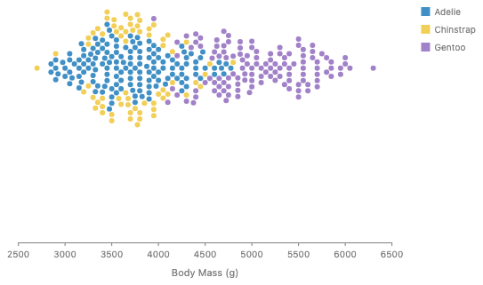

The whole rule is one helper:

<!-- id: greedy-helper -->

```ts
type Pos = { x: number; y: number };
type Placed = Pos & { r: number };

function greedyPlace<T extends { r: number }>(
  items: T[],
  rule: {
    candidates: (item: T, placed: Placed[]) => Pos[];
    cost: (pos: Pos, item: T, placed: Placed[]) => number;
    collides: (pos: Pos, item: T, placed: Placed[]) => boolean;
  }
): Placed[] {
  const placed: Placed[] = [];
  for (const item of items) {
    let best = { x: NaN, y: NaN };
    let bestCost = Infinity;
    for (const pos of rule.candidates(item, placed)) {
      const c = rule.cost(pos, item, placed);
      if (c < bestCost && !rule.collides(pos, item, placed)) {
        best = pos;
        bestCost = c;
      }
    }
    placed.push({ ...best, r: item.r });
  }
  return placed;
}
```

A beeswarm is that helper with "touching an earlier dot, at my own x" as the candidates and distance from the axis as the cost:

<!-- id: swarm-use -->

```ts
// The x scale GoFish will pick, rebuilt by hand from the rendered axis.
const xPx = (mass) => ((mass - 2500) / (6500 - 2500)) * 420;

const swarm = greedyPlace(
  weighed.map((p) => ({ x: xPx(p["Body Mass (g)"]), r: 3 })),
  {
    candidates: (item, placed) => [
      { x: item.x, y: 0 },
      ...placed.flatMap((p) => {
        const dr = item.r + p.r + 1;
        const dx = item.x - p.x;
        if (Math.abs(dx) >= dr) return [];
        const dy = Math.sqrt(dr * dr - dx * dx);
        return [
          { x: item.x, y: p.y - dy },
          { x: item.x, y: p.y + dy },
        ];
      }),
    ],
    cost: (pos) => Math.abs(pos.y),
    collides: (pos, item, placed) => overlapsAny(pos, item.r, placed, 1),
  }
);
```

What is missing: the first line. The rule runs in pixels, and user code cannot see the scale GoFish picks, so the prototype rebuilt it by hand from a rendered axis. There is also no clean way to put a mark at a data value on x and a pixel offset on y (the story uses `offset` plus a hand-computed shift, and says so).

### Circle packing, by the same rule

Built-in `pack` on the left. In the middle, the same helper with "touching two earlier circles" as the candidates and distance from the center of the placed circles as the cost. On the right, the same helper with squares.

  

<!-- id: pack-use -->

```ts
const packed = greedyPlace(
  seafood.map((d) => ({ r: 4.5 * Math.sqrt(d.count) })),
  {
    candidates: (item, placed) =>
      placed.length === 0
        ? [{ x: 0, y: 0 }]
        : placed.length === 1
          ? [{ x: placed[0].r + item.r, y: 0 }]
          : placed.flatMap((a, i) =>
              placed.slice(i + 1).flatMap((b) => tangentToBoth(a, b, item.r))
            ),
    cost: (pos) => Math.hypot(pos.x, pos.y),
    collides: (pos, item, placed) => overlapsAny(pos, item.r, placed),
  }
);
```

| Order         | Built-in `pack` | Greedy, cost from origin | Greedy, cost from centroid |
| ------------- | --------------- | ------------------------ | -------------------------- |
| data order    | R 149.3         | R 151.4 (1.4% looser)    | R 143.6 (3.8% tighter)     |
| largest first | R 136.8         | R 133.0 (2.7% tighter)   | R 140.9 (3.0% looser)      |

R is the radius of the smallest circle around all 30 circles. The greedy rule packs about as tightly as d3. It is not d3's algorithm. d3's front chain tries one position per circle (touching the current pair on the outer boundary) and never compares positions. The greedy rule compares every touching position, which costs about n⁴ steps for n circles as written. So the built-in `pack` stays a kernel, and the greedy rule is a second packing a user can write.

### Tidy tree, by contours

On the left, siblings separated by their bounding boxes: 446 px wide. This is what GoTree does, and it needs nothing new. On the right, siblings separated by their contours: 314 px, which is exactly `d3.tree`'s width for this tree.

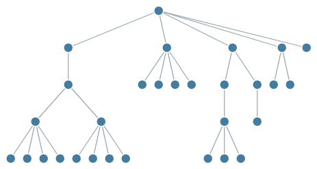 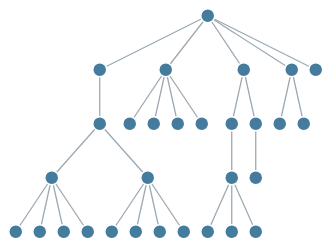

The box version is a 15-line recursive function over public operators:

<!-- id: tree-boxes -->

```ts
const boxTree = (t: Tree, path = "n"): any => {
  const node = nodeMark(path); // circle(...).name(path)
  if (!t.children?.length) return node;
  const kids = spread(
    { dir: "x", spacing: GAP, alignment: "start" },
    t.children.map((c, i) => boxTree(c, `${path}.${i}`))
  ).name(`${path}/kids`);
  return layer([node, kids]).relate((c) => [
    Constraint.distribute({ dir: "y", spacing: LEVEL }, [
      c[path],
      c[`${path}/kids`],
    ]),
    Constraint.align({ x: "middle" }, [c[path], c[`${path}/kids`]]),
  ]);
};
```

The contour version today needs a separate 34-line fold in JS (Kennedy's `fit` and `merge`) that mirrors the layout recursion, plus one `Constraint.distribute` per pair of siblings to hand the offsets over. The fold is the plan here, and it is the only prototype where the plan had to redo geometry that the engine should own. Proposed, one changed line in the box version:

<!-- id: p-tree -->

```js
const kids = spread(
  { dir: "x", spacing: Spacing.contour(GAP), alignment: "start" },
  t.children.map((c, i) => tidyTree(c, `${path}.${i}`))
).name(`${path}/kids`);
```

`Spacing.contour` is already planned (stack profiles, draft PR #1375, and the sankey proposal). This prototype is the evidence that it is the whole difference between a GoTree tree and a tidy tree, apart from centering the parent between its first and last child. Measured over vertical position, it covers non-layered trees too, and a layered tree is the case where every node in a row has the same height.

### Non-layered trees, and the symmetry rule

A source tree where a node's height is its file's length. On the left, layered: every row is as tall as its tallest node (349 by 337 px). In the middle, each child group sits right below its own parent, spaced by bounding boxes (470 by 204). On the right, the same spaced by contours measured over vertical position (434 by 204), as in van der Ploeg (2014).

 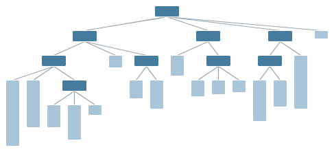 

The box version fell out of the existing recursive function with no change except node sizes. For contours, the outline becomes a sorted list of pieces, each with a top, bottom, left and right, instead of one pair per depth. `fit` changes in the one way the paper says: after comparing a pair of pieces, only the one that ends higher advances.

<!-- id: fit-both -->

```ts
// Per depth (Kennedy): one [left, right] pair per level.
const fitEdges = (p: Extent, q: Extent): number =>
  Math.max(0, ...p.slice(0, q.length).map(([, r], d) => r - q[d][0] + GAP));

// By vertical position (van der Ploeg): pieces { top, bottom, left, right }.
const fitPieces = (p: Pieces, q: Pieces): number => {
  let x = 0;
  for (let i = 0, j = 0; i < p.length && j < q.length; ) {
    x = Math.max(x, p[i].right - q[j].left + GAP);
    const [pb, qb] = [p[i].bottom, q[j].bottom];
    if (pb <= qb) i++; // advance whichever piece ends higher, or both
    if (qb <= pb) j++;
  }
  return x;
};
```

`merge` keeps its meaning but needs the same two-list walk (12 lines instead of 4). So "one change" is true of the algorithm and not quite of the code.

The symmetry rule is a separate choice. A parent with a wide first child, three single leaves in the middle and a deep last child: packed from the left, the leaves pile up at the left and the mirrored tree does not draw as the mirror image. Kennedy's mean of a left and a right packing is symmetric but clusters the leaves in the middle. Walker's rule spreads them evenly, and it equals `d3.tree` node for node (0 px on this tree, and on 398 random trees).

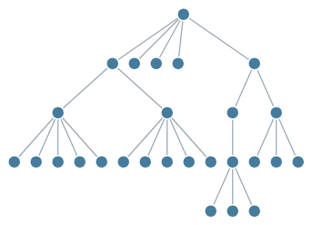  

`Spacing.contour` uses Walker's spread, because it is what d3 draws and it reads better. Kennedy's mean is the alternative.

### Layered graph, by phases

Sixteen courses and 23 prerequisite links. Input order on the left: 39 crossings. After four barycenter sweeps in the middle: 6. On the right, each node is also pulled toward the mean of its predecessors.

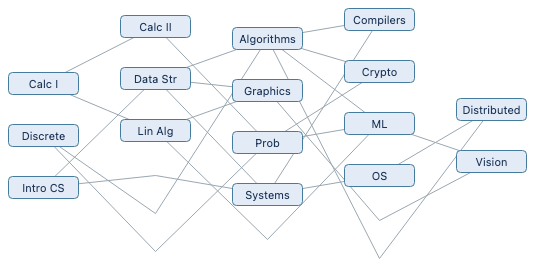 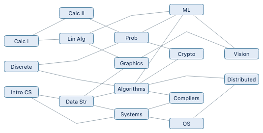 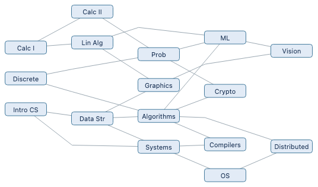

The plan is three small functions: `layers` (longest path, 12 lines), `splitLongEdges` (19 lines) and `order` (21 lines plus a 14-line crossing count). The drawing is a spread of spreads with links between named nodes:

<!-- id: graph-draw -->

```ts
const layeredGraph = (rows: string[][]) =>
  layer([
    spread(
      { dir: "x", spacing: 42, alignment: "middle" },
      rows.map((row) =>
        spread(
          { dir: "y", spacing: 30, alignment: "middle" },
          row.map(graphNode)
        )
      )
    ),
  ]).relate(() => graphLinks(graph.links));
```

This matches the sankey proposal's approach A (`derive(layers(...))`, `derive(order(...))`, then two `spread`s). The straightened version is where today's API runs out: the story has to copy spread's geometry (node heights and gaps) to compute explicit y values, because there is no "as close to the mean of these as the order allows" placement.

### Voronoi, by relaxation

Random sites, then each site moved to the center of its cell 2 times and 30 times. The cells are drawn by the real `partition` with `Bin.voronoi({ seeds })`. On the right, the Delaunay links of the last frame.

 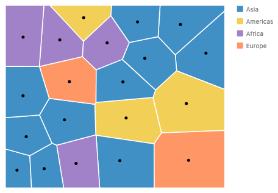  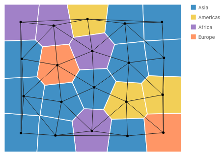

<!-- id: vor-relax -->

```ts
function relax(sites: Site[], steps: number): Site[] {
  for (let s = 0; s < steps; s++) {
    const voronoi = Delaunay.from(sites.map((d) => [d.x, d.y])).voronoi([
      0,
      0,
      W,
      H,
    ]);
    sites = sites.map((d, i) => {
      const [x, y] = centroid(voronoi.cellPolygon(i) as any);
      return { ...d, x, y };
    });
  }
  return sites;
}

const cells = (sites: Site[]) =>
  chart(framed(sites)) // two extra corner rows, see the list of walls
    .flow(
      partition({
        by: struct({ x: "x", y: "y" }).bin(Bin.voronoi({ seeds: sites })),
      })
    )
    .mark(region({ fill: "continent", stroke: "white", strokeWidth: 1.5 }));

const links = chart(edges)
  .flow(resolve(["source", "target"], { from: selectAll("sites") }))
  .mark(line({ from: "source", to: "target", stroke: "#222" }));
```

## Is there a Voronoi or Delaunay primitive?

**Voronoi: yes, and GoFish already has it, twice.** `Bin.voronoi({ seeds })` in `partition` gives the cells of given sites. `Tile.voronoi` gives cells with chosen areas. The prototype shows the first one decomposes one level: a relaxed Voronoi layout is plain Voronoi cells, repeated, with the sites moved between rounds. The loop is user code. `Tile.voronoi` is the same loop with one more step per round (grow the weight of a cell that is too small). It could be written in user space if `Bin.voronoi` took two more things: the region to clip to, which today is always the data's bounding box and cannot be set, and a weight per site.

**Below that, it is cuts.** A Voronoi cell is the region cut by one half-plane per other site, and a two-site Voronoi diagram is one straight cut, the same atom as a binary treemap split. GoFish's own `Tile.voronoi` computes its cells exactly this way (`voronoiTiling.ts`). So the diagram decomposes into cuts of a polygon, and what user code lacks is the polygon helpers and a way to draw given polygons as cells.

**Delaunay: not a layout primitive, a relation on data.** It answers "which items are neighbors". That makes it a `derive` step that returns pairs. Drawing those pairs needed nothing new: named points, `resolve`, and `line({ from, to })` worked on the first try. Its use inside layouts is as the neighbor list that makes collision checks cheap. One correction to the usual slogan: after clipping to a box, Delaunay is not exactly "whose cells touch". In the picture above there are 49 Delaunay links but only 43 pairs of cells that share an edge inside the box. The other six are long links around the outside.

**Where the geometry should live.** The prototypes imported `d3-delaunay` directly in the plan and used GoFish only to draw. That is the right split: GoFish is not a data transform library, and a Python user has `scipy.spatial` for the same job. GoFish needs to draw what the plan decides, so the additions are the two `Bin.voronoi` options above, not a geometry namespace.

## What the kernels would take in user space

| Kernel                                    | Today                                                                                                                                            | What user code would need                                                                                                                                                                            | How it would be written                                                                                                      |
| ----------------------------------------- | ------------------------------------------------------------------------------------------------------------------------------------------------ | ---------------------------------------------------------------------------------------------------------------------------------------------------------------------------------------------------- | ---------------------------------------------------------------------------------------------------------------------------- |
| Crossing reduction                        | Not built in. I called it a kernel and that was wrong.                                                                                           | Nothing. The prototype's `order` is 35 lines of plan.                                                                                                                                                | A plan function, today.                                                                                                      |
| Power diagram (`Tile.voronoi`)            | 340 lines in `voronoiTiling.ts`. Each cell is the region cut by one half-plane per other site, then a Newton step fits the weights to the areas. | Polygon helpers (cut by a half-plane, area, centroid), public or from a library. The shape a parent hands down, readable by user code. A `partition` member that takes given polygons.               | The relaxation loop as a plan, drawn by `partition`.                                                                         |
| Front chain and enclosing circle (`pack`) | d3's `packSiblings` (120 lines) and `packEnclose` (123 lines).                                                                                   | The children's measured sizes, readable before they are placed. Placement at pixel positions in a layer that keeps its box. To fit its room (#967), sizes as a function of the scale, not as pixels. | A fold that carries the chain from one circle to the next. It does not fit `choose`, because a collision rewrites the chain. |
| Contour fit (`Spacing.contour`)           | Not built.                                                                                                                                       | A child's outline per depth, readable by its parent. One spacing per gap.                                                                                                                            | Kennedy's fold, 34 lines. The prototype already does it, awkwardly.                                                          |
| Outline geometry (`enclose`, label spots) | `enclose.tsx` and its folder.                                                                                                                    | The placed geometry of the members, readable after layout. A path mark in pixels.                                                                                                                    | A function from placed shapes to a path.                                                                                     |
| Scale solve and placement                 | The layout engine.                                                                                                                               | Stays. It is what everything else lowers into.                                                                                                                                                       | Not user code.                                                                                                               |

The needs repeat. User code has to read three things: the box or shape it was given (from above), the measured sizes and outlines of its children (from below), and the placed geometry of other nodes (afterward). It also has to place children at pixel positions and still report a box. Those four together are the layout protocol that SwiftUI and Compose expose, and they are what #692 and #1279 ask to make public. Code written at that level does not lower into operators. It is library code at the floor, which is also how Mojo's standard library uses its intrinsics.

The hard part is fitting. A kernel that works in pixels cannot take part in fitting a chart to its room unless its result scales evenly when its inputs do. Circle packing does. Pixel padding breaks it. That contract is the real design work, not the algorithms.

## The layout protocol

The needs in the kernels table repeat, and they are the steps of the layout protocol that UI toolkits expose. GoFish's engine already works this way inside (the layout-synthesis essay: "SwiftUI's protocol is propose-down / respond-up"). The node protocol is private, which is the whole gap.

| Step | SwiftUI `Layout` | Compose `Layout` | Typst | `layout(size => ...)` and `measure(content)`, both returning content | the protocol as two functions that return the language itself. The model for the proposed spelling |
| Compose `SubcomposeLayout`, Flutter `LayoutBuilder` | children built during layout, from the constraints | both refuse size questions through the builder. The model for `layout` and for its rule that it asks for no room |
| Higher-order attribute grammars (Vogt, Swierstra, Kuiper 1989) | an attribute computes a new tree, which is then attributed | the nearest formal treatment of the nested second run, with the condition that the new tree cannot feed back into what defined it. It is associated with scheduling at run time, so it does not settle ours |
| Lightweight Modular Staging (Scala) | `Rep[T]` against `T` | the type says when a value is known, and using it too early is a type error. The model for `Length` against a number |
| CSS container queries | `container-type`, then a query on the container's size | a size query needs containment, so the container's size cannot depend on its contents |
| Typst `context`, LaTeX reruns | layout that reads its own results | settled by repeating layout, up to five attempts in Typst. The model GoFish avoids by solving once |
| Build Systems à la Carte (2018), selective functors (2019) | tasks with dependencies known up front, or found while running | the three-way split of `measure`, `choose` and `layout` |
| Superconductor and its schedule synthesis (Meyerovich, Bodik and others, 2010 to 2013) | an attribute grammar, plus an optional sketch of the schedule | a synthesized and checked schedule of `parPre` and `parPost` passes. A five-pass treemap, nine passes for CSS. The model for our fixed passes and for naming the first failing pass in an error |
| Spineless Traversal (2025), Servo | passes over a tree that does not change during layout | incremental layout depends on a stable tree and a fixed order of fields. Servo's fixed passes grew from four to seven and were dropped in its rewrite. The cautions for a pass that creates nodes |
| --------------------------------- | --------------------------------------------------------- | ------------------------------------------------- | --------------------------- | -------------------------------------------------------------------- | -------------------------------------------------------------------------------------------------- |
| Read the space offered | `proposal` in `sizeThatFits`, `bounds` in `placeSubviews` | `constraints` | `layout(size => ...)` | `layout(size, scales, children, node, shape)` | `layout(({ w, h, shape }) => node)` |
| Measure a child before placing it | `subview.sizeThatFits(proposal)` | `measurable.measure(constraints)`, once per child | `measure(content)` | `child.layout(size, scales)` returns its `dims` and `geometry()` | `measure(child)` |
| Place children | `subview.place(at:anchor:proposal:)` | `placeable.place(x, y)` | return content | `placeable.place(axis, value, anchor)` | return operators: `position`, `layer`, `stack` |
| Report its own size | return a `CGSize` | `layout(width, height) { }` | the size of what it returns | `intrinsicDims` | the box of what it returns |
| Read where other nodes ended up | not in the protocol | not in the protocol | not checked | `ref`, `.relate` | already public: `ref`, `selectAll` |

Two differences from the UI toolkits matter.

**GoFish passes shapes, not only boxes.** A SwiftUI child answers a measurement with a width and height. A GoFish child answers with `geometry()`, which today has its box, its enclosing circle and its outline. `pack` and the beeswarm read the circle. `enclose` and label placement read the outline. A contour would be a fourth answer. Going down, a parent can offer a convex polygon along with the box, which is how a Voronoi cell hands its region to the tiling inside it. So `measure(child)` returns that geometry, and circle packing in user space reads `measure(child).enclosingCircle` (the sketch is at the top of this page).

**GoFish has scales, and that is the hard part.** A node describes itself to its parent twice. Before the scale is chosen it says how much room it needs as a function of the scale (an `Extent` in `Pwl.Value`), which is what lets a chart fit its room. That answer is one extent per axis today, so it is a box. After layout it has its full geometry in pixels: `geometry()`, with the circle and the outline. So of the `Geometry` that `measure` is sketched to return, only the box exists in lengths today. The circle and the outline exist only in pixels, which is why `pack` reads them after layout and does not fit its room (#967). Carrying a circle, an outline or a contour in lengths is the engine work this proposal depends on. The layout-synthesis essay names the rule any such answer has to keep: "responses must be monotone in the proposal". The silhouette note in `notes/design/` is the start of that design. It is the real work here, more than any one algorithm.

## Keeping relations instead of positions

The plans above hand GoFish positions. Two experiments tested whether a layout can hand over relations instead, the way `spread` lowers into `align` and `distribute`.

### A minimum gap: "at least this far apart, in this order"

`distribute` says "exactly this gap". Its inequality sibling says "at least this gap", and each item takes the nearest position that satisfies all its constraints (WebCoLa calls this a separation constraint). A set of them with no cycles is solved in one pass in dependency order. We wrote that solver once (56 lines) and re-expressed four layouts as a plan that emits minimum gaps.

| Layout              | Result                                                                       | Plan                                 |
| ------------------- | ---------------------------------------------------------------------------- | ------------------------------------ |
| Tidy tree           | exact: 0 px from the contour tree, on the test trees and on 600 random trees | 29 lines, replacing the 34-line fold |
| Graph layering      | exact: identical ranks on the course graph and on 200 random graphs          | 6 lines, replacing 12                |
| Graph straightening | same numbers, but see below                                                  | 25 lines, replacing 24               |
| One-sided beeswarm  | fails: 229 of 342 dots differ                                                | does not work                        |

 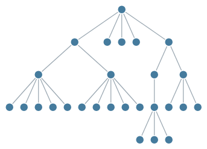  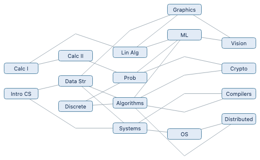

<!-- id: sep-plans -->

```ts
// Layering: every link's target is at least 1 layer after its source.
export const sepLayers = (nodes: string[], links: Link[], policy: Policy) =>
  solveSeparations(
    nodes,
    links.map((l) => ({ after: l.source, before: l.target, gap: 1 })),
    { policy }
  );

// Tidy tree, inside the recursion: child j clears every earlier child i,
// by their two contours alone.
const seps = kids.flatMap((b, j) =>
  kids.slice(0, j).map((a, i) => ({
    after: ids[i],
    before: ids[j],
    gap: fitPair(a.contour, b.contour),
  }))
);
const x = solveSeparations(ids, seps, { policy });
```

- **The tree match is exact, not approximate.** Fitting against the merged outline of all earlier siblings is the same computation as the longest-path step. Packed to the start is the left-packed tree. The mean of the start and end solutions is Kennedy's mean.
- **Where the slack goes is a policy.** Start, end and center are all one-pass. For layering, start and end are both legible (end lines up the sinks) and center is not: it gives half layers.
- **The beeswarm is not a set of minimum gaps.** A minimum gap says "this dot is above that one". The built-in swarm puts a later dot below an earlier one in 154 pairs, by dropping it into a hole or keeping it low beside a tall neighbor. That is an either-or per pair, and deciding it is the greedy rule itself. Given the built-in's choices, the solver matches all 342 dots. So the constraint can check and tighten a swarm but cannot place one.
- **Straightening is a soft target, not a constraint.** The numbers match only because "at least the wanted position" and "at most the wanted position" were solved as two separate systems and averaged. As one system they contradict each other for 17 of 19 nodes. Pulling a node toward a position is a different thing from a minimum gap.
- **Centering a parent over its children is an exact relation.** It is done in the plan as an equality.
- **The pairwise form is quadratic in the number of siblings.** Kennedy's fold is linear, so the engine would want the fold as its implementation of the same constraint.

Proposed spelling, a sketch. A minimum gap is a spacing, so it extends `distribute` and `spread` through the `Spacing` family instead of adding a constraint. `justify` is CSS's name for where slack goes, and is a placeholder.

<!-- id: p-separation -->

```js
// A minimum gap is a spacing, so it goes where a gap goes today.
Constraint.distribute({ dir: "x", spacing: Spacing.atLeast(10) }, [a, b]);

// Contour spacing lowers to one of these per pair of siblings, with the
// gap read from their two contours. `justify` says where the slack goes.
spread({ dir: "x", spacing: Spacing.contour(10), justify: "center" }, subtrees);

// Layering: every link's target is at least one column after its source.
layer(nodes).relate((n) =>
  links.map((l) =>
    Constraint.distribute({ dir: "x", spacing: Spacing.atLeast(112) }, [
      n[l.source],
      n[l.target],
    ])
  )
);
```

**One constraint in the API, two kinds in the engine.** An exact gap and a minimum gap are the same idea with different slack, and Auto Layout spells them as one constraint with a relation. Inside the engine they should stay two kinds of fact. Exact gaps glue items into rigid groups that can be resolved in any order, and a disagreement between two of them is an error. Minimum gaps need a dependency order, never conflict (the larger wins), and are the only ones that leave slack. Resolving the rigid groups first and then separating them keeps it to one pass. "At most" gaps would bring back cycles and systems with no solution, so they are left out.

The solver, as the semantics of the constraint:

<!-- id: sep-solver -->

```ts
/** pos[before] - pos[after] >= gap. A lower bound `x >= p` is a separation
 *  of gap p from a fixed zero item. */
export type Sep = { after: string; before: string; gap: number };
export type Policy = "start" | "end" | "center";

/** Items in an order where every separation points forward. */
const topoOrder = (items: string[], seps: Sep[]): string[] => {
  const ins = new Map(items.map((id) => [id, 0]));
  for (const s of seps) ins.set(s.before, ins.get(s.before)! + 1);
  const ready = items.filter((id) => ins.get(id) === 0);
  for (let k = 0; k < ready.length; k++)
    for (const s of seps)
      if (s.after === ready[k]) {
        ins.set(s.before, ins.get(s.before)! - 1);
        if (ins.get(s.before) === 0) ready.push(s.before);
      }
  if (ready.length < items.length)
    throw new Error("solveSeparations: the separations have a cycle");
  return ready;
};

/** One pass in order: each item as near `base` as its separations allow. */
const nearest = (
  order: string[],
  into: (id: string) => [string, number][],
  base: number
): Map<string, number> => {
  const pos = new Map<string, number>();
  for (const id of order) {
    const from = into(id).map(([u, gap]) => pos.get(u)! + gap);
    pos.set(id, from.length ? Math.max(...from) : base);
  }
  return pos;
};

/** "start": every item as near the start as its separations allow.
 *  "end": as near the end. "center": the mean of the two. */
export function solveSeparations(
  items: string[],
  seps: Sep[],
  { policy = "start", upper }: { policy?: Policy; upper?: number } = {}
): Map<string, number> {
  const order = topoOrder(items, seps);
  const least = nearest(
    order,
    (id) => seps.filter((s) => s.before === id).map((s) => [s.after, s.gap]),
    0
  );
  if (policy === "start") return least;
  const top = upper ?? Math.max(...least.values());
  // The greatest solution is the least one of the mirrored problem.
  const mirrored = nearest(
    [...order].reverse(),
    (id) => seps.filter((s) => s.after === id).map((s) => [s.before, s.gap]),
    -top
  );
  return new Map(
    items.map((id) => {
      const greatest = -mirrored.get(id)!;
      return [
        id,
        policy === "end" ? greatest : (least.get(id)! + greatest) / 2,
      ];
    })
  );
}
```

### Circle packing as contour spacing in polar coordinates

The idea: a circle slides in along a ray from the origin until it first touches something, which is contour spacing along the radius. The only decision is the angle. A beeswarm would be the same rule with vertical rays and the ray given by the data. We wrote that as one 43-line function.

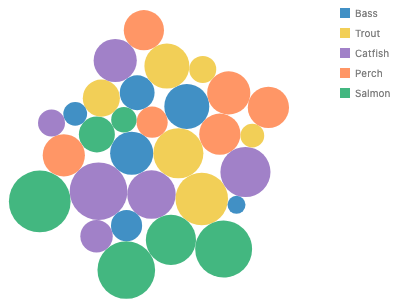  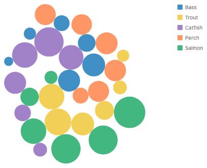 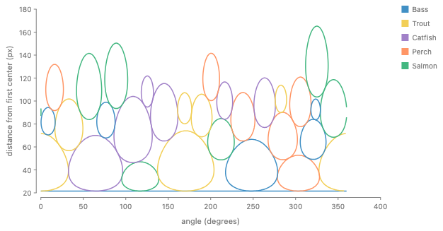

<!-- id: skyline-use -->

```ts
// A beeswarm: the ray is given by the data.
const swarm = skyline(
  weighed.map((p) => ({ x: xPx(p["Body Mass (g)"]!), r: DOT })),
  cartesian,
  { lane: (d) => d.x, floor: DOT, pad: 1 }
);

// A circle packing: rays from an origin, and the ray is chosen.
const notchPack = skyline(circles, polar);
const goldenPack = skyline(circles, polar, {
  lane: (_, i) => (i * 137.50776 * Math.PI) / 180,
});

// The two coordinate systems: vertical rays over x, and rays from an origin.
const cartesian: Rays = { at: (x, y) => ({ x, y }), laneOf: (p) => p.x };
const polar: Rays = {
  at: (t, d) => ({ x: d * Math.cos(t), y: d * Math.sin(t) }),
  laneOf: (p) => Math.atan2(p.y, p.x),
};
```

It holds only in part.

- **One function does both.** It produces a valid beeswarm and a valid packing, changing only the family of rays and whether the ray is given or chosen.
- **It packs about as tightly as d3.** Choosing the angle where the circle comes to rest deepest gives an enclosing radius of 0.97 to 1.00 times d3's on average over 200 random sets. The golden angle needs no search and is 7 to 23% larger.
- **d3's packing is not this rule.** 91 to 93% of d3's circles in input order sit exactly where sliding in along their own angle would put them, and 99 to 100% largest first. The rest are tucked under an overhang, usually under one of the two circles they rest against, where a straight slide from outside cannot reach.
- **The built-in beeswarm is not this rule either.** 229 of 342 dots differ and the sliding version is 45% taller, because the built-in fills holes.
- **It is slow as written.** The exact version takes 1.2 s for 1000 circles against d3's 1.6 ms. The short readable version is as slow as the greedy helper.
- **It needs a fixed origin.** A moving origin packs well but is no longer one coordinate space. With the first circle's center as origin there are exact ties, and Node and the browser picked different layouts until a tie rule was added.
- **GoFish cannot draw it through `Coord.polar()` today.** Circles stay round, but the distance from the origin is fitted as a data scale, so the pack shrinks toward a ring and circles overlap by up to 20 px. There is no way to say a coordinate is already in pixels, which is the same wall the beeswarm hit.

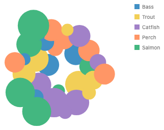

So sliding in is a real third relation, weaker than "touches these two" and cheaper to state, and it does unify packing with one-directional stacking. It does not replace the existing algorithms, because both of them use holes.

## The review: every algorithm, side by side

| Algorithm       | Plan (decisions)                         | Drawing (operators)             | Kernel it needs                             | Result of the prototype                           |
| --------------- | ---------------------------------------- | ------------------------------- | ------------------------------------------- | ------------------------------------------------- |
| slice, dice     | none                                     | one `stack`                     | none                                        | already true on main                              |
| squarify        | rows by the aspect rule, 24 lines        | nested `stack`s, 15 lines       | none                                        | equals the built-in to 3e-14 px                   |
| binary          | splits at the weight median, 27 lines    | nested `stack`s, 4 lines        | none                                        | equals the built-in to 3e-14 px                   |
| strip           | rows by the aspect rule, 24 lines        | a `stack` of `stack`s, 13 lines | none                                        | renders, GoFish has no built-in to compare        |
| Voronoi         | site positions by relaxation, 30 lines   | `partition` by `Bin.voronoi`    | the diagram                                 | equal-weight cells only                           |
| beeswarm        | y per dot by the greedy rule, 22 lines   | `scatter` plus an offset        | none                                        | equals `Overlap.separate`, 0 of 342 differ        |
| circle packing  | positions by the greedy rule, 32 lines   | circles at pixel positions      | none (d3's front chain is a different rule) | within 4% of `pack`'s radius                      |
| label placement | spot per label by the greedy rule        | the label mark                  | outline geometry                            | not prototyped, #1205 already works this way      |
| tidy tree       | none, once spacing can follow contours   | nested `spread`s in `layer`s    | contour fit                                 | equals `d3.tree`'s width (314 vs 446 px by boxes) |
| layered graph   | layer, split long edges, order: 66 lines | a `spread` of `spread`s, links  | none (ordering is a heuristic search)       | crossings 39 to 6                                 |
| sankey          | the layered graph's plan                 | the same, with sized nodes      | none                                        | see the sankey proposal                           |
| enclose         | none                                     | a derived mark over its members | outline geometry                            | not prototyped                                    |

Reading down the columns:

- **The drawing column is always existing operators.** No algorithm needed a new operator to draw its result.
- **The plan column has four kinds of decision.** Dividing a box among items (squarify, binary, strip). Placing items one at a time against the ones already placed (beeswarm, packing, labels, and line wrapping). Ordering (layered graph, sankey). Repeating until it settles (Voronoi, sankey relaxation).
- **The kernel column is short**: the Voronoi or power diagram, the contour fit, outline geometry. Each is a function from shapes to shapes with no decisions in it.
- **The second kind of decision is a choice with a cost.** "Lowest-cost position that does not collide" is `choose` over candidates, made once per item, where each item sees the ones before it. Squarify's row rule is the same shape: "add to the row or close it", by aspect ratio. This is where the choice operator (#486, the open issue for choice with cost-based selection) meets the layout algorithms.

## Approaches

The space has two separate axes: what a user-written layout returns, and how its decisions are written.

### What a user-written layout returns

**A. Geometry (a function at the seam).** A member of a family is a function from geometry to geometry: a tiling takes a region and weights and returns regions, an overlap strategy takes positions and returns offsets. This is #1101's direction, and the seams already exist inside the library (`type Tiling = (region, weights, options) => Ring[]`).

<!-- id: p-func -->

```js
// A strip tiling as a function from a region to one rectangle per child.
const strip = (region, weights) =>
  stripRows(weights, region).flatMap((row) => row.cells);

chart(countries)
  .flow(tile({ size: "pop", tiling: strip }))
  .mark(rect({ fill: "continent" }));
```

- Composes: it plugs into the operator that owns the family, so `.flow()`, coordinates and nesting work as for built-in members.
- Overlap with existing operators: none, it adds no operator.
- Trade-offs: it is the cheapest to build. Each family has its own signature, so nothing is shared between a tiling and a packing. The function is opaque: it cannot be inspected, and it reaches Python only through the callback runner. It lowers into nothing, so it is an escape hatch and not a language.

**B. GoFish operators (a layout is a function that returns a drawing).** The user writes the plan, then returns `stack`s, `spread`s and `layer`s. Every prototype above is this approach, limited only by what user code can read.

- Composes: the result is ordinary nodes, so axes, coordinates, selection, animation and nesting apply to it with no extra work.
- Overlap: exact composition of existing operators. `Tiling.squarify` is defined by its rewrite into stacks, which is the regime api-design.md asks for.
- Trade-offs: it needs one new primitive (reading the box) and one planned one (contour spacing). Plans that need pixel positions of siblings (the beeswarm) are awkward until the decision half can run during layout, which is approach C. The plan is still opaque JS, but the drawing is inspectable.

**D. Constraints and an objective (the foil).** Add non-overlap and a cost to the constraint set and let a solver find the layout, as Penrose, WebCoLa and Auto Layout do.

<!-- id: p-constraints -->

```js
layer(circles).relate((c) => [
  Constraint.separate({ padding: 1 }, all(c)), // no two overlap
  Constraint.minimize(Cost.distance({ from: "center" }), all(c)),
]);
```

- It reads well for the continuous half of some algorithms: layered-graph coordinates and minimum-width tidy trees are linear programs once the order is fixed.
- It does not fit: non-overlap is an either-or (left of, or right of), treemap areas are products, and ordering is a permutation. Solvers handle these with search or local minima, and the result stops being predictable. GoFish's layout engine is one pass with one unknown per axis by design (constraints-as-core.md), and nothing in the prototypes needed more.

### How the decisions are written

**Plain JS (what the prototypes do).** The plan is a function. It is the least machinery and the most freedom.

**C. A sequential `choose` with a `Cost`.** The greedy rule written as data, in the choice proposal's spelling. All three lines below are sketches on top of an unsigned proposal.

<!-- id: p-choose -->

```js
// Beeswarm: each dot takes the y nearest the axis that touches no earlier dot.
scatter({
  x: "Body Mass (g)",
  y: choose(Placement.touching({ padding: 1 }), { cost: Cost.distance() }),
});

// Circle packing: each circle takes the free spot nearest the center.
scatter({
  at: choose(Placement.touching(), { cost: Cost.distance({ from: "center" }) }),
});

// Strip treemap: close a row when one more item would make its cells less square.
stack({ dir: "x", size: "pop", wrap: { cost: Cost.aspect() } });
```

- Composes: `Placement` members already generate ranked candidates for labels, and one greedy chooser already picks among them (#1205). This reuses both. The new part is that a `choose` on a per-item option is made item by item, each seeing the items before it.
- Overlap: `Overlap.separate` and the label placer become exact rewrites into it. `pack` does not (d3's front chain is a different rule), so `pack` keeps its kernel.
- Trade-offs: it runs during layout, so it sees real pixels and the scale wall disappears. It is data, so it crosses to Python with no callback. It only covers decisions that fit "candidates, cost, no collision". Ordering and relaxation stay plain code. It depends on the choice proposal being signed off first.

## Recommendation

Approach B for what a layout returns, at both levels: plans drawn in operators, and kernels written with `layout` and `measure` that still return operators. C is the next step for decisions. A (a function from geometry to geometry per family) is then a special case and is not needed as a separate mechanism.

- **It lowers into the existing core.** principles.md asks that a feature desugar into the core or be rethought. Squarify and binary do, exactly. That page calls treemaps as nested stacks "an even more aspirational example" and says "the engine cannot do that today". The prototype shows it can, at spacing 0.
- **One concept, one operator.** B adds no operator. `tile` keeps its members, and a member becomes a rewrite.
- **Few new terms.** Two new functions, `layout` and `measure`, which are Typst's names for the same two things, and `Spacing.contour`, which was already planned.
- **A closed set plus a function escape hatch.** A member is a declared kind or a function, as #1101 says. The function returns GoFish, so the escape hatch is the same language as everything else.
- **The same shape in Python.** A plan written in Python that returns combinators is a pure spec: it serializes with no callback, because the drawing is just nested `stack`s. Only the box reader needs the callback runner, as `derive` does.

<!-- id: p-python -->

```python
def draw_squarify(plan):
    cells = stack(
        [cell(d) for d in plan.row],
        **along(across(plan.dir), [d["pop"] for d in plan.row]),
    )
    if plan.rest is None:
        return cells
    return stack(
        [cells, draw_squarify(plan.rest)],
        **along(plan.dir, [total(plan.row), total(flatten(plan.rest))]),
    )
```

(A sketch. The Python combinator calls were not run.)

**The Mojo reading.** Lattner's line for Mojo is "push everything that we can into libraries, and push the magic out of the compiler": `Int` and `Float` are library types, and the compiler keeps a small floor of intrinsics. MLIR adds two rules that fit here. Lower in steps, and keep the high-level operation until everything that needs it has read it. For GoFish:

| Level                 | What lives there                             | Examples                                                                     |
| --------------------- | -------------------------------------------- | ---------------------------------------------------------------------------- |
| Operators and members | the vocabulary users write and the IR keeps  | `tile({ tiling: Tiling.squarify })`, `pack`, `Overlap.separate`              |
| Plans and drawings    | library code, written in GoFish              | squarify as nested `stack`s, a tree as nested `spread`s                      |
| Constraints           | what `stack` and `spread` already lower into | `align`, `distribute`, `position`, `nest`                                    |
| Kernels               | the floor                                    | the one-unknown scale solve, the power diagram, contour fit, the front chain |

The test of success is Lattner's: can a built-in be deleted and replaced by library code with no change in output? For `squarify` and `binary` the prototype says yes. Keeping `tile` in the IR while it lowers inside the engine is the "keep the high-level operation" rule, and it is what constraints-as-core.md already decided for `spread`.

**What would change the pick.** If reading the box turns out to be expensive in the engine (it defers building part of the tree until layout, which is issue #1334's lazy node operators), A alone is the fallback: user tilings as functions that return rectangles, with no lowering. If the choice proposal lands first, C becomes the natural way to write `Overlap.separate` and the label placer, and B is then only needed for the dividing layouts.

## What to add, in order of how much it unlocks

1. **`layout`: read the space offered.** Unlocks every dividing layout (squarify, strip, spiral, pivot, any responsive mark).
2. **`Spacing.contour`, measured over vertical position, with Walker's spread.** Unlocks tidy trees, layered or not.
3. **Custom members (#1101, #692).** Lets a function that returns GoFish be passed as `tiling:` so it works in `.flow()`.
4. **One sequential tiling with settings.** `squarify`, `strip`, `spiral`, `pivot`, `slice` and `dice` become presets of it. The built-in `binary` is not shown to be one.
5. **`measure`: read a child's geometry.** Unlocks circle packing, label placement and contour folds in user space, in pixels. Fitting needs the richer before-layout answer described above.
6. **`Bin.voronoi` takes a region and weights.** Unlocks Voronoi layouts in user space.
7. **Sequential `choose`.** Unlocks beeswarm, labels and greedy packing as data. Waits on the choice proposal.

Not proposed: a geometry namespace, a phase language for graph layout (the sankey proposal's `Layering` and `Ordering` helpers already cover it as `derive` steps), a constraint solver.

## Three forks, each at its example

**1. The names `layout` and `measure`.** Stated with the API at the top of this page.

**2. Greedy placement as a helper or as `choose` (beeswarm, packing).** The helper is 31 lines of JS with three callbacks. It works today, for any shape, and it is opaque. The `choose` form is three options, crosses to Python, and sees real pixels, and it needs the choice proposal first. This page leans to building `choose` and showing the helper as what it lowers into.

**3. Make the built-in tilings presets of one sequential tiling (squarify and the rest).** They match exactly at spacing 0, so `squarify`, `slice` and `dice` could be settings of the one algorithm above and drop d3-hierarchy, and `strip`, `spiral` and `pivot` come for free. The one difference is spacing. d3 tiles the whole box and then shrinks each cell. A stack with gaps gives each child its share of the room that is left. Cell areas differ by up to 11% between the two at spacing 2. Before a rewrite, someone has to decide which of those two is the right meaning of `spacing`. This page leans to the presets, with the stack meaning.

## Walls and bugs the prototypes hit

Each of these is a candidate issue. None was worked around silently. The stories mark every workaround with a comment.

- **User code cannot read its box**, so plans take the size by hand (fork 1).
- **User code cannot see a scale**, so the beeswarm rebuilt GoFish's x scale from a rendered axis.
- **A mark cannot sit at a data value on one axis and a pixel offset on the other.** `scatter({ y: "dy" })` fits a scale to the offsets. `position` inside `scatter` loses the offset. `offset` draws correctly but takes no room, so dots are clipped.
- **Sizes in nested stacks must be shares of the parent.** Raw weights do not work, because one scale is shared across nesting levels.
- **`stack` along y runs up and `spread` along y runs down** in the same frame.
- **`Bin.voronoi` clips to the data's bounding box** and the box cannot be set. The story adds two corner rows.
- **One spacing per `spread`.** Contour offsets differ per gap, so the tree uses one `Constraint.distribute` per pair.
- **A `distribute` between two nested operands is ignored with no warning.**
- **`Constraint.position` inside a `spread` with `alignment: "start"` or `"middle"` is discarded with no warning.** Only `"baseline"` keeps it.
- **A `rect` inside a `Tile.voronoi` treemap draws its cell's bounding box**, with no error. It needs `region()`.
- **A `.name()` inside a `.mark((d) => ...)` function does not register**, and a `createMark` prop declared `"raw"` arrives wrapped.
- **Rendering a combinator puts the legend inside `w`**, where `chart(data, { w })` treats `w` as the plot only.
- **Tooling.** `capture-one` on its default port attaches to another session's server, and a stale `gofish-ir` build broke every story until rebuilt.

## Precedent

| System                                          | What the user writes                                                                                                                                                        | What it shows                                                                                                                                                                                                                                                                                                                                                                          |
| ----------------------------------------------- | --------------------------------------------------------------------------------------------------------------------------------------------------------------------------- | -------------------------------------------------------------------------------------------------------------------------------------------------------------------------------------------------------------------------------------------------------------------------------------------------------------------------------------------------------------------------------------- |
| Mojo, MLIR                                      | library code for `Int` and `Float`, lowered in steps to a small floor                                                                                                       | built-ins as library code, intrinsics as the floor                                                                                                                                                                                                                                                                                                                                     |
| d3-hierarchy                                    | `tile(node, x0, y0, x1, y1)`, a function that sets child rectangles                                                                                                         | approach A. Inside d3, squarify calls `treemapDice` or `treemapSlice` per row, so it is already a plan plus stacks                                                                                                                                                                                                                                                                     |
| SwiftUI `Layout`, Compose `Layout`, CSS Houdini | `sizeThatFits` and `placeSubviews`; `measure` and `place`                                                                                                                   | the same steps GoFish's engine runs inside: offer space, measure children, place them. They pass boxes; GoFish passes shapes and scales. `ViewThatFits` is a built-in `choose`                                                                                                                                                                                                         |
| Typst                                           | `layout(size => ...)` and `measure`                                                                                                                                         | reading the box is one small primitive, and users write measure-then-place layouts in the document language                                                                                                                                                                                                                                                                            |
| Kennedy, "Drawing Trees" (1996)                 | `fit`, `merge` and a fold over extents                                                                                                                                      | a tidy tree is a small algebra over contours                                                                                                                                                                                                                                                                                                                                           |
| van der Ploeg, non-layered tidy trees (2014)    | the same contour walk over nodes with their own heights                                                                                                                     | the walk changes in one place: after comparing a pair of contour nodes, only the one that ends higher advances. A layered tree is the case where every node at a depth has the same height. For symmetry it spreads extra room evenly over the siblings in between, and says Kennedy's mean "tends to cluster smaller subtrees". Fixed y positions per node come from thin dummy nodes |
| Baudel and Broeksema (2012)                     | five small functions: order, size, chunk (by a `score`: close the row when the score drops), recurse, phrase (which side the next row goes on, and which way its items run) | squarify, strip, pivot, spiral, slice and dice, grids and mosaic plots are settings of one algorithm. Each row is cut from a full side of the room that is left, which is a two-child `stack` of the row and the rest. So their five functions are a plan and their fixed loop is the drawing. Voronoi treemaps are out of its scope                                                   |
| Wadler, Bernardy, Knuth and Plass               | `group`, choice, cost                                                                                                                                                       | choice with a cost stays fast only when the cost adds up along a sequence                                                                                                                                                                                                                                                                                                              |
| Observable Plot `dodge`                         | `dodgeY({ anchor, padding })`                                                                                                                                               | the beeswarm is a greedy pass in pixel space, after scales                                                                                                                                                                                                                                                                                                                             |
| Penrose                                         | `ensure`, `encourage`, stages                                                                                                                                               | approach D. Its stages are an admission that layout is a pipeline                                                                                                                                                                                                                                                                                                                      |
| WebCoLa, VPSC                                   | separation constraints                                                                                                                                                      | the either-or part of non-overlap is decided by a scan first, and only the rest goes to the solver                                                                                                                                                                                                                                                                                     |
| ELK, OGDF, dagre                                | five phases with a strategy per phase                                                                                                                                       | graph layout decomposes by phase. Each phase is still a procedure                                                                                                                                                                                                                                                                                                                      |
| Atom, productplots, HiVE                        | a layout per level from a fixed menu                                                                                                                                        | dividing layouts compose per level, and squarify is the one they cannot express                                                                                                                                                                                                                                                                                                        |
| GoTree                                          | parent-child and sibling relations per axis                                                                                                                                 | trees from `align`, `distribute` and `nest`, bounding boxes only                                                                                                                                                                                                                                                                                                                       |
| Bluefish                                        | relations that share children                                                                                                                                               | a small relation vocabulary composes, and it stops at relations that need no search                                                                                                                                                                                                                                                                                                    |

## Related issues

Open:

- #1101: one extensibility model for strategy families, a member is a declared kind or a user function. Approach A, and item 3 above.
- #1279: extensibility audit. Nine of twelve families are closed, and `createOperator` is not reachable by users.
- #692: public `defineMark` and `defineOperator`.
- #631: modular layout algorithms, the research issue behind `notes/design/modular-layout-algorithms.md`. This proposal is its user-facing half.
- #610: a layout-program IR between the frontend and the core. Its guardrail is "do not build this without a concrete consumer", and B needs no such IR.
- #355: decompose treemap, tidy tree and Sugiyama into simpler primitives. The table above is an answer.
- #541: treemap as a generator of constraints. Fork 3 is this, taken to stacks.
- #486, #630, #806, #1194: the choice operator, `min` in the size algebra, and choices in chart chrome. Approach C builds on these.
- #37, #1334: layout that depends on the offered size, and lazy node operators. Item 1.
- #122, #40: wrap and pretty printing. Strip treemaps are wrap with weights.
- #967, #973, #974, #1064: `pack` fitting its room and its geometry queries.
- #1276, #1355, #1295: delete slice and dice, rename treemap to tile, the Voronoi outer shape.
- #38, #618, #1163: GoTree examples, parity, and extension packages crossing to Python.
- #1138: the road to beta lists "basic graph and tree layout", a recursive choice operator and pretty printing.

Closed, for the decisions they record: #1013 (family namespaces), #1272 (`Tile.voronoi`, a parent hands its child a convex region), #968 (`pack` and `geometry()`), #1003 (`Overlap.separate`), #1205 (label placement by ranked candidates and one greedy chooser), #547 (`spread` is `layer` plus `align` plus `distribute`), #1365 (`Spacing`).
