# Layouts in user space

A design for writing layout algorithms as GoFish code, on the smallest set of layout primitives that covers them. Every d3 layout is checked against it. (today) marks a real render on today's public API. (sketch) marks proposed syntax that does not run yet.

## The design

- A layout algorithm has two parts. Its **decisions** are discrete: an order, a grouping into rows, which side a dot goes on. Its **relations** say how positions and sizes depend on each other once the decisions are made. A **solver** turns relations into positions.
- The relations today's solver handles come down to five primitives: a linear equation between positions, a minimum gap, one shared scale per scope, a coordinate map, and a choice. `stack`, `spread`, `tile`, a tidy tree and a sankey are compositions of those.
- Every d3 layout was written this way and compared with d3's own numbers. Pie, stack, partition, treemap, tree, cluster, chord arcs and a sankey without relaxation match exactly. Circle packing, force and sankey relaxation need relations today's solver does not have.
- Those are jobs for other solvers: one for geometry (touching, intersecting) and one that optimizes (pulls, repulsion). A scope picks its solver the way it picks a coordinate space, and solvers meet only at scope boundaries.
- User code writes decisions three ways: a function that calls `measure` on its children, a `choose` among alternatives, or a `layout` that reads the room it was given.
- Nothing is implemented except prototype stories. Two of the five primitives are partly missing: the minimum gap, and an average of positions.

**Decisions.** Discrete. Made by plan code, or by `choose`. _which items share a row, the order in a column, which two circles a new one rests on_

**Relations** Facts between shapes. Data, not code. these are 10 apart, this is at least clear of that, these touch

**A solver per scope.** Turns one scope's relations into positions. today: one symbolic solver. Later: geometry, optimization

This is the split issue \#485 asks for: a small relational core, and user-space algorithms that hand it their discrete commitments instead of final positions. A commitment survives a resize or a data edit. A position does not.

### The primitives

#### What today's symbolic solver needs

| Primitive                                | In math                                                      | In GoFish                                                                             | Status                                                                                                           |
| ---------------------------------------- | ------------------------------------------------------------ | ------------------------------------------------------------------------------------- | ---------------------------------------------------------------------------------------------------------------- |
| A linear equation between positions      | a = b; b − a = g; p = the average of a, b, c                 | `Constraint.align`, `Constraint.distribute`, `Constraint.position`, `Constraint.nest` | Today, except the average. A dendrogram puts a parent at the mean of its children, and nothing public says that. |
| A minimum gap, with a rule for the slack | b − a ≥ g, then start, end, center or even                   | `Spacing.atLeast(g)`, `Spacing.contour(g)` on `distribute` and `spread` (sketch)      | Missing. Prototyped as a 56-line solver.                                                                         |
| One scale per scope                      | size = value × scale; a container is the max of its contents | `rect({ h: "value" })`, shared across a scope                                         | Today. It solved d3-sankey's scale on its own.                                                                   |
| A coordinate map                         | positions → f(positions), applied after the solve            | `Coord.polar()`, `Coord.clock()`                                                      | Today, except that an angle axis does not wrap.                                                                  |
| A choice                                 | the minimum over alternatives                                | `choose([a, b])` (sketch)                                                             | The choice proposal. Needs `min` in the size algebra (\#630).                                                    |

The first three are one piece of mathematics: equations and lower bounds on differences of positions, a max, and one unknown scale. That is why one pass solves them. Every operator below lowers into these.

| Operator                  | Lowers into                                                                                                                  |
| ------------------------- | ---------------------------------------------------------------------------------------------------------------------------- |
| `stack`, `spread`         | equal positions across, an exact gap along. Today.                                                                           |
| `tile` (treemap)          | a decision (which items share a row), then nested stacks whose sizes are shares of the parent.                               |
| pie, sunburst, chord arcs | stacks and spreads along the angle, inside a coordinate map. Today.                                                          |
| a tidy tree, a dendrogram | minimum gaps between subtrees, an average for the parent.                                                                    |
| a sankey, a layered graph | minimum gaps for the columns, spreads on one shared scale for the nodes, stacks for the links, and a decision for the order. |

#### Relations for other solvers (sketch)

| Solver           | Its relations                                                          | What needs it                                                                                                                |
| ---------------- | ---------------------------------------------------------------------- | ---------------------------------------------------------------------------------------------------------------------------- |
| Symbolic (today) | equations and minimum gaps between positions, per axis, with one scale | charts, trees, treemaps, sankeys without relaxation                                                                          |
| Geometry         | touches, intersects, lies on, at a distance, at an angle               | circle packing (each circle touches two others), Voronoi cells (a cell is its region cut by lines), ribbons through a center |
| Optimizing       | pull toward a position, keep a distance, push apart, do not overlap    | force layouts, sankey relaxation, label avoidance, the beeswarm's above-or-below                                             |

```js
// Relations are one vocabulary. The scope's solver turns them into positions.
layer(nodes).relate((n) => [
  Constraint.align({ y: "start" }, [n.a, n.b, n.c]), // today
  Constraint.distribute({ dir: "x", spacing: 10 }, [n.a, n.b]), // today: exactly 10
  Constraint.distribute({ dir: "x", spacing: Spacing.atLeast(10) }, [n.b, n.c]), // proposed: 10 or more
]);

// Later, another solver for another kind of relation. The solver is chosen
// where a coordinate space is chosen today: at the layer.
layer({ solver: Solver.geometry }, circles).relate((c) => [
  Constraint.touch([c.a, c.b]),
  Constraint.touch([c.c, c.a]),
  Constraint.touch([c.c, c.b]),
]);
```

The names `Solver.geometry` and `Constraint.touch` only show the shape of the idea. The point is that a relation is data in one vocabulary, a solver declares which relations it handles, and a relation handed to a solver that does not handle it is an error at the layer that declared it.

#### Solvers meet at scope boundaries

Across a scope boundary, solvers share no unknowns. What crosses is small and the same for every solver:

- **Down:** the room offered, as a box or a convex shape.
- **Up:** how much room the scope needs, and its geometry (box, enclosing circle, outline).
- **Nothing else.** No scale is shared across the boundary, and no length leaves the scope it was computed in.

**Inside a scope, solvers can share unknowns in one direction.** One runs first and the next reads its results as known. The engine already does this: the overlap step and label placement run after the symbolic solve, on the positions it fixed. That covers a beeswarm (x from the symbolic solver, the other axis from another), ribbons drawn after their nodes, and a circle placed against two circles that are already placed. It is an order of solvers, not an exchange between them.

**Nelson-Oppen does not give more than that for these solvers.** It combines solvers that share unknowns by passing equalities between them until nothing new appears. It needs the theories to have no operations in common, and the symbolic and geometry solvers both do arithmetic on the same coordinates. It answers whether a solution exists, not which one a slack rule or a cost would pick. And where a relation has an either-or consequence (a circle that touches two others has two possible places), it needs case splits, which here are the decisions. The design note in PR \#806 draws the same line: the lesson to keep is cooperation through a small shared set of facts, not the algorithm. Unknowns that two solvers constrain at the same time belong inside one solver whose relations cover both, which is the optimizing one.

This is the same boundary a `layout` function needs (below), and it is what issue \#806 calls cooperating layout theories. A geometry scope inside a chart is a child with a size. A chart inside a geometry scope is a shape to be placed. The symbolic solver asks one more thing of a scope that wants to take part in fitting a chart to its room: its size must be a function of the scale that never shrinks when the scale grows. Circle packing gives one when all its radii come from data, because the whole packing grows with the scale. That is what d3 does.

### Writing the decisions

#### Three ways, by when the structure is known

| Structure                                           | What user code writes                                 | What it can do                                                         | Example                                   |
| --------------------------------------------------- | ----------------------------------------------------- | ---------------------------------------------------------------------- | ----------------------------------------- |
| Fixed. Values flow through it.                      | a function that calls `measure` and returns relations | Joins the one solve, takes part in fitting.                            | a tidy tree, a sankey                     |
| A choice among alternatives that all exist up front | `choose([a, b])`                                      | Every alternative is measured, one is picked, nothing is created late. | wrapped text, a row that becomes a column |
| Depends on a value known only late                  | `layout(children, body)`                              | A nested second run inside its box. The escape hatch.                  | squarify, which compares aspect ratios    |

```ts
// A length before the scale is chosen: a function of the scale that the
// engine can solve for. Inside the engine this is `Pwl.Value`, a
// piecewise-linear function of pixels per data unit.
type Length = {
  add(other: Length | number): Length;
  sub(other: Length | number): Length;
  scale(k: number): Length;
  // Its pixels, for a length with no scale in it. An error otherwise.
  readonly px: number;
};
declare const Length: { max(...lengths: (Length | number)[]): Length };

// A child's geometry, in lengths, before the scale is chosen.
declare function measure(child: Node): Geometry;

type Geometry = {
  box: { min: [Length, Length]; max: [Length, Length] };
  enclosingCircle: { cx: Length; cy: Length; r: Length };
  outline: Outline[];
};

// The space this node was offered, in pixels, after the scale is chosen,
// and the children it was given. The body returns an arrangement of those
// children.
declare function layout(
  children: Node[],
  body: (
    space: { w: number; h: number; shape?: Ring },
    children: Node[]
  ) => Node
): Node;
```

- `measure` answers in lengths. A length is a size before the scale is chosen. Arithmetic that stays inside `Length` (add, subtract, scale by a number, max) keeps the result solvable, which is the rule the engine's own code follows. `.px` leaves that world and is an error if the length depends on the scale.
- `layout` gives pixels, because room comes down after the scale is solved. Its body runs then, so a `layout` node asks for no room of its own, and what it returns is laid out in a second run inside its box.
- The children are an argument and the body only arranges them. Marks carry the data, names and colors, so they have to exist before the body runs. A mark created inside the body is an error.
- None of the three places anything. They return operators and relations, and the solver does the placing.

> **Fork: the names.** `layout` and `measure` are Typst's spellings for exactly these two things. The alternative is a second argument to `createMark`, which adds no top-level names but ties both to defining a mark. This page uses `layout` and `measure`.

#### `layout`: a treemap that reads its box (sketch)


**\*treemap({ tile: Tile.squarify })**, built-in\*

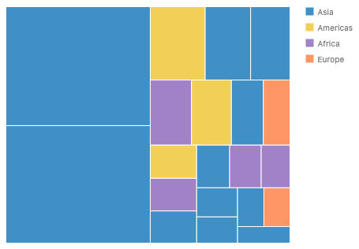

_Nested stacks in user space today, with the size typed by hand. All 20 cells agree to 3e-14 px._

```js
// A tiling written in GoFish: read the box, plan the rows, and return
// stacks of the cells it was given.
const squarified = (cells, weights) =>
  layout(cells, ({ w, h }, cells) =>
    drawPlan(squarify(weights, [w, h]), cells)
  );

squarified(
  countries.map(cell),
  countries.map((d) => d.pop)
).render(container, { w: 360, h: 300 });
```

#### `measure`: a tree's contour fit, in lengths (sketch)

```js
// Kennedy's fit over lengths. It only subtracts, adds a number and takes a
// max, so its result is still a length and the tree takes part in fitting.
const fit = (p, q) =>
  Length.max(
    0,
    ...p.slice(0, q.length).map(([, right], d) => right.sub(q[d][0]).add(GAP))
  );
```

It only subtracts, adds a number and takes a max, so the result is still a length. With the minimum gap as a primitive, user code would not write this at all: `spread` with `Spacing.contour` is this fit.

#### `choose`: alternatives that exist up front (sketch)

```js
// A row when it fits, a column otherwise. Both arrangements exist up front,
// so nothing is created late and both are measured in lengths.
choose([spread({ dir: "x" }, cards), spread({ dir: "y" }, cards)]);
```

Wrapped text is this case. Every way of breaking the text exists up front. With a literal width nothing new is needed. With a width that comes from the room offered, the height has to be measured after the width is placed, which means finishing the x passes before the y measure pass. Only a trade between the two axes needs a set of alternatives carried upward, which is the frontier in the choice proposal.

#### In Python (sketch, not run)

```python
def squarified(cells, weights):
    return layout(
        cells,
        lambda space, cells: draw_plan(squarify(weights, (space.w, space.h)), cells),
    )
```

`layout` takes a function, so it goes through the callback runner, as `derive` does. A function that calls `measure` runs inside the engine, so it is a callback too. Relations and `choose` are data and need no callback.

## Every d3 layout

Each layout was written through GoFish's public API, the way GoFish already writes it where it has a way, and compared with d3's numbers for the same input. (exact) means the difference is rounding. (partly) means some of it matches. (not matched) means the prototype shows it does not fit. (on paper) means it was not run.

d3 layout

Decisions

Relations

Solver

Against d3

pie

a sort

a stack along the angle, sizes on one scale, a polar map

symbolic, today

(exact) angles identical. `padAngle` matches once the sweep is shortened by one gap by hand, because the angle axis does not wrap.

stack: none, expand, silhouette

the series order

a stack per x; normalized sizes; stacks aligned on their middle

symbolic, today

(exact) 0 px at every x, both orders

stack: wiggle

the series order

a stack per x on a baseline that d3 gives by a formula

symbolic, today, with a workaround

(exact) 1e-4 px. The prototype puts the baseline in as an invisible first band. `Baseline.wiggle()` landed on main after it was written (\#1375) and has not been compared with d3 yet.

treemap: squarify, binary, slice, dice

which items share a row

nested stacks whose sizes are shares of the parent

symbolic, today

(exact) 3e-14 px at spacing 0. d3's padding is a different relation from spacing.

partition: icicle, sunburst

none

each node stacked above the stack of its children; the same in a polar map

symbolic, today

(exact) 1e-4 px; angles identical. The sunburst's root disc is not drawn (a bug).

tree (tidy)

none

minimum gaps between subtree contours, slack shared evenly; the parent at the average of its first and last child

symbolic, with the minimum gap

(exact) node for node, on the test tree and 398 random trees. The left-packed and centered variants were run through the one solver. d3's even spread was matched by direct code, not yet through the solver.

cluster (dendrogram)

none

leaves in a spread; levels by minimum gaps packed to the end; the parent at the average of its children

symbolic, with the minimum gap and the average

(exact) all 24 nodes. The average is computed by hand.

sankey, no relaxation

node order, link order

columns by minimum gaps; each column a spread on one shared scale, slack shared evenly; links as stacks against each node's sides; ribbons

symbolic, with the minimum gap

(exact) 0 px for nodes and links, for all four of d3's alignments. GoFish solved d3's scale itself.

sankey, relaxed

node order

each node pulled toward the weighted mean of its neighbors, kept in order and apart

optimizing

(not matched) up to 68 px off. A pull is not a constraint.

pack

which two circles each new circle rests on

touches; the smallest enclosing circle

geometry

(partly) a different greedy rule packs within 4% of d3's radius. d3's own choices replayed as "touches" were not run.

chord

sorts

a spread of groups along the angle, each a stack of sub-arcs; ribbons through the center

symbolic for the arcs, geometry for the ribbons

(partly) arcs match to 1e-5 rad. Ribbons through the center cannot be drawn.

force

none

pulls toward positions, target distances, repulsion, no overlap

optimizing

(drawn only) d3 computed the positions and GoFish drew them.

Voronoi, Delaunay

site positions

a cell is its region cut by one line per other site; Delaunay is which sites are neighbors

geometry (a built-in today)

(exact) cells match d3-delaunay to 1e-4 px

histogram, hexbin, contour, bundle, geo

Not layouts in this sense. They are data transforms, curves and coordinate maps, and GoFish has them as `bin`, `Curve` and `Coord.geo`.

So the layouts that are equations and gaps come out exactly, with no new operator. The ones that do not are the ones whose core relation is touching or pulling. None needed anything outside the three solver families.

#### Pie, sunburst, icicle, chord: stacks and a coordinate map (today)


_Pie. The existing Pie story also matches **d3.pie** to 1e-5 rad._

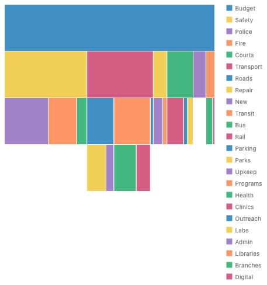

_Icicle. Within 1e-4 px of **d3.partition**, as is the existing Icicle story._

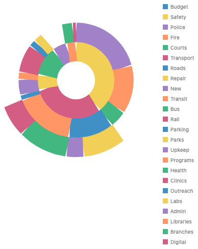

_Sunburst: the same stacks in a polar map._


_Chord arcs. Within 1e-5 rad of **d3.chord**._

```ts
// A pie, as GoFish already writes it: a stack along the angle.
chart(browsers, { coord: Coord.clock() })
  .flow(stack({ by: "name", dir: "x" }))
  .mark(rect({ w: "value", fill: "name" }));

// With d3's padAngle: a spread, and a sweep one gap short of the circle.
chart(browsers, { coord: Coord.clock({ centralAngle: 2 * Math.PI - PAD }) })
  .flow(spread({ by: "name", dir: "x", spacing: PAD }))
  .mark(rect({ w: "value", fill: "name" }));
```

```ts
// An icicle: each node above the stack of its children, widths from data.
const node = (t: Tree): any => {
  const self = rect({ w: v(total(t)), h: ROW, fill: v(t.name) });
  if (!t.children) return self;
  return stack({ dir: "y", alignment: "middle" }, [
    self,
    stack({ dir: "x", alignment: "start" }, t.children.map(node)),
  ]);
};
layer({ w: 360, h: 320 }, [node(budget)]);

// A sunburst: the same node in a polar coordinate space.
layer({ coord: Coord.clock() }, [node(budget)]);
```

**Chord arcs**

```ts
// Chord arcs: a spread of groups along the angle, each a stack of sub-arcs.
layer({ coord: Coord.clock({ centralAngle: 2 * Math.PI - PAD }) }, [
  spread(
    { dir: "x", spacing: PAD, y: 120 },
    matrix.map((row, i) =>
      stack(
        { dir: "x", w: v(sum(row)) },
        row.map((m) => rect({ w: v(m), h: 18, fill: v(names[i]) }))
      )
    )
  ),
]);
```

These are written the way GoFish already writes a pie. They have no plan at all. What is missing: an angle axis that wraps, so a spread around a circle has a gap after the last slice too, and a ribbon that crosses the center.

#### Stack and its offsets (today)


**_stackOffsetNone_**


**_Expand_**

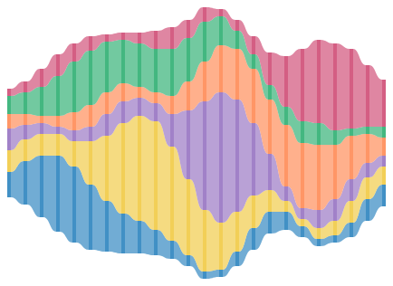

**_Silhouette_**

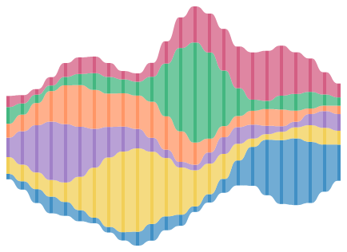

**\*Wiggle**, inside-out order\*

```js
// stackOffsetNone: a stack per x.
chart(rows, { w: 420, h: 300 })
  .flow(
    spread({ by: "x", dir: "x", spacing: 14, alignment: "start" }),
    stack({ by: "series", dir: "y" })
  )
  .mark(rect({ w: 4, h: "amount", fill: "series" }));

// stackOffsetExpand: each stack fills the height.
stack({ by: "series", dir: "y", size: field("amount").normalize() });

// stackOffsetSilhouette: the stacks centered on one line.
spread({ by: "x", dir: "x", spacing: 14, alignment: "middle" });
```

All match d3 at every x. In the prototype, wiggle's baseline and the inside-out order are plans (17 and 15 lines of d3's formulas). Main now has `Baseline.wiggle()`, which should replace the first. d3's diverging offset was not tested. It needs two stacks per x that meet at zero.

#### Treemap: one tiling, many settings (today)


**\*squarify**. 0 px from the built-in.\*


**_strip_**


**_spiral_**

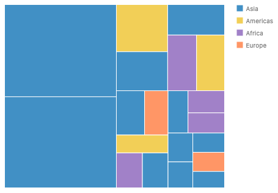

**_pivot_**

Baudel and Broeksema (2012) show the rectangular treemaps are one algorithm with five small functions plugged in: the order, the size, a score that says when to close a row, whether to subdivide a closed row again, and a phrase that says which side the next row goes on. That is the decision. The relations are nested two-child stacks. It works one level at a time, which is what `tile` is.

```ts
const seq = (options) =>
  render(drawSequential(sequential(countries, [W, H], options)));

// squarify
seq({ size: pop, score: Score.squarified(), phrase: Phrase.bestDiscontinuous });
// strip, zigzag, spiral
seq({ size: pop, score: Score.bestMinAspectRatio, phrase: Phrase.strip });
seq({ size: pop, score: Score.bestMinAspectRatio, phrase: Phrase.zigzag });
seq({ size: pop, score: Score.bestMinAspectRatio, phrase: Phrase.spiral });
// grid
seq({ size: () => 1, score: Score.grid, phrase: Phrase.strip });
```

**The decision: 40 lines**

```ts
function sequential<T>(
  items: T[],
  [w, h]: [number, number],
  options: Options<T>
): SeqPlan<T> {
  const { order = (xs) => xs, size, score, phrase, recurse } = options;
  items = order(items);
  const sizes = items.map(size);
  const plan: SeqPlan<T> = [];
  let i = 0;
  while (i < items.length) {
    const remaining = sum(sizes.slice(i));
    const state = { w, h, remaining, total: sum(sizes), count: items.length };
    const config = phrase(plan[plan.length - 1], state);
    const chunk: Chunk<T> = { ...config, items: [], sizes: [], sum: 0 };
    let last = -Infinity;
    while (i < items.length) {
      const next = score(chunk, sizes[i], state);
      if (next < last) break;
      last = next;
      chunk.items.push(items[i]);
      chunk.sizes.push(sizes[i]);
      chunk.sum += sizes[i];
      i++;
    }
    const share = chunk.sum / remaining;
    const box: [number, number] = isColumn(chunk.side)
      ? [w * share, h]
      : [w, h * share];
    if (isColumn(chunk.side)) w *= 1 - share;
    else h *= 1 - share;
    const whole = chunk.items.length === items.length;
    plan.push(
      !whole && recurse?.(chunk)
        ? { ...chunk, subplan: sequential(chunk.items, box, options) }
        : chunk
    );
  }
  return plan;
}
```

**The relations: any plan as nested stacks, 24 lines**

```ts
function drawSequential<T extends Country>(plan: SeqPlan<T>): any {
  const [chunk, ...rest] = plan;
  const reverse = chunk.direction === "up" || chunk.direction === "left";
  const flip = <X>(xs: X[]) => (reverse ? [...xs].reverse() : xs);
  const here = chunk.subplan
    ? drawSequential(chunk.subplan)
    : stack(
        along(isColumn(chunk.side) ? "y" : "x", flip(chunk.sizes)),
        flip(chunk.items).map(cell)
      );
  if (rest.length === 0) return here;
  const parts = [
    { weight: chunk.sum, node: here },
    { weight: sum(rest.map((c) => c.sum)), node: drawSequential(rest) },
  ];
  if (chunk.side === "S" || chunk.side === "E") parts.reverse();
  return stack(
    along(
      isColumn(chunk.side) ? "x" : "y",
      parts.map((p) => p.weight)
    ),
    parts.map((p) => p.node)
  );
}
```

**Proposed: named tilings are presets (sketch)**

```js
// Tiling.squarify is this, by definition.
const squarify = Tiling.sequential({
  score: Score.squarified(),
  phrase: Phrase.bestDiscontinuous,
});

// A tiling GoFish does not have, with no new code in the library.
const spiral = Tiling.sequential({
  score: Score.bestMinAspectRatio,
  phrase: Phrase.spiral,
});

chart(countries)
  .flow(tile({ size: "pop", tiling: spiral }))
  .mark(rect({ fill: "continent" }));
```

> **Fork: what spacing means in a tiling.** d3 tiles the whole box and then shrinks each cell, on one side for a partition. A stack with gaps gives each child its share of the room that is left. Cell areas differ by up to 11% in a treemap at spacing 2, and edges by up to 28 px in an icicle. The built-in tilings can become presets with no pixel change only at spacing 0. This page leans to the stack meaning, since it is the one the primitives give.

#### Tree and dendrogram: minimum gaps and an average (today)


_Exact gaps between bounding boxes, which is all today's primitives give: 446 px._


_Minimum gaps between contours: 314 px, **d3.tree**'s width._


\*Slack at the **start\***

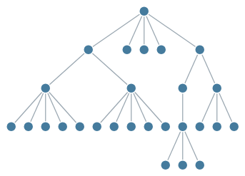

**_center_**


**\*even**. Equals **d3.tree**.\*


_Dendrogram. Equals **d3.cluster**._

Each subtree is at least its contour gap from every earlier sibling. Where the slack goes is the only choice, and d3's is "shared evenly". Nodes of different heights need no new idea: the contour is measured over vertical position, and a layered tree is the case where every node in a row has the same height.

**Proposed (sketch)**

```js
const kids = spread(
  { dir: "x", spacing: Spacing.contour(GAP), alignment: "start" },
  t.children.map((c, i) => tidyTree(c, `${path}.${i}`))
).name(`${path}/kids`);
```

**The minimum-gap solver, as the semantics of the constraint: 56 lines**

```ts
/** pos[before] - pos[after] >= gap. A lower bound `x >= p` is a separation
 *  of gap p from a fixed zero item. */
export type Sep = { after: string; before: string; gap: number };
export type Policy = "start" | "end" | "center";

/** Items in an order where every separation points forward. */
const topoOrder = (items: string[], seps: Sep[]): string[] => {
  const ins = new Map(items.map((id) => [id, 0]));
  for (const s of seps) ins.set(s.before, ins.get(s.before)! + 1);
  const ready = items.filter((id) => ins.get(id) === 0);
  for (let k = 0; k < ready.length; k++)
    for (const s of seps)
      if (s.after === ready[k]) {
        ins.set(s.before, ins.get(s.before)! - 1);
        if (ins.get(s.before) === 0) ready.push(s.before);
      }
  if (ready.length < items.length)
    throw new Error("solveSeparations: the separations have a cycle");
  return ready;
};

/** One pass in order: each item as near `base` as its separations allow. */
const nearest = (
  order: string[],
  into: (id: string) => [string, number][],
  base: number
): Map<string, number> => {
  const pos = new Map<string, number>();
  for (const id of order) {
    const from = into(id).map(([u, gap]) => pos.get(u)! + gap);
    pos.set(id, from.length ? Math.max(...from) : base);
  }
  return pos;
};

/** "start": every item as near the start as its separations allow.
 *  "end": as near the end. "center": the mean of the two. */
export function solveSeparations(
  items: string[],
  seps: Sep[],
  { policy = "start", upper }: { policy?: Policy; upper?: number } = {}
): Map<string, number> {
  const order = topoOrder(items, seps);
  const least = nearest(
    order,
    (id) => seps.filter((s) => s.before === id).map((s) => [s.after, s.gap]),
    0
  );
  if (policy === "start") return least;
  const top = upper ?? Math.max(...least.values());
  // The greatest solution is the least one of the mirrored problem.
  const mirrored = nearest(
    [...order].reverse(),
    (id) => seps.filter((s) => s.after === id).map((s) => [s.before, s.gap]),
    -top
  );
  return new Map(
    items.map((id) => {
      const greatest = -mirrored.get(id)!;
      return [
        id,
        policy === "end" ? greatest : (least.get(id)! + greatest) / 2,
      ];
    })
  );
}
```

**A dendrogram today: levels from the solver, the average by hand**

```ts
// The plan: a level per node, and an x per node in units of one leaf.
const levels = solveSeparations(
  nodes.map((n) => n.path),
  links.map((l) => ({ after: l.parent, before: l.child, gap: 1 })),
  { policy: "end" }
);
const x = new Map<string, number>();
let k = 0;
const walk = (t: Tree, path: string): number => {
  const v = t.children
    ? mean(t.children.map((c, i) => walk(c, `${path}.${i}`)))
    : k++;
  x.set(path, v);
  return v;
};
walk(root, "n");

// The drawing: leaves in a spread, every other node at its computed place.
const dot = (n: Node) => circle({ r: 5 }).name(n.path);
layer([
  spread({ dir: "x", spacing: Spacing.pitch(DX) }, leaves.map(dot)).name(
    "leaves"
  ),
  ...inner.map(dot),
]).relate((c) => [
  Constraint.position(
    { x: ((leaves.length - 1) / 2) * DX, y: levels.get(leaves[0].path)! * DY },
    [c.leaves]
  ),
  ...inner.map((n) =>
    Constraint.position(
      { x: x.get(n.path)! * DX, y: levels.get(n.path)! * DY },
      [c[n.path]]
    )
  ),
  ...links.map((l) => line({}, [ref(l.parent), ref(l.child)])),
]);
```

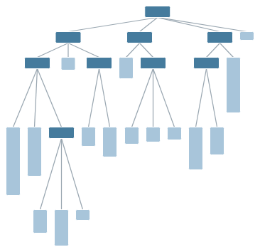

_Layered: 349 by 337 px._


_Non-layered, contours over vertical position (van der Ploeg 2014): 434 by 204 px._

#### Sankey: gaps, one scale, and a decision (today)

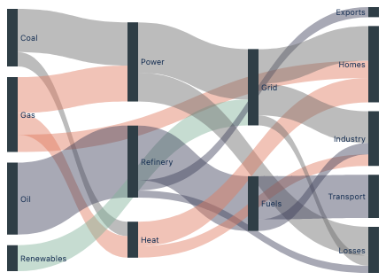

_No relaxation. Nodes and links 0 px from **d3-sankey**._


_An attempt at d3's relaxation with two passes. Up to 68 px off._

| Step in d3-sankey        | What it is                                                                                                                                                                 |
| ------------------------ | -------------------------------------------------------------------------------------------------------------------------------------------------------------------------- |
| A node's column          | A minimum gap per link. Left is slack at the start, right is slack at the end, justify adds one lower bound per sink. d3's center is a two-step rule, so it is a decision. |
| A node's height          | Value on one scale shared by every column. GoFish solves it: each column is a spread with gaps, and the tightest column sets the scale.                                    |
| A node's vertical place  | A minimum gap between neighbors, with the slack shared evenly. The order is a decision.                                                                                    |
| A link's width and place | Its value on the same scale, stacked against its node's side.                                                                                                              |
| Relaxation               | A pull toward the weighted mean of neighbors, repeated six times with damping. Not a constraint.                                                                           |

```js
// Columns: every link's target is at least one column after its source.
const columnsOf = (nodes, links, align) => {
  const seps = links.map((l) => ({
    after: l.source,
    before: l.target,
    gap: 1,
  }));
  const left = solveSeparations(nodes, seps); // d3's sankeyLeft
  if (align === "left") return left;
  if (align === "right")
    return solveSeparations(nodes, seps, { policy: "end" }); // sankeyRight
  // sankeyJustify: the same, with every sink also held at the last column.
  const last = Math.max(...left.values());
  const sinks = nodes.filter((n) => !links.some((l) => l.source === n));
  return solveSeparations(
    ["zero", ...nodes],
    [...seps, ...sinks.map((n) => ({ after: "zero", before: n, gap: last }))]
  );
};
```

```js
// Node heights: GoFish solves d3's one scale (ky) itself. Each column is a
// spread with gaps, and all columns share one scale.
chart(rows, { w: 420, h: 300 })
  .flow(
    spread({ by: "column", dir: "x", spacing: 124, alignment: "start" }),
    spread({ by: "name", dir: "y", spacing: 10, alignment: "start" })
  )
  .mark(rect({ w: 12, h: "value" }));
```

**A node with its links, and a ribbon**

```js
// A node and its links: the links are ports stacked end to end against the
// node's two sides, on the same shared scale, and a ribbon joins each pair.
const sankeyNode = (n, value, outs, ins, links) => {
  const port = (l, side) =>
    blank({ w: 0, h: v(l.value) }).name(`${side}:${links.indexOf(l)}`);
  const ports = (ls, side) =>
    spread(
      { dir: "y", spacing: 0, alignment: "start" },
      ls.map((l) => port(l, side))
    );
  return layer([
    rect({ w: NODE_W, h: v(value), fill: "#2f3e46" }).name(n),
    ports(outs, "o").name(`${n}/out`),
    ports(ins, "i").name(`${n}/in`),
  ]).relate((c) => [
    Constraint.align({ x: "end", y: "start" }, [c[n], c[`${n}/out`]]),
    Constraint.align({ x: "start", y: "start" }, [c[n], c[`${n}/in`]]),
  ]);
};

ribbon({ dir: "x", curve: Curve.bezier() }, [ref(`o:${i}`), ref(`i:${i}`)]);
```

A layered graph is the same without sizes. Its layers come from the same minimum gaps, and ordering by barycenter sweeps took the test graph from 39 crossings to 6.


_Input order: 39 crossings_


_After four ordering sweeps: 6_

#### Circle packing: a decision and "touches" (today)


**\*pack()**, d3's front chain. Radius 149.\*


_A greedy rule in user space. Radius 144._


_Slide in along an angle. Radius 153._


_The greedy rule with squares._

d3 decides which two circles each new circle rests on. Given that, the positions follow from "touches", one circle at a time. Today's solver works on each axis separately, and touching ties x and y together through a square root, so this is the first layout that needs a geometry solver.

```js
// Circle packing as a plan and relations. The plan is d3's front chain: it
// only says which two circles each new circle rests against. A geometry
// solver finds the centers from "touches".
const packed = (children) =>
  layer({ solver: Solver.geometry }, children).relate((c) =>
    restingPairs(children).flatMap(({ circle, on: [a, b] }) => [
      Constraint.touch([c[circle], c[a]]),
      Constraint.touch([c[circle], c[b]]),
    ])
  );
```

- Keeping the list of pairs, instead of positions, means changed data moves the picture smoothly. A reused list can fail when new radii make a circle bump into a third one, so it needs an overlap check.
- It still fits a chart's scale. When every radius comes from data, the whole packing grows with the scale, so it runs once at scale 1 and reports a length. Pixel gaps break that (\#967).
- Two other rules were tried as the decision: "the free spot nearest the center", and "slide in along an angle until something is touched". Both pack within a few percent of d3 and neither is d3's rule.

**The greedy rule today: 31 lines**

```ts
type Pos = { x: number; y: number };
type Placed = Pos & { r: number };

function greedyPlace<T extends { r: number }>(
  items: T[],
  rule: {
    candidates: (item: T, placed: Placed[]) => Pos[];
    cost: (pos: Pos, item: T, placed: Placed[]) => number;
    collides: (pos: Pos, item: T, placed: Placed[]) => boolean;
  }
): Placed[] {
  const placed: Placed[] = [];
  for (const item of items) {
    let best = { x: NaN, y: NaN };
    let bestCost = Infinity;
    for (const pos of rule.candidates(item, placed)) {
      const c = rule.cost(pos, item, placed);
      if (c < bestCost && !rule.collides(pos, item, placed)) {
        best = pos;
        bestCost = c;
      }
    }
    placed.push({ ...best, r: item.r });
  }
  return placed;
}
```

```ts
const packed = greedyPlace(
  seafood.map((d) => ({ r: 4.5 * Math.sqrt(d.count) })),
  {
    candidates: (item, placed) =>
      placed.length === 0
        ? [{ x: 0, y: 0 }]
        : placed.length === 1
          ? [{ x: placed[0].r + item.r, y: 0 }]
          : placed.flatMap((a, i) =>
              placed.slice(i + 1).flatMap((b) => tangentToBoth(a, b, item.r))
            ),
    cost: (pos) => Math.hypot(pos.x, pos.y),
    collides: (pos, item, placed) => overlapsAny(pos, item.r, placed),
  }
);
```

#### Force and the beeswarm: pulls and either-or (today)

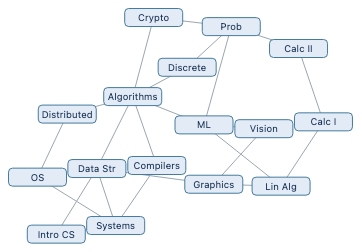

_d3-force computed the positions. GoFish only drew them._

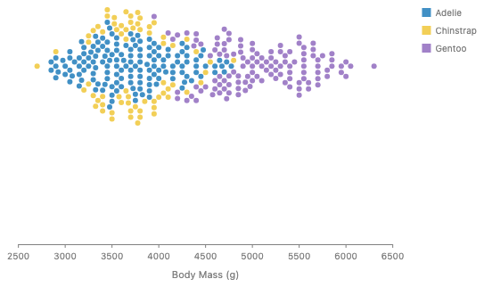

**\*Overlap.separate**. A greedy rule in user space matches it dot for dot.\*

| d3 force                          | What it is                                              |
| --------------------------------- | ------------------------------------------------------- |
| `forceX`, `forceY`, `forceRadial` | a pull toward a position or a circle                    |
| `forceLink`                       | a pull toward a distance between two marks              |
| `forceManyBody`                   | a push between every pair                               |
| `forceCollide`                    | no overlap, which is an either-or between directions    |
| `forceCenter`                     | an exact relation: the mean of all positions is a point |

None of these is an equation or a minimum gap, so a force layout is a different solver: one that minimizes, with a stopping rule and a seed. The beeswarm is on the border. "This dot is at least clear of that one" is a minimum gap, but each pair also needs "above or below", and deciding that is the greedy rule itself. Given those choices, the minimum-gap solver matches the built-in on all 342 dots. Without them it cannot place the swarm.

#### Voronoi and Delaunay (today)


_Random sites_


_Sites moved to their cells' centers 30 times_


**\*Tile.voronoi**: the same loop with a weight per site\*


_Delaunay links_

A cell is its region cut by one straight line per other site, which is how GoFish's own `Tile.voronoi` computes it. So a Voronoi diagram is "intersects" relations, and it belongs with the geometry solver. The decision is where the sites go, and a relaxed layout repeats the diagram with the sites moved. Delaunay is not a layout relation. It is which sites are neighbors, and drawing it needed only named points and `line`.

**Relaxation in user code, drawn by `partition`**

```ts
function relax(sites: Site[], steps: number): Site[] {
  for (let s = 0; s < steps; s++) {
    const voronoi = Delaunay.from(sites.map((d) => [d.x, d.y])).voronoi([
      0,
      0,
      W,
      H,
    ]);
    sites = sites.map((d, i) => {
      const [x, y] = centroid(voronoi.cellPolygon(i) as any);
      return { ...d, x, y };
    });
  }
  return sites;
}

const cells = (sites: Site[]) =>
  chart(framed(sites)) // two extra corner rows, see the list of walls
    .flow(
      partition({
        by: struct({ x: "x", y: "y" }).bin(Bin.voronoi({ seeds: sites })),
      })
    )
    .mark(region({ fill: "continent", stroke: "white", strokeWidth: 1.5 }));

const links = chart(edges)
  .flow(resolve(["source", "target"], { from: selectAll("sites") }))
  .mark(line({ from: "source", to: "target", stroke: "#222" }));
```

## What to build, and what is open

### What to build, by how much it unlocks

1.  **The minimum gap**, with a rule for the slack. Tidy trees, dendrogram levels, sankey columns, layered graphs. One pass, and it stays symbolic. It is a second kind of fact inside the solver: exact gaps glue items into rigid groups, and minimum gaps separate the groups.
2.  **An average of positions.** A parent over its children. The last missing piece of "a linear equation between positions".
3.  **`layout`: read the room offered.** Every tiling, and any mark that adapts to its box.
4.  **One sequential tiling with settings.** `squarify`, strip, spiral, pivot, `slice` and `dice` become presets of it. The built-in `binary` is not shown to be one.
5.  **Custom members (\#1101, \#692).** So a function that returns GoFish can be passed as `tiling:` and work in `.flow()`.
6.  **`measure`, in lengths.** Only the box exists in lengths in the engine today. The circle, the outline and a contour exist only in pixels after layout.
7.  **An angle axis that wraps.** Small, and it removes the workaround in the pie and chord prototypes. The other workaround, a baseline per group on `stack`, is already on main as `Baseline.wiggle()` (\#1375).
8.  **`choose`**, from the choice proposal, with `min` in the size algebra (\#630).
9.  **A relation vocabulary that names its solver.** Needed before a second solver exists, so the first one's relations are not special.

Not proposed: a geometry or optimizing solver now, a constraint that iterates, or a phase language for graph layout.

### What is not settled

#### Three forks

- **The names `layout` and `measure`**, or a second argument to `createMark`. Shown with the API on the first tab.
- **What spacing means in a tiling:** d3's inset or a stack's gap. Shown with the treemap on the second tab. It decides whether the built-in tilings can become presets with no pixel change.
- **The spelling of the minimum gap and its slack rule.** This page writes `Spacing.atLeast(n)` and `justify: "start" | "end" | "center" | "even"`. `justify` is CSS's word. "Even" is what an `fr` gap already does, so the slack rule may be the same option spacing already has.

#### Hard parts

- **Shapes in lengths.** A node tells its parent how big it is before the scale is chosen, as a box. For a contour fit or a packing to take part in fitting, the contour or the circle has to go up in lengths too. The silhouette note is the start of that design.
- **The contract a scope with another solver must meet.** To sit inside a fitted chart its size must be a function of the scale that never shrinks. A packing with data radii meets it. A packing with pixel gaps does not (\#967). A force layout has no such function and would need a fixed box.
- **A pass that creates nodes.** The layout literature avoids it. Ours is contained because what `layout` returns reuses the same node kinds and the same passes, inside a box whose size is set from outside. It still means incremental re-layout needs keyed reuse.
- **Pulls.** Sankey relaxation and graph straightening are not constraints. Solving "at least" and "at most" as one system contradicts itself. They need the optimizing solver, or they stay plan code.
- **Either-or.** The beeswarm and non-overlap in general need a side chosen per pair. The solver can check the choice but not make it.

#### What declared structure buys

| What is known                           | What it allows                                                                          |
| --------------------------------------- | --------------------------------------------------------------------------------------- |
| The decisions did not change, only data | Solve the relations again. Do not decide again. d3's resquarify does this for treemaps. |
| Only the box changed                    | Size requests do not mention the box, so only the solve and the place pass run again.   |
| A node only measures                    | Its passes can be fused, and its children processed in parallel or as arrays.           |
| A scope is contained                    | A change inside cannot spread out, and separate scopes are independent.                 |
| A scope scales evenly                   | Run it once at scale 1 and multiply.                                                    |
| A cost adds up along a sequence         | `choose` can prune alternatives instead of trying every combination.                    |

None of this is measured on GoFish.

### Walls and bugs the prototypes hit

Each is a candidate issue. The stories mark every workaround with a comment.

- **User code cannot read its box, a scale, or a sibling's size.** Plans take the size by hand, and the beeswarm rebuilt GoFish's x scale from a rendered axis.
- **A mark cannot sit at a data value on one axis and a pixel offset on the other.** There is no way to say a coordinate is already in pixels. This also stops a packing from being drawn through `Coord.polar()`.
- **A `stack` nested in a stack or spread along the same axis has no size of its own.** It silently gets an equal share, or lands on top of its siblings. A stack of data-sized parts beside a data-sized rect in a `layer` breaks the rect's size, with no warning.
- **Sizes in nested stacks must be shares of the parent.** Raw weights share one scale across nesting levels.
- **Even slack cannot be stated beside data sizes.** `spacing: fr(1)` with data-sized rects gives the wrong scale.
- **A `distribute` between two nested operands is ignored with no warning**, and `Constraint.position` inside a spread with `alignment: "start"` or `"middle"` is discarded with no warning.
- **`stack({ dir: "y", alignment: "start" })` over a rect and a stack throws a placement conflict** on some trees. `"middle"` works.
- **In polar space:** a rect spanning the full circle draws nothing, a rect with a pixel height is drawn as a thick stroked arc (so `stroke` repaints it and its ends are not radial), a sunburst with data-sized rings gets its radii wrong, a spread along the angle does not wrap, and a `ribbon` runs around the ring instead of across it.
- **`Bin.voronoi` clips to the data's bounding box**, which cannot be set, and a `rect` inside a `Tile.voronoi` treemap draws its cell's bounding box with no error.
- **`stack` along y runs up and `spread` along y runs down** in the same frame.
- **A `.name()` inside a `.mark((d) => ...)` function does not register**, and a `createMark` prop declared `"raw"` arrives wrapped.
- **Rendering a combinator puts the legend inside `w`**, and a layer of positioned marks is shifted so its bounding box starts at the corner.

## Background

### Terms

- **Decision.** A discrete choice a layout makes: an order, a grouping, a side. Also called the plan.
- **Relation.** A fact between shapes that a solver can satisfy: these are 10 apart, these touch.
- **Solver.** The part of the engine that turns one scope's relations into positions.
- **Scope.** A group of nodes solved together. Today, the nodes that share a scale.
- **Length.** A size before the scale is chosen, as a function of the scale.
- **Scale.** Pixels per data unit, the one unknown the symbolic solver finds for a scope.
- **Minimum gap.** "At least this far apart, in this order." Each item takes the nearest position that satisfies all of them.
- **Slack.** The room a minimum gap leaves over. A rule says where it goes.
- **Contour.** The left and right outline of a subtree at each height.
- **Pass.** One sweep over the tree. GoFish has four: resolve what each axis means, measure, solve, place.

### How the passes run

#### The four passes, and where user code runs

```text
parPost Node { meaning } ;                 resolve what each axis means
parPost Node { size(scale) } ;             measure: user `measure` code runs here
[ solve the scale, once per scope ] ;      not a traversal
parPre  Node { x, y, w, h }                place
  { layout -> body ;                       user `layout` body runs here
              parPost { size(scale') } ;   and the same schedule runs again
              [ solve scale' ] ;           on the tree it returned
              parPre  { x, y, w, h } }
```

`parPost` is a bottom-up pass and `parPre` a top-down one, in the notation of Meyerovich and others (2013). A function that calls `measure` runs in the second pass and joins the one solve. A `layout` body runs in the last one, and the same passes then run again on what it returned, inside its box. Nothing ever loops back.

| Rule                                            | Where it comes from                                                          |
| ----------------------------------------------- | ---------------------------------------------------------------------------- |
| A `layout` node's size is set from outside      | CSS container queries require containment; Flutter's relayout boundary       |
| It asks for no room of its own                  | Compose and Flutter refuse size questions through a builder                  |
| Its body arranges children and creates no marks | SwiftUI's `Layout` and CSS Houdini hand the children in                      |
| Its body is pure                                | Julia's generated functions                                                  |
| A length does not leave its scope               | scope extrusion in multi-stage languages                                     |
| Nothing loops back                              | Typst and LaTeX rerun layout; attribute-grammar layout engines reject cycles |

### Precedent

#### Issue \#485, Spytial

A small relational core, with user-space algorithms that hand it discrete commitments. The source of the decisions-and-relations split.

#### Baudel and Broeksema (2012)

Rectangular treemaps as one algorithm with five functions. The decision half of a tiling.

#### Kennedy (1996), van der Ploeg (2014)

A tidy tree as `fit` and `merge` over contours, by depth or by vertical position. The minimum gap for trees.

#### WebCoLa, VPSC

Separation constraints. The either-or part of non-overlap is decided first and only the rest goes to the solver.

#### Auto Layout, TeX glue

One constraint with a relation of equal, at least or at most. Exact and minimum gaps as one idea.

#### SwiftUI Layout, Compose, CSS Houdini, Typst

Offer space, measure children, place them. GoFish's engine runs the same steps inside. They pass boxes; GoFish passes shapes and scales.

#### Compose SubcomposeLayout, Flutter LayoutBuilder

Children built during layout. The model for `layout` and its rules.

#### Scala LMS

`Rep[T]` against `T`: the type says when a value is known. The model for `Length`.

#### Build Systems à la Carte (2018)

Dependencies known up front, chosen among fixed alternatives, or found while running. The three ways to write decisions. Applying it to layout is our reading.

#### Superconductor and its schedule synthesis

Layout as ordered passes over a tree, checked statically. Three to five passes for visualizations. A bottom-up request, a global step and a top-down response is their memory allocation and our measure, solve, place.

#### Spineless Traversal, Servo

Incremental layout needs a tree that does not change during layout. Servo's fixed passes grew from four to seven and were dropped. The cautions for `layout`.

#### Penrose, d3-force

Constraints and energies handed to an optimizer. The model for the third solver, and the reason it is separate.

#### Mojo, GHC, Lean

A small core, with built-ins written as library code on top of it. The test: can a built-in be replaced by library code with no change in output? For squarify, yes.

**Alternatives considered**

- **A function from geometry to geometry per family** (\#1101's first form): a tiling takes a region and weights and returns regions. Cheapest to build. It lowers into nothing, each family has its own signature, and it reaches Python only as a callback. It is a special case of a function that returns GoFish.
- **One solver for everything**, with non-overlap and costs as constraints, as Penrose does. Non-overlap is an either-or and ordering is a permutation, so the result stops being predictable, and nothing in the exact layouts needed it.
- **Positions out of the plan.** What the first prototypes did. It works, but a resize or a data edit has to decide everything again.
- **Circle packing as contour spacing in polar coordinates.** It holds in part: one function packs circles and places a beeswarm. Neither d3's packing nor the built-in beeswarm is that rule, because both use holes a straight slide cannot reach.

### Related issues

- **\#485**: a relational core with user-space solvers that emit commitments. This page is a concrete version.
- **\#806**: cooperating layout theories across a scope boundary. The solver boundary here.
- **\#1101, \#1279, \#692**: user functions as strategy members, the extensibility audit, public `defineOperator`.
- **\#631, \#610, \#355, \#541**: modular layout algorithms, a layout-program IR, decomposing treemap, tree and Sugiyama, treemap as generated constraints.
- **\#486, \#630, \#1194, \#122, \#40**: the choice operator, `min` in the size algebra, choices in chart chrome, wrap, pretty printing.
- **\#37, \#1334**: layout that depends on the offered size, lazy node operators.
- **\#967, \#973, \#974, \#1064**: `pack` fitting its room and its geometry queries.
- **\#1276, \#1355, \#1295**: delete slice and dice, rename treemap to tile, the Voronoi outer shape.
- **\#38, \#618, \#1163**: GoTree examples and parity, extension packages crossing to Python.

Names: this page uses `tile({ tiling: Tiling.squarify })`, decided on 11-17 (draft PR \#1366). The prototype stories run on main, where it is still `treemap({ tile: Tile.squarify })`. Stories: `packages/gofish-graphics/stories/_proposals/UserSpace*.stories.tsx`. Papers not obtained, so described from the papers that cite them: Kastens (1980), Vogt, Swierstra and Kuiper (1989), TreeFuser, Medea, Cassius.
