# Voronoi treemaps (#1222)

> **Settled and implemented (2026-11-02).** `Tile.voronoi` / `Tile.voronoi({ seed })`, with only `seed` exposed (default 0).
> A parent hands its child a convex shape at layout: treemap cells, partition cell outlines and enclose outlines all go through it, and `region()` draws it.
> A rectangular tiling in a non-rectangular region is a loud error that names `Tile.voronoi`. `enclose({ shape })` around a member with no size hands its outline down (box or oval only; in a Voronoi cell, `Shape.box` is the cell).
> `spacing` insets each cell by spacing/2, `padding` the outer region. `Tile.sliceDice` is deleted. Final renders are in `img/final/`.

**Summary.**

- GoFish's `treemap` already lays out one level per flow step, like `pack`, and each level can already use its own tiling.
- A Voronoi treemap is one more tiling, so the proposal is `Tile.voronoi`, plus one new layout ability: a parent can hand its child a convex polygon instead of a box.
- The leaves draw with the existing `region()` mark, and gaps between cells use treemap's existing `spacing`.

**Recommendation.** Approach A, `treemap({ tile: Tile.voronoi })`, with polygon regions passed down in layout. A circular outer boundary comes from an `enclose({ shape: Shape.oval })` step above the treemap. A rectangular tiling inside a polygon cell is a loud error. `Tile.sliceDice` is deleted, because it draws exactly like `Tile.dice` today and per-level steps already express it.

```js
chart(countryPopulations)
  .flow(
    treemap({ by: "continent", size: "pop", spacing: 5, tile: Tile.voronoi }),
    treemap({ by: "region", size: "pop", spacing: 2.5, tile: Tile.voronoi }),
    treemap({ size: "pop", spacing: 1, tile: Tile.voronoi })
  )
  .mark(region({ fill: "continent" }));
```

The Voronoi pictures below come from a throwaway prototype. The prototype computes the polygons in story code and draws them with real GoFish `polygon()` marks. The pictures labeled "today" use the real current API. The prototype is in `packages/gofish-graphics/stories/_proposals/` on branch `worktree-voronoi-treemap-proposal-1222`.

## Terms

- **Tiling.** A rule that cuts one region into one piece per child, with each piece's area proportional to the child's value. Squarify and slice are tilings.
- **Level.** One step of grouping, e.g., continents, then regions inside each continent. In GoFish one level is one operator in `.flow()`.
- **Top-down layout.** The parent's region is fixed first, and the children split it. Every treemap tiling works this way.
- **Bottom-up layout.** The children's sizes are fixed first, and the parent's size follows from them. Circle packing and bubble treemaps work this way.
- **Voronoi diagram.** Given a set of points called sites, each site's cell is the set of points closer to it than to any other site.
- **Power diagram.** A Voronoi diagram where each site also has a weight, and a bigger weight gives a bigger cell. Its cells have straight edges and are always convex.
- **Convex.** A shape is convex when the straight line between any two points inside it stays inside it. Rectangles, circles, hexagons and Voronoi cells are convex. An L shape is not.

## How treemap algorithms work

All the common rectangular tilings take the same two inputs: one node's child values, and the rectangle that node got. None of them look at the levels above or below. This is true in d3, where `treemap(root)` calls `tile(node, x0, y0, x1, y1)` once per internal node from the top down (d3-hierarchy `src/treemap/index.js`). Bruls et al. chose this on purpose in the squarify paper: "we do not consider the subdivision for all levels simultaneously. This leads to an explosion in computation time."

| Tiling                    | How it works                                                                                                                                                                                                                                                 | Order kept | Shapes           |
| ------------------------- | ------------------------------------------------------------------------------------------------------------------------------------------------------------------------------------------------------------------------------------------------------------ | ---------- | ---------------- |
| `Tile.slice`              | Cuts the rectangle into horizontal strips, one per child, top to bottom.                                                                                                                                                                                     | yes        | thin strips      |
| `Tile.dice`               | The same with vertical strips, left to right.                                                                                                                                                                                                                | yes        | thin strips      |
| `Tile.squarify`           | Sorts children largest first. Fills a row along the short side and keeps adding children while the worst aspect ratio in the row improves. When it gets worse, it closes the row and starts a new one in the leftover space. (Bruls, Huizing, van Wijk 2000) | no         | close to square  |
| `Tile.binary`             | Splits the children into two halves of about equal total value. It cuts a wide rectangle left and right and a tall one top and bottom, then recurses. (d3)                                                                                                   | partly     | balanced         |
| `Tile.voronoi` (proposed) | Places one site per child and grows a power diagram. It moves sites and adjusts weights until every cell has its target area. (Balzer and Deussen 2005; Nocaj and Brandes 2012)                                                                              | no         | rounded polygons |

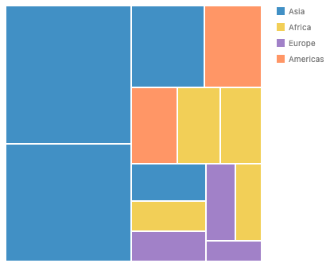 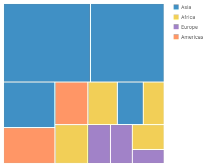 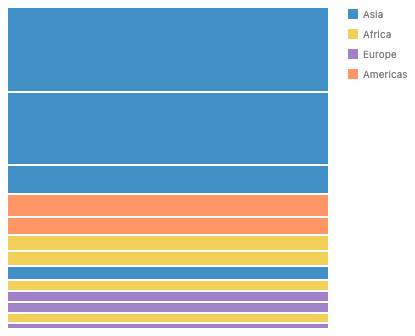 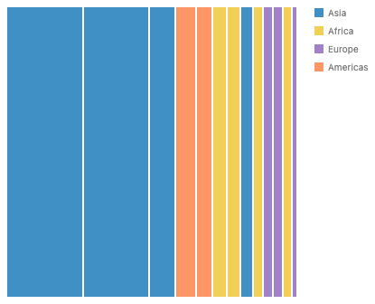 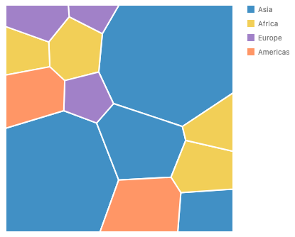

```js
chart(countryPopulations, { w: 320, h: 320 })
  .flow(treemap({ by: "region", size: "pop", spacing: 2, tile: Tile.squarify }))
  .mark(rect({ fill: "continent" }));
```

Other published tilings follow the same pattern: strip and pivot (Bederson, Shneiderman, Wattenberg 2002), split (Engdahl 2005) and spiral. Each one is a greedy rule or a divide step on one level.

### Slice and dice within a level and across levels

Slice and dice are each a single-level tiling. The classic "slice-and-dice treemap" (Shneiderman 1992) is the two of them alternating by depth: level one slices, level two dices, and so on. d3's `treemapSliceDice` is only a switch on `node.depth`. In GoFish each level is its own flow step, so you write the alternation directly, one tiling per step. This works today.

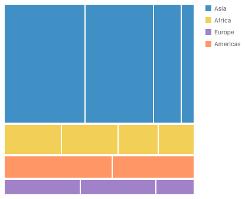

```js
chart(countryPopulations, { w: 320, h: 320 })
  .flow(
    treemap({ by: "continent", size: "pop", spacing: 4, tile: Tile.slice }),
    treemap({ by: "region", size: "pop", spacing: 2, tile: Tile.dice })
  )
  .mark(rect({ fill: "continent" }));
```

`Tile.sliceDice` in GoFish draws exactly like `Tile.dice`. Every GoFish treemap builds its own one-level hierarchy, so the depth is always 0 and d3 always dices. Since the per-level form already expresses alternation, the proposal deletes `Tile.sliceDice` rather than fixing it.

### Is a treemap a dynamic program, like the pretty printer?

No. Squarify, strip, pivot, split and binary are all greedy or divide-and-conquer rules, and the squarify paper says it cannot guarantee the best result. Finding the treemap with the best aspect ratios is strongly NP-hard even for one level (de Berg, Speckmann, van der Weele 2011, Theorem 11). We found no published treemap layout that uses dynamic programming.

The comparison still helps.

- A Wadler-style pretty printer picks line breaks greedily, as squarify picks rows greedily.
- An optimal pretty printer (Bernardy 2017, Porncharoenwase et al. 2023) can be exact because its state is small, a column position below the page width, and its cost adds up line by line.
- A treemap's leftover region is a 2D shape that depends on every earlier choice, and the worst aspect ratio does not add up. So the same method does not apply.
- One case does fit. A strip layout with a fixed order and fixed strip direction is the same problem as breaking a paragraph into lines (Knuth and Plass), and a dynamic program over break points finds the best strips. This is our own observation, and no system we surveyed ships it.

A Voronoi treemap is a third kind. It is an iterative search that settles into a local optimum.

## How a Voronoi treemap is built

One level, inside a convex region:

1. Place one site per child, from a seeded random number generator so the result is repeatable.
2. Give every site the same small weight and compute the power diagram, clipped to the region.
3. Move each site to the center of its cell. This keeps cells round.
4. Compare each cell's area to its target, which is the region's area times the child's share of the total. Grow the weight of a cell that is too small and shrink one that is too large. Keep each weight small enough that the site stays inside its own cell.
5. Repeat steps 3 and 4 until the total area error is below a tolerance, e.g., 1%, or until an iteration cap is reached.

Every cell of a clipped power diagram is convex, so each cell can be the region for the next level. That is why the method nests. The prototype reaches a worst-cell error of 2% to 3% in 13 to 42 ms for 70 countries in three levels.

d3 splits this into three packages, and that split matches GoFish's levels:

- `d3-weighted-voronoi` computes one power diagram.
- `d3-voronoi-map` runs the loop above for one level.
- `d3-voronoi-treemap` repeats `d3-voronoi-map` inside each cell.

## Is GoFish's treemap already compositional?

Yes, mostly. Each `treemap` in `.flow()` lays out one level over its own box (`treemap.tsx:215-251`). Nested steps reproduce d3's nested treemap exactly, and each step can use a different tiling.

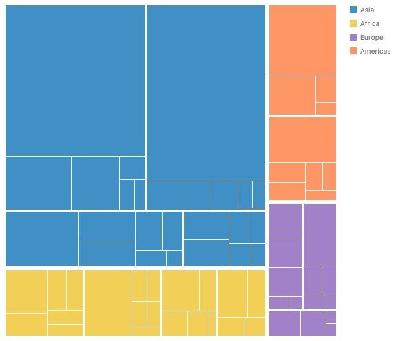

```js
chart(countryPopulations, { w: 480, h: 480 })
  .flow(
    treemap({ by: "continent", size: "pop", spacing: 6 }),
    treemap({ by: "region", size: "pop", spacing: 3 }),
    treemap({ size: "pop", spacing: 1 })
  )
  .mark(rect({ fill: "continent" }));
```

The bubble treemap has the same shape, with `pack` in place of `treemap` and `enclose` steps that draw the contours.

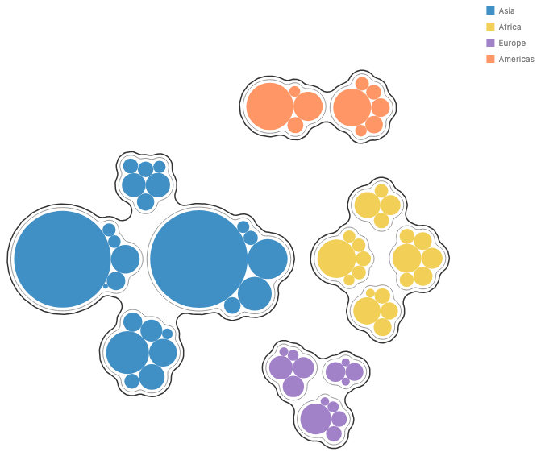

```js
chart(countryPopulations)
  .flow(
    pack({ by: "continent", spacing: 4 }),
    enclose({
      shape: Shape.arcs({ radius: 12 }),
      padding: 4,
      fill: "none",
      stroke: "#333",
    }),
    pack({ by: "region", spacing: 4 }),
    enclose({
      shape: Shape.arcs({ radius: 8 }),
      padding: 4,
      fill: "none",
      stroke: "#999",
    }),
    pack()
  )
  .mark(country);
```

Three things keep treemap from composing freely with everything else.

1. **The region is always a box.** Layout hands a child only a width and a height. A Voronoi level needs its parent's polygon. This is the same gap as the nested-partition TODO in `position.ts:88` (#1059) and a circle pack inside each hex bin (#1064).
2. **Top-down and bottom-up do not meet.** A treemap fills the region it is given. A pack keeps its children at their own size. So a pack of treemaps has no way to say that each treemap's area should follow its total, and every continent below comes out the same size. Fixing this needs an area request with a free aspect ratio (#967, #972). It is out of scope here.
3. **Group padding lives on the treemap.** Treemap has `spacing` (the gap between siblings) and `padding` (an inset at its own edge). Bubble treemaps put the group's gap and outline on an `enclose` step instead. The proposal keeps treemap's keys, and `enclose` still works for drawn outlines (see axis 2).

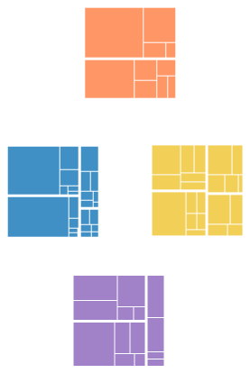

```js
chart(countryPopulations)
  .flow(
    pack({ by: "continent", spacing: 8 }),
    treemap({ by: "region", size: "pop", spacing: 3, w: 100, h: 100 }),
    treemap({ size: "pop", spacing: 1 })
  )
  .mark(rect({ fill: "continent" }));
```

## Precedent

| System                      | Spelling                                                                                                          | What it decides                                                                                           |
| --------------------------- | ----------------------------------------------------------------------------------------------------------------- | --------------------------------------------------------------------------------------------------------- |
| d3-hierarchy                | `d3.treemap().tile(d3.treemapSquarify.ratio(1)).paddingInner(2)`                                                  | One tile function for the tree, called once per node. A custom tile can switch on `node.depth`.           |
| d3-voronoi-treemap (Lebeau) | `d3.voronoiTreemap().clip(circle).convergenceRatio(0.01).maxIterationCount(50).minWeightRatio(0.01).prng(seeded)` | Recursive. The outer boundary is a convex `clip` polygon. Not repeatable unless you pass a seeded `prng`. |
| d3-voronoi-map              | `d3.voronoiMapSimulation(data).weight(d => d.value).clip(poly)`                                                   | One level only. The building block of the treemap package.                                                |
| WeightedTreemaps (R)        | `voronoiTreemap(data, levels = c("gear", "car_name"), cell_size = "wt", shape = "rounded_rect", seed = 123)`      | Recursive Voronoi. Custom shapes are not checked. Only the starting positions can vary per level.         |
| Highcharts                  | `layoutAlgorithm: "squarified", levels: [{ level: 1, layoutAlgorithm: "sliceAndDice" }]`                          | The only surveyed system with a tiling per level as an option.                                            |
| Vega                        | `{ type: "treemap", method: "squarify", ratio: 1.618, paddingInner: 2 }`                                          | One method for the whole tree.                                                                            |
| Plotly                      | `tiling: { packing: "squarify", squarifyratio: 1 }`                                                               | One method per trace. No Voronoi.                                                                         |
| FoamTree                    | `layout: "relaxed"`                                                                                               | Voronoi tiling, one setting for the whole tree.                                                           |
| ggplot2 treemapify          | `geom_treemap(layout = "squarified")`                                                                             | One layout. No Voronoi.                                                                                   |
| Vega-Lite, Observable Plot  | none                                                                                                              | Users compute layouts in d3 and draw rects.                                                               |

What GoFish takes from this:

- Every system calls the Voronoi treemap a tiling choice, either a method value or a separate package that shares the hierarchy code. None of them makes it a new chart type with its own options for size and padding.
- d3's one-level map versus recursive treemap split is the split GoFish already has between one flow step and a chain of them.
- d3 and WeightedTreemaps both need a seed for repeatable output. GoFish's `noise` strategy already uses `seed`.
- The outer boundary is a `clip` option in d3 and a `shape` option in WeightedTreemaps. In GoFish it can come from the parent (see axis 3).

## Approaches

The design has three independent questions.

- Axis 1 asks where the Voronoi algorithm lives.
- Axis 2 asks where gaps and group outlines live.
- Axis 3 asks where the outer boundary comes from.

### Axis 1, approach A (recommended): `Tile.voronoi` on `treemap`

Voronoi becomes one more member of the `Tile` family. Each level is one `treemap` step. Leaves draw with `region()`, the mark that already fills its partition cell, and which would now also fill its treemap cell.

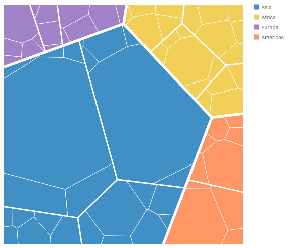

```js
chart(countryPopulations)
  .flow(
    treemap({ by: "continent", size: "pop", spacing: 5, tile: Tile.voronoi }),
    treemap({ by: "region", size: "pop", spacing: 2.5, tile: Tile.voronoi }),
    treemap({ size: "pop", spacing: 1, tile: Tile.voronoi })
  )
  .mark(region({ fill: "continent" }));
```

```python
chart(COUNTRY_POPULATIONS).flow(
    treemap(by="continent", size="pop", spacing=5, tile=Tile.voronoi),
    treemap(by="region", size="pop", spacing=2.5, tile=Tile.voronoi),
    treemap(size="pop", spacing=1, tile=Tile.voronoi),
).mark(region(fill="continent"))
```

Mixing levels works when the outer tiling hands down a shape the inner one accepts. A rectangle is convex, so Voronoi inside squarify works:

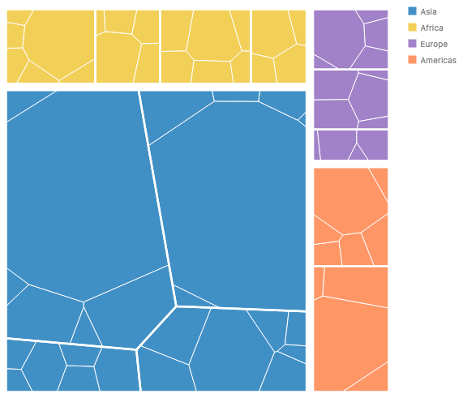

```js
chart(countryPopulations)
  .flow(
    treemap({ by: "continent", size: "pop", spacing: 8 }),
    treemap({ by: "region", size: "pop", spacing: 2.5, tile: Tile.voronoi }),
    treemap({ size: "pop", spacing: 1, tile: Tile.voronoi })
  )
  .mark(region({ fill: "continent" }));
```

The reverse, squarify inside a Voronoi cell, has no correct answer, because squarify assumes a rectangle. Laying it out in the cell's bounding box would break the area encoding. So it is a loud error that names the fix:

```js
chart(countryPopulations)
  .flow(
    treemap({ by: "continent", size: "pop", tile: Tile.voronoi }),
    treemap({ by: "region", size: "pop", tile: Tile.squarify })
  )
  .mark(region({ fill: "continent" }));
// Error: treemap (by "region"): Tile.squarify needs a rectangular region,
// but this treemap sits in a Voronoi cell. Use Tile.voronoi here.
```

A later polygon tiling, e.g., angular treemaps (Liang et al. 2012), could fill that gap as a new `Tile` member.

**Hard example: a pack inside each Voronoi cell.** This mixes top-down and bottom-up. The prototype draws it with one shared circle scale, chosen so that every continent's pack fits its cell's inscribed circle. The picture shows the tension. Cell area and circle area both show population, and the thinnest cell (Europe) sets the scale, so the packs look small in the big cells. This is a design problem of the chart itself, not of the API. It needs the pack fitting from #967 before it renders well.

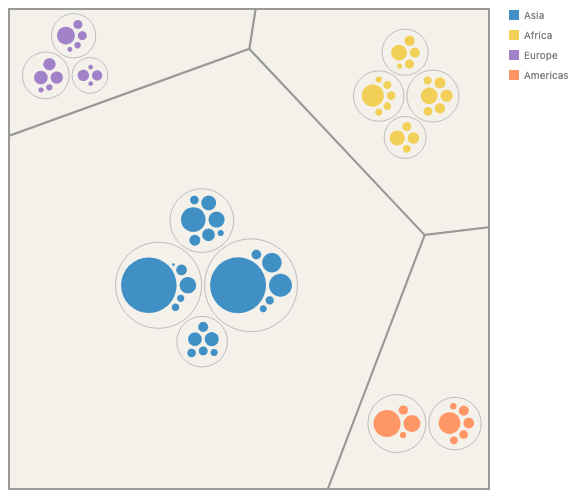

```js
chart(countryPopulations)
  .flow(
    treemap({ by: "continent", size: "pop", tile: Tile.voronoi }),
    pack({ by: "region", spacing: 4 }),
    enclose({ shape: Shape.arcs({ radius: 8 }), padding: 4, fill: "none" }),
    pack()
  )
  .mark(country);
```

**Hard example: Voronoi treemaps inside hex bins (no render).** A hex cell is convex, so once partitions hand their cells down as regions (#1059), this needs nothing new:

```js
chart(sightings)
  .flow(
    partition({
      by: struct({ x: "lon", y: "lat" }).bin(Bin.hex({ radius: 1 })),
    }),
    treemap({ by: "species", size: "count", tile: Tile.voronoi })
  )
  .mark(region({ fill: "species" }));
```

**How it composes.**

- It desugars into the existing `treemap` node. The only change to the core is that a layout region may be a convex polygon as well as a box.
- That polygon region has three producers: treemap cells of any tiling, partition cells (`Bin.hex`, `Bin.voronoi`), and `enclose` with a shape (axis 3).
- It has three consumers: `treemap` itself, `region()`, and later `pack`, which could fit inside a polygon.
- Coordinate transforms: a Voronoi treemap in `Coord.polar` would bend its straight edges. This is the same as a rect treemap today, and it needs no special case.
- Animation: a seeded start gives the same picture on every render. Stable layouts across data changes, e.g., Hahn et al. 2014, would be a later option on the strategy.
- Python: `Tile.voronoi` comes from the generated `Tile` module. Nothing new crosses the wire except the strategy kind.

**Overlap check.**

- `Bin.voronoi({ seeds })` also makes Voronoi cells. It is a small shared case, not a large overlap. A partition puts each row in the cell nearest its position in data. A treemap makes one cell per group, sized by value, and ignores position. Both should share one clipping and power-diagram routine (`geometry/clip.ts` already has `clipToConvex` and `insetConvex`).
- With pack there is no overlap. Pack is bottom-up and treemap is top-down.

**Trade-offs.**

- Easy: no new operator, and every treemap option keeps its meaning (`by`, `size`, `spacing`, `padding`, `sort`).
- Awkward: some combinations of tilings become errors, and users learn which tilings need a rectangle.
- New terms: `Tile.voronoi`, plus the `seed` option it takes. The rule "a region can be a polygon" is new inside the library, but users only see it as fewer errors.
- Extending: a custom tiling (#1101) would receive a region, either a box or a polygon, and return one region per child. That is the d3 tile signature with a polygon in place of four numbers.

### Axis 1, approach B: a separate `voronoi` operator

This mirrors d3's packages, with a `voronoi()` operator as a sibling of `treemap` and `pack`.

```js
chart(countryPopulations)
  .flow(
    voronoi({ by: "continent", size: "pop", spacing: 5 }),
    voronoi({ by: "region", size: "pop", spacing: 2.5 }),
    voronoi({ size: "pop", spacing: 1 })
  )
  .mark(region({ fill: "continent" }));
```

Its pictures are the same as A's. It overlaps `treemap` almost completely, since both take values and a region and return one cell per group, with the same `by`, `size`, `spacing` and `padding`. That is the large partial overlap that the API rules warn against. Mixing squarify and Voronoi levels would also look like two different operators, when to the reader they are two tilings of one idea. We recommend against B.

### Axis 1, approach C: a weighted Voronoi partition

`partition({ by: struct({ x, y }).bin(Bin.voronoi({ seeds, weight })) })` would add weights to the Voronoi binning that exists today. This is a useful feature on its own, but it is not a treemap. A partition decides cells from where the data sits, and a treemap decides cells from how much each group holds. A treemap of continents has no seed positions to give. We list it only as a foil, and so the two features keep separate names.

### Axis 2: where gaps and group outlines live

**(i), recommended: treemap's own `spacing` and `padding`.** These keep the meaning they have in every tiling today. `spacing` is the gap between sibling cells, done by shrinking each cell by half the spacing with `insetConvex`. `padding` is the inset at the treemap's own outer edge. White gaps that grow toward the top level are the usual Voronoi treemap look, and the prototype pictures above use them.

**(ii), also works: `enclose` for a drawn outline.** If you want a colored outline around a group, as in the bubble treemap, add an `enclose` step. The union of a group's cells is its parent cell, so enclose's outline is that cell. This needs cells to report their outlines (#1233), which pack already does.

```js
chart(countryPopulations)
  .flow(
    treemap({ by: "continent", size: "pop", spacing: 6, tile: Tile.voronoi }),
    enclose({
      shape: Shape.box,
      fill: "none",
      stroke: "#333",
      strokeWidth: 1.5,
    }),
    treemap({ by: "region", size: "pop", spacing: 3, tile: Tile.voronoi }),
    treemap({ size: "pop", spacing: 1, tile: Tile.voronoi })
  )
  .mark(region({ fill: "continent" }));
```

(i) and (ii) do not compete. (i) is the default, and (ii) composes for free once cells have outlines. The one thing we do not propose is moving treemap's `padding` onto `enclose` to match the bubble treemap exactly. In a bottom-up pack, enclose padding grows the group outward. In a top-down treemap the same number would have to shrink the region inward. One word with two directions is a trap.

`Shape.box` in a polygon cell would mean the cell itself. If that reads badly, a `Shape.cell` member could name it. This is listed as a decision.

### Axis 3: where a circular outer boundary comes from

**(a), recommended: an `enclose` step with a shape above the treemap.** When enclose's child fills its region, as a treemap does, enclose hands its own shape down as the child's region. The circle is a property of the container, and it uses the same polygon region mechanism as hex bins.

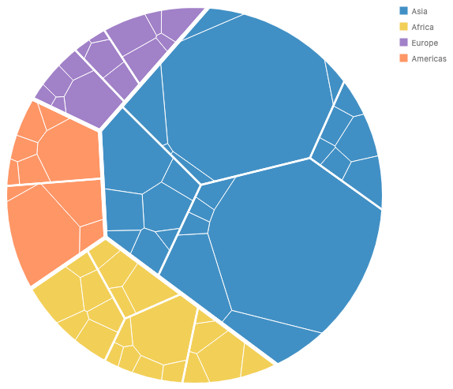

```js
chart(countryPopulations)
  .flow(
    enclose({ shape: Shape.oval, fill: "none" }),
    treemap({ by: "continent", size: "pop", spacing: 5, tile: Tile.voronoi }),
    treemap({ by: "region", size: "pop", spacing: 2.5, tile: Tile.voronoi }),
    treemap({ size: "pop", spacing: 1, tile: Tile.voronoi })
  )
  .mark(region({ fill: "continent" }));
```

```python
chart(COUNTRY_POPULATIONS).flow(
    enclose(shape=Shape.oval, fill="none"),
    treemap(by="continent", size="pop", spacing=5, tile=Tile.voronoi(seed=7)),
    treemap(by="region", size="pop", spacing=2.5, tile=Tile.voronoi),
    treemap(size="pop", spacing=1, tile=Tile.voronoi),
).mark(region(fill="continent"))
```

This gives `enclose` a second mode. Around content with its own size, enclose hugs the content. Around content that fills its space, the content fills enclose's shape. CSS boxes work the same way, with the content setting the box or the box setting the content. Only convex shapes are allowed, so `Shape.box` and `Shape.oval` work, and `Shape.arcs` and `Shape.blob` around a filling child are errors.

**(b): a `clip` option on the strategy, as in d3.**

```js
treemap({
  by: "continent",
  size: "pop",
  tile: Tile.voronoi({ clip: Shape.oval }),
});
```

This is simpler to build, but only Voronoi would get a circle. A squarify treemap in a circle has no meaning, but a pack in a circle or a Voronoi treemap in a hexagon would each need their own clip option. We pick (a) because it reuses the region mechanism that approach A needs anyway.

## Recommendation

Approach A with (i) and (a): `treemap({ tile: Tile.voronoi })`, `region()` leaves, treemap's `spacing` and `padding`, and `enclose({ shape: Shape.oval })` for a round boundary.

- **It desugars into the existing core.** It adds a strategy and lets a layout region be a convex polygon. The polygon region also closes #1059's nested-partition TODO and #1064. Following "Why keep the core small" in `principles.md`, the long tail grows as strategies and the mechanism stays fixed.
- **One concept is one operator.** A Voronoi treemap is a treemap with a different tiling, and every surveyed library treats it that way. B would be a large partial overlap with `treemap` (api-design.md, "Overlap is fine at the edges, not in the middle").
- **Few new terms.** The new terms are `Tile.voronoi` and `seed`. `region()` and `enclose` gain cases they already suggest.
- **It matches recent decisions.** Strategies are uppercase family members and bare kinds are values (#1013, #1145). `spacing` is the sibling gap and `padding` the outer inset (#1005). `seed` is spelled as in `noise`.
- **It errors loudly.** A rectangular tiling in a polygon cell is an error that names the fix, not a picture with the wrong areas.
- **It is the same in Python.** Python gets `tile=Tile.voronoi(seed=7)` from the generated module.

**Runner-up.** Axis 3(b), `Tile.voronoi({ clip })`, if giving `enclose` a filling mode turns out to be too much for one change. We would switch to it if the polygon region mechanism slips, because (b) needs nothing from layout for the outer boundary. Inner levels would still need polygon regions.

**Cleanups folded in.**

- Delete `Tile.sliceDice`. It draws like `Tile.dice`, and per-level steps express the alternation.
- Treemap writes the global `scaleContext.x` and `.y` (`treemap.tsx:204-213`), so nested treemaps overwrite each other. Polygon regions should replace that write.
- #1069: treemap has no `serialize`, so JS `toJSON` loses it.

## Decisions for Josh

1. Is `Tile.voronoi` on `treemap` the right home, rather than a separate `voronoi` operator?
2. Should the leaf mark be `region()`, the partition cell mark, rather than a new mark or a stretched `rect`?
3. Is a rectangular tiling inside a polygon cell a loud error, rather than falling back to the bounding box?
4. Should `enclose({ shape })` around a filling child hand its shape down, for a circular boundary? Or should Voronoi take `clip` as in d3?
5. Should `Tile.voronoi` take only `seed`, with tolerance and iteration cap fixed inside? d3 exposes `convergenceRatio`, `maxIterationCount` and `minWeightRatio`.
6. Is it OK to delete `Tile.sliceDice`?
7. In a polygon cell, should `Shape.box` mean the cell, or do we add `Shape.cell`?

**User-facing syntax to review.**

- New: `Tile.voronoi`, `Tile.voronoi({ seed })`.
- New use of `region()` as a treemap leaf.
- New `enclose` mode around a filling child.
- Removed: `Tile.sliceDice`.

## Related issues

- #1222: this issue, "voronoi treemap: can this be done more compositionally?"
- #1221, #1226: bubble treemaps, with `enclose` as a flow step, `Shape.arcs` and pack `spacing`.
- #1005: treemap tile strategies as objects, and the meaning of `spacing` and `padding`.
- #1013, #1145: strategy families as uppercase namespaces, and bare kinds as values.
- #1059: 2D partitions, `Bin.voronoi`, the `region()` mark, and the nested-partition TODO.
- #1064: a circle pack inside each hex bin, which needs the same polygon region.
- #967, #972: pack fitting to its space, and area requests, needed for top-down and bottom-up to meet.
- #973, #974, #1233: pack padding, the boundary query, and containers reporting their children's outlines.
- #1201: non-convex intersect and offset.
- #1004: a data-driven leaf size inside a treemap renders NaN.
- #1069: treemap is missing from JS `toJSON`.
- #1101: custom strategies.
- #541, #631: treemap and other layouts as constraint generators.

## Sources

- Shneiderman 1992, "Tree visualization with tree-maps", ACM TOG 11(1).
- Bruls, Huizing, van Wijk 2000, "Squarified treemaps", VisSym.
- Bederson, Shneiderman, Wattenberg 2002, "Ordered and quantum treemaps", ACM TOG 21(4).
- de Berg, Speckmann, van der Weele 2011, "Treemaps with bounded aspect ratio", arXiv:1012.1749.
- Balzer and Deussen 2005, "Voronoi treemaps", InfoVis.
- Nocaj and Brandes 2012, "Computing Voronoi treemaps: faster, simpler, and resolution-independent", CGF 31(3).
- Hahn, Trümper, Moritz, Döllner 2014, "Visualization of varying hierarchies by stable layout of Voronoi treemaps", IVAPP.
- Liang, Nguyen, Simoff, Huang 2012, "Angular treemaps", IV.
- Porncharoenwase et al. 2023, "A pretty expressive printer", OOPSLA. Bernardy 2017, "A pretty but not greedy printer", ICFP.
- d3-hierarchy, d3-voronoi-treemap, d3-voronoi-map, WeightedTreemaps, Highcharts, Vega, Plotly and FoamTree documentation.
