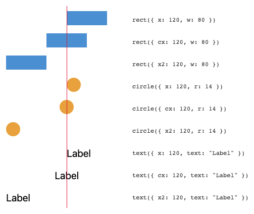
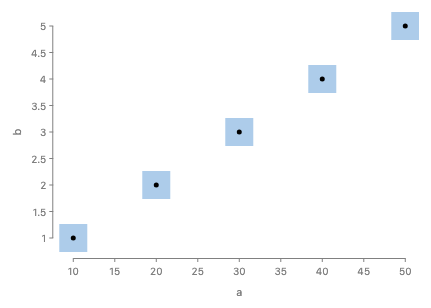
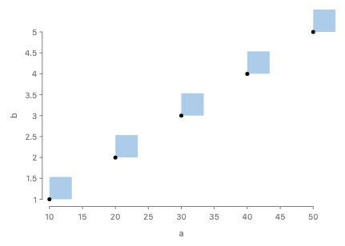
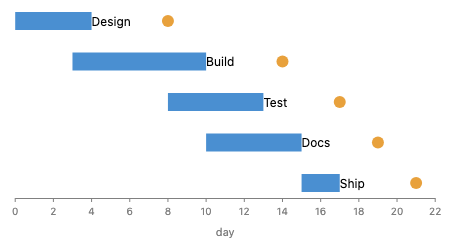
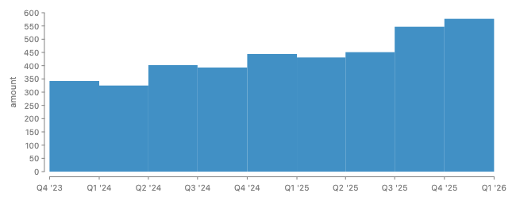

# What `x` means: one rule for `x`, `cx`, `x2` (#1376, PR #1378)

Review page: https://claude.ai/artifact/HpxjPmHDmHRQRZjt35evAX

**Summary.** PR #1378 renames `scatter`'s `xMin`/`xMax` to `x`/`x2`, like `rect`. That exposed a split: on a mark a bare `x` is the start edge, and in `scatter` it is the center, switching to the start edge when `x2` is given. The API also has two word sets for the same three places on a box, `min`/`center`/`max` and `start`/`middle`/`end`.

**Recommendation.** One rule everywhere: `x` is the start edge, `cx` the center, `x2` the end edge, `w` the size (and the same for `y`). `scatter` reads the same keys as a mark, so a point is `scatter({ cx, cy })` and a span is `scatter({ x, x2 })`. One vocabulary, `start` / `center` / `end`, which Josh approved on 2026-11-17. Nothing is implemented.

Issue #1376 is "revisit the naming of interval ends". Issue #281 asks start/middle/end against min/center/max. Issue #1178 is "a lone `x2` is silently ignored". Issue #130 is "two ways to talk about boxes". Issue #681 settled that a mark's `y` is the edge of its box, for text as for a rect.

## Terms

- **Start, center, end.** The three places on a box along one axis. Start is where the axis starts, so it is the left edge on a left-to-right axis, and the top or the bottom edge of `y` depending on which way y reads.
- **Span.** A mark placed by two ends, `x` and `x2`.
- **Glyph.** A mark whose size is in pixels and that is placed at one data value.

## What the code does today (at the #1378 head)

| Construct                            | Bare `x`                                               | `cx`              | `x2`                                           |
| ------------------------------------ | ------------------------------------------------------ | ----------------- | ---------------------------------------------- |
| `rect`, `ellipse`, `circle`, `image` | start edge                                             | center            | end edge with `x`; alone it is ignored (#1178) |
| `text`                               | the `textAnchor` point                                 | center of the box | ignored                                        |
| `scatter`                            | the child's **center**; with `x2`, the start of a span | not an option     | end of the span                                |
| `Constraint.position`                | a point, default anchor `"middle"`                     |                   | pair `[min, max]`                              |
| `position` operator                  | the child's start corner                               |                   |                                                |
| `layer`, `spread`, `stack` box       | start edge                                             |                   |                                                |

The mark table (`MARK_DIMS`, `dims.ts`) maps a bare value to `min`. The scatter table (`SCATTER_DIMS`, `scatter.tsx`) maps it to `center` and rewrites it to `min` when a `max` is present. That rewrite is the cause of both open questions in #1378's description.

`start`/`middle`/`end` and `min`/`center`/`max` are exact synonyms: `BOX_ANCHOR` in `constraints/placementProgramLowerer.ts` maps one to the other.

## Examples

Every picture is a real GoFish render at the #1378 head. The prototype story is `prototype.stories.tsx.txt` in this folder.

### 1. Marks already follow the rule



The red line is at 120. `x` puts the start edge on it and `cx` the center, for a rect, a circle and a text alike. The `x2` rows show #1178: a lone `x2` is ignored and the mark draws at 0. Under the rule it ends at 120.

```js
rect({ x: 120, w: 80 }); // start edge at 120
rect({ cx: 120, w: 80 }); // center at 120
rect({ x2: 120, w: 80 }); // end edge at 120
```

### 2. A scatterplot is `scatter({ cx, cy })`



```js
// proposed
chart(points, { w: 360, h: 240 })
  .flow(scatter({ cx: "a", cy: "b" }))
  .mark(rect({ w: 28, h: 28 }))
  .render(container);

// today
chart(points, { w: 360, h: 240 })
  .flow(scatter({ x: "a", y: "b" }))
  .mark(rect({ w: 28, h: 28 }))
  .render(container);
```

```python
chart(points, w=360, h=240).flow(
    scatter(cx="a", cy="b")
).mark(rect(w=28, h=28))
```

**The one real fork.** Under the rule, `scatter({ x: "a", y: "b" })` draws this, with the start edges on the data points:



Today this picture needs a mark's own `x` inside `group`; a lone `scatter({ dims: { x: { min: "a" } } })` throws "a span needs both ends". The cost of the rule is that every other charting library writes a scatterplot with `x` and `y`, so a newcomer who writes `scatter({ x, y })` gets marks shifted by half their size with no error. The alternative is that `scatter` keeps `x` as the center, and with it the switch to the start edge when `x2` is given. I pick the rule. The familiar `scatter(x=, y=)` for the Python audience is the argument that would change the pick.

### 3. Bars, milestones and labels on one axis



```js
// proposed
chart(tasks, { w: 420, h: 180 })
  .flow(scatter({ by: "task", x: "start", x2: "end", cy: "row" }))
  .mark(rect({ h: 18 }))
  .layer(
    chart(tasks)
      .flow(scatter({ by: "task", cx: "due", cy: "row" }))
      .mark(circle({ r: 6 }))
  )
  .layer(
    chart(tasks)
      .flow(scatter({ by: "task", x: "end", cy: "row" }))
      .mark(text({ text: "task" }))
  )
  .render(container);
```

```js
// today (how the picture was drawn)
chart(tasks, { w: 420, h: 180 })
  .flow(scatter({ by: "task", x: "start", x2: "end", y: "row" }))
  .mark(rect({ h: 18 }))
  .layer(
    chart(tasks)
      .flow(scatter({ by: "task", x: "due", y: "row" }))
      .mark(circle({ r: 6 }))
  )
  .layer(
    chart(tasks)
      .flow(group({ by: "task" }))
      .mark(text({ x: "end", cy: "row", text: "task" }))
  )
  .render(container);
```

In today's version, the first `scatter` reads `x` as a start edge and `y` as a center in one call, the second reads `x` as a center, and the label cannot be a `scatter` at all.

### 4. Spans stay as #1378 has them



```js
scatter({ by: "start", x: "start", x2: "end" });
```

### 5. The words

```js
// proposed
rect({ dims: { theta: { start: 0, end: 90 } } });
spread({ dir: "x", alignment: "center" }, [a, b]);
Place.along({ at: "x-end" });

// today
rect({ dims: { theta: { min: 0, max: 90 } } });
spread({ dir: "x", alignment: "middle" }, [a, b]);
Place.along({ at: "x-max" });
```

## The other spellings

Written on the Gantt bar and a plain rect.

| Spelling                      | JavaScript                                                             | Verdict                                                                                                                                                               |
| ----------------------------- | ---------------------------------------------------------------------- | --------------------------------------------------------------------------------------------------------------------------------------------------------------------- |
| `x` / `cx` / `x2`             | `scatter({ x: "start", x2: "end", cy: "row" })`                        | Proposed. Short, already what marks use, and Vega's rect takes the same set (`x`, `xc`, `x2`, `width`). `x2` does not say "end".                                      |
| `xStart` / `xCenter` / `xEnd` | `scatter({ xStart: "start", xEnd: "end", yCenter: "row" })`            | Nothing is unmarked, but three options that share a prefix are a hierarchy written into names (the "nest a role instead of prefixing its name" rule), and it is long. |
| `"x-start"` / `"x-end"`       | `scatter({ "x-start": "start", "x-end": "end" })`                      | Needs quotes in JavaScript and cannot be a Python keyword argument. Fine as a value (`"x-end"`), not as a key.                                                        |
| `x: { start, center, end }`   | `scatter({ x: { start: "start", end: "end" }, y: { center: "row" } })` | The regular form, which exists today as `dims`. Heavy as the only form, and a bare `x: 0` short form brings the question back. Kept under `dims`.                     |
| `x` center, `x1`/`x2` edges   | `scatter({ x1: "start", x2: "end", y: "row" })`                        | The charting-grammar rule (ggplot2, Observable Plot). Flips every mark: `rect({ x: 0, w: 90 })` would be centered on 0, against SVG, CSS, Figma and #681.             |

**Center or middle:** center. `cx` already says it, and CSS, Typst, SwiftUI, Flutter, Figma and Auto Layout say "center" on both axes. "Middle" is mostly the vertical word beside a horizontal "center" (Plotly `yanchor`, Vega-Lite `baseline`).

## Precedent

From my knowledge of each system's documentation; not fetched again for this proposal.

| System          | Bare `x`                              | Other places                                                       |
| --------------- | ------------------------------------- | ------------------------------------------------------------------ |
| SVG             | rect: left edge                       | circle `cx`; line `x1`/`x2`; `text-anchor: start \| middle \| end` |
| Vega            | left edge                             | `xc`, `x2`, `width`                                                |
| Canvas 2D       | `fillRect`: corner; `arc`: center     |                                                                    |
| Processing, p5  | corner for rect, center for ellipse   | `rectMode`, `ellipseMode`                                          |
| CSS             | `left`, `inset-inline-start`          | `start \| center \| end`                                           |
| Figma           | left edge                             | `MIN \| CENTER \| MAX`                                             |
| Typst, Flutter  |                                       | `start \| center \| end`                                           |
| SwiftUI         | `position` places the center          | `leading \| center \| trailing`                                    |
| TikZ            | node centered on its coordinate       | `anchor=west`                                                      |
| ggplot2         | center                                | `xmin`, `xmax`, `hjust`                                            |
| Observable Plot | center or band                        | `x1`, `x2`                                                         |
| Vega-Lite       | center for a point, one end with `x2` | depends on the mark type                                           |
| matplotlib      | bar: center unless `align="edge"`     | Rectangle: lower-left corner                                       |
| Plotly          |                                       | shapes `x0`/`x1`; `xanchor: center`, `yanchor: middle`             |

Graphics systems read `x` as an edge. Charting grammars read it as a center or let it depend on the mark type. GoFish draws charts and diagrams with the same marks, so it cannot take a per-chart-type reading.

## What changes

**The `x` / `cx` / `x2` rule**

| Construct                             | Under the rule                                                                                                                                    |
| ------------------------------------- | ------------------------------------------------------------------------------------------------------------------------------------------------- |
| `rect`, `ellipse`, `circle`, `image`  | No change to `x` and `cx`. A lone `x2` places the end edge (#1178).                                                                               |
| `text`                                | `x` is always the start edge. `textAnchor: "middle"` with `x` becomes `cx`. Whether `textAnchor` is still needed is a follow-up.                  |
| `scatter` bare `x`                    | The start edge. `cx` is the center. About 170 JavaScript and 110 Python lines in stories and docs change `x` to `cx` (grep counts, upper bounds). |
| `scatter` `dims`                      | Same reading as a mark's `dims`. `SCATTER_DIMS` is deleted.                                                                                       |
| `Constraint.position({ x })`          | Takes `x`, `cx`, `x2`. The pair becomes `x` and `x2`.                                                                                             |
| `position` operator, operator box `x` | No change.                                                                                                                                        |
| `petal`                               | Left alone; being replaced (#1339).                                                                                                               |

**The vocabulary**

| Spelling                                      | Today                                      | After                                        |
| --------------------------------------------- | ------------------------------------------ | -------------------------------------------- |
| `dims` interval object                        | `{ min, center, max, size, embedded }`     | `{ start, center, end, size, embedded }`     |
| Box anchor type                               | `"min" \| "center" \| "max" \| "baseline"` | `"start" \| "center" \| "end" \| "baseline"` |
| `alignment`, connector anchors, overlap sides | `"start" \| "middle" \| "end"`             | `"middle"` becomes `"center"`                |
| `Place.along({ at })`, label edges            | `"x-min"`, `"x-max"`, `"middle"`           | `"x-start"`, `"x-end"`, `"center"`           |
| Label alignment, axis `side`, bin cells       | already `start` / `center` / `end`         | no change                                    |
| Internal `box.min`/`box.max`, `x0`/`x1`       |                                            | renamed with the public ones (#130)          |

**Found along the way**

- `scatter({ dims: { x: { min: "a", max: "a" } } })` sizes a 28 px rect to zero, with no error.
- A category on `scatter`'s `x`: the code reads as placing the child's center at the start of its band, where the docs say the center of its position. Not rendered.
- `Constraint.position`'s doc comment says the `position` operator places marks at their center. It places the start corner.

## What this means for #1378

Its `x`/`x2` span is the rule's spelling. Both open questions in its description go away: a bare `x` and `{ center }` no longer share a slot, and the three keys become one kind of channel. I would add the `cx`/`cy` change to #1378 before it merges, so the switching rule and its docs never ship, and do the vocabulary rename as its own PR.

## Why this rule

- **Marks lay out alike** (API design page, #681). The edge reading is settled for marks; `scatter` is the exception.
- **No rule a user has to model.** "`x` is the center unless `x2` is present" is a conditional the user cannot see or write the other case of.
- **One table instead of two.**
- **It adds reach.** `scatter` can place a child by its start or end edge, which example 3's label needs.
- **Flat keys stay as short forms** (#838). No story or docs page uses `dims` with `center`, `min` or `max` today.
