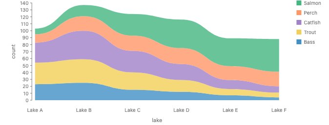
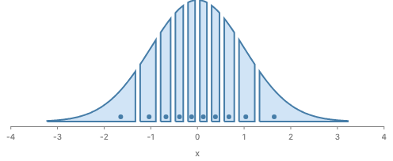
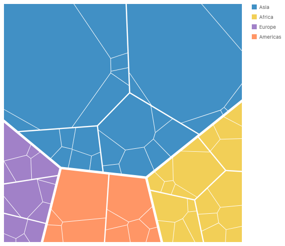
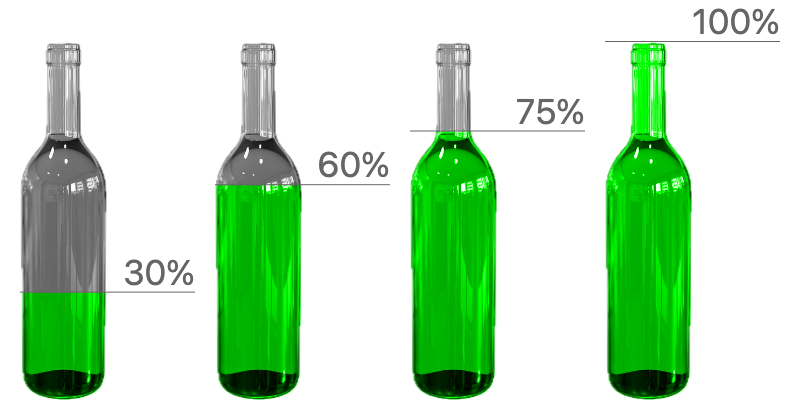

# 🐟 GoFish Weekly Update (2026-10-29 → 2026-11-05)

## Highlights
This week GoFish got a new layout engine under the hood, plus new ways to build shapes and treemaps. Croissant charts and Voronoi treemaps are now first-class, and shapes can be combined with set operations.

## What changed

**Layout and naming**
- The core layout engine is replaced by a symbolic layout kernel, with `fr` and percent sizing for gaps, panels and insets ([PR #1220](https://github.com/gofish-graphics/gofish-graphics/pull/1220)).

- Names are now hygienic: one resolver, slot handles and plural names, with no public spelling changes ([PR #1237](https://github.com/gofish-graphics/gofish-graphics/pull/1237)).

**New charts and shapes**
- Croissant charts arrive as a first-class spelling, with `Bin.quantiles`, median and `quantileRows` ([PR #1229](https://github.com/gofish-graphics/gofish-graphics/pull/1229)).

- Voronoi treemaps via `Tile.voronoi`, with shapes now taking part in layout and one shared tiling interface ([PR #1272](https://github.com/gofish-graphics/gofish-graphics/pull/1272)).

- New shape definitions: `.hidden()`, `Filter`, `blendMode`, and region compositing as five set operations (union, intersect, subtract, exclude, atop) ([PR #1287](https://github.com/gofish-graphics/gofish-graphics/pull/1287)).

**Tooling and docs**
- The visual diff viewer now shows layout warnings, and a warnings-only change counts as a diff ([PR #1261](https://github.com/gofish-graphics/gofish-graphics/pull/1261)).
- `CLAUDE.md` and the cross-language skill were corrected where the repo contradicted them ([PR #1288](https://github.com/gofish-graphics/gofish-graphics/pull/1288)).
