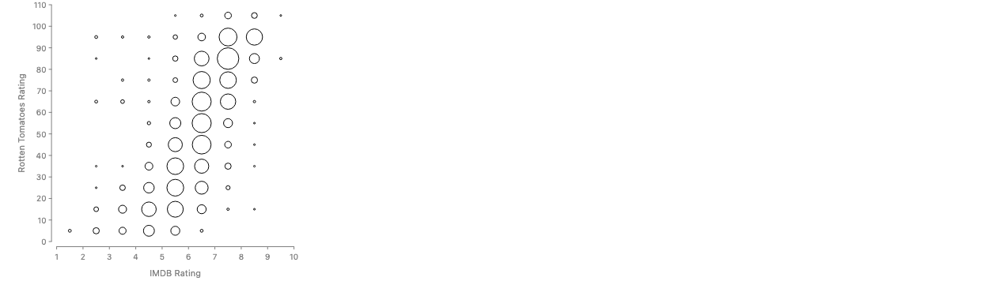
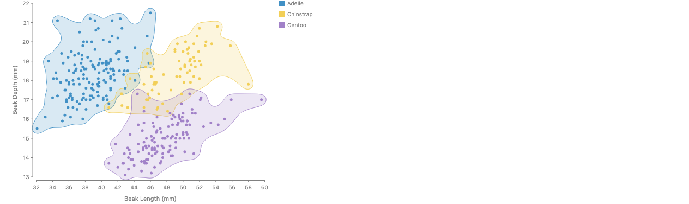
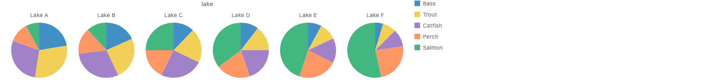

# 🐟 GoFish Weekly Update (2026-11-05 → 2026-11-12)

## Highlights
This week brought data-sized circles, a unified engine for curved `enclose` outlines, and a round of API tidying around traits and `layer`. The docs home page also got a big polish pass, especially on phones.

## What changed

**New charting capabilities**
- Circles can be sized by data with `circle({ area })`, so each circle's area is proportional to its value. Circles at data points or in cells now get a scale of their own, fit to their room, which also fixes #1087. ([PR #1323](https://github.com/gofish-graphics/gofish-graphics/pull/1323))

- `enclose` outlines share one engine. `Shape.blob` gains `connection` and `separate` options, and `Shape.arcs` is now `Shape.fillet`. ([PR #1307](https://github.com/gofish-graphics/gofish-graphics/pull/1307))

**API cleanup**
- `Frame` folds into `layer`, and `group` now takes a box (`x`, `y`, `w`, `h`) like `spread` and `stack`. ([PR #1278](https://github.com/gofish-graphics/gofish-graphics/pull/1278))

- Chrome (axes, captions and so on) is now plain children: a chart is a layer of its plot and its chrome. ([PR #1293](https://github.com/gofish-graphics/gofish-graphics/pull/1293))
- Properties a type has are now called **traits** everywhere ([PR #1268](https://github.com/gofish-graphics/gofish-graphics/pull/1268)), and `CanAdd` is renamed `CanSum` with no alias kept ([PR #1311](https://github.com/gofish-graphics/gofish-graphics/pull/1311)).

**Docs and site**
- The docs home page now works on phones, with a chart collage and swipe row. Every docs page also downloads about 30 MB less JavaScript. ([PR #1305](https://github.com/gofish-graphics/gofish-graphics/pull/1305))
- The landing hero shows the same seven examples on every screen, with taped cards and a version stamp on the wordmark. npm nightly version numbers now match Python's. ([PR #1328](https://github.com/gofish-graphics/gofish-graphics/pull/1328))
