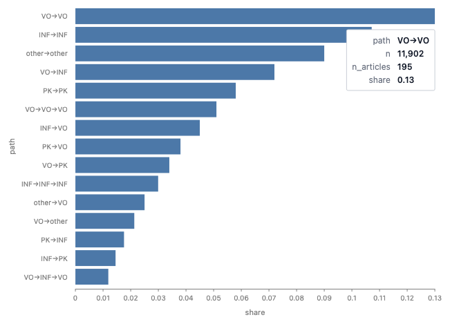
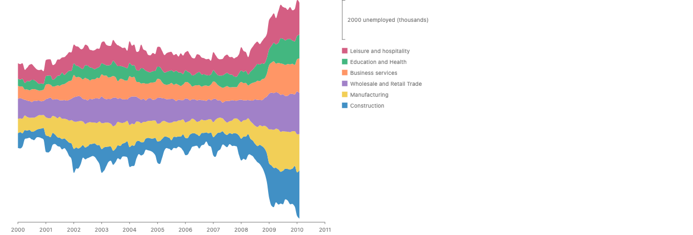
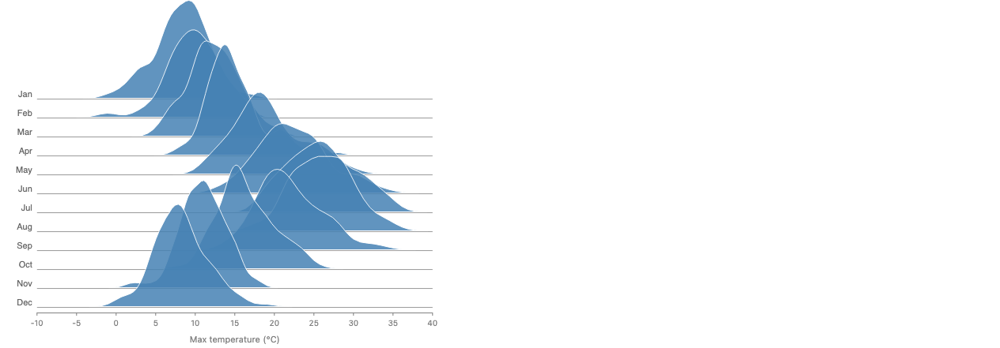

# 🐟 GoFish Weekly Update (2026-11-19 → 2026-11-26)

## Highlights
This week GoFish got tooltips, richer stacked areas and densities, and a cleaner naming scheme for strategy options. Charts are now more interactive, and a stack can hold more than bars.

## What changed
**Interactivity**
- [PR #1401](https://github.com/gofish-graphics/gofish-graphics/pull/1401) adds `.tooltip()` on marks in both JavaScript and Python. `.name()` now works on operators, and labels and tooltips share one lowering. The visual diff viewer can also run a story live.

**New chart types**
- [PR #1375](https://github.com/gofish-graphics/gofish-graphics/pull/1375) lets a stack hold areas and densities, not only bars. A ribbon now draws one band per group, and a stack layers those bands one cross-section at a time. This makes stacked areas, streamgraphs, violins and ridgelines possible.

**API cleanup**
- [PR #1366](https://github.com/gofish-graphics/gofish-graphics/pull/1366) renames the `treemap` operator to `tile`. It also sets one naming rule for every strategy family, such as `Tiling.squarify()`.
